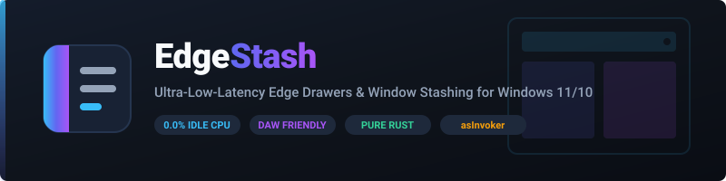
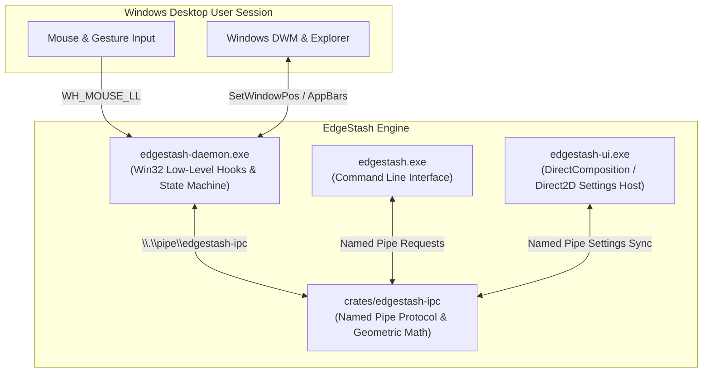

<div align="center">



# EdgeStash

**Ultra-Low-Latency Edge Drawers &amp; Window Stashing for Windows 11/10**

[](https://github.com/zunaidfarouque/EdgeStash/actions/workflows/ci.yml)
[](LICENSE)
[](https://microsoft.com/windows)
[](https://www.rust-lang.org)
[-success.svg)](#security--least-privilege)
[-brightgreen.svg)](#real-time-performance--daw-safety)

<p align="center">
  <a href="#key-features">Key Features</a> •
  <a href="#architecture">Architecture</a> •
  <a href="#quick-start">Quick Start</a> •
  <a href="#cli-reference">CLI Reference</a> •
  <a href="#configuration">Configuration</a> •
  <a href="#faq">FAQ</a>
</p>

</div>

---

## Why EdgeStash?

EdgeStash brings fluid, gesture-driven window stashing and sliding edge drawers to the Windows desktop—engineered from the ground up in pure Rust for power users, software engineers, and real-time audio/VJ performers.

Instead of minimizing windows into the taskbar or overcrowding virtual desktops, EdgeStash tucks your active tools (File Explorers, terminals, reference documentation, audio plugins) directly into the perimeter edges of your displays. Peek or slide them into focus with an **Edge Bump**, a circular **Corner Churn**, or drag-and-drop stashing zones, and let them tuck away automatically when you're done.

### Real-Time Performance & DAW Safety

Most desktop customization utilities run continuous background polling loops, consume dozens of megabytes of RAM, or periodically trim process working sets—introducing thread stalls and **Deferred Procedure Call (DPC) latency spikes** that cause audio dropouts (pops and clicks) in Digital Audio Workstations (Ableton Live, Bitwig, FL Studio, Pro Tools) and frame drops in real-time visualizers (TouchDesigner, Resolume).

**EdgeStash is built differently:**
- **0.0% Idle CPU**: Pure event-driven execution using native Win32 window hooks and named pipe IPC. Zero `while true` busy loops. Zero background polling ticks.
- **Zero Allocations in Mouse Path**: Low-level hook (`WH_MOUSE_LL`) executes in sub-microsecond time with zero heap allocations (`Box`, `Vec`, `String`) and zero thread contention.
- **DPC Latency Free**: No aggressive page trimming (`SetProcessWorkingSetSize(-1, -1)`) that triggers hard page faults.
- **Least-Privilege Security**: Runs purely as standard user (`asInvoker`). Never nags for UAC elevation or Administrator permissions.

---

## Key Features

- **Corner Churn Gesture**: Swirl the cursor in any screen corner to instantly toggle or summon stashed drawers.
- **Edge Bump & Peek**: Push against screen edges to slide out stashed windows; retracts smoothly on mouse departure.
- **Visual Drag & Drop Stashing**: Drag files or windows into intuitive edge drop zones. Windows Shell `SysDragImage` visual drag previews remain visible in the `HWND_TOPMOST` band during transit.
- **Dual Presentation Modes**:
  - *Floating Overlay*: Smooth sliding drawer hovering above existing windows.
  - *Native Work Area Dock (AppBar)*: Dynamically adjusts desktop work area coordinates so maximized windows respect the docked utility.
- **Per-Monitor DPI & Multi-Display Awareness**: Full physical boundary detection across mixed-DPI multi-monitor configurations without coordinate clipping or cursor trapping.
- **Explorer Restart Recovery**: Automatically detects and registers with new taskbar instances when `explorer.exe` restarts, bypassing UIPI integrity barriers via `ChangeWindowMessageFilterEx`.

---

## Architecture

EdgeStash is structured as a modular workspace of four decoupled Rust crates:



| Crate | Responsibility |
| :--- | :--- |
| **`edgestash-ipc`** | Geometry math, slot state machines, serialization, and asynchronous named pipe protocol. |
| **`edgestash-daemon`** | Low-level Win32 hooks (`WH_MOUSE_LL`), gesture detection algorithms, window manipulation, and Z-order management. |
| **`edgestash-cli`** | Command-line utility (`edgestash.exe`) for terminal scripts, hotkey daemons, and querying status. |
| **`edgestash-ui`** | High-DPI Fluent-styled configuration window and system tray icon host powered by DirectComposition. |

---

## Visual Showcase

<!-- Slide 1: Corner Churn -->
| Corner Churn Gesture | Edge Bump Peek |
| :---: | :---: |
|  |  |
| *Swirl cursor into corner to reveal stashed Explorer* | *Bump perimeter to peek drawer with zero latency* |

| Drag-and-Drop Stashing | Fluent Settings Manager |
| :---: | :---: |
|  |  |
| *Visual drag previews remain crisp and visible* | *Customize edge zones, churn sensitivity, and hotkeys* |

*(High-framerate demonstration GIFs can be placed in `docs/assets/`. See [`docs/assets/README.md`](docs/assets/README.md) for recording guidelines.)*

---

## Quick Start

### Option A: Precompiled Release (Recommended)

1. Download the latest `EdgeStash-vX.Y.Z-x86_64-pc-windows-msvc.zip` from [Releases](https://github.com/zunaidfarouque/EdgeStash/releases).
2. Extract the archive into a folder (e.g. `C:\Tools\EdgeStash` or `%LOCALAPPDATA%\Programs\EdgeStash`).
3. Run `edgestash-daemon.exe`. The EdgeStash icon will appear in your system tray.

### Option B: Build from Source

#### Prerequisites
- Windows 10 (Build 19041+) or Windows 11
- [Rust 1.85+ with MSVC toolchain](https://www.rust-lang.org/tools/install)
- Visual Studio C++ Build Tools (Windows SDK)

```pwsh
# 1. Clone the repository
git clone https://github.com/zunaidfarouque/EdgeStash.git
cd EdgeStash

# 2. Run the automated test suite
cargo test --workspace -- --test-threads=1

# 3. Build optimized release binaries
cargo build --release

# 4. Launch the daemon
.\target\release\edgestash-daemon.exe
```

### Launch on Windows Startup

To automatically run EdgeStash when logging into Windows:
1. Press <kbd>Win</kbd> + <kbd>R</kbd>, type `shell:startup`, and press <kbd>Enter</kbd>.
2. Create a shortcut to `edgestash-daemon.exe` inside the Startup folder.

---

## CLI Reference

The companion CLI `edgestash.exe` allows you to control the daemon from scripts, Windows Terminal, or third-party hotkey utilities (e.g., AutoHotkey, PowerToys Run):

```pwsh
# Check daemon health, active monitor count, and stashed slots
edgestash status

# Stash the currently active foreground window to the left edge
edgestash stash --edge left

# Toggle the drawer on the right edge
edgestash toggle --edge right

# Cycle through windows in slot 1
edgestash cycle --slot 1

# Switch display presentation between Floating Overlay and AppBar Dock
edgestash dock-mode --mode floating
edgestash dock-mode --mode appbar

# Reload configuration from disk
edgestash reload

# Gracefully terminate the background daemon
edgestash shutdown
```

---

## Configuration

EdgeStash loads its configuration from `%APPDATA%\EdgeStash\config.toml` (auto-created on first run if missing):

```toml
[gestures]
# Corner churn radius threshold in physical pixels
corner_churn_radius_px = 32
# Churn angular accumulation required to trigger (degrees)
corner_churn_angle_deg = 270.0
# Edge bump detection speed threshold (pixels per second)
edge_bump_velocity_pps = 1200.0

[animation]
# Drawer slide animation duration in milliseconds (0 for instant)
slide_duration_ms = 120
# Ease curve type: "linear", "ease_out_cubic", or "instant"
curve = "ease_out_cubic"

[dock]
# Presentation mode: "floating" (default) or "appbar"
mode = "floating"
# Retract drawer automatically when mouse cursor leaves drawer bounds
auto_retract_on_leave = true
# Auto-retract delay after mouse exits (milliseconds)
auto_retract_delay_ms = 350

[hotkeys]
toggle_left = "Win+Alt+Left"
toggle_right = "Win+Alt+Right"
stash_active = "Win+Alt+Down"
```

---

## Frequently Asked Questions

<details>
<summary><strong>Why doesn't EdgeStash require Administrator privileges?</strong></summary>

EdgeStash is designed around the **Principle of Least Privilege** (`asInvoker`). Running as Administrator is an unnecessary security risk for desktop enhancement tools. Standard user execution ensures UIPI integrity barriers remain active, protecting your machine against privilege escalation vulnerabilities.
</details>

<details>
<summary><strong>Will EdgeStash interfere with ASIO audio or low-latency DAWs?</strong></summary>

**No.** EdgeStash is explicitly optimized for music production and live VJ workstations. The low-level mouse hook avoids dynamic heap allocations, synchronization locks, and periodic thread wakeups. When idle, CPU utilization is 0.00%, ensuring zero DPC latency spikes or audio buffer underruns.
</details>

<details>
<summary><strong>What happens if Windows Explorer crashes or restarts?</strong></summary>

EdgeStash subscribes to the system-wide `TaskbarCreated` broadcast message. When `explorer.exe` restarts, EdgeStash automatically reinstates its system tray icon using Windows `ChangeWindowMessageFilterEx` to cross UIPI message boundaries cleanly.
</details>

<details>
<summary><strong>Does it support multi-monitor setups with different DPI scalings?</strong></summary>

**Yes.** EdgeStash uses Windows Per-Monitor V2 DPI awareness. Edge boundaries, corner churn angles, and drop zones adapt dynamically to the DPI scaling factor and resolution of each individual display.
</details>

---

## Contributing

Contributions are welcome! Please read our [Contributing Guide](CONTRIBUTING.md) and [Code of Conduct](CODE_OF_CONDUCT.md) before submitting pull requests.

To run the test suite and linters locally:
```pwsh
cargo fmt --check
cargo clippy --workspace --all-targets -- -D warnings
cargo test --workspace -- --test-threads=1
```

---

## License & Security

- **License**: Distributed under the [MIT License](LICENSE). Copyright &copy; 2026 Zunaid Farouque.
- **Security Policy**: For vulnerability disclosure, see [SECURITY.md](SECURITY.md).
