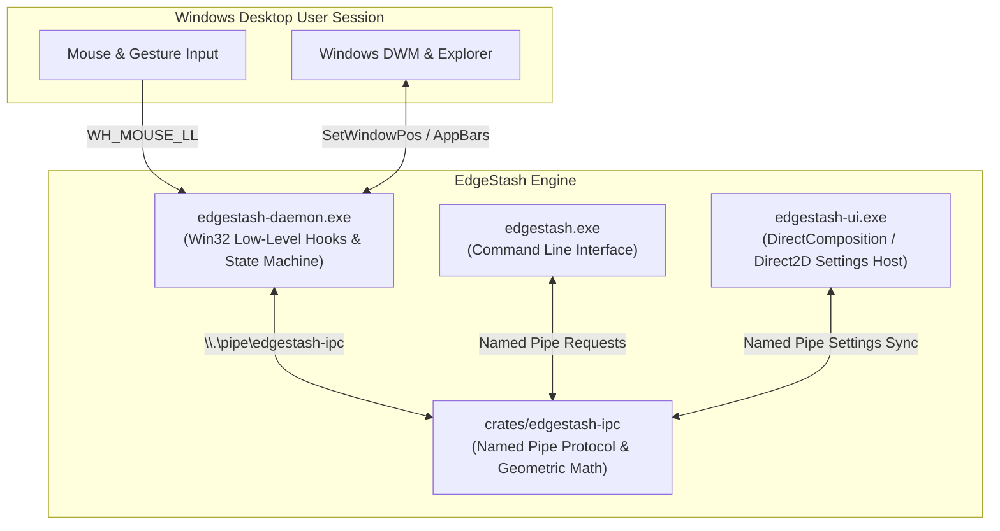

# EdgeStash: Complete Codebase & Architectural Context for AI Evaluation

> **Export Date**: 2026-11-27 02:19:56 UTC
> **Target OS**: Windows 11 / Windows 10 (Build 19041+)
> **Language & Toolchain**: Rust 2024 Edition (MSVC `x86_64-pc-windows-msvc`)
> **Total Files Exported**: 37 | **Total Source Lines**: 17,940

---

## 1. Project Overview & Core Mission

**EdgeStash** is an ultra-low-latency, gesture-driven window stashing and perimeter edge-drawer utility engineered for Windows 10 and 11. Instead of minimizing windows into the taskbar or overcrowding virtual desktops, EdgeStash allows power users to stash active applications (File Explorers, terminal windows, audio instruments, reference manuals) into the screen perimeter edges.

Users summon and peek into stashed drawers using natural physical interactions:
- **Edge Bump**: Pushing the mouse against the physical screen edge past a velocity threshold.
- **Corner Churn**: Swirling the mouse cursor in a screen corner (e.g. 270° angular accumulation).
- **Edge Hover**: Resting the cursor along a 1px non-blocking edge trigger strip.
- **Drop Zones**: Dragging files or windows directly to visual screen edge zones.

---

## 2. Non-Negotiable Invariants & Performance Constraints

EdgeStash is designed for live audio production (DAWs such as Ableton Live, Bitwig, FL Studio) and real-time visual performance (TouchDesigner, Resolume). As such, it enforces strict architectural invariants:

1. **0.0% Idle CPU Overhead**:
   - The daemon must never run continuous `while true` loops or periodic polling timers.
   - All state transitions are strictly event-driven: Win32 window message queues, low-level mouse hooks (`WH_MOUSE_LL`), and asynchronous named pipe IPC.

2. **Zero Audio DPC Latency Spikes**:
   - The low-level mouse hook executes in sub-microsecond time.
   - Zero heap allocations (`Box`, `Vec`, `String`) and zero thread synchronization locks inside the mouse callback.
   - No aggressive process working-set trimming (`SetProcessWorkingSetSize(-1, -1)`) that causes hard page faults.

3. **Principle of Least Privilege (`asInvoker`)**:
   - Runs strictly with standard user privileges (`asInvoker` execution level in the application manifest).
   - Never triggers UAC prompts and respects Windows User Interface Privilege Isolation (UIPI).

4. **Explorer Restart Resilience**:
   - Automatically reinstates the system tray icon via `ChangeWindowMessageFilterEx` when `explorer.exe` restarts.

5. **Topmost Band Management & Drag Preview (`SysDragImage`)**:
   - Windows Shell drag-and-drop previews (`SysDragImage`) are dynamically promoted above `HWND_TOPMOST` drawers so users maintain visual feedback while dragging items into stashed folders.

---

## 3. High-Level System Architecture



---

## 4. Table of Contents & Manifest


### Workspace Manifest

| # | File | Lines | Size | Role |
| :--- | :--- | :--- | :--- | :--- |
| 1 | [`Cargo.toml`](#cargotoml) | 52 | 1.2 KB | Root workspace configuration, compiler optimizations, and dependencies. |

### Crate: `edgestash-ipc`

| # | File | Lines | Size | Role |
| :--- | :--- | :--- | :--- | :--- |
| 2 | [`crates/edgestash-ipc/Cargo.toml`](#cratesedgestashipccargotoml) | 13 | 0.2 KB | Crate manifest and dependencies. |
| 3 | [`crates/edgestash-ipc/src/lib.rs`](#cratesedgestashipcsrclibrs) | 4 | 0.1 KB | IPC module exports and re-exports. |
| 4 | [`crates/edgestash-ipc/src/types.rs`](#cratesedgestashipcsrctypesrs) | 285 | 9.3 KB | Rect, ScreenEdge, DockMode, SlotId, and geometric primitives. |
| 5 | [`crates/edgestash-ipc/src/config.rs`](#cratesedgestashipcsrcconfigrs) | 519 | 18.3 KB | EdgeStashConfig TOML schema, defaults, and boundary clamping. |
| 6 | [`crates/edgestash-ipc/src/protocol.rs`](#cratesedgestashipcsrcprotocolrs) | 192 | 5.8 KB | IpcRequest, IpcResponse, StatusSnapshot, and IPC error codes. |
| 7 | [`crates/edgestash-ipc/src/pipe.rs`](#cratesedgestashipcsrcpipers) | 268 | 8.4 KB | Named pipe server and client implementation with length-prefixed JSON framing. |

### Crate: `edgestash-daemon`

| # | File | Lines | Size | Role |
| :--- | :--- | :--- | :--- | :--- |
| 8 | [`crates/edgestash-daemon/Cargo.toml`](#cratesedgestashdaemoncargotoml) | 26 | 0.4 KB | Crate manifest and Win32 / Direct2D dependencies. |
| 9 | [`crates/edgestash-daemon/build.rs`](#cratesedgestashdaemonbuildrs) | 22 | 0.7 KB | Build script linking Windows application manifests. |
| 10 | [`crates/edgestash-daemon/src/main.rs`](#cratesedgestashdaemonsrcmainrs) | 13 | 0.3 KB | Daemon CLI entry point and argument parsing. |
| 11 | [`crates/edgestash-daemon/src/lib.rs`](#cratesedgestashdaemonsrclibrs) | 12 | 0.2 KB | Subsystem module declarations. |
| 12 | [`crates/edgestash-daemon/src/daemon.rs`](#cratesedgestashdaemonsrcdaemonrs) | 4,322 | 155.8 KB | Main Win32 message pump, named pipe dispatcher, timer loops, and tray management. |
| 13 | [`crates/edgestash-daemon/src/state.rs`](#cratesedgestashdaemonsrcstaters) | 2,260 | 83.4 KB | Core EngineState managing multi-monitor decks, slot stacks, and transitions. |
| 14 | [`crates/edgestash-daemon/src/trigger.rs`](#cratesedgestashdaemonsrctriggerrs) | 1,467 | 48.7 KB | Gesture state machines: Corner Churn, Edge Bump velocity, and Edge Hover. |
| 15 | [`crates/edgestash-daemon/src/animator.rs`](#cratesedgestashdaemonsrcanimatorrs) | 336 | 10.8 KB | DWM cubic-easing slide animations and coordinate interpolation. |
| 16 | [`crates/edgestash-daemon/src/focus.rs`](#cratesedgestashdaemonsrcfocusrs) | 354 | 12.4 KB | Delayed focus restoration, popup tracking, and active window protection. |
| 17 | [`crates/edgestash-daemon/src/geometry.rs`](#cratesedgestashdaemonsrcgeometryrs) | 317 | 11.2 KB | Per-monitor DPI coordinate transforms and boundary padding calculations. |
| 18 | [`crates/edgestash-daemon/src/dwm.rs`](#cratesedgestashdaemonsrcdwmrs) | 95 | 2.9 KB | Win32 DWM cloak, window framing, and border inset compensations. |
| 19 | [`crates/edgestash-daemon/src/appbar.rs`](#cratesedgestashdaemonsrcappbarrs) | 61 | 2.2 KB | Native Windows AppBar work-area registration for docked presentation. |
| 20 | [`crates/edgestash-daemon/src/vdesktop.rs`](#cratesedgestashdaemonsrcvdesktoprs) | 65 | 2.2 KB | COM VirtualDesktopManager integration for virtual desktop scoping. |
| 21 | [`crates/edgestash-daemon/src/crash_recovery.rs`](#cratesedgestashdaemonsrccrashrecoveryrs) | 88 | 2.9 KB | JSON manifest persistence for orphaned window restoration across restarts. |
| 22 | [`crates/edgestash-daemon/src/platform/mod.rs`](#cratesedgestashdaemonsrcplatformmodrs) | 279 | 7.8 KB | Abstract platform interface definitions. |
| 23 | [`crates/edgestash-daemon/src/platform/win32.rs`](#cratesedgestashdaemonsrcplatformwin32rs) | 812 | 27.9 KB | Win32 implementation: hooks, SysDragImage z-order fix, and message loop helpers. |
| 24 | [`crates/edgestash-daemon/src/renderer/mod.rs`](#cratesedgestashdaemonsrcrenderermodrs) | 84 | 2.7 KB | Renderer module exports. |
| 25 | [`crates/edgestash-daemon/src/renderer/d2d.rs`](#cratesedgestashdaemonsrcrendererd2drs) | 2,206 | 81.0 KB | DirectComposition / Direct2D overlay rendering: edge pills, drop zones, headers, and scrims. |

### Crate: `edgestash-cli`

| # | File | Lines | Size | Role |
| :--- | :--- | :--- | :--- | :--- |
| 26 | [`crates/edgestash-cli/Cargo.toml`](#cratesedgestashclicargotoml) | 17 | 0.3 KB | Crate manifest. |
| 27 | [`crates/edgestash-cli/src/main.rs`](#cratesedgestashclisrcmainrs) | 5 | 0.1 KB | CLI binary entry point. |
| 28 | [`crates/edgestash-cli/src/lib.rs`](#cratesedgestashclisrclibrs) | 1 | 0.0 KB | Library exports. |
| 29 | [`crates/edgestash-cli/src/cli.rs`](#cratesedgestashclisrcclirs) | 291 | 10.0 KB | Subcommand parsing (stash, toggle, cycle, dock-mode, status) and formatting. |

### Crate: `edgestash-ui`

| # | File | Lines | Size | Role |
| :--- | :--- | :--- | :--- | :--- |
| 30 | [`crates/edgestash-ui/Cargo.toml`](#cratesedgestashuicargotoml) | 20 | 0.3 KB | Crate manifest and eframe/egui dependencies. |
| 31 | [`crates/edgestash-ui/src/main.rs`](#cratesedgestashuisrcmainrs) | 106 | 3.2 KB | GUI binary entry point. |
| 32 | [`crates/edgestash-ui/src/lib.rs`](#cratesedgestashuisrclibrs) | 5 | 0.1 KB | Library exports. |
| 33 | [`crates/edgestash-ui/src/app.rs`](#cratesedgestashuisrcapprs) | 2,406 | 100.5 KB | egui UI layouts: gestures tab, dock tab, hotkeys tab, live slots deck. |
| 34 | [`crates/edgestash-ui/src/model.rs`](#cratesedgestashuisrcmodelrs) | 359 | 12.9 KB | Settings state, draft modifications, dirty-checking, and preset saving. |
| 35 | [`crates/edgestash-ui/src/hotkey.rs`](#cratesedgestashuisrchotkeyrs) | 223 | 6.3 KB | Interactive hotkey capture widget and Win32 key code translation. |
| 36 | [`crates/edgestash-ui/src/ipc_bridge.rs`](#cratesedgestashuisrcipcbridgers) | 110 | 3.2 KB | Named pipe client bridge communicating with the background daemon. |
| 37 | [`crates/edgestash-ui/src/theme.rs`](#cratesedgestashuisrcthemers) | 245 | 9.0 KB | Fluent dark theme palettes, visual tokens, and rounded card styling. |

---

## 5. Major Source Code Listings


<a id="cargotoml"></a>
### 1. `Cargo.toml`

> **Location**: [`Cargo.toml`](Cargo.toml) | **Category**: Workspace Manifest
> **Metrics**: 52 lines | 1.2 KB
> **Purpose**: Root workspace configuration, compiler optimizations, and dependencies.

```toml
[workspace]
resolver = "3"
members = [
    "crates/edgestash-ipc",
    "crates/edgestash-daemon",
    "crates/edgestash-cli",
    "crates/edgestash-ui",
]

[workspace.package]
version = "0.1.0"
edition = "2024"
license = "MIT"

[workspace.dependencies]
serde = { version = "1.0", features = ["derive"] }
serde_json = "1.0"
toml = "0.8"

[workspace.dependencies.windows]
version = "0.58"
features = [
    "implement",
    "Foundation_Numerics",
    "Win32_Foundation",
    "Win32_Graphics_Direct2D",
    "Win32_Graphics_Direct2D_Common",
    "Win32_Graphics_Direct3D",
    "Win32_Graphics_Direct3D11",
    "Win32_Graphics_DirectComposition",
    "Win32_Graphics_DirectWrite",
    "Win32_Graphics_Dxgi",
    "Win32_Graphics_Dxgi_Common",
    "Win32_Graphics_Dwm",
    "Win32_Graphics_Gdi",
    "Win32_Security",
    "Win32_Security_Authorization",
    "Win32_Storage_FileSystem",
    "Win32_System_Com",
    "Win32_System_Console",
    "Win32_System_IO",
    "Win32_System_LibraryLoader",
    "Win32_System_Ole",
    "Win32_System_Pipes",
    "Win32_System_SystemServices",
    "Win32_System_Threading",
    "Win32_UI_Accessibility",
    "Win32_UI_HiDpi",
    "Win32_UI_Input_KeyboardAndMouse",
    "Win32_UI_Shell",
    "Win32_UI_WindowsAndMessaging",
]

```

---

<a id="cratesedgestashipccargotoml"></a>
### 2. `crates/edgestash-ipc/Cargo.toml`

> **Location**: [`crates/edgestash-ipc/Cargo.toml`](crates/edgestash-ipc/Cargo.toml) | **Category**: Crate: `edgestash-ipc`
> **Metrics**: 13 lines | 0.2 KB
> **Purpose**: Crate manifest and dependencies.

```toml
[package]
name = "edgestash-ipc"
version.workspace = true
edition.workspace = true
license.workspace = true

[dependencies]
serde.workspace = true
serde_json.workspace = true
toml.workspace = true

[dependencies.windows]
workspace = true

```

---

<a id="cratesedgestashipcsrclibrs"></a>
### 3. `crates/edgestash-ipc/src/lib.rs`

> **Location**: [`crates/edgestash-ipc/src/lib.rs`](crates/edgestash-ipc/src/lib.rs) | **Category**: Crate: `edgestash-ipc`
> **Metrics**: 4 lines | 0.1 KB
> **Purpose**: IPC module exports and re-exports.

```rust
pub mod config;
pub mod pipe;
pub mod protocol;
pub mod types;

```

---

<a id="cratesedgestashipcsrctypesrs"></a>
### 4. `crates/edgestash-ipc/src/types.rs`

> **Location**: [`crates/edgestash-ipc/src/types.rs`](crates/edgestash-ipc/src/types.rs) | **Category**: Crate: `edgestash-ipc`
> **Metrics**: 285 lines | 9.3 KB
> **Purpose**: Rect, ScreenEdge, DockMode, SlotId, and geometric primitives.

```rust
use serde::{Deserialize, Serialize};
use windows::Win32::Foundation::RECT;
use windows::core::GUID;

/// Screen edge to which a stashed drawer or group is anchored.
#[derive(Debug, Clone, Copy, PartialEq, Eq, Hash, Serialize, Deserialize)]
pub enum ScreenEdge {
    Left,
    Right,
    Top,
    Bottom,
}

impl ScreenEdge {
    /// All four screen edges in deterministic clockwise order starting from Left.
    pub const ALL: [ScreenEdge; 4] = [
        ScreenEdge::Left,
        ScreenEdge::Top,
        ScreenEdge::Right,
        ScreenEdge::Bottom,
    ];

    /// Returns true if the edge runs vertically (Left or Right), where drawer size is width.
    pub fn is_vertical_edge(self) -> bool {
        matches!(self, ScreenEdge::Left | ScreenEdge::Right)
    }

    /// Returns true if the edge runs horizontally (Top or Bottom), where drawer size is height.
    pub fn is_horizontal_edge(self) -> bool {
        !self.is_vertical_edge()
    }
}

/// Visual transition animation style when opening or closing a drawer.
#[derive(Debug, Clone, Copy, PartialEq, Eq, Serialize, Deserialize)]
pub enum AnimationStyle {
    /// Smooth translation from screen bezel synced to `DwmFlush()`.
    Slide,
    /// Fades alpha `0 -> 255` while gliding `16px` into position.
    FloatAndFade,
    /// `0ms` instant appear/disappear.
    Instant,
}

/// Edge trigger mechanism configuration derived from user settings.
#[derive(Debug, Clone, Copy, PartialEq, Eq, Serialize, Deserialize)]
pub enum TriggerGesture {
    /// Crisp bezel push on any stashed screen edge (dwell threshold).
    EdgeBump { dwell_ms: u64 },
    /// Windows 8 Charms style: hit corner `8x8px` box, then slide along edge.
    CornerSlide {
        corner_size_px: i32,
        slide_distance_px: i32,
        timeout_ms: u64,
    },
    /// Standard hover on `1px` edge strip with dwell time.
    EdgeHover { dwell_ms: u64 },
    /// Only open when clicking the edge indicator pill or pressing hotkey.
    ManualOrHotkeyOnly,
}

/// Presentation mode of an open drawer on the desktop.
#[derive(Debug, Clone, Copy, PartialEq, Eq, Serialize, Deserialize)]
pub enum DockMode {
    /// Floats above windows (`HWND_TOPMOST`) and auto-hides on mouse-leave or focus-loss.
    FloatingOverlay,
    /// Permanent floating pin (`HWND_TOPMOST`, stays open until collapsed/unpinned, no backdrop dim).
    FloatingPinned,
    /// Reserves screen work area via `SHAppBarMessage` (pushes other windows aside permanently).
    NativeWorkAreaDock,
}

/// Global/default virtual desktop pinning behavior.
#[derive(Debug, Clone, Copy, PartialEq, Eq, Serialize, Deserialize)]
pub enum VirtualDesktopMode {
    AllDesktops,
    CurrentDesktopOnly,
}

/// Per-slot virtual desktop pinning scope.
#[derive(Debug, Clone, Copy, PartialEq, Eq, Serialize, Deserialize)]
pub enum VirtualDesktopScope {
    /// Follows user across all Virtual Desktops.
    AllDesktops,
    /// Only triggers on the Virtual Desktop where it was originally stashed (raw 16-byte GUID).
    PinnedToDesktop([u8; 16]),
}

impl VirtualDesktopScope {
    /// Converts a Win32 `GUID` into a pinned scope.
    pub fn from_guid(guid: GUID) -> Self {
        Self::PinnedToDesktop(guid_to_bytes(guid))
    }

    /// Returns the pinned `GUID` if this scope is pinned to a specific desktop.
    pub fn as_guid(self) -> Option<GUID> {
        match self {
            Self::AllDesktops => None,
            Self::PinnedToDesktop(bytes) => Some(bytes_to_guid(bytes)),
        }
    }
}

/// Converts a `GUID` into deterministic little-endian byte storage.
pub fn guid_to_bytes(guid: GUID) -> [u8; 16] {
    let mut out = [0u8; 16];
    out[0..4].copy_from_slice(&guid.data1.to_le_bytes());
    out[4..6].copy_from_slice(&guid.data2.to_le_bytes());
    out[6..8].copy_from_slice(&guid.data3.to_le_bytes());
    out[8..16].copy_from_slice(&guid.data4);
    out
}

/// Reconstructs a Win32 `GUID` from serialized bytes.
pub fn bytes_to_guid(bytes: [u8; 16]) -> GUID {
    GUID {
        data1: u32::from_le_bytes(bytes[0..4].try_into().expect("4 bytes")),
        data2: u16::from_le_bytes(bytes[4..6].try_into().expect("2 bytes")),
        data3: u16::from_le_bytes(bytes[6..8].try_into().expect("2 bytes")),
        data4: bytes[8..16].try_into().expect("8 bytes"),
    }
}

/// Visual styling for the screen-edge indicator pill.
#[derive(Debug, Clone, Copy, PartialEq, Eq, Serialize, Deserialize)]
pub enum EdgePillStyle {
    MinimalLine,
    AppIconsStack,
    Hidden,
}

/// Directed corner-slide ("churn") zones around each monitor's four edges.
#[derive(Debug, Clone, Copy, PartialEq, Eq, Hash, PartialOrd, Ord, Serialize, Deserialize)]
pub enum ChurnZoneId {
    TopLeftDown,
    BottomLeftUp,
    TopRightDown,
    BottomRightUp,
    TopLeftRight,
    TopRightLeft,
    BottomLeftRight,
    BottomRightLeft,
}

impl ChurnZoneId {
    /// All 8 canonical directed corner-slide churn zones.
    pub const ALL: [Self; 8] = [
        Self::BottomRightUp,
        Self::TopRightDown,
        Self::BottomLeftUp,
        Self::TopLeftDown,
        Self::TopRightLeft,
        Self::TopLeftRight,
        Self::BottomRightLeft,
        Self::BottomLeftRight,
    ];

    /// Target edge associated with sliding along this corner corridor.
    pub const fn edge(self) -> ScreenEdge {
        match self {
            Self::TopLeftDown | Self::BottomLeftUp => ScreenEdge::Left,
            Self::TopRightDown | Self::BottomRightUp => ScreenEdge::Right,
            Self::TopLeftRight | Self::TopRightLeft => ScreenEdge::Top,
            Self::BottomLeftRight | Self::BottomRightLeft => ScreenEdge::Bottom,
        }
    }

    /// Whether entry starts in the far corner (`bottom` for Left/Right, `right` for Top/Bottom).
    pub const fn is_far_corner(self) -> bool {
        matches!(
            self,
            Self::BottomLeftUp | Self::BottomRightUp | Self::TopRightLeft | Self::BottomRightLeft
        )
    }

    /// Required bezel slide sign along the edge axis (`+1` = down/right, `-1` = up/left).
    pub const fn slide_sign(self) -> i32 {
        match self {
            Self::TopLeftDown | Self::TopRightDown | Self::TopLeftRight | Self::BottomLeftRight => {
                1
            }
            Self::BottomLeftUp
            | Self::BottomRightUp
            | Self::TopRightLeft
            | Self::BottomRightLeft => -1,
        }
    }

    /// Human-readable label shown in Settings UI.
    pub const fn label(self) -> &'static str {
        match self {
            Self::BottomRightUp => "Right Edge — Bottom -> Up (Upward Churn)",
            Self::TopRightDown => "Right Edge — Top -> Down (Downward Churn)",
            Self::BottomLeftUp => "Left Edge — Bottom -> Up (Upward Churn)",
            Self::TopLeftDown => "Left Edge — Top -> Down (Downward Churn)",
            Self::TopRightLeft => "Top Edge — Right -> Left (Leftward Churn)",
            Self::TopLeftRight => "Top Edge — Left -> Right (Rightward Churn)",
            Self::BottomRightLeft => "Bottom Edge — Right -> Left (Leftward Churn)",
            Self::BottomLeftRight => "Bottom Edge — Left -> Right (Rightward Churn)",
        }
    }
}

/// Serializable, platform-agnostic integer rectangle matching Win32 `RECT`.
#[derive(Debug, Clone, Copy, Default, PartialEq, Eq, Serialize, Deserialize)]
pub struct Rect {
    pub left: i32,
    pub top: i32,
    pub right: i32,
    pub bottom: i32,
}

impl Rect {
    /// Creates a new rectangle from edge coordinates.
    pub const fn new(left: i32, top: i32, right: i32, bottom: i32) -> Self {
        Self {
            left,
            top,
            right,
            bottom,
        }
    }

    /// Horizontal span (`right - left`), clamped to zero if inverted.
    pub fn width(self) -> i32 {
        (self.right - self.left).max(0)
    }

    /// Vertical span (`bottom - top`), clamped to zero if inverted.
    pub fn height(self) -> i32 {
        (self.bottom - self.top).max(0)
    }

    /// Half-open Win32 containment (`left <= x < right && top <= y < bottom`).
    pub fn contains(self, x: i32, y: i32) -> bool {
        x >= self.left && x < self.right && y >= self.top && y < self.bottom
    }

    /// Inclusive containment (`left <= x <= right && top <= y <= bottom`), matching `PtInRect`/margin hysteresis.
    pub fn contains_inclusive(self, x: i32, y: i32) -> bool {
        x >= self.left && x <= self.right && y >= self.top && y <= self.bottom
    }

    /// Returns a new rectangle expanded outward on all four sides by `margin_px`.
    pub fn expanded(self, margin_px: i32) -> Self {
        Self {
            left: self.left - margin_px,
            top: self.top - margin_px,
            right: self.right + margin_px,
            bottom: self.bottom + margin_px,
        }
    }

    /// Returns the bounding rectangle containing both `self` and `other`.
    pub fn union(self, other: Self) -> Self {
        Self {
            left: self.left.min(other.left),
            top: self.top.min(other.top),
            right: self.right.max(other.right),
            bottom: self.bottom.max(other.bottom),
        }
    }
}

impl From<RECT> for Rect {
    fn from(r: RECT) -> Self {
        Self {
            left: r.left,
            top: r.top,
            right: r.right,
            bottom: r.bottom,
        }
    }
}

impl From<Rect> for RECT {
    fn from(r: Rect) -> Self {
        RECT {
            left: r.left,
            top: r.top,
            right: r.right,
            bottom: r.bottom,
        }
    }
}

```

---

<a id="cratesedgestashipcsrcconfigrs"></a>
### 5. `crates/edgestash-ipc/src/config.rs`

> **Location**: [`crates/edgestash-ipc/src/config.rs`](crates/edgestash-ipc/src/config.rs) | **Category**: Crate: `edgestash-ipc`
> **Metrics**: 519 lines | 18.3 KB
> **Purpose**: EdgeStashConfig TOML schema, defaults, and boundary clamping.

```rust
use std::fs;
use std::io;
use std::path::{Path, PathBuf};

use serde::{Deserialize, Serialize};

use crate::types::{
    AnimationStyle, ChurnZoneId, DockMode, EdgePillStyle, ScreenEdge, TriggerGesture,
    VirtualDesktopMode,
};

/// Top-level trigger mode stored in `config.toml`.
#[derive(Debug, Clone, Copy, PartialEq, Eq, Default, Serialize, Deserialize)]
pub enum GestureMode {
    #[default]
    EdgeBump,
    CornerSlide,
    EdgeHover,
    PillClick,
    HotkeyOnly,
}

/// Area-aware scroll mode determining when scrolling along the thin edge trigger strip cycles slots.
#[derive(Debug, Clone, Copy, PartialEq, Eq, Default, Serialize, Deserialize)]
pub enum AreaAwareScrollMode {
    /// Works anywhere on the thin trigger line from initial contact/trigger until cursor leaves
    /// that line into the drawer window body; hovering the pill itself always cycles windows.
    InitialTriggerSession,
    /// Works any time the cursor rests on the thin trigger line (even after returning from the app window).
    AlwaysOnTriggerLine,
    /// Active strictly after the drawer was opened via edge trigger and before cursor leaves the thin line.
    #[default]
    OpenSessionStrict,
}

/// Assignment policy for an individual directed corner-slide churn zone.
#[derive(Debug, Clone, PartialEq, Eq, Default, Serialize, Deserialize)]
#[serde(tag = "type")]
pub enum ChurnZoneAction {
    /// Open the default last-opened stashed drawer (or that edge's active stashed window).
    #[default]
    DefaultLastOpened,
    /// Open a specific stashed app matching `matcher` (exe name or window title substring) if stashed.
    SpecificApp { matcher: String },
    /// Ignore corner-slide gestures originating from this zone.
    Disabled,
}

/// Key modifier required when dragging a window to reveal stash drop zones.
#[derive(Debug, Clone, Copy, PartialEq, Eq, Default, Serialize, Deserialize)]
#[serde(rename_all = "snake_case")]
pub enum DragDropModifierKey {
    #[default]
    Shift,
    Ctrl,
    Alt,
    Any,
}

/// Per-zone churn gesture bindings serialized cleanly under `[churn_zones]` in `config.toml`.
#[derive(Debug, Clone, PartialEq, Eq, Default, Serialize, Deserialize)]
#[serde(default)]
pub struct ChurnZonesConfig {
    pub top_left_down: ChurnZoneAction,
    pub bottom_left_up: ChurnZoneAction,
    pub top_right_down: ChurnZoneAction,
    pub bottom_right_up: ChurnZoneAction,
    pub top_left_right: ChurnZoneAction,
    pub top_right_left: ChurnZoneAction,
    pub bottom_left_right: ChurnZoneAction,
    pub bottom_right_left: ChurnZoneAction,
}

impl ChurnZonesConfig {
    /// Reads the action assigned to `zone`.
    pub fn get(&self, zone: ChurnZoneId) -> &ChurnZoneAction {
        match zone {
            ChurnZoneId::TopLeftDown => &self.top_left_down,
            ChurnZoneId::BottomLeftUp => &self.bottom_left_up,
            ChurnZoneId::TopRightDown => &self.top_right_down,
            ChurnZoneId::BottomRightUp => &self.bottom_right_up,
            ChurnZoneId::TopLeftRight => &self.top_left_right,
            ChurnZoneId::TopRightLeft => &self.top_right_left,
            ChurnZoneId::BottomLeftRight => &self.bottom_left_right,
            ChurnZoneId::BottomRightLeft => &self.bottom_right_left,
        }
    }

    /// Updates the action assigned to `zone`.
    pub fn set(&mut self, zone: ChurnZoneId, action: ChurnZoneAction) {
        let slot = match zone {
            ChurnZoneId::TopLeftDown => &mut self.top_left_down,
            ChurnZoneId::BottomLeftUp => &mut self.bottom_left_up,
            ChurnZoneId::TopRightDown => &mut self.top_right_down,
            ChurnZoneId::BottomRightUp => &mut self.bottom_right_up,
            ChurnZoneId::TopLeftRight => &mut self.top_left_right,
            ChurnZoneId::TopRightLeft => &mut self.top_right_left,
            ChurnZoneId::BottomLeftRight => &mut self.bottom_left_right,
            ChurnZoneId::BottomRightLeft => &mut self.bottom_right_left,
        };
        *slot = action;
    }
}

/// Configurable global hotkey strings.
#[derive(Debug, Clone, PartialEq, Eq, Serialize, Deserialize)]
#[serde(default)]
pub struct HotkeyConfig {
    pub stash_left: String,
    pub stash_right: String,
    pub stash_top: String,
    pub stash_bottom: String,
    pub toggle_active: String,
    pub group_active: String,
    pub unstash_active: String,
}

impl Default for HotkeyConfig {
    fn default() -> Self {
        Self {
            stash_left: "Ctrl+Alt+Shift+Left".to_string(),
            stash_right: "Ctrl+Alt+Shift+Right".to_string(),
            stash_top: "Ctrl+Alt+Shift+Up".to_string(),
            stash_bottom: "Ctrl+Alt+Shift+Down".to_string(),
            toggle_active: "Ctrl+Alt+\\".to_string(),
            group_active: "Ctrl+Alt+G".to_string(),
            unstash_active: "Ctrl+Alt+U".to_string(),
        }
    }
}

/// Complete configuration schema matching Section 5 of the architecture specification.
#[derive(Debug, Clone, PartialEq, Eq, Serialize, Deserialize)]
#[serde(default)]
pub struct EdgeStashConfig {
    pub gesture_mode: GestureMode,
    pub edge_bump_dwell_ms: u64,
    pub corner_zone_px: i32,
    pub slide_distance_px: i32,
    pub corner_timeout_ms: u64,
    pub edge_dwell_ms: u64,
    pub disable_in_fullscreen: bool,

    pub transition_style: AnimationStyle,
    pub open_duration_ms: u32,
    pub close_duration_ms: u32,

    pub auto_focus_on_open: bool,
    pub hide_on_mouse_leave: bool,
    pub mouse_leave_delay_ms: u32,
    pub hide_on_focus_loss: bool,
    pub restore_prev_focus: bool,
    pub focus_restore_delay_ms: u32,

    pub dock_mode: DockMode,
    pub virtual_desktop_mode: VirtualDesktopMode,
    pub edge_pill_style: EdgePillStyle,
    pub auto_hide_pill: bool,
    pub show_attention_pill: bool,
    pub prioritize_attention_on_summon: bool,
    pub dim_background: u8,
    pub dim_fade_duration_ms: u32,
    pub lock_stashed_position: bool,
    pub area_aware_edge_scroll: bool,
    pub area_aware_edge_scroll_mode: AreaAwareScrollMode,
    pub scroll_trigger_line_only_when_open: bool,
    pub enable_drag_drop_zones: bool,
    pub drag_drop_zone_px: i32,
    pub drag_corner_zone_px: i32,
    pub drag_drop_dwell_ms: u32,
    pub drag_drop_left: bool,
    pub drag_drop_right: bool,
    pub drag_drop_top: bool,
    pub drag_drop_bottom: bool,
    pub drag_drop_require_modifier: bool,
    pub drag_drop_modifier_key: DragDropModifierKey,
    pub drag_drop_inset_px: i32,
    pub churn_diagonal_angle_deg: i32,
    pub churn_zones: ChurnZonesConfig,

    pub hotkeys: HotkeyConfig,
}

impl Default for EdgeStashConfig {
    fn default() -> Self {
        Self {
            gesture_mode: GestureMode::EdgeBump,
            edge_bump_dwell_ms: 80,
            corner_zone_px: 8,
            slide_distance_px: 40,
            corner_timeout_ms: 1000,
            edge_dwell_ms: 120,
            disable_in_fullscreen: true,

            transition_style: AnimationStyle::Slide,
            open_duration_ms: 160,
            close_duration_ms: 130,

            auto_focus_on_open: true,
            hide_on_mouse_leave: true,
            mouse_leave_delay_ms: 350,
            hide_on_focus_loss: true,
            restore_prev_focus: true,
            focus_restore_delay_ms: 50,

            dock_mode: DockMode::FloatingOverlay,
            virtual_desktop_mode: VirtualDesktopMode::AllDesktops,
            edge_pill_style: EdgePillStyle::AppIconsStack,
            auto_hide_pill: false,
            show_attention_pill: true,
            prioritize_attention_on_summon: true,
            dim_background: 0,
            dim_fade_duration_ms: 160,
            lock_stashed_position: true,
            area_aware_edge_scroll: true,
            area_aware_edge_scroll_mode: AreaAwareScrollMode::OpenSessionStrict,
            scroll_trigger_line_only_when_open: false,
            enable_drag_drop_zones: true,
            drag_drop_zone_px: 80,
            drag_corner_zone_px: 96,
            drag_drop_dwell_ms: 200,
            drag_drop_left: true,
            drag_drop_right: true,
            drag_drop_top: false,
            drag_drop_bottom: true,
            drag_drop_require_modifier: false,
            drag_drop_modifier_key: DragDropModifierKey::Shift,
            drag_drop_inset_px: 48,
            churn_diagonal_angle_deg: 45,
            churn_zones: ChurnZonesConfig::default(),

            hotkeys: HotkeyConfig::default(),
        }
    }
}

impl EdgeStashConfig {
    /// Returns whether drop zones are enabled for `edge`.
    pub fn is_drag_drop_edge_enabled(&self, edge: ScreenEdge) -> bool {
        match edge {
            ScreenEdge::Left => self.drag_drop_left,
            ScreenEdge::Right => self.drag_drop_right,
            ScreenEdge::Top => self.drag_drop_top,
            ScreenEdge::Bottom => self.drag_drop_bottom,
        }
    }

    /// Clamps numeric settings to the specification's safe bounds.
    pub fn validate_and_clamp(&mut self) {
        self.edge_bump_dwell_ms = self.edge_bump_dwell_ms.clamp(0, 1000);
        self.corner_zone_px = self.corner_zone_px.clamp(4, 32);
        self.slide_distance_px = self.slide_distance_px.clamp(16, 200);
        self.corner_timeout_ms = self.corner_timeout_ms.clamp(150, 3000);
        self.edge_dwell_ms = self.edge_dwell_ms.clamp(0, 1000);
        self.open_duration_ms = self.open_duration_ms.clamp(50, 500);
        self.close_duration_ms = self.close_duration_ms.clamp(50, 500);
        self.mouse_leave_delay_ms = self.mouse_leave_delay_ms.clamp(0, 5000);
        self.focus_restore_delay_ms = self.focus_restore_delay_ms.clamp(0, 2000);
        self.dim_background = self.dim_background.clamp(0, 60);
        self.dim_fade_duration_ms = self.dim_fade_duration_ms.clamp(0, 2000);
        self.churn_diagonal_angle_deg = self.churn_diagonal_angle_deg.clamp(15, 75);
        self.drag_drop_zone_px = self.drag_drop_zone_px.clamp(30, 240);
        self.drag_corner_zone_px = self.drag_corner_zone_px.clamp(40, 240);
        self.drag_drop_dwell_ms = self.drag_drop_dwell_ms.clamp(0, 1000);
        self.drag_drop_inset_px = self.drag_drop_inset_px.clamp(0, 200);
    }

    /// Parses a TOML configuration string, filling omitted keys with defaults and clamping ranges.
    pub fn from_toml_str(raw: &str) -> Result<Self, toml::de::Error> {
        let mut cfg: Self = toml::from_str(raw)?;
        cfg.validate_and_clamp();
        Ok(cfg)
    }

    /// Serializes the configuration into pretty TOML.
    pub fn to_toml_string(&self) -> Result<String, toml::ser::Error> {
        toml::to_string_pretty(self)
    }

    /// Converts the active gesture fields into a [`TriggerGesture`].
    pub fn trigger_gesture(&self) -> TriggerGesture {
        match self.gesture_mode {
            GestureMode::EdgeBump => TriggerGesture::EdgeBump {
                dwell_ms: self.edge_bump_dwell_ms,
            },
            GestureMode::CornerSlide => TriggerGesture::CornerSlide {
                corner_size_px: self.corner_zone_px,
                slide_distance_px: self.slide_distance_px,
                timeout_ms: self.corner_timeout_ms,
            },
            GestureMode::EdgeHover => TriggerGesture::EdgeHover {
                dwell_ms: self.edge_dwell_ms,
            },
            GestureMode::PillClick | GestureMode::HotkeyOnly => TriggerGesture::ManualOrHotkeyOnly,
        }
    }

    /// Default path `%APPDATA%\EdgeStash\config.toml`.
    pub fn default_path() -> Option<PathBuf> {
        std::env::var_os("APPDATA")
            .map(PathBuf::from)
            .map(|dir| dir.join("EdgeStash").join("config.toml"))
    }

    /// Default directory `%APPDATA%\EdgeStash\presets` for saved named configuration presets.
    pub fn default_presets_dir() -> Option<PathBuf> {
        std::env::var_os("APPDATA")
            .map(PathBuf::from)
            .map(|dir| dir.join("EdgeStash").join("presets"))
    }

    /// Saves the current configuration into the presets directory with the given preset name.
    pub fn save_as_named_preset(&self, name: &str) -> io::Result<PathBuf> {
        let name = name.trim();
        if name.is_empty() {
            return Err(io::Error::new(
                io::ErrorKind::InvalidInput,
                "Preset name cannot be empty",
            ));
        }
        let invalid_chars = ['\\', '/', ':', '*', '?', '"', '<', '>', '|'];
        if name
            .chars()
            .any(|c| invalid_chars.contains(&c) || c.is_control())
        {
            return Err(io::Error::new(
                io::ErrorKind::InvalidInput,
                "Preset name contains invalid characters (\\ / : * ? \" < > |)",
            ));
        }

        let dir = Self::default_presets_dir().unwrap_or_else(|| PathBuf::from("presets"));
        fs::create_dir_all(&dir)?;
        let file_path = dir.join(format!("{}.toml", name));
        self.save_to_at(&file_path)?;
        Ok(file_path)
    }

    /// Lists all available `.toml` preset files found in the default presets directory.
    pub fn list_presets() -> Vec<(String, PathBuf)> {
        let mut presets = Vec::new();
        if let Some(dir) = Self::default_presets_dir()
            && let Ok(entries) = fs::read_dir(dir)
        {
            for entry in entries.flatten() {
                let path = entry.path();
                if path.is_file()
                    && path.extension().is_some_and(|ext| ext == "toml")
                    && let Some(stem) = path.file_stem().and_then(|s| s.to_str())
                {
                    presets.push((stem.to_string(), path));
                }
            }
        }
        presets.sort_by_key(|a| a.0.to_lowercase());
        presets
    }

    /// Saves the configuration as pretty TOML to `path`, creating parent directories if needed.
    pub fn save_to_at(&self, path: &Path) -> io::Result<()> {
        if let Some(parent) = path.parent() {
            fs::create_dir_all(parent)?;
        }
        let content = self.to_toml_string().map_err(io::Error::other)?;
        fs::write(path, content)
    }

    /// Loads config from `path`, creating a default config file if missing.
    pub fn load_or_create_at(path: &Path) -> io::Result<Self> {
        match fs::read_to_string(path) {
            Ok(raw) => Self::from_toml_str(&raw)
                .map_err(|err| io::Error::new(io::ErrorKind::InvalidData, err)),
            Err(err) if err.kind() == io::ErrorKind::NotFound => {
                let cfg = Self::default();
                cfg.save_to_at(path)?;
                Ok(cfg)
            }
            Err(err) => Err(err),
        }
    }
}

/// Supported primary virtual keys for global hotkeys.
#[derive(Debug, Clone, Copy, PartialEq, Eq)]
pub enum VirtualKey {
    Left,
    Right,
    Up,
    Down,
    Backslash,
    Space,
    Tab,
    Escape,
    Enter,
    Char(u8),
    Function(u8),
}

/// Parsed hotkey specification ready for Win32 `RegisterHotKey`.
#[derive(Debug, Clone, Copy, PartialEq, Eq)]
pub struct HotkeySpec {
    pub ctrl: bool,
    pub alt: bool,
    pub shift: bool,
    pub win: bool,
    pub key: VirtualKey,
}

impl HotkeySpec {
    /// Parses a binding string like `"Ctrl+Alt+Shift+Left"` or `"Ctrl+Alt+\\"`.
    pub fn parse(raw: &str) -> Result<Self, String> {
        let trimmed = raw.trim();
        if trimmed.is_empty() {
            return Err("empty hotkey binding".to_string());
        }

        let mut spec = Self {
            ctrl: false,
            alt: false,
            shift: false,
            win: false,
            key: VirtualKey::Space,
        };
        let mut parsed_key: Option<VirtualKey> = None;

        for token in trimmed
            .split('+')
            .map(|s| s.trim())
            .filter(|s| !s.is_empty())
        {
            let lower = token.to_ascii_lowercase();
            match lower.as_str() {
                "ctrl" | "control" => spec.ctrl = true,
                "alt" | "menu" => spec.alt = true,
                "shift" => spec.shift = true,
                "win" | "super" | "meta" => spec.win = true,
                _ => {
                    if parsed_key.is_some() {
                        return Err(format!("multiple primary keys in hotkey '{raw}'"));
                    }
                    parsed_key = Some(parse_primary_key(token)?);
                }
            }
        }

        match parsed_key {
            Some(key) => {
                spec.key = key;
                Ok(spec)
            }
            None => Err(format!("missing primary key in hotkey '{raw}'")),
        }
    }

    /// Returns the Win32 Virtual-Key (`VK_*`) numeric code.
    pub fn vk_code(self) -> u32 {
        match self.key {
            VirtualKey::Left => 0x25,
            VirtualKey::Up => 0x26,
            VirtualKey::Right => 0x27,
            VirtualKey::Down => 0x28,
            VirtualKey::Backslash => 0xDC, // VK_OEM_5
            VirtualKey::Space => 0x20,
            VirtualKey::Tab => 0x09,
            VirtualKey::Escape => 0x1B,
            VirtualKey::Enter => 0x0D,
            VirtualKey::Char(b) => b as u32,
            VirtualKey::Function(n) => 0x70 + u32::from(n - 1),
        }
    }

    /// Returns the Win32 `MOD_*` modifier bitmask (`MOD_ALT=1`, `MOD_CONTROL=2`, `MOD_SHIFT=4`, `MOD_WIN=8`, `MOD_NOREPEAT=0x4000`).
    pub fn win32_modifiers(self) -> u32 {
        let mut mods = 0x4000u32; // MOD_NOREPEAT
        if self.alt {
            mods |= 0x0001;
        }
        if self.ctrl {
            mods |= 0x0002;
        }
        if self.shift {
            mods |= 0x0004;
        }
        if self.win {
            mods |= 0x0008;
        }
        mods
    }
}

fn parse_primary_key(token: &str) -> Result<VirtualKey, String> {
    let lower = token.to_ascii_lowercase();
    match lower.as_str() {
        "left" => Ok(VirtualKey::Left),
        "right" => Ok(VirtualKey::Right),
        "up" => Ok(VirtualKey::Up),
        "down" => Ok(VirtualKey::Down),
        "\\" | "backslash" | "oem_5" => Ok(VirtualKey::Backslash),
        "space" => Ok(VirtualKey::Space),
        "tab" => Ok(VirtualKey::Tab),
        "esc" | "escape" => Ok(VirtualKey::Escape),
        "enter" | "return" => Ok(VirtualKey::Enter),
        _ => {
            if lower.len() == 1 {
                let b = lower.as_bytes()[0].to_ascii_uppercase();
                if b.is_ascii_alphanumeric() {
                    return Ok(VirtualKey::Char(b));
                }
            }
            if let Some(rest) = lower.strip_prefix('f')
                && let Ok(n) = rest.parse::<u8>()
                && (1..=24).contains(&n)
            {
                return Ok(VirtualKey::Function(n));
            }
            Err(format!("unsupported key '{token}'"))
        }
    }
}

```

---

<a id="cratesedgestashipcsrcprotocolrs"></a>
### 6. `crates/edgestash-ipc/src/protocol.rs`

> **Location**: [`crates/edgestash-ipc/src/protocol.rs`](crates/edgestash-ipc/src/protocol.rs) | **Category**: Crate: `edgestash-ipc`
> **Metrics**: 192 lines | 5.8 KB
> **Purpose**: IpcRequest, IpcResponse, StatusSnapshot, and IPC error codes.

```rust
use std::io::{self, Read, Write};

use serde::{Deserialize, Serialize, de::DeserializeOwned};

use crate::types::{ChurnZoneId, DockMode, Rect, ScreenEdge, VirtualDesktopMode};

/// Default Windows Named Pipe endpoint for daemon IPC.
pub const DEFAULT_PIPE_NAME: &str = r"\\.\pipe\EdgeStash";

/// Maximum accepted IPC frame payload size (1 MiB) to protect against malformed framing.
pub const MAX_IPC_FRAME_BYTES: usize = 1024 * 1024;

/// Structured IPC requests sent from `edgestash-cli` or future `edgestash-ui` to `edgestash-daemon`.
#[derive(Debug, Clone, PartialEq, Eq, Serialize, Deserialize)]
pub enum IpcRequest {
    Ping,
    Status,
    StashForeground {
        edge: ScreenEdge,
        group_with_active: bool,
    },
    StashWindow {
        hwnd: isize,
        edge: ScreenEdge,
        group_with_active: bool,
    },
    UnstashWindow {
        hwnd: isize,
    },
    UnstashActive {
        monitor_id: Option<String>,
        edge: ScreenEdge,
    },
    UnstashAll,
    ToggleEdge {
        monitor_id: Option<String>,
        edge: ScreenEdge,
    },
    ToggleActive,
    CycleEdge {
        monitor_id: Option<String>,
        edge: ScreenEdge,
        delta: i32,
    },
    SetDockMode {
        monitor_id: Option<String>,
        edge: ScreenEdge,
        mode: DockMode,
    },
    SetVirtualDesktopMode {
        hwnd: isize,
        mode: VirtualDesktopMode,
    },
    UngroupWindow {
        hwnd: isize,
    },
    PreviewChurnVisual {
        enabled: bool,
        zone: Option<ChurnZoneId>,
        corner_zone_px: i32,
        slide_distance_px: i32,
        diagonal_angle_deg: i32,
    },
    SimulateWindowAttention {
        hwnd: Option<isize>,
        edge: Option<ScreenEdge>,
    },
    ReloadConfig,
    Shutdown,
}

/// Machine-readable error codes returned over IPC.
#[derive(Debug, Clone, Copy, PartialEq, Eq, Serialize, Deserialize)]
pub enum IpcErrorCode {
    InvalidWindow,
    WindowProtected,
    AlreadyStashed,
    NotStashed,
    NoSlotOnEdge,
    ConfigError,
    InternalError,
}

/// Snapshot of a single stashed window inside a slot.
#[derive(Debug, Clone, PartialEq, Eq, Serialize, Deserialize)]
pub struct StashedWindowSnapshot {
    pub hwnd: isize,
    pub title: String,
    #[serde(default)]
    pub process_name: String,
    pub target_rect: Rect,
    #[serde(default)]
    pub needs_attention: bool,
}

/// Snapshot of a slot (1 or more grouped windows) on a `(monitor, edge)` deck.
#[derive(Debug, Clone, PartialEq, Eq, Serialize, Deserialize)]
pub struct EdgeSlotSnapshot {
    pub monitor_id: String,
    pub edge: ScreenEdge,
    pub slot_index: usize,
    pub is_active_in_deck: bool,
    pub is_open: bool,
    pub dock_mode: DockMode,
    pub virtual_desktop_mode: VirtualDesktopMode,
    #[serde(default)]
    pub needs_attention: bool,
    pub windows: Vec<StashedWindowSnapshot>,
}

/// Full daemon status snapshot returned for `IpcRequest::Status`.
#[derive(Debug, Clone, PartialEq, Eq, Serialize, Deserialize)]
pub struct DaemonStatusSnapshot {
    pub pid: u32,
    pub slots: Vec<EdgeSlotSnapshot>,
}

/// Structured IPC responses from `edgestash-daemon`.
#[derive(Debug, Clone, PartialEq, Eq, Serialize, Deserialize)]
pub enum IpcResponse {
    Pong { version: String, pid: u32 },
    Status(DaemonStatusSnapshot),
    Ok { message: String },
    Error { code: IpcErrorCode, message: String },
}

/// Encodes a serializable message into a 4-byte little-endian length-prefixed JSON frame.
pub fn encode_frame<T: Serialize>(value: &T) -> io::Result<Vec<u8>> {
    let payload =
        serde_json::to_vec(value).map_err(|err| io::Error::new(io::ErrorKind::InvalidData, err))?;
    if payload.len() > MAX_IPC_FRAME_BYTES {
        return Err(io::Error::new(
            io::ErrorKind::InvalidInput,
            "IPC frame exceeds maximum size",
        ));
    }

    let len = u32::try_from(payload.len())
        .map_err(|_| io::Error::new(io::ErrorKind::InvalidInput, "IPC payload too large"))?;
    let mut out = Vec::with_capacity(4 + payload.len());
    out.extend_from_slice(&len.to_le_bytes());
    out.extend_from_slice(&payload);
    Ok(out)
}

/// Decodes a complete length-prefixed JSON frame from an in-memory byte slice.
pub fn decode_frame<T: DeserializeOwned>(frame: &[u8]) -> io::Result<T> {
    if frame.len() < 4 {
        return Err(io::Error::new(
            io::ErrorKind::UnexpectedEof,
            "missing IPC frame header",
        ));
    }
    let len = u32::from_le_bytes(frame[0..4].try_into().expect("4 bytes")) as usize;
    if len > MAX_IPC_FRAME_BYTES {
        return Err(io::Error::new(
            io::ErrorKind::InvalidData,
            "IPC frame exceeds maximum size",
        ));
    }
    if frame.len() < 4 + len {
        return Err(io::Error::new(
            io::ErrorKind::UnexpectedEof,
            "truncated IPC frame payload",
        ));
    }
    serde_json::from_slice(&frame[4..4 + len])
        .map_err(|err| io::Error::new(io::ErrorKind::InvalidData, err))
}

/// Writes a length-prefixed JSON frame to any `Write` stream.
pub fn write_frame<W: Write, T: Serialize>(writer: &mut W, value: &T) -> io::Result<()> {
    let encoded = encode_frame(value)?;
    writer.write_all(&encoded)?;
    writer.flush()
}

/// Reads and deserializes a length-prefixed JSON frame from any `Read` stream.
pub fn read_frame<R: Read, T: DeserializeOwned>(reader: &mut R) -> io::Result<T> {
    let mut header = [0u8; 4];
    reader.read_exact(&mut header)?;
    let len = u32::from_le_bytes(header) as usize;
    if len > MAX_IPC_FRAME_BYTES {
        return Err(io::Error::new(
            io::ErrorKind::InvalidData,
            "IPC frame exceeds maximum size",
        ));
    }
    let mut payload = vec![0u8; len];
    reader.read_exact(&mut payload)?;
    serde_json::from_slice(&payload).map_err(|err| io::Error::new(io::ErrorKind::InvalidData, err))
}

```

---

<a id="cratesedgestashipcsrcpipers"></a>
### 7. `crates/edgestash-ipc/src/pipe.rs`

> **Location**: [`crates/edgestash-ipc/src/pipe.rs`](crates/edgestash-ipc/src/pipe.rs) | **Category**: Crate: `edgestash-ipc`
> **Metrics**: 268 lines | 8.4 KB
> **Purpose**: Named pipe server and client implementation with length-prefixed JSON framing.

```rust
use std::ffi::c_void;
use std::io::{self, Read, Write};
use std::ptr;

use windows::Win32::Foundation::{
    BOOL, CloseHandle, ERROR_FILE_NOT_FOUND, ERROR_PIPE_BUSY, ERROR_PIPE_CONNECTED, GENERIC_READ,
    GENERIC_WRITE, GetLastError, HANDLE, HLOCAL, INVALID_HANDLE_VALUE, LocalFree,
};
use windows::Win32::Security::Authorization::{
    ConvertStringSecurityDescriptorToSecurityDescriptorW, SDDL_REVISION_1,
};
use windows::Win32::Security::{PSECURITY_DESCRIPTOR, SECURITY_ATTRIBUTES};
use windows::Win32::Storage::FileSystem::{
    CreateFileW, FILE_ATTRIBUTE_NORMAL, FILE_SHARE_NONE, FlushFileBuffers, OPEN_EXISTING,
    PIPE_ACCESS_DUPLEX, ReadFile, WriteFile,
};
use windows::Win32::System::Pipes::{
    ConnectNamedPipe, CreateNamedPipeW, DisconnectNamedPipe, PIPE_READMODE_BYTE, PIPE_TYPE_BYTE,
    PIPE_UNLIMITED_INSTANCES, PIPE_WAIT, WaitNamedPipeW,
};
use windows::core::PCWSTR;

use crate::protocol::{IpcRequest, IpcResponse, read_frame, write_frame};

const PIPE_BUFFER_SIZE: u32 = 65_536;
// Grants Full Access to Administrators/SYSTEM and Read+Write to Authenticated Users at Medium integrity.
const CROSS_INTEGRITY_SDDL: &str = "D:(A;;GA;;;BA)(A;;GA;;;SY)(A;;GRGW;;;AU)S:(ML;;NW;;;ME)";
const FALLBACK_DACL_SDDL: &str = "D:(A;;GA;;;BA)(A;;GA;;;SY)(A;;GRGW;;;AU)";

struct OwnedHandle(HANDLE);

// Win32 file/pipe kernel handles are process-global and safe to move between threads with exclusive ownership.
unsafe impl Send for OwnedHandle {}

impl Drop for OwnedHandle {
    fn drop(&mut self) {
        if !self.0.is_invalid() && !self.0.0.is_null() {
            unsafe {
                let _ = CloseHandle(self.0);
            }
        }
    }
}

impl Read for OwnedHandle {
    fn read(&mut self, buf: &mut [u8]) -> io::Result<usize> {
        let mut bytes_read = 0u32;
        let to_read = u32::try_from(buf.len()).unwrap_or(u32::MAX);
        unsafe {
            ReadFile(
                self.0,
                Some(&mut buf[..to_read as usize]),
                Some(&mut bytes_read),
                None,
            )
            .map_err(win32_err_to_io)?;
        }
        Ok(bytes_read as usize)
    }
}

impl Write for OwnedHandle {
    fn write(&mut self, buf: &[u8]) -> io::Result<usize> {
        let mut bytes_written = 0u32;
        let to_write = u32::try_from(buf.len()).unwrap_or(u32::MAX);
        unsafe {
            WriteFile(
                self.0,
                Some(&buf[..to_write as usize]),
                Some(&mut bytes_written),
                None,
            )
            .map_err(win32_err_to_io)?;
        }
        Ok(bytes_written as usize)
    }

    fn flush(&mut self) -> io::Result<()> {
        unsafe { FlushFileBuffers(self.0).map_err(win32_err_to_io) }
    }
}

struct OwnedSecurityDescriptor(PSECURITY_DESCRIPTOR);

impl Drop for OwnedSecurityDescriptor {
    fn drop(&mut self) {
        if !self.0.0.is_null() {
            unsafe {
                let _ = LocalFree(HLOCAL(self.0.0));
            }
        }
    }
}

fn to_wide_null(s: &str) -> Vec<u16> {
    s.encode_utf16().chain(std::iter::once(0)).collect()
}

fn win32_err_to_io(err: windows::core::Error) -> io::Error {
    let raw = err.code().0 as u32;
    // HRESULT_FROM_WIN32 uses 0x8007xxxx
    let win32_code = if (raw & 0xFFFF_0000) == 0x8007_0000 {
        raw & 0x0000_FFFF
    } else {
        raw
    };
    if win32_code == ERROR_FILE_NOT_FOUND.0 {
        io::Error::new(io::ErrorKind::NotFound, err.message())
    } else {
        io::Error::from_raw_os_error(win32_code as i32)
    }
}

fn build_pipe_security_descriptor() -> Option<OwnedSecurityDescriptor> {
    for sddl in [CROSS_INTEGRITY_SDDL, FALLBACK_DACL_SDDL] {
        let wide = to_wide_null(sddl);
        let mut sd = PSECURITY_DESCRIPTOR::default();
        let ok = unsafe {
            ConvertStringSecurityDescriptorToSecurityDescriptorW(
                PCWSTR(wide.as_ptr()),
                SDDL_REVISION_1,
                &mut sd,
                None,
            )
        };
        if ok.is_ok() && !sd.0.is_null() {
            return Some(OwnedSecurityDescriptor(sd));
        }
    }
    None
}

/// Synchronous Win32 Named Pipe server accepting one framed JSON request per connection.
pub struct PipeServer {
    handle: OwnedHandle,
    pipe_name: String,
}

impl PipeServer {
    /// Creates and binds the Named Pipe server with cross-integrity permissions.
    pub fn bind(pipe_name: &str) -> io::Result<Self> {
        let wide_name = to_wide_null(pipe_name);
        let sd_guard = build_pipe_security_descriptor();
        let mut sa = SECURITY_ATTRIBUTES {
            nLength: size_of::<SECURITY_ATTRIBUTES>() as u32,
            lpSecurityDescriptor: sd_guard
                .as_ref()
                .map(|sd| sd.0.0)
                .unwrap_or(ptr::null_mut::<c_void>()),
            bInheritHandle: BOOL(0),
        };
        let sa_ptr = sd_guard
            .as_ref()
            .map(|_| &mut sa as *mut SECURITY_ATTRIBUTES);

        let handle = unsafe {
            CreateNamedPipeW(
                PCWSTR(wide_name.as_ptr()),
                PIPE_ACCESS_DUPLEX,
                PIPE_TYPE_BYTE | PIPE_READMODE_BYTE | PIPE_WAIT,
                PIPE_UNLIMITED_INSTANCES,
                PIPE_BUFFER_SIZE,
                PIPE_BUFFER_SIZE,
                0,
                sa_ptr.map(|p| p as *const _),
            )
        };
        if handle == INVALID_HANDLE_VALUE {
            return Err(io::Error::last_os_error());
        }

        Ok(Self {
            handle: OwnedHandle(handle),
            pipe_name: pipe_name.to_string(),
        })
    }

    /// Returns the bound pipe path.
    pub fn pipe_name(&self) -> &str {
        &self.pipe_name
    }

    /// Waits for a single client connection, reads one `IpcRequest`, invokes `handler`,
    /// writes the `IpcResponse`, and disconnects the client handle for reuse.
    pub fn accept_one<F>(&mut self, mut handler: F) -> io::Result<IpcRequest>
    where
        F: FnMut(IpcRequest) -> IpcResponse,
    {
        let connect_res = unsafe { ConnectNamedPipe(self.handle.0, None) };
        if let Err(err) = connect_res {
            let last = unsafe { GetLastError() };
            if last != ERROR_PIPE_CONNECTED {
                return Err(win32_err_to_io(err));
            }
        }

        let result = (|| {
            let req: IpcRequest = read_frame(&mut self.handle)?;
            let resp = handler(req.clone());
            write_frame(&mut self.handle, &resp)?;
            Ok(req)
        })();

        unsafe {
            let _ = FlushFileBuffers(self.handle.0);
            let _ = DisconnectNamedPipe(self.handle.0);
        }

        result
    }
}

/// Synchronous Win32 Named Pipe client.
pub struct PipeClient {
    pipe_name: String,
}

impl PipeClient {
    /// Creates a client targeting `pipe_name` (e.g. `DEFAULT_PIPE_NAME`).
    pub fn new(pipe_name: impl Into<String>) -> Self {
        Self {
            pipe_name: pipe_name.into(),
        }
    }

    /// Connects to the daemon pipe, sends `request`, and reads back the `IpcResponse`.
    pub fn send(&self, request: &IpcRequest) -> io::Result<IpcResponse> {
        let wide_name = to_wide_null(&self.pipe_name);
        let mut handle = self.open_pipe_handle(&wide_name)?;
        write_frame(&mut handle, request)?;
        read_frame(&mut handle)
    }

    fn open_pipe_handle(&self, wide_name: &[u16]) -> io::Result<OwnedHandle> {
        for attempt in 0..3 {
            let res = unsafe {
                CreateFileW(
                    PCWSTR(wide_name.as_ptr()),
                    GENERIC_READ.0 | GENERIC_WRITE.0,
                    FILE_SHARE_NONE,
                    None,
                    OPEN_EXISTING,
                    FILE_ATTRIBUTE_NORMAL,
                    None,
                )
            };

            match res {
                Ok(h) if h != INVALID_HANDLE_VALUE => return Ok(OwnedHandle(h)),
                Ok(_) => return Err(io::Error::last_os_error()),
                Err(err) => {
                    let os_err = win32_err_to_io(err);
                    if os_err.raw_os_error() == Some(ERROR_PIPE_BUSY.0 as i32) && attempt < 2 {
                        unsafe {
                            let _ = WaitNamedPipeW(PCWSTR(wide_name.as_ptr()), 1000);
                        }
                        continue;
                    }
                    return Err(os_err);
                }
            }
        }
        Err(io::Error::new(
            io::ErrorKind::TimedOut,
            "named pipe remained busy",
        ))
    }
}

```

---

<a id="cratesedgestashdaemoncargotoml"></a>
### 8. `crates/edgestash-daemon/Cargo.toml`

> **Location**: [`crates/edgestash-daemon/Cargo.toml`](crates/edgestash-daemon/Cargo.toml) | **Category**: Crate: `edgestash-daemon`
> **Metrics**: 26 lines | 0.4 KB
> **Purpose**: Crate manifest and Win32 / Direct2D dependencies.

```toml
[package]
name = "edgestash-daemon"
version.workspace = true
edition.workspace = true
license.workspace = true

[features]
default = []
uiaccess = []

[lib]
name = "edgestash_daemon"
path = "src/lib.rs"

[[bin]]
name = "edgestash-daemon"
path = "src/main.rs"
test = false

[dependencies]
edgestash-ipc = { path = "../edgestash-ipc" }
serde.workspace = true
serde_json.workspace = true
toml.workspace = true
windows.workspace = true
windows-core = "0.58"

```

---

<a id="cratesedgestashdaemonbuildrs"></a>
### 9. `crates/edgestash-daemon/build.rs`

> **Location**: [`crates/edgestash-daemon/build.rs`](crates/edgestash-daemon/build.rs) | **Category**: Crate: `edgestash-daemon`
> **Metrics**: 22 lines | 0.7 KB
> **Purpose**: Build script linking Windows application manifests.

```rust
use std::path::PathBuf;

fn main() {
    let manifest_dir = PathBuf::from(std::env::var("CARGO_MANIFEST_DIR").unwrap());
    let manifest = if cfg!(feature = "uiaccess") {
        manifest_dir.join("manifests/edgestash-daemon-uiaccess.manifest")
    } else {
        manifest_dir.join("manifests/edgestash-daemon.manifest")
    };

    println!("cargo:rerun-if-changed={}", manifest.display());

    #[cfg(target_env = "msvc")]
    {
        println!("cargo:rustc-link-arg-bins=/MANIFEST:EMBED");
        println!("cargo:rustc-link-arg-bins=/MANIFESTUAC:NO");
        println!(
            "cargo:rustc-link-arg-bins=/MANIFESTINPUT:{}",
            manifest.display()
        );
    }
}

```

---

<a id="cratesedgestashdaemonsrcmainrs"></a>
### 10. `crates/edgestash-daemon/src/main.rs`

> **Location**: [`crates/edgestash-daemon/src/main.rs`](crates/edgestash-daemon/src/main.rs) | **Category**: Crate: `edgestash-daemon`
> **Metrics**: 13 lines | 0.3 KB
> **Purpose**: Daemon CLI entry point and argument parsing.

```rust
#![cfg_attr(not(debug_assertions), windows_subsystem = "windows")]

use std::process::ExitCode;

fn main() -> ExitCode {
    match edgestash_daemon::daemon::run_daemon() {
        Ok(()) => ExitCode::SUCCESS,
        Err(err) => {
            eprintln!("edgestash-daemon error: {err}");
            ExitCode::FAILURE
        }
    }
}

```

---

<a id="cratesedgestashdaemonsrclibrs"></a>
### 11. `crates/edgestash-daemon/src/lib.rs`

> **Location**: [`crates/edgestash-daemon/src/lib.rs`](crates/edgestash-daemon/src/lib.rs) | **Category**: Crate: `edgestash-daemon`
> **Metrics**: 12 lines | 0.2 KB
> **Purpose**: Subsystem module declarations.

```rust
pub mod animator;
pub mod appbar;
pub mod crash_recovery;
pub mod daemon;
pub mod dwm;
pub mod focus;
pub mod geometry;
pub mod platform;
pub mod renderer;
pub mod state;
pub mod trigger;
pub mod vdesktop;

```

---

<a id="cratesedgestashdaemonsrcdaemonrs"></a>
### 12. `crates/edgestash-daemon/src/daemon.rs`

> **Location**: [`crates/edgestash-daemon/src/daemon.rs`](crates/edgestash-daemon/src/daemon.rs) | **Category**: Crate: `edgestash-daemon`
> **Metrics**: 4,322 lines | 155.8 KB
> **Purpose**: Main Win32 message pump, named pipe dispatcher, timer loops, and tray management.

```rust
use std::cell::RefCell;
use std::collections::{HashMap, HashSet};
use std::mem::size_of;
use std::path::{Path, PathBuf};
use std::rc::Rc;
use std::sync::atomic::{AtomicBool, Ordering};
use std::sync::{Arc, OnceLock, mpsc};
use std::thread;

use edgestash_ipc::config::{DragDropModifierKey, EdgeStashConfig, GestureMode, HotkeySpec};
use edgestash_ipc::pipe::{PipeClient, PipeServer};
use edgestash_ipc::protocol::{DEFAULT_PIPE_NAME, IpcErrorCode, IpcRequest, IpcResponse};
use edgestash_ipc::types::{ChurnZoneId, DockMode, EdgePillStyle, Rect, ScreenEdge};
use windows::Win32::Foundation::{
    BOOL, CloseHandle, ERROR_ALREADY_EXISTS, GetLastError, HANDLE, HINSTANCE, HWND, LPARAM,
    LRESULT, POINT, POINTL, RECT, WPARAM,
};
use windows::Win32::Graphics::Gdi::{COLOR_WINDOW, ClientToScreen, HBRUSH};
use windows::Win32::Storage::FileSystem::{
    CreateFileW, FILE_FLAG_BACKUP_SEMANTICS, FILE_LIST_DIRECTORY, FILE_NOTIFY_CHANGE_FILE_NAME,
    FILE_NOTIFY_CHANGE_LAST_WRITE, FILE_SHARE_DELETE, FILE_SHARE_READ, FILE_SHARE_WRITE,
    OPEN_EXISTING, ReadDirectoryChangesW,
};
use windows::Win32::System::Com::IDataObject;
use windows::Win32::System::Console::{
    CTRL_BREAK_EVENT, CTRL_C_EVENT, CTRL_CLOSE_EVENT, CTRL_LOGOFF_EVENT, CTRL_SHUTDOWN_EVENT,
    SetConsoleCtrlHandler,
};
use windows::Win32::System::LibraryLoader::GetModuleHandleW;
use windows::Win32::System::Ole::{
    DROPEFFECT, DROPEFFECT_NONE, IDropTarget, IDropTarget_Impl, OleInitialize, OleUninitialize,
    RegisterDragDrop, RevokeDragDrop,
};
use windows::Win32::System::SystemServices::MODIFIERKEYS_FLAGS;
use windows::Win32::System::Threading::CreateMutexW;
use windows::Win32::UI::Accessibility::{HWINEVENTHOOK, SetWinEventHook, UnhookWinEvent};
use windows::Win32::UI::HiDpi::{
    DPI_AWARENESS_CONTEXT_PER_MONITOR_AWARE_V2, GetDpiForWindow, SetProcessDpiAwarenessContext,
};
use windows::Win32::UI::Input::KeyboardAndMouse::{
    GetAsyncKeyState, HOT_KEY_MODIFIERS, RegisterHotKey, TME_LEAVE, TRACKMOUSEEVENT,
    TrackMouseEvent, UnregisterHotKey, VK_CONTROL, VK_LBUTTON, VK_LWIN, VK_MENU, VK_RBUTTON,
    VK_RWIN, VK_SHIFT,
};
use windows::Win32::UI::Shell::{
    NIF_ICON, NIF_MESSAGE, NIF_TIP, NIM_ADD, NIM_DELETE, NIM_MODIFY, NOTIFYICONDATAW,
    Shell_NotifyIconW,
};
use windows::Win32::UI::WindowsAndMessaging::{
    AppendMenuW, CHILDID_SELF, CallNextHookEx, ChangeWindowMessageFilterEx, CreatePopupMenu,
    CreateWindowExW, DefWindowProcW, DeregisterShellHookWindow, DestroyMenu, DestroyWindow,
    DispatchMessageW, EVENT_OBJECT_DESTROY, EVENT_OBJECT_LOCATIONCHANGE, EVENT_SYSTEM_FOREGROUND,
    EVENT_SYSTEM_MINIMIZEEND, EVENT_SYSTEM_MINIMIZESTART, EVENT_SYSTEM_MOVESIZEEND,
    EVENT_SYSTEM_MOVESIZESTART, FindWindowW, GA_ROOT, GWL_EXSTYLE, GWLP_USERDATA, GetAncestor,
    GetCursorPos, GetMessageW, GetWindowLongPtrW, GetWindowRect, HHOOK, HWND_NOTOPMOST,
    HWND_TOPMOST, IDC_ARROW, IDI_APPLICATION, IsZoomed, KillTimer, LoadCursorW, LoadIconW,
    MF_CHECKED, MF_SEPARATOR, MF_STRING, MSG, MSGFLT_ALLOW, MSLLHOOKSTRUCT, OBJID_WINDOW,
    PM_NOREMOVE, PeekMessageW, PostMessageW, PostQuitMessage, RegisterClassW,
    RegisterShellHookWindow, RegisterWindowMessageW, SW_HIDE, SW_RESTORE, SW_SHOWNOACTIVATE,
    SWP_FRAMECHANGED, SWP_NOACTIVATE, SWP_NOMOVE, SWP_NOSIZE, SWP_NOZORDER, SetForegroundWindow,
    SetTimer, SetWindowLongPtrW, SetWindowPos, SetWindowsHookExW, ShowWindow, TPM_BOTTOMALIGN,
    TPM_LEFTALIGN, TPM_RETURNCMD, TrackPopupMenu, TranslateMessage, UnhookWindowsHookEx,
    WH_MOUSE_LL, WINEVENT_OUTOFCONTEXT, WINEVENT_SKIPOWNPROCESS, WM_APP, WM_DESTROY,
    WM_DISPLAYCHANGE, WM_ENDSESSION, WM_HOTKEY, WM_LBUTTONDBLCLK, WM_LBUTTONDOWN, WM_LBUTTONUP,
    WM_MOUSEMOVE, WM_MOUSEWHEEL, WM_NCCREATE, WM_NCLBUTTONDOWN, WM_QUERYENDSESSION, WM_RBUTTONUP,
    WM_TIMER, WNDCLASSW, WS_EX_LAYERED, WS_EX_NOACTIVATE, WS_EX_NOREDIRECTIONBITMAP,
    WS_EX_TOOLWINDOW, WS_EX_TOPMOST, WS_EX_TRANSPARENT, WS_POPUP, WindowFromPoint,
};
use windows::core::{PCWSTR, Result as WinResult, implement, w};

use crate::crash_recovery::{CrashManifest, recover_orphans_with};
use crate::geometry::{HeaderButtonKind, header_button_rects};
use crate::platform::win32::{
    Win32AppBar, Win32VirtualDesktop, Win32WindowSystem, bring_drag_image_to_top,
};
use crate::platform::{
    Clock, MonitorInfo, PillOverlayEvent, SystemClock, UnstashTargetState, VisualOverlayApi,
    WindowHandle, WindowSystem,
};
use crate::renderer::DimScrimFade;
use crate::renderer::d2d::{
    CloseAnimFrame, D2DGraphicsContext, D2DWindowSurface, DrawerHeaderVisual, IconPixels,
    PillSlotVisual, extract_window_icon_bgra,
};
use crate::state::EdgeStashEngine;
use crate::trigger::{
    AreaAwareScrollController, DirectedCharmsDetector, DragCaptureStateMachine, DragDropTarget,
    EdgeBumpStateMachine, EdgeHoverStateMachine, StripScrollDecision, allows_pill_click,
    allows_pill_hover, allows_strip_hover, area_scroll_shade_rect, compute_churn_preview_rect,
    compute_dim_scrim_insert_after, compute_edge_band_rect_inset, detect_near_edge_ext,
    edge_pill_rect_for_style, hit_test_pill_slot_index, is_in_area_scroll_line,
    is_strip_input_transparent, should_pill_be_visible, trigger_strip_rect,
};

const WM_MOUSELEAVE: u32 = 0x02A3;
const WM_APP_IPC: u32 = WM_APP + 1;
const WM_APP_RELOAD_CONFIG: u32 = WM_APP + 2;
const WM_APP_TRAY: u32 = WM_APP + 3;
const WM_APP_WIN_FOREGROUND: u32 = WM_APP + 4;
const WM_APP_WIN_MOVESIZESTART: u32 = WM_APP + 5;
const WM_APP_WIN_MOVESIZEEND: u32 = WM_APP + 6;
const WM_APP_WIN_DESTROY: u32 = WM_APP + 7;
const WM_APP_DRAG_ENTER: u32 = WM_APP + 8;
const WM_APP_DRAG_OVER: u32 = WM_APP + 9;
const WM_APP_DRAG_LEAVE: u32 = WM_APP + 10;
const WM_APP_DRAG_DROP: u32 = WM_APP + 11;
const WM_APP_DRAG_WHEEL: u32 = WM_APP + 12;
const WM_APP_WIN_LOCATIONCHANGE: u32 = WM_APP + 13;
const WM_APP_GLOBAL_MOUSEMOVE: u32 = WM_APP + 14;
const WM_APP_EDGE_WHEEL: u32 = WM_APP + 15;
const WM_APP_WIN_MINIMIZE: u32 = WM_APP + 16;

const TIMER_DISMISS_CHECK: usize = 1;
const TIMER_EDGE_HOVER: usize = 2;
const TIMER_DRAG_POLL: usize = 3;
const TIMER_CLOSE_ANIM: usize = 4;
const TIMER_CHARMS_POLL: usize = 5;
const TIMER_DIM_FADE: usize = 6;
const TIMER_ATTENTION_PULSE: usize = 7;
const TIMER_TRAY_RETRY: usize = 8;

const HOTKEY_STASH_LEFT: i32 = 1;
const HOTKEY_STASH_RIGHT: i32 = 2;
const HOTKEY_STASH_TOP: i32 = 3;
const HOTKEY_STASH_BOTTOM: i32 = 4;
const HOTKEY_TOGGLE_ACTIVE: i32 = 5;
const HOTKEY_GROUP_ACTIVE: i32 = 6;
const HOTKEY_UNSTASH_ACTIVE: i32 = 7;

const TRAY_CMD_UNSTASH_ALL: u32 = 1001;
const TRAY_CMD_RELOAD: u32 = 1002;
const TRAY_CMD_EXIT: u32 = 1003;
const TRAY_CMD_TOGGLE_GESTURE_MODE: u32 = 1004;
const TRAY_CMD_SETTINGS: u32 = 1005;

const PILL_CMD_TOGGLE: u32 = 2001;
const PILL_CMD_UNSTASH: u32 = 2002;
const PILL_CMD_TOGGLE_DOCK: u32 = 2003;
const PILL_CMD_SETTINGS: u32 = 2004;
const PILL_CMD_PIN_FLOATING: u32 = 2005;
const PILL_CMD_UNPIN: u32 = 2006;

const HEADER_CMD_PIN_FLOATING: u32 = 3001;
const HEADER_CMD_PIN_DOCK: u32 = 3002;
const HEADER_CMD_UNPIN: u32 = 3003;

/// Resolves the `edgestash-ui.exe` sibling binary beside `current_exe`,
/// falling back to `PATH` when no parent directory is available.
pub fn resolve_settings_ui_binary(current_exe: Option<&Path>) -> PathBuf {
    if let Some(dir) = current_exe.and_then(|p| p.parent())
        && !dir.as_os_str().is_empty()
    {
        return dir.join("edgestash-ui.exe");
    }
    PathBuf::from("edgestash-ui.exe")
}

/// Focuses an open `EdgeStash Settings` window if present, otherwise launches `edgestash-ui.exe`.
pub fn launch_settings_ui() {
    if let Ok(hwnd) = unsafe { FindWindowW(None, w!("EdgeStash Settings")) }
        && !hwnd.0.is_null()
    {
        unsafe {
            let _ = ShowWindow(hwnd, SW_RESTORE);
            let _ = SetForegroundWindow(hwnd);
        }
        return;
    }

    let current_exe = std::env::current_exe().ok();
    let ui_exe = resolve_settings_ui_binary(current_exe.as_deref());
    let _ = std::process::Command::new(ui_exe).spawn();
}

fn is_drag_modifier_held(modifier: DragDropModifierKey) -> bool {
    match modifier {
        DragDropModifierKey::Shift => unsafe {
            (GetAsyncKeyState(VK_SHIFT.0 as i32) as u16 & 0x8000) != 0
        },
        DragDropModifierKey::Ctrl => unsafe {
            (GetAsyncKeyState(VK_CONTROL.0 as i32) as u16 & 0x8000) != 0
        },
        DragDropModifierKey::Alt => unsafe {
            (GetAsyncKeyState(VK_MENU.0 as i32) as u16 & 0x8000) != 0
        },
        DragDropModifierKey::Any => unsafe {
            (GetAsyncKeyState(VK_SHIFT.0 as i32) as u16 & 0x8000) != 0
                || (GetAsyncKeyState(VK_CONTROL.0 as i32) as u16 & 0x8000) != 0
                || (GetAsyncKeyState(VK_MENU.0 as i32) as u16 & 0x8000) != 0
                || (GetAsyncKeyState(VK_RBUTTON.0 as i32) as u16 & 0x8000) != 0
        },
    }
}

static EMERGENCY_MANIFEST_PATH: OnceLock<PathBuf> = OnceLock::new();
static SAFETY_HOOKS_INSTALLED: OnceLock<()> = OnceLock::new();
static GLOBAL_MSG_HWND: std::sync::atomic::AtomicIsize = std::sync::atomic::AtomicIsize::new(0);
static DRAG_WHEEL_HOOK: std::sync::atomic::AtomicIsize = std::sync::atomic::AtomicIsize::new(0);
static GLOBAL_MOUSE_HOOK: std::sync::atomic::AtomicIsize = std::sync::atomic::AtomicIsize::new(0);
static WM_SHELLHOOK_MSG: std::sync::atomic::AtomicU32 = std::sync::atomic::AtomicU32::new(0);
static WM_TASKBAR_CREATED_MSG: std::sync::atomic::AtomicU32 = std::sync::atomic::AtomicU32::new(0);
static LAST_MINIMIZE_CLICK_HWND: std::sync::atomic::AtomicIsize =
    std::sync::atomic::AtomicIsize::new(0);
static LAST_MINIMIZE_CLICK_TIME: std::sync::atomic::AtomicU64 =
    std::sync::atomic::AtomicU64::new(0);

#[derive(Default)]
struct LowLevelMouseSnapshot {
    monitors: Vec<MonitorInfo>,
    corner_zone_px: i32,
    should_track_bezel_moves: bool,
    active_charms_or_hover: bool,
    was_near_edge: bool,
    wheel_capture_zones: Vec<(String, ScreenEdge, Rect)>,
}

thread_local! {
    static OPEN_STASHED_HWNDS: RefCell<HashSet<isize>> = RefCell::new(HashSet::new());
    static LL_MOUSE_STATE: RefCell<LowLevelMouseSnapshot> = RefCell::new(LowLevelMouseSnapshot::default());
}

fn edge_to_code(edge: ScreenEdge) -> usize {
    match edge {
        ScreenEdge::Left => 0,
        ScreenEdge::Right => 1,
        ScreenEdge::Top => 2,
        ScreenEdge::Bottom => 3,
    }
}

fn code_to_edge(code: usize) -> Option<ScreenEdge> {
    match code {
        0 => Some(ScreenEdge::Left),
        1 => Some(ScreenEdge::Right),
        2 => Some(ScreenEdge::Top),
        3 => Some(ScreenEdge::Bottom),
        _ => None,
    }
}

fn point_near_any_monitor_edge(monitors: &[MonitorInfo], pt: POINT, margin_px: i32) -> bool {
    let m = margin_px.max(8);
    monitors.iter().any(|mon| {
        let r = mon.rect;
        pt.x >= r.left - 24
            && pt.x <= r.right + 24
            && pt.y >= r.top - 24
            && pt.y <= r.bottom + 24
            && (pt.x <= r.left + m
                || pt.x >= r.right - m
                || pt.y <= r.top + m
                || pt.y >= r.bottom - m)
    })
}

unsafe extern "system" fn global_mouse_hook_proc(
    code: i32,
    wparam: WPARAM,
    lparam: LPARAM,
) -> LRESULT {
    if code >= 0 && lparam.0 != 0 {
        let info = unsafe { &*(lparam.0 as *const MSLLHOOKSTRUCT) };
        let msg_raw = GLOBAL_MSG_HWND.load(Ordering::Acquire);
        if msg_raw != 0 {
            let msg = wparam.0 as u32;
            if msg == WM_MOUSEMOVE {
                let should_post = LL_MOUSE_STATE.with(|cell| {
                    let mut st = cell.borrow_mut();
                    if !st.should_track_bezel_moves {
                        st.was_near_edge = false;
                        return false;
                    }
                    let margin = (st.corner_zone_px * 4).max(48);
                    let near = point_near_any_monitor_edge(&st.monitors, info.pt, margin);
                    let notify = near || st.active_charms_or_hover || st.was_near_edge;
                    st.was_near_edge = near;
                    notify
                });
                if should_post {
                    unsafe {
                        let _ = PostMessageW(
                            HWND(msg_raw as *mut _),
                            WM_APP_GLOBAL_MOUSEMOVE,
                            WPARAM(info.pt.x as isize as usize),
                            LPARAM(info.pt.y as isize),
                        );
                    }
                }
            } else if msg == WM_MOUSEWHEEL {
                let delta = ((info.mouseData >> 16) as u16) as i16;
                if delta != 0 {
                    let captured = LL_MOUSE_STATE.with(|cell| {
                        let st = cell.borrow();
                        st.wheel_capture_zones
                            .iter()
                            .enumerate()
                            .find(|(_, (_, _, rect))| rect.contains_inclusive(info.pt.x, info.pt.y))
                            .map(|(idx, (_, edge, _))| (idx, *edge))
                    });
                    if let Some((idx, edge)) = captured {
                        unsafe {
                            let _ = PostMessageW(
                                HWND(msg_raw as *mut _),
                                WM_APP_EDGE_WHEEL,
                                WPARAM((delta as u16) as usize),
                                LPARAM(((idx << 4) | edge_to_code(edge)) as isize),
                            );
                        }
                        return LRESULT(1);
                    }
                }
            } else if msg == WM_LBUTTONDOWN || msg == WM_NCLBUTTONDOWN {
                let hit_stashed = OPEN_STASHED_HWNDS.with(|cell| {
                    let set = cell.borrow();
                    if set.is_empty() {
                        return None;
                    }
                    unsafe {
                        let target = WindowFromPoint(info.pt);
                        if target.0.is_null() {
                            return None;
                        }
                        let root = GetAncestor(target, GA_ROOT);
                        if set.contains(&(root.0 as isize)) {
                            Some(root)
                        } else {
                            None
                        }
                    }
                });
                if let Some(root_hwnd) = hit_stashed {
                    unsafe {
                        let mut wr = RECT::default();
                        if GetWindowRect(root_hwnd, &mut wr).is_ok() {
                            let in_caption = info.pt.y >= wr.top - 8
                                && info.pt.y <= wr.top + 50
                                && info.pt.x >= wr.left
                                && info.pt.x <= wr.right;
                            if in_caption {
                                let now_ms = std::time::SystemTime::now()
                                    .duration_since(std::time::UNIX_EPOCH)
                                    .map(|d| d.as_millis() as u64)
                                    .unwrap_or(0);
                                LAST_MINIMIZE_CLICK_HWND
                                    .store(root_hwnd.0 as isize, Ordering::Release);
                                LAST_MINIMIZE_CLICK_TIME.store(now_ms, Ordering::Release);
                            }
                        }
                    }
                }
            }
        }
    }
    unsafe { CallNextHookEx(None, code, wparam, lparam) }
}

fn install_global_mouse_hook() {
    if GLOBAL_MOUSE_HOOK.load(Ordering::Acquire) != 0 {
        return;
    }
    if let Ok(hook) =
        unsafe { SetWindowsHookExW(WH_MOUSE_LL, Some(global_mouse_hook_proc), None, 0) }
        && !hook.is_invalid()
    {
        let prev = GLOBAL_MOUSE_HOOK.swap(hook.0 as isize, Ordering::AcqRel);
        if prev != 0 {
            unsafe {
                let _ = UnhookWindowsHookEx(HHOOK(prev as *mut _));
            }
        }
    }
}

fn uninstall_global_mouse_hook() {
    let raw = GLOBAL_MOUSE_HOOK.swap(0, Ordering::AcqRel);
    if raw != 0 {
        unsafe {
            let _ = UnhookWindowsHookEx(HHOOK(raw as *mut _));
        }
    }
}

unsafe extern "system" fn drag_wheel_hook_proc(
    code: i32,
    wparam: WPARAM,
    lparam: LPARAM,
) -> LRESULT {
    if code >= 0 && wparam.0 as u32 == WM_MOUSEWHEEL && lparam.0 != 0 {
        let info = unsafe { &*(lparam.0 as *const MSLLHOOKSTRUCT) };
        let delta = ((info.mouseData >> 16) as u16) as i16;
        let msg_raw = GLOBAL_MSG_HWND.load(Ordering::Acquire);
        if msg_raw != 0 && delta != 0 {
            unsafe {
                let _ = PostMessageW(
                    HWND(msg_raw as *mut _),
                    WM_APP_DRAG_WHEEL,
                    WPARAM((delta as u16) as usize),
                    LPARAM(0),
                );
            }
        }
    }
    unsafe { CallNextHookEx(None, code, wparam, lparam) }
}

fn install_drag_wheel_hook() {
    if DRAG_WHEEL_HOOK.load(Ordering::Acquire) != 0 {
        return;
    }
    if let Ok(hook) = unsafe { SetWindowsHookExW(WH_MOUSE_LL, Some(drag_wheel_hook_proc), None, 0) }
        && !hook.is_invalid()
    {
        let prev = DRAG_WHEEL_HOOK.swap(hook.0 as isize, Ordering::AcqRel);
        if prev != 0 {
            unsafe {
                let _ = UnhookWindowsHookEx(HHOOK(prev as *mut _));
            }
        }
    }
}

fn uninstall_drag_wheel_hook() {
    let raw = DRAG_WHEEL_HOOK.swap(0, Ordering::AcqRel);
    if raw != 0 {
        unsafe {
            let _ = UnhookWindowsHookEx(HHOOK(raw as *mut _));
        }
    }
}

/// OLE drop-target attached to each visible edge pill HWND so dragging items
/// over a pill opens the stashed drawer without stealing drag foreground focus.
#[implement(IDropTarget)]
struct PillDropTarget {
    pill_hwnd_raw: isize,
    msg_hwnd_raw: isize,
}

impl IDropTarget_Impl for PillDropTarget_Impl {
    fn DragEnter(
        &self,
        _pdataobj: Option<&IDataObject>,
        _grfkeystate: MODIFIERKEYS_FLAGS,
        pt: &POINTL,
        pdweffect: *mut DROPEFFECT,
    ) -> WinResult<()> {
        unsafe {
            if !pdweffect.is_null() {
                *pdweffect = DROPEFFECT_NONE;
            }
            let _ = PostMessageW(
                HWND(self.msg_hwnd_raw as *mut _),
                WM_APP_DRAG_ENTER,
                WPARAM(self.pill_hwnd_raw as usize),
                LPARAM(((pt.x & 0xFFFF) | ((pt.y & 0xFFFF) << 16)) as isize),
            );
        }
        Ok(())
    }

    fn DragOver(
        &self,
        _grfkeystate: MODIFIERKEYS_FLAGS,
        pt: &POINTL,
        pdweffect: *mut DROPEFFECT,
    ) -> WinResult<()> {
        unsafe {
            if !pdweffect.is_null() {
                *pdweffect = DROPEFFECT_NONE;
            }
            let _ = PostMessageW(
                HWND(self.msg_hwnd_raw as *mut _),
                WM_APP_DRAG_OVER,
                WPARAM(self.pill_hwnd_raw as usize),
                LPARAM(((pt.x & 0xFFFF) | ((pt.y & 0xFFFF) << 16)) as isize),
            );
        }
        Ok(())
    }

    fn DragLeave(&self) -> WinResult<()> {
        unsafe {
            let _ = PostMessageW(
                HWND(self.msg_hwnd_raw as *mut _),
                WM_APP_DRAG_LEAVE,
                WPARAM(self.pill_hwnd_raw as usize),
                LPARAM(0),
            );
        }
        Ok(())
    }

    fn Drop(
        &self,
        _pdataobj: Option<&IDataObject>,
        _grfkeystate: MODIFIERKEYS_FLAGS,
        _pt: &POINTL,
        pdweffect: *mut DROPEFFECT,
    ) -> WinResult<()> {
        unsafe {
            if !pdweffect.is_null() {
                *pdweffect = DROPEFFECT_NONE;
            }
            let _ = PostMessageW(
                HWND(self.msg_hwnd_raw as *mut _),
                WM_APP_DRAG_DROP,
                WPARAM(self.pill_hwnd_raw as usize),
                LPARAM(0),
            );
        }
        Ok(())
    }
}

/// Configuration options controlling how [`run_daemon_with_options`] initializes OS hooks and endpoints.
#[derive(Debug, Clone)]
pub struct DaemonLaunchOptions {
    pub pipe_name: String,
    pub config_path: PathBuf,
    pub manifest_path: PathBuf,
    pub single_instance_mutex: Option<String>,
    pub enable_tray: bool,
    pub enable_hotkeys: bool,
    pub enable_win_events: bool,
    pub enable_edge_triggers: bool,
}

impl Default for DaemonLaunchOptions {
    fn default() -> Self {
        Self {
            pipe_name: DEFAULT_PIPE_NAME.to_string(),
            config_path: EdgeStashConfig::default_path()
                .unwrap_or_else(|| PathBuf::from("edgestash.toml")),
            manifest_path: CrashManifest::default_path()
                .unwrap_or_else(|| PathBuf::from("active_stashes.json")),
            single_instance_mutex: Some(r"Local\EdgeStashDaemonMutex".to_string()),
            enable_tray: true,
            enable_hotkeys: true,
            enable_win_events: true,
            enable_edge_triggers: true,
        }
    }
}

struct ComGuard;

impl ComGuard {
    fn init() -> Self {
        unsafe {
            let _ = OleInitialize(None);
        }
        Self
    }
}

impl Drop for ComGuard {
    fn drop(&mut self) {
        unsafe {
            OleUninitialize();
        }
    }
}

struct MutexGuard(HANDLE);

impl Drop for MutexGuard {
    fn drop(&mut self) {
        if !self.0.is_invalid() && !self.0.0.is_null() {
            unsafe {
                let _ = CloseHandle(self.0);
            }
        }
    }
}

fn to_wide_null(s: &str) -> Vec<u16> {
    s.encode_utf16().chain(std::iter::once(0)).collect()
}

/// Performs startup recovery and registers panic/console emergency recovery hooks.
pub fn emergency_restore_from_manifest(manifest_path: &Path) -> usize {
    let sys = Win32WindowSystem::new();
    let monitors = sys.enumerate_monitors();
    let fallback_center = monitors
        .first()
        .map(|m| {
            let cx = m.work_rect.left + (m.work_rect.width() - 800).max(0) / 2;
            let cy = m.work_rect.top + (m.work_rect.height() - 600).max(0) / 2;
            Rect::new(cx, cy, cx + 800, cy + 600)
        })
        .unwrap_or(Rect::new(100, 100, 900, 700));

    recover_orphans_with(
        manifest_path,
        |hwnd| sys.is_window(hwnd) && sys.is_window_cloaked(hwnd),
        |hwnd, orig_ex, orig_rect| {
            let visible_somewhere = monitors.iter().any(|m| {
                m.rect.contains_inclusive(
                    orig_rect.left + orig_rect.width() / 2,
                    orig_rect.top + orig_rect.height() / 2,
                )
            });
            let safe_rect = if visible_somewhere && orig_rect.width() > 0 && orig_rect.height() > 0
            {
                orig_rect
            } else {
                fallback_center
            };
            sys.restore_window_from_stash(hwnd, orig_ex, safe_rect);
        },
    )
    .unwrap_or(0)
}

fn install_safety_hooks(manifest_path: PathBuf) {
    let _ = EMERGENCY_MANIFEST_PATH.set(manifest_path);
    if SAFETY_HOOKS_INSTALLED.set(()).is_err() {
        return;
    }

    let prev_hook = std::panic::take_hook();
    std::panic::set_hook(Box::new(move |info| {
        if let Some(path) = EMERGENCY_MANIFEST_PATH.get() {
            let _ = emergency_restore_from_manifest(path);
        }
        prev_hook(info);
    }));

    unsafe extern "system" fn console_ctrl_handler(ctrl_type: u32) -> BOOL {
        if matches!(
            ctrl_type,
            CTRL_C_EVENT
                | CTRL_BREAK_EVENT
                | CTRL_CLOSE_EVENT
                | CTRL_LOGOFF_EVENT
                | CTRL_SHUTDOWN_EVENT
        ) {
            if let Some(path) = EMERGENCY_MANIFEST_PATH.get() {
                let _ = emergency_restore_from_manifest(path);
            }
            let raw = GLOBAL_MSG_HWND.load(Ordering::Acquire);
            if raw != 0 {
                unsafe {
                    let _ = PostMessageW(HWND(raw as *mut _), WM_APP_IPC, WPARAM(0), LPARAM(0));
                }
            }
        }
        BOOL(0)
    }

    unsafe {
        let _ = SetConsoleCtrlHandler(Some(console_ctrl_handler), true);
    }
}

struct IpcPayload {
    req: IpcRequest,
    reply_tx: mpsc::Sender<IpcResponse>,
}

struct StripMeta {
    hwnd: HWND,
    monitor_id: String,
    edge: ScreenEdge,
    transparent: bool,
}

struct PillMeta {
    hwnd: HWND,
    surface: D2DWindowSurface,
    rect: Rect,
    slot_count: usize,
    active_index: usize,
    window_handles: Vec<WindowHandle>,
    slot_titles: Vec<String>,
    is_open: bool,
    needs_attention: Vec<bool>,
    attention_count: u32,
    visible: bool,
    drag_drop_registered: bool,
}

#[derive(Clone)]
struct DesiredPillState {
    slot_count: usize,
    active_index: usize,
    window_handles: Vec<WindowHandle>,
    slot_titles: Vec<String>,
    is_open: bool,
    needs_attention: Vec<bool>,
    attention_count: u32,
}

struct HeaderBarMeta {
    hwnd: HWND,
    surface: D2DWindowSurface,
    rect: Rect,
    title: String,
    slot_index: usize,
    slot_count: usize,
    dock_mode: DockMode,
    is_grouped: bool,
    hovered_button: Option<HeaderButtonKind>,
    visible: bool,
}

struct ShadeMeta {
    hwnd: HWND,
    surface: D2DWindowSurface,
    rect: Rect,
    visible: bool,
}

struct ActiveCloseAnim {
    icon: Option<IconPixels>,
    started_at_ms: u64,
    duration_ms: u64,
}

fn set_hwnd_ex_transparent(hwnd: HWND, transparent: bool) {
    unsafe {
        let ex = GetWindowLongPtrW(hwnd, GWL_EXSTYLE);
        let bit = WS_EX_TRANSPARENT.0 as isize;
        let has_bit = (ex & bit) != 0;
        if has_bit == transparent {
            return;
        }
        let next = if transparent { ex | bit } else { ex & !bit };
        SetWindowLongPtrW(hwnd, GWL_EXSTYLE, next);
        let _ = SetWindowPos(
            hwnd,
            None,
            0,
            0,
            0,
            0,
            SWP_NOMOVE | SWP_NOSIZE | SWP_NOZORDER | SWP_NOACTIVATE | SWP_FRAMECHANGED,
        );
    }
}

struct OverlayWindowState {
    d2d: Option<D2DGraphicsContext>,
    pill_style: EdgePillStyle,
    auto_hide_pill: bool,
    dim_fade_duration_ms: u32,
    dim_fade: DimScrimFade,
    drag_transparent: bool,
    strips: HashMap<(String, ScreenEdge), StripMeta>,
    pills: HashMap<(String, ScreenEdge), PillMeta>,
    headers: HashMap<(String, ScreenEdge), HeaderBarMeta>,
    shades: HashMap<(String, ScreenEdge), ShadeMeta>,
    desired_pills: HashMap<(String, ScreenEdge), DesiredPillState>,
    drag_preview: Option<(HWND, D2DWindowSurface, Rect)>,
    dim_scrim: Option<(HWND, D2DWindowSurface, Rect)>,
    churn_previews: HashMap<ChurnZoneId, (HWND, D2DWindowSurface, Rect)>,
    icon_cache: HashMap<WindowHandle, IconPixels>,
    close_anims: HashMap<(String, ScreenEdge), ActiveCloseAnim>,
    monitors: Vec<MonitorInfo>,
    clock: SystemClock,
    msg_hwnd: HWND,
    trigger_class: Vec<u16>,
    overlay_class: Vec<u16>,
}

impl Drop for OverlayWindowState {
    fn drop(&mut self) {
        self.destroy_all_overlays();
    }
}

impl OverlayWindowState {
    fn new(
        msg_hwnd: HWND,
        pill_style: EdgePillStyle,
        auto_hide_pill: bool,
        dim_fade_duration_ms: u32,
        monitors: Vec<MonitorInfo>,
    ) -> Self {
        Self {
            d2d: D2DGraphicsContext::new().ok(),
            pill_style,
            auto_hide_pill,
            dim_fade_duration_ms,
            dim_fade: DimScrimFade::default(),
            drag_transparent: false,
            strips: HashMap::new(),
            pills: HashMap::new(),
            headers: HashMap::new(),
            shades: HashMap::new(),
            desired_pills: HashMap::new(),
            drag_preview: None,
            dim_scrim: None,
            churn_previews: HashMap::new(),
            icon_cache: HashMap::new(),
            close_anims: HashMap::new(),
            monitors,
            clock: SystemClock::new(),
            msg_hwnd,
            trigger_class: to_wide_null("EdgeStashTriggerStrip"),
            overlay_class: to_wide_null("EdgeStashD2DOverlay"),
        }
    }

    fn destroy_all_overlays(&mut self) {
        for (_, strip) in self.strips.drain() {
            unsafe {
                let _ = DestroyWindow(strip.hwnd);
            }
        }
        for (_, pill) in self.pills.drain() {
            unsafe {
                if pill.drag_drop_registered {
                    let _ = RevokeDragDrop(pill.hwnd);
                }
                let _ = DestroyWindow(pill.hwnd);
            }
        }
        for (_, header) in self.headers.drain() {
            unsafe {
                let _ = DestroyWindow(header.hwnd);
            }
        }
        for (_, shade) in self.shades.drain() {
            unsafe {
                let _ = DestroyWindow(shade.hwnd);
            }
        }
        if let Some((hwnd, _, _)) = self.drag_preview.take() {
            unsafe {
                let _ = DestroyWindow(hwnd);
            }
        }
        if let Some((hwnd, _, _)) = self.dim_scrim.take() {
            unsafe {
                let _ = DestroyWindow(hwnd);
            }
        }
        for (_, (hwnd, _, _)) in self.churn_previews.drain() {
            unsafe {
                let _ = DestroyWindow(hwnd);
            }
        }
    }

    fn all_overlay_hwnds(&self) -> Vec<WindowHandle> {
        let mut out = Vec::with_capacity(
            self.strips.len()
                + self.pills.len()
                + self.headers.len()
                + self.shades.len()
                + self.churn_previews.len()
                + 3,
        );
        out.push(WindowHandle::from_hwnd(self.msg_hwnd));
        for s in self.strips.values() {
            out.push(WindowHandle::from_hwnd(s.hwnd));
        }
        for p in self.pills.values() {
            out.push(WindowHandle::from_hwnd(p.hwnd));
        }
        for h in self.headers.values() {
            out.push(WindowHandle::from_hwnd(h.hwnd));
        }
        for sh in self.shades.values() {
            out.push(WindowHandle::from_hwnd(sh.hwnd));
        }
        for (h, _, _) in self.churn_previews.values() {
            out.push(WindowHandle::from_hwnd(*h));
        }
        if let Some((h, _, _)) = &self.drag_preview {
            out.push(WindowHandle::from_hwnd(*h));
        }
        if let Some((h, _, _)) = &self.dim_scrim {
            out.push(WindowHandle::from_hwnd(*h));
        }
        out
    }

    fn current_open_floating_hwnds(&self) -> Vec<WindowHandle> {
        let mut out = Vec::new();
        for (key, desired) in &self.desired_pills {
            if !desired.is_open {
                continue;
            }
            let is_native_dock = self
                .headers
                .get(key)
                .is_some_and(|h| h.dock_mode == DockMode::NativeWorkAreaDock);
            if !is_native_dock {
                out.extend(desired.window_handles.iter().copied());
            }
        }
        out
    }

    fn rebuild_trigger_strips(&mut self, enable_triggers: bool) {
        for (_, strip) in self.strips.drain() {
            unsafe {
                let _ = DestroyWindow(strip.hwnd);
            }
        }
        if !enable_triggers {
            return;
        }
        for mon in &self.monitors {
            for edge in ScreenEdge::ALL {
                let r = trigger_strip_rect(mon, edge, 1);
                if let Ok(hwnd) = create_trigger_strip_window(&self.trigger_class, r, self.msg_hwnd)
                {
                    self.strips.insert(
                        (mon.id.clone(), edge),
                        StripMeta {
                            hwnd,
                            monitor_id: mon.id.clone(),
                            edge,
                            transparent: true,
                        },
                    );
                }
            }
        }
    }

    fn set_strip_transparent(&mut self, mon_id: &str, edge: ScreenEdge, transparent: bool) {
        if let Some(strip) = self.strips.get_mut(&(mon_id.to_string(), edge))
            && strip.transparent != transparent
        {
            strip.transparent = transparent;
            set_hwnd_ex_transparent(strip.hwnd, transparent);
        }
    }

    fn set_drag_transparent(&mut self, drag: bool) {
        self.drag_transparent = drag;
        if let Some((hwnd, _, _)) = &self.dim_scrim {
            set_hwnd_ex_transparent(*hwnd, drag);
        }
    }

    fn ensure_overlays_topmost(&self) {
        let open_floating = self.current_open_floating_hwnds();
        unsafe {
            // Raise floating drawers first so we can atomically insert dim_scrim BELOW the bottommost one
            // without ever popping scrim onto HWND_TOPMOST above visible drawers (eliminates Bug #1 flicker).
            for h in &open_floating {
                let _ = SetWindowPos(
                    h.to_hwnd(),
                    HWND_TOPMOST,
                    0,
                    0,
                    0,
                    0,
                    SWP_NOMOVE | SWP_NOSIZE | SWP_NOACTIVATE,
                );
            }
            if self.dim_fade.is_visible()
                && let Some((scrim_hwnd, _, _)) = &self.dim_scrim
            {
                let insert_after = compute_dim_scrim_insert_after(&open_floating)
                    .map(|h| h.to_hwnd())
                    .unwrap_or(HWND_TOPMOST);
                let _ = SetWindowPos(
                    *scrim_hwnd,
                    insert_after,
                    0,
                    0,
                    0,
                    0,
                    SWP_NOMOVE | SWP_NOSIZE | SWP_NOACTIVATE,
                );
            }
            for header in self.headers.values() {
                if header.visible {
                    let insert_after = if header.dock_mode == DockMode::NativeWorkAreaDock {
                        HWND_NOTOPMOST
                    } else {
                        HWND_TOPMOST
                    };
                    let _ = SetWindowPos(
                        header.hwnd,
                        insert_after,
                        0,
                        0,
                        0,
                        0,
                        SWP_NOMOVE | SWP_NOSIZE | SWP_NOACTIVATE,
                    );
                }
            }
            for pill in self.pills.values() {
                if pill.visible {
                    let _ = SetWindowPos(
                        pill.hwnd,
                        HWND_TOPMOST,
                        0,
                        0,
                        0,
                        0,
                        SWP_NOMOVE | SWP_NOSIZE | SWP_NOACTIVATE,
                    );
                }
            }
            for shade in self.shades.values() {
                if shade.visible {
                    let _ = SetWindowPos(
                        shade.hwnd,
                        HWND_TOPMOST,
                        0,
                        0,
                        0,
                        0,
                        SWP_NOMOVE | SWP_NOSIZE | SWP_NOACTIVATE,
                    );
                }
            }
            for strip in self.strips.values() {
                let _ = SetWindowPos(
                    strip.hwnd,
                    HWND_TOPMOST,
                    0,
                    0,
                    0,
                    0,
                    SWP_NOMOVE | SWP_NOSIZE | SWP_NOACTIVATE,
                );
            }
            for (h, _, _) in self.churn_previews.values() {
                let _ = SetWindowPos(
                    *h,
                    HWND_TOPMOST,
                    0,
                    0,
                    0,
                    0,
                    SWP_NOMOVE | SWP_NOSIZE | SWP_NOACTIVATE,
                );
            }
            bring_drag_image_to_top();
        }
    }

    fn find_strip_by_hwnd(&self, hwnd: HWND) -> Option<(String, ScreenEdge)> {
        self.strips
            .values()
            .find(|s| s.hwnd == hwnd)
            .map(|s| (s.monitor_id.clone(), s.edge))
    }

    fn find_pill_by_hwnd(&self, hwnd: HWND) -> Option<(String, ScreenEdge)> {
        self.pills
            .iter()
            .find(|(_, p)| p.hwnd == hwnd)
            .map(|(k, _)| k.clone())
    }

    fn find_header_by_hwnd(&self, hwnd: HWND) -> Option<(String, ScreenEdge)> {
        self.headers
            .iter()
            .find(|(_, h)| h.hwnd == hwnd)
            .map(|(k, _)| k.clone())
    }

    fn is_scrim_hwnd(&self, hwnd: HWND) -> bool {
        self.dim_scrim.as_ref().is_some_and(|(h, _, _)| *h == hwnd)
    }

    fn slot_count_for(&self, monitor_id: &str, edge: ScreenEdge) -> usize {
        self.desired_pills
            .get(&(monitor_id.to_string(), edge))
            .map(|d| d.slot_count)
            .unwrap_or(0)
    }

    fn render_header_meta(h: &mut HeaderBarMeta) {
        let visual = DrawerHeaderVisual {
            title: &h.title,
            slot_index: h.slot_index,
            slot_count: h.slot_count,
            dock_mode: h.dock_mode,
            hovered_button: h.hovered_button,
        };
        let _ = h.surface.render_drawer_header(
            h.rect.width().max(1) as u32,
            h.rect.height().max(1) as u32,
            &visual,
        );
    }

    fn render_dim_scrim_current(&mut self) {
        let alpha = self.dim_fade.current_alpha();
        if let Some((hwnd, surface, rect)) = &mut self.dim_scrim {
            if alpha <= 0.001 && !self.dim_fade.is_visible() {
                unsafe {
                    let _ = ShowWindow(*hwnd, SW_HIDE);
                }
                return;
            }
            let _ = surface.render_scrim_alpha(
                rect.width().max(1) as u32,
                rect.height().max(1) as u32,
                alpha,
            );
        }
    }

    fn tick_dim_fade(&mut self) -> bool {
        let now = self.clock.now_ms();
        let (_alpha, still_running) = self.dim_fade.advance(now);
        self.render_dim_scrim_current();
        if !still_running
            && !self.dim_fade.is_visible()
            && let Some((hwnd, _, _)) = &self.dim_scrim
        {
            unsafe {
                let _ = ShowWindow(*hwnd, SW_HIDE);
            }
        }
        still_running
    }

    fn set_churn_previews(
        &mut self,
        enabled: bool,
        target_zone: Option<ChurnZoneId>,
        corner_zone_px: i32,
        slide_distance_px: i32,
        diagonal_angle_deg: i32,
    ) {
        if !enabled {
            for (_, (hwnd, _, _)) in self.churn_previews.drain() {
                unsafe {
                    let _ = DestroyWindow(hwnd);
                }
            }
            return;
        }

        let Some(mon) = self
            .monitors
            .iter()
            .find(|m| m.is_primary)
            .cloned()
            .or_else(|| self.monitors.first().cloned())
        else {
            return;
        };

        let zones_to_render: Vec<ChurnZoneId> = match target_zone {
            Some(z) => vec![z],
            None => vec![ChurnZoneId::TopRightDown, ChurnZoneId::BottomRightUp],
        };

        // Clean up any overlays not part of the active selection
        let existing_zones: Vec<ChurnZoneId> = self.churn_previews.keys().copied().collect();
        for z in existing_zones {
            if !zones_to_render.contains(&z)
                && let Some((hwnd, _, _)) = self.churn_previews.remove(&z)
            {
                unsafe {
                    let _ = DestroyWindow(hwnd);
                }
            }
        }

        for zone in zones_to_render {
            let target_rect = compute_churn_preview_rect(
                &mon,
                zone,
                corner_zone_px,
                slide_distance_px,
                diagonal_angle_deg,
            );

            if let Some((hwnd, surface, rect)) = self.churn_previews.get_mut(&zone) {
                if *rect != target_rect {
                    *rect = target_rect;
                    unsafe {
                        let _ = SetWindowPos(
                            *hwnd,
                            HWND_TOPMOST,
                            target_rect.left,
                            target_rect.top,
                            target_rect.width().max(1),
                            target_rect.height().max(1),
                            SWP_NOACTIVATE,
                        );
                    }
                }
                let _ = surface.render_churn_zone_visual(
                    target_rect.width().max(1) as u32,
                    target_rect.height().max(1) as u32,
                    zone,
                    corner_zone_px,
                    slide_distance_px,
                    diagonal_angle_deg,
                );
                unsafe {
                    let _ = ShowWindow(*hwnd, SW_SHOWNOACTIVATE);
                }
            } else if let Some(ctx) = &self.d2d
                && let Ok(hwnd) =
                    create_d2d_overlay_window(&self.overlay_class, target_rect, true, self.msg_hwnd)
            {
                if let Ok(mut surface) = ctx.create_window_surface(
                    hwnd,
                    target_rect.width().max(1) as u32,
                    target_rect.height().max(1) as u32,
                ) {
                    let _ = surface.render_churn_zone_visual(
                        target_rect.width().max(1) as u32,
                        target_rect.height().max(1) as u32,
                        zone,
                        corner_zone_px,
                        slide_distance_px,
                        diagonal_angle_deg,
                    );
                    unsafe {
                        let _ = ShowWindow(hwnd, SW_SHOWNOACTIVATE);
                    }
                    self.churn_previews
                        .insert(zone, (hwnd, surface, target_rect));
                } else {
                    unsafe {
                        let _ = DestroyWindow(hwnd);
                    }
                }
            }
        }
    }

    fn sync_pill(&mut self, monitor_id: &str, edge: ScreenEdge) {
        let Some(mon) = self.monitors.iter().find(|m| m.id == monitor_id).cloned() else {
            return;
        };
        let key = (monitor_id.to_string(), edge);
        let anim_progress = self.close_anims.get(&key).map(|a| {
            let elapsed = self.clock.now_ms().saturating_sub(a.started_at_ms);
            (elapsed as f32 / a.duration_ms as f32).clamp(0.0, 1.0)
        });
        let is_animating = anim_progress.is_some();

        let desired = self
            .desired_pills
            .get(&key)
            .cloned()
            .unwrap_or(DesiredPillState {
                slot_count: 0,
                active_index: 0,
                window_handles: Vec::new(),
                slot_titles: Vec::new(),
                is_open: false,
                needs_attention: Vec::new(),
                attention_count: 0,
            });

        let should_show = should_pill_be_visible(
            self.pill_style,
            self.auto_hide_pill,
            desired.slot_count,
            desired.is_open,
            is_animating,
            desired.attention_count > 0,
        );

        if !should_show {
            if let Some(pill) = self.pills.get_mut(&key)
                && pill.visible
            {
                unsafe {
                    let _ = ShowWindow(pill.hwnd, SW_HIDE);
                }
                pill.visible = false;
            }
            return;
        }

        let target_rect = if !desired.is_open && desired.attention_count > 0 {
            edge_pill_rect_for_style(&mon, edge, EdgePillStyle::AppIconsStack, 1)
        } else {
            edge_pill_rect_for_style(&mon, edge, self.pill_style, desired.slot_count.max(1))
        };

        if !self.pills.contains_key(&key)
            && let Some(ctx) = &self.d2d
            && let Ok(hwnd) =
                create_d2d_overlay_window(&self.overlay_class, target_rect, false, self.msg_hwnd)
        {
            if let Ok(surface) = ctx.create_window_surface(
                hwnd,
                target_rect.width().max(1) as u32,
                target_rect.height().max(1) as u32,
            ) {
                let drop_target: IDropTarget = PillDropTarget {
                    pill_hwnd_raw: hwnd.0 as isize,
                    msg_hwnd_raw: self.msg_hwnd.0 as isize,
                }
                .into();
                let drag_drop_registered = unsafe { RegisterDragDrop(hwnd, &drop_target).is_ok() };
                self.pills.insert(
                    key.clone(),
                    PillMeta {
                        hwnd,
                        surface,
                        rect: target_rect,
                        slot_count: desired.slot_count,
                        active_index: desired.active_index,
                        window_handles: desired.window_handles.clone(),
                        slot_titles: desired.slot_titles.clone(),
                        is_open: desired.is_open,
                        needs_attention: desired.needs_attention.clone(),
                        attention_count: desired.attention_count,
                        visible: false,
                        drag_drop_registered,
                    },
                );
            } else {
                unsafe {
                    let _ = DestroyWindow(hwnd);
                }
            }
        }

        let close_anim_owned = self
            .close_anims
            .get(&key)
            .and_then(|a| anim_progress.map(|p| (p, a.icon.clone())));
        let pill_style = self.pill_style;
        let visuals_owned: Vec<(Option<&IconPixels>, String)> = desired
            .window_handles
            .iter()
            .enumerate()
            .map(|(i, h)| {
                let icon = self.icon_cache.get(h).filter(|px| px.width > 1);
                let title = desired.slot_titles.get(i).cloned().unwrap_or_default();
                (icon, title)
            })
            .collect();
        let visuals: Vec<PillSlotVisual<'_>> = visuals_owned
            .iter()
            .enumerate()
            .map(|(i, (icon, title))| PillSlotVisual {
                icon: *icon,
                title: title.as_str(),
                needs_attention: desired.needs_attention.get(i).copied().unwrap_or(false),
            })
            .collect();

        if let Some(pill) = self.pills.get_mut(&key) {
            pill.slot_count = desired.slot_count;
            pill.active_index = desired.active_index;
            pill.window_handles = desired.window_handles;
            pill.slot_titles = desired.slot_titles;
            pill.is_open = desired.is_open;
            pill.needs_attention = desired.needs_attention.clone();
            pill.attention_count = desired.attention_count;
            pill.rect = target_rect;
            unsafe {
                let _ = SetWindowPos(
                    pill.hwnd,
                    HWND_TOPMOST,
                    pill.rect.left,
                    pill.rect.top,
                    pill.rect.width().max(1),
                    pill.rect.height().max(1),
                    SWP_NOACTIVATE,
                );
                let _ = ShowWindow(pill.hwnd, SW_SHOWNOACTIVATE);
            }
            pill.visible = true;
            let frame = close_anim_owned.as_ref().map(|(p, icon)| CloseAnimFrame {
                progress: *p,
                icon: icon.as_ref(),
            });
            let alert_idx = desired.needs_attention.iter().position(|&a| a).unwrap_or(0);
            let now_ms = self.clock.now_ms();
            let (render_visuals, render_slot_count, render_active_index) =
                if !desired.is_open && desired.attention_count > 0 {
                    let single_visual = visuals
                        .get(alert_idx)
                        .cloned()
                        .into_iter()
                        .collect::<Vec<_>>();
                    (single_visual, 1, 0)
                } else {
                    (visuals, pill.slot_count, pill.active_index)
                };
            let _ = pill.surface.render_pill(
                pill.rect.width().max(1) as u32,
                pill.rect.height().max(1) as u32,
                pill_style,
                &render_visuals,
                render_slot_count,
                render_active_index,
                frame,
                desired.attention_count,
                now_ms,
            );
        }
        self.ensure_overlays_topmost();
    }

    fn tick_close_animations(&mut self) -> bool {
        let now = self.clock.now_ms();
        let finished: Vec<(String, ScreenEdge)> = self
            .close_anims
            .iter()
            .filter(|&(_k, anim)| now.saturating_sub(anim.started_at_ms) >= anim.duration_ms)
            .map(|(k, _anim)| k.clone())
            .collect();

        for k in finished {
            self.close_anims.remove(&k);
            self.sync_pill(&k.0, k.1);
        }

        let remaining: Vec<(String, ScreenEdge)> = self.close_anims.keys().cloned().collect();
        for k in remaining {
            self.sync_pill(&k.0, k.1);
        }
        !self.close_anims.is_empty()
    }

    fn set_area_scroll_shade(&mut self, monitor_id: &str, edge: ScreenEdge, visible: bool) {
        let key = (monitor_id.to_string(), edge);
        if !visible {
            if let Some(shade) = self.shades.get_mut(&key)
                && shade.visible
            {
                shade.visible = false;
                unsafe {
                    let _ = ShowWindow(shade.hwnd, SW_HIDE);
                }
            }
            return;
        }
        let Some(mon) = self.monitors.iter().find(|m| m.id == monitor_id).cloned() else {
            return;
        };
        let target_rect = area_scroll_shade_rect(&mon, edge);
        if !self.shades.contains_key(&key)
            && let Some(ctx) = &self.d2d
            && let Ok(hwnd) =
                create_d2d_overlay_window(&self.overlay_class, target_rect, true, self.msg_hwnd)
        {
            if let Ok(surface) = ctx.create_window_surface(
                hwnd,
                target_rect.width().max(1) as u32,
                target_rect.height().max(1) as u32,
            ) {
                self.shades.insert(
                    key.clone(),
                    ShadeMeta {
                        hwnd,
                        surface,
                        rect: target_rect,
                        visible: false,
                    },
                );
            } else {
                unsafe {
                    let _ = DestroyWindow(hwnd);
                }
            }
        }
        if let Some(shade) = self.shades.get_mut(&key) {
            let needs_redraw = !shade.visible || shade.rect != target_rect;
            shade.rect = target_rect;
            if needs_redraw {
                let _ = shade.surface.render_area_scroll_shade(
                    target_rect.width().max(1) as u32,
                    target_rect.height().max(1) as u32,
                    edge,
                );
                unsafe {
                    let _ = SetWindowPos(
                        shade.hwnd,
                        HWND_TOPMOST,
                        target_rect.left,
                        target_rect.top,
                        target_rect.width().max(1),
                        target_rect.height().max(1),
                        SWP_NOACTIVATE,
                    );
                    let _ = ShowWindow(shade.hwnd, SW_SHOWNOACTIVATE);
                }
                shade.visible = true;
            }
        }
    }
}

#[derive(Clone)]
struct SharedOverlayBridge {
    inner: Rc<RefCell<OverlayWindowState>>,
}

impl VisualOverlayApi for SharedOverlayBridge {
    fn header_hwnd_for_edge(&self, monitor_id: &str, edge: ScreenEdge) -> Option<WindowHandle> {
        self.inner
            .borrow()
            .headers
            .get(&(monitor_id.to_string(), edge))
            .map(|h| WindowHandle::from_hwnd(h.hwnd))
    }

    fn emit_overlay_event(&self, event: PillOverlayEvent) {
        let mut st = self.inner.borrow_mut();
        match event {
            PillOverlayEvent::SyncState {
                monitor_id,
                edge,
                slot_count,
                active_index,
                window_handles,
                slot_titles,
                is_open,
                needs_attention,
                attention_count,
            } => {
                for hwnd in &window_handles {
                    st.icon_cache.entry(*hwnd).or_insert_with(|| IconPixels {
                        width: 1,
                        height: 1,
                        bgra: vec![0, 0, 0, 0],
                    });
                    if st.icon_cache.get(hwnd).is_some_and(|i| i.width == 1)
                        && let Some(real_icon) = extract_window_icon_bgra(hwnd.to_hwnd())
                    {
                        st.icon_cache.insert(*hwnd, real_icon);
                    }
                }

                let key = (monitor_id.clone(), edge);
                if slot_count == 0 {
                    st.desired_pills.remove(&key);
                } else {
                    st.desired_pills.insert(
                        key,
                        DesiredPillState {
                            slot_count,
                            active_index,
                            window_handles,
                            slot_titles,
                            is_open,
                            needs_attention,
                            attention_count,
                        },
                    );
                }
                if attention_count > 0 {
                    unsafe {
                        let _ = SetTimer(st.msg_hwnd, TIMER_ATTENTION_PULSE, 33, None);
                    }
                }
                st.sync_pill(&monitor_id, edge);
            }
            PillOverlayEvent::WindowClosedAnimation {
                monitor_id,
                edge,
                closed_hwnd,
                closed_title: _,
            } => {
                let icon = st.icon_cache.remove(&closed_hwnd).filter(|i| i.width > 1);
                let started_at_ms = st.clock.now_ms();
                let key = (monitor_id.clone(), edge);
                st.close_anims.insert(
                    key,
                    ActiveCloseAnim {
                        icon,
                        started_at_ms,
                        duration_ms: 550,
                    },
                );
                st.sync_pill(&monitor_id, edge);
                unsafe {
                    let _ = SetTimer(st.msg_hwnd, TIMER_CLOSE_ANIM, 16, None);
                }
            }
            PillOverlayEvent::ShowDragPreview {
                monitor_id: _,
                edge,
                band_rect,
                active_target,
                edge_zone_px,
                corner_span_px,
            } => {
                if st.drag_preview.is_none()
                    && let Some(ctx) = &st.d2d
                    && let Ok(hwnd) =
                        create_d2d_overlay_window(&st.overlay_class, band_rect, true, st.msg_hwnd)
                {
                    if let Ok(surface) = ctx.create_window_surface(
                        hwnd,
                        band_rect.width().max(1) as u32,
                        band_rect.height().max(1) as u32,
                    ) {
                        st.drag_preview = Some((hwnd, surface, band_rect));
                    } else {
                        unsafe {
                            let _ = DestroyWindow(hwnd);
                        }
                    }
                }
                let d2d_ctx = st.d2d.clone();
                if let (Some((hwnd, surface, rect)), Some(ctx)) = (&mut st.drag_preview, &d2d_ctx) {
                    let size_changed =
                        rect.width() != band_rect.width() || rect.height() != band_rect.height();
                    *rect = band_rect;
                    unsafe {
                        let _ = SetWindowPos(
                            *hwnd,
                            HWND_TOPMOST,
                            band_rect.left,
                            band_rect.top,
                            band_rect.width().max(1),
                            band_rect.height().max(1),
                            SWP_NOACTIVATE,
                        );
                        let _ = ShowWindow(*hwnd, SW_SHOWNOACTIVATE);
                    }
                    if size_changed
                        && let Ok(new_surface) = ctx.create_window_surface(
                            *hwnd,
                            band_rect.width().max(1) as u32,
                            band_rect.height().max(1) as u32,
                        )
                    {
                        *surface = new_surface;
                    }
                    let _ = surface.render_drag_preview(
                        band_rect.width().max(1) as u32,
                        band_rect.height().max(1) as u32,
                        edge,
                        edge_zone_px,
                        corner_span_px,
                        active_target.as_ref(),
                    );
                }
            }
            PillOverlayEvent::HideDragPreview => {
                if let Some((hwnd, _, _)) = &st.drag_preview {
                    unsafe {
                        let _ = ShowWindow(*hwnd, SW_HIDE);
                    }
                }
            }
            PillOverlayEvent::SetDimScrim {
                visible,
                monitor_rect,
                opacity_percent,
            } => {
                if visible
                    && st.dim_scrim.is_none()
                    && let Some(ctx) = &st.d2d
                    && let Ok(hwnd) = create_d2d_overlay_window(
                        &st.overlay_class,
                        monitor_rect,
                        st.drag_transparent,
                        st.msg_hwnd,
                    )
                {
                    if let Ok(surface) = ctx.create_window_surface(
                        hwnd,
                        monitor_rect.width().max(1) as u32,
                        monitor_rect.height().max(1) as u32,
                    ) {
                        st.dim_scrim = Some((hwnd, surface, monitor_rect));
                    } else {
                        unsafe {
                            let _ = DestroyWindow(hwnd);
                        }
                    }
                }
                if let Some((_, _, rect)) = &mut st.dim_scrim
                    && visible
                {
                    *rect = monitor_rect;
                }
                let target_alpha = if visible {
                    (opacity_percent.min(100) as f32) / 100.0
                } else {
                    0.0
                };
                let now_ms = st.clock.now_ms();
                let fade_ms = st.dim_fade_duration_ms;
                st.dim_fade.set_target(target_alpha, fade_ms, now_ms);
                let (_alpha, animating) = st.dim_fade.advance(now_ms);

                if st.dim_fade.is_visible() {
                    if let Some((hwnd, _, rect)) = &st.dim_scrim {
                        unsafe {
                            let _ = SetWindowPos(
                                *hwnd,
                                None,
                                rect.left,
                                rect.top,
                                rect.width().max(1),
                                rect.height().max(1),
                                SWP_NOZORDER | SWP_NOACTIVATE,
                            );
                        }
                        set_hwnd_ex_transparent(*hwnd, st.drag_transparent);
                    }
                    st.render_dim_scrim_current();
                    st.ensure_overlays_topmost();
                    if let Some((hwnd, _, _)) = &st.dim_scrim {
                        unsafe {
                            let _ = ShowWindow(*hwnd, SW_SHOWNOACTIVATE);
                        }
                    }
                } else if let Some((hwnd, _, _)) = &st.dim_scrim {
                    unsafe {
                        let _ = ShowWindow(*hwnd, SW_HIDE);
                    }
                }

                unsafe {
                    if !animating {
                        let _ = KillTimer(st.msg_hwnd, TIMER_DIM_FADE);
                    } else {
                        let _ = SetTimer(st.msg_hwnd, TIMER_DIM_FADE, 16, None);
                    }
                }
            }
            PillOverlayEvent::ShowDrawerHeader {
                monitor_id,
                edge,
                header_rect,
                title,
                slot_index,
                slot_count,
                dock_mode,
                preferred_pin_mode: _,
                is_grouped,
            } => {
                let key = (monitor_id, edge);
                if !st.headers.contains_key(&key)
                    && let Some(ctx) = &st.d2d
                    && let Ok(hwnd) = create_d2d_overlay_window(
                        &st.overlay_class,
                        header_rect,
                        false,
                        st.msg_hwnd,
                    )
                {
                    if let Ok(surface) = ctx.create_window_surface(
                        hwnd,
                        header_rect.width().max(1) as u32,
                        header_rect.height().max(1) as u32,
                    ) {
                        st.headers.insert(
                            key.clone(),
                            HeaderBarMeta {
                                hwnd,
                                surface,
                                rect: header_rect,
                                title: title.clone(),
                                slot_index,
                                slot_count,
                                dock_mode,
                                is_grouped,
                                hovered_button: None,
                                visible: false,
                            },
                        );
                    } else {
                        unsafe {
                            let _ = DestroyWindow(hwnd);
                        }
                    }
                }
                if let Some(h) = st.headers.get_mut(&key) {
                    h.rect = header_rect;
                    h.title = title;
                    h.slot_index = slot_index;
                    h.slot_count = slot_count;
                    h.dock_mode = dock_mode;
                    h.is_grouped = is_grouped;
                    if !h.visible {
                        h.hovered_button = None;
                    }
                    let insert_after = if dock_mode == DockMode::NativeWorkAreaDock {
                        HWND_NOTOPMOST
                    } else {
                        HWND_TOPMOST
                    };
                    unsafe {
                        let _ = SetWindowPos(
                            h.hwnd,
                            insert_after,
                            header_rect.left,
                            header_rect.top,
                            header_rect.width().max(1),
                            header_rect.height().max(1),
                            SWP_NOACTIVATE,
                        );
                        let _ = ShowWindow(h.hwnd, SW_SHOWNOACTIVATE);
                    }
                    h.visible = true;
                    OverlayWindowState::render_header_meta(h);
                }
                st.ensure_overlays_topmost();
            }
            PillOverlayEvent::HideDrawerHeader { monitor_id, edge } => {
                if let Some(h) = st.headers.get_mut(&(monitor_id, edge)) {
                    h.visible = false;
                    h.hovered_button = None;
                    unsafe {
                        let _ = ShowWindow(h.hwnd, SW_HIDE);
                    }
                }
            }
        }
    }
}

fn create_trigger_strip_window(
    class_name: &[u16],
    rect: Rect,
    owner_msg: HWND,
) -> windows::core::Result<HWND> {
    let hinst: HINSTANCE = unsafe { GetModuleHandleW(None)? }.into();
    let hwnd = unsafe {
        CreateWindowExW(
            WS_EX_TOPMOST | WS_EX_TOOLWINDOW | WS_EX_NOACTIVATE | WS_EX_LAYERED | WS_EX_TRANSPARENT,
            PCWSTR(class_name.as_ptr()),
            w!("EdgeStashStrip"),
            WS_POPUP,
            rect.left,
            rect.top,
            rect.width().max(1),
            rect.height().max(1),
            None,
            None,
            hinst,
            Some(owner_msg.0),
        )?
    };
    unsafe {
        // Alpha = 1 keeps window invisible while preserving Win32 WM_MOUSEMOVE hit-testing!
        let _ = windows::Win32::UI::WindowsAndMessaging::SetLayeredWindowAttributes(
            hwnd,
            windows::Win32::Foundation::COLORREF(0),
            1,
            windows::Win32::UI::WindowsAndMessaging::LWA_ALPHA,
        );
        let _ = ShowWindow(hwnd, SW_SHOWNOACTIVATE);
    }
    Ok(hwnd)
}

fn create_d2d_overlay_window(
    class_name: &[u16],
    rect: Rect,
    click_through: bool,
    owner_msg: HWND,
) -> windows::core::Result<HWND> {
    let hinst: HINSTANCE = unsafe { GetModuleHandleW(None)? }.into();
    let mut ex = WS_EX_NOREDIRECTIONBITMAP | WS_EX_TOPMOST | WS_EX_TOOLWINDOW | WS_EX_NOACTIVATE;
    if click_through {
        ex |= WS_EX_TRANSPARENT;
    }
    unsafe {
        CreateWindowExW(
            ex,
            PCWSTR(class_name.as_ptr()),
            w!("EdgeStashOverlay"),
            WS_POPUP,
            rect.left,
            rect.top,
            rect.width().max(1),
            rect.height().max(1),
            None,
            None,
            hinst,
            Some(owner_msg.0),
        )
    }
}

fn append_menu_item(
    menu: windows::Win32::UI::WindowsAndMessaging::HMENU,
    id: u32,
    label: &str,
    checked: bool,
) {
    let wide = to_wide_null(label);
    let flags = if checked {
        MF_STRING | MF_CHECKED
    } else {
        MF_STRING
    };
    unsafe {
        let _ = AppendMenuW(menu, flags, id as usize, PCWSTR(wide.as_ptr()));
    }
}

fn hit_test_header_button(rect: Rect, lparam: LPARAM) -> Option<HeaderButtonKind> {
    let cx = (lparam.0 & 0xFFFF) as i16 as i32;
    let cy = ((lparam.0 >> 16) & 0xFFFF) as i16 as i32;
    header_button_rects(rect.width(), rect.height())
        .into_iter()
        .find(|(_, btn_rect)| btn_rect.contains_inclusive(cx, cy))
        .map(|(kind, _)| kind)
}

struct DaemonController {
    engine:
        EdgeStashEngine<Win32WindowSystem, Win32VirtualDesktop, Win32AppBar, SharedOverlayBridge>,
    overlays: Rc<RefCell<OverlayWindowState>>,
    clock: SystemClock,
    msg_hwnd: HWND,
    config_path: PathBuf,
    charms: HashMap<String, DirectedCharmsDetector>,
    bumps: HashMap<(String, ScreenEdge), EdgeBumpStateMachine>,
    hovers: HashMap<(String, ScreenEdge), EdgeHoverStateMachine>,
    area_scrolls: HashMap<(String, ScreenEdge), AreaAwareScrollController>,
    prev_open_edges: HashSet<(String, ScreenEdge)>,
    cursor_on_line_edges: HashSet<(String, ScreenEdge)>,
    last_opened_via_edge: Option<(String, ScreenEdge)>,
    active_hover: Option<(String, ScreenEdge, bool, bool)>,
    drag_hover_pill: Option<(String, ScreenEdge)>,
    drag_open_active: bool,
    drag_capture: DragCaptureStateMachine,
    hotkeys_enabled: bool,
    edge_triggers_enabled: bool,
    tray_active: bool,
    tray_retries_remaining: u32,
    should_quit: bool,
}

impl DaemonController {
    fn sync_hotkeys(&self) {
        if !self.hotkeys_enabled {
            return;
        }
        for id in HOTKEY_STASH_LEFT..=HOTKEY_UNSTASH_ACTIVE {
            unsafe {
                let _ = UnregisterHotKey(self.msg_hwnd, id);
            }
        }
        let hk = &self.engine.config().hotkeys;
        let bindings = [
            (HOTKEY_STASH_LEFT, hk.stash_left.as_str()),
            (HOTKEY_STASH_RIGHT, hk.stash_right.as_str()),
            (HOTKEY_STASH_TOP, hk.stash_top.as_str()),
            (HOTKEY_STASH_BOTTOM, hk.stash_bottom.as_str()),
            (HOTKEY_TOGGLE_ACTIVE, hk.toggle_active.as_str()),
            (HOTKEY_GROUP_ACTIVE, hk.group_active.as_str()),
            (HOTKEY_UNSTASH_ACTIVE, hk.unstash_active.as_str()),
        ];
        for (id, raw) in bindings {
            if let Ok(spec) = HotkeySpec::parse(raw) {
                unsafe {
                    let _ = RegisterHotKey(
                        self.msg_hwnd,
                        id,
                        HOT_KEY_MODIFIERS(spec.win32_modifiers()),
                        spec.vk_code(),
                    );
                }
            }
        }
    }

    fn reload_config(&mut self) -> Result<(), String> {
        let new_cfg = EdgeStashConfig::load_or_create_at(&self.config_path)
            .map_err(|err| format!("Failed to reload config: {err}"))?;
        {
            let mut ov = self.overlays.borrow_mut();
            ov.pill_style = new_cfg.edge_pill_style;
            ov.auto_hide_pill = new_cfg.auto_hide_pill;
            ov.dim_fade_duration_ms = new_cfg.dim_fade_duration_ms;
        }
        self.engine.update_config(new_cfg);
        self.charms.clear();
        self.bumps.clear();
        self.hovers.clear();
        self.active_hover = None;
        self.sync_hotkeys();
        let keys: Vec<(String, ScreenEdge)> =
            self.overlays.borrow().pills.keys().cloned().collect();
        for (mon, edge) in keys {
            self.overlays.borrow_mut().sync_pill(&mon, edge);
        }
        self.overlays
            .borrow_mut()
            .rebuild_trigger_strips(self.edge_triggers_enabled);
        self.cursor_on_line_edges.clear();
        self.sync_overlay_handles_to_engine();
        self.sync_ll_mouse_snapshot();
        self.update_dismiss_timer();
        Ok(())
    }

    fn update_dismiss_timer(&self) {
        let snap = self.engine.status_snapshot(std::process::id());
        let has_open = snap.slots.iter().any(|s| s.is_open);
        let has_pending = self.engine.has_pending_focus_restore();
        unsafe {
            if has_open || self.drag_open_active || has_pending {
                let _ = SetTimer(self.msg_hwnd, TIMER_DISMISS_CHECK, 33, None);
            } else {
                let _ = KillTimer(self.msg_hwnd, TIMER_DISMISS_CHECK);
            }
        }
    }

    fn sync_strip_hit_test(&mut self, mon_id: &str, edge: ScreenEdge) {
        let cfg = self.engine.config();
        let is_open = self.engine.is_edge_open(mon_id, edge);
        let has_slots = self.engine.has_slots_on_edge(mon_id, edge);
        let transparent = is_strip_input_transparent(
            cfg.gesture_mode,
            cfg.area_aware_edge_scroll,
            cfg.area_aware_edge_scroll_mode,
            is_open,
            has_slots,
        ) || self.edge_triggers_enabled;
        // Note: when global mouse hook is active, strip HWNDs remain click/scroll-transparent so
        // right-edge scrollbars are never blocked, while WH_MOUSE_LL intercepts wheel when armed.
        self.overlays
            .borrow_mut()
            .set_strip_transparent(mon_id, edge, transparent);
    }

    fn sync_open_stashed_hwnds(&self) {
        let open = self.engine.open_stashed_hwnds();
        OPEN_STASHED_HWNDS.with(|cell| {
            let mut set = cell.borrow_mut();
            set.clear();
            set.extend(open);
        });
    }

    fn sync_ll_mouse_snapshot(&self) {
        let cfg = self.engine.config();
        let monitors = self.overlays.borrow().monitors.clone();
        let any_open = self.engine.has_any_open_slot();
        let mut wheel_capture_zones = Vec::new();

        if self.drag_hover_pill.is_none() && cfg.area_aware_edge_scroll {
            for mon in &monitors {
                for edge in ScreenEdge::ALL {
                    let is_open = self.engine.is_edge_open(&mon.id, edge);
                    let has_slots = self.engine.has_slots_on_edge(&mon.id, edge);
                    let active =
                        self.area_scrolls
                            .get(&(mon.id.clone(), edge))
                            .is_some_and(|ctrl| {
                                ctrl.should_strip_capture_pointer(
                                    cfg.area_aware_edge_scroll,
                                    cfg.area_aware_edge_scroll_mode,
                                    cfg.scroll_trigger_line_only_when_open,
                                    is_open,
                                    has_slots,
                                )
                            });
                    if active {
                        wheel_capture_zones.push((
                            mon.id.clone(),
                            edge,
                            area_scroll_shade_rect(mon, edge),
                        ));
                    }
                }
            }
        }

        let active_charms_or_hover = self
            .charms
            .values()
            .any(DirectedCharmsDetector::is_any_armed)
            || self.bumps.values().any(EdgeBumpStateMachine::is_armed)
            || self.active_hover.is_some();
        let should_track_bezel_moves = self.edge_triggers_enabled
            && (matches!(
                cfg.gesture_mode,
                GestureMode::EdgeBump | GestureMode::CornerSlide | GestureMode::EdgeHover
            ) || (any_open && cfg.area_aware_edge_scroll)
                || !wheel_capture_zones.is_empty());

        LL_MOUSE_STATE.with(|cell| {
            let mut st = cell.borrow_mut();
            st.monitors = monitors;
            st.corner_zone_px = cfg.corner_zone_px;
            st.should_track_bezel_moves = should_track_bezel_moves;
            st.active_charms_or_hover = active_charms_or_hover;
            st.wheel_capture_zones = wheel_capture_zones;
        });
    }

    fn sync_area_scroll_shades(&mut self, cursor: Option<POINT>) {
        let cfg = self.engine.config().clone();
        let monitors = self.overlays.borrow().monitors.clone();
        for mon in &monitors {
            for edge in ScreenEdge::ALL {
                let key = (mon.id.clone(), edge);
                let is_open = self.engine.is_edge_open(&mon.id, edge);
                let has_slots = self.engine.has_slots_on_edge(&mon.id, edge);
                let on_line = cursor
                    .is_some_and(|pt| is_in_area_scroll_line(mon, edge, (pt.x, pt.y)))
                    || self.cursor_on_line_edges.contains(&key);
                let visible = self.area_scrolls.get(&key).is_some_and(|c| {
                    c.is_shade_visible(
                        cfg.area_aware_edge_scroll,
                        cfg.area_aware_edge_scroll_mode,
                        cfg.scroll_trigger_line_only_when_open,
                        is_open,
                        has_slots,
                        on_line,
                    )
                });
                self.overlays
                    .borrow_mut()
                    .set_area_scroll_shade(&mon.id, edge, visible);
            }
        }
    }

    fn sync_overlay_handles_to_engine(&mut self) {
        let mut cur_pt = POINT::default();
        let has_cursor = unsafe { GetCursorPos(&mut cur_pt).is_ok() };
        let monitors = self.overlays.borrow().monitors.clone();
        for mon in &monitors {
            for edge in ScreenEdge::ALL {
                let key = (mon.id.clone(), edge);
                let now_open = self.engine.is_edge_open(&mon.id, edge);
                let was_open = self.prev_open_edges.contains(&key);
                let cursor_on_strip =
                    has_cursor && is_in_area_scroll_line(mon, edge, (cur_pt.x, cur_pt.y));
                if cursor_on_strip {
                    self.cursor_on_line_edges.insert(key.clone());
                } else {
                    self.cursor_on_line_edges.remove(&key);
                }
                let opened_via_edge = self.last_opened_via_edge.as_ref() == Some(&key);
                {
                    let ctrl = self.area_scrolls.entry(key.clone()).or_default();
                    if !was_open && now_open {
                        ctrl.on_drawer_opened(opened_via_edge || cursor_on_strip, cursor_on_strip);
                        self.prev_open_edges.insert(key);
                    } else if was_open && !now_open {
                        ctrl.on_drawer_closed();
                        self.prev_open_edges.remove(&key);
                    }
                }
                self.sync_strip_hit_test(&mon.id, edge);
            }
        }
        if !self.engine.has_any_open_slot() {
            self.charms
                .values_mut()
                .for_each(DirectedCharmsDetector::reset);
            self.bumps
                .values_mut()
                .for_each(EdgeBumpStateMachine::reset);
        }
        self.last_opened_via_edge = None;
        self.sync_area_scroll_shades(has_cursor.then_some(cur_pt));
        self.sync_open_stashed_hwnds();
        self.sync_ll_mouse_snapshot();
        let overlay_hwnds = {
            let ov = self.overlays.borrow();
            ov.ensure_overlays_topmost();
            ov.all_overlay_hwnds()
        };
        self.engine.set_overlay_windows(overlay_hwnds);
    }

    fn handle_hotkey(&mut self, id: i32) {
        match id {
            HOTKEY_STASH_LEFT => {
                let _ = self.engine.stash_foreground(ScreenEdge::Left, false);
            }
            HOTKEY_STASH_RIGHT => {
                let _ = self.engine.stash_foreground(ScreenEdge::Right, false);
            }
            HOTKEY_STASH_TOP => {
                let _ = self.engine.stash_foreground(ScreenEdge::Top, false);
            }
            HOTKEY_STASH_BOTTOM => {
                let _ = self.engine.stash_foreground(ScreenEdge::Bottom, false);
            }
            HOTKEY_TOGGLE_ACTIVE => {
                let _ = self.engine.toggle_active();
            }
            HOTKEY_GROUP_ACTIVE => {
                let edge = self
                    .engine
                    .status_snapshot(0)
                    .slots
                    .into_iter()
                    .find(|s| s.is_open)
                    .map(|s| s.edge)
                    .unwrap_or(ScreenEdge::Right);
                let _ = self.engine.stash_foreground(edge, true);
            }
            HOTKEY_UNSTASH_ACTIVE => {
                if let Some(open_slot) = self
                    .engine
                    .status_snapshot(0)
                    .slots
                    .into_iter()
                    .find(|s| s.is_open)
                {
                    let _ = self
                        .engine
                        .unstash_active(Some(&open_slot.monitor_id), open_slot.edge);
                }
            }
            _ => {}
        }
        self.sync_overlay_handles_to_engine();
        self.update_dismiss_timer();
    }

    fn is_cursor_on_hover_target(
        &self,
        mon_id: &str,
        edge: ScreenEdge,
        pt: (i32, i32),
        allow_strip: bool,
        allow_pill: bool,
    ) -> bool {
        let ov = self.overlays.borrow();
        let Some(mon) = ov.monitors.iter().find(|m| m.id == mon_id) else {
            return false;
        };
        if allow_pill
            && let Some(pill) = ov.pills.get(&(mon_id.to_string(), edge))
            && pill.visible
            && pill.rect.contains_inclusive(pt.0, pt.1)
        {
            return true;
        }
        if allow_strip {
            let strip_rect = trigger_strip_rect(mon, edge, 1);
            if strip_rect.contains_inclusive(pt.0, pt.1) {
                return true;
            }
        }
        false
    }

    fn arm_or_trigger_hover(
        &mut self,
        mon_id: String,
        edge: ScreenEdge,
        from_pill: bool,
        from_drag: bool,
    ) {
        if self.engine.is_edge_open(&mon_id, edge) || !self.engine.has_slots_on_edge(&mon_id, edge)
        {
            return;
        }
        let cfg = self.engine.config().clone();
        let now = self.clock.now_ms();
        if let Some((prev_mon, prev_edge, _, _)) = &self.active_hover
            && (prev_mon != &mon_id || *prev_edge != edge)
            && let Some(prev) = self.hovers.get_mut(&(prev_mon.clone(), *prev_edge))
        {
            prev.reset();
        }
        self.active_hover = Some((mon_id.clone(), edge, from_pill, from_drag));
        let hover = self
            .hovers
            .entry((mon_id.clone(), edge))
            .or_insert_with(|| EdgeHoverStateMachine::new(cfg.edge_dwell_ms));
        hover.dwell_ms = cfg.edge_dwell_ms;
        if hover.update(true, now) {
            let triggered = if from_drag {
                self.engine.on_drag_over_pill_trigger(&mon_id, edge)
            } else {
                self.engine.on_edge_trigger(&mon_id, edge)
            };
            if triggered {
                self.engine.mark_drawer_opened_at(now);
                if !from_drag {
                    self.last_opened_via_edge = Some((mon_id.clone(), edge));
                }
                self.sync_overlay_handles_to_engine();
                self.update_dismiss_timer();
            }
            unsafe {
                let _ = KillTimer(self.msg_hwnd, TIMER_EDGE_HOVER);
            }
        } else {
            unsafe {
                let _ = SetTimer(self.msg_hwnd, TIMER_EDGE_HOVER, 20, None);
            }
        }
    }

    fn handle_strip_mouse_move(&mut self, strip_hwnd: HWND, lparam: LPARAM) {
        let mut pt = POINT {
            x: (lparam.0 & 0xFFFF) as i16 as i32,
            y: ((lparam.0 >> 16) & 0xFFFF) as i16 as i32,
        };
        let mut has_pt = unsafe { ClientToScreen(strip_hwnd, &mut pt).as_bool() };
        if !has_pt {
            has_pt = unsafe { GetCursorPos(&mut pt).is_ok() };
        }
        if has_pt {
            self.handle_global_mouse_move(pt);
        }
    }

    fn handle_global_mouse_move(&mut self, pt: POINT) {
        if self.engine.has_open_floating_drawer() {
            let mouse_down = unsafe {
                ((GetAsyncKeyState(VK_LBUTTON.0 as i32) as u16 & 0x8000) != 0)
                    || ((GetAsyncKeyState(VK_RBUTTON.0 as i32) as u16 & 0x8000) != 0)
            };
            if mouse_down {
                bring_drag_image_to_top();
            }
        }

        let monitors = self.overlays.borrow().monitors.clone();
        let cfg = self.engine.config().clone();
        let now = self.clock.now_ms();

        // 1. Update area-aware 4px edge line enter/leave state and shade visibility
        let mut any_shade_state_changed = false;
        for mon in &monitors {
            for edge in ScreenEdge::ALL {
                let key = (mon.id.clone(), edge);
                let is_open = self.engine.is_edge_open(&mon.id, edge);
                let on_line = is_in_area_scroll_line(mon, edge, (pt.x, pt.y));
                let was_on_line = self.cursor_on_line_edges.contains(&key);
                let on_pill = self
                    .overlays
                    .borrow()
                    .pills
                    .get(&key)
                    .is_some_and(|p| p.visible && p.rect.contains_inclusive(pt.x, pt.y));
                let ctrl = self.area_scrolls.entry(key.clone()).or_default();
                if !was_on_line && on_line {
                    self.cursor_on_line_edges.insert(key.clone());
                    ctrl.on_strip_enter(is_open);
                    any_shade_state_changed = true;
                } else if was_on_line && !on_line {
                    self.cursor_on_line_edges.remove(&key);
                    ctrl.on_strip_leave(is_open && !on_pill);
                    any_shade_state_changed = true;
                }
            }
        }

        // 2. Gesture handling: EdgeBump, CornerSlide, and/or EdgeHover
        let mut any_triggered = false;
        let supports_charms = cfg.gesture_mode == GestureMode::CornerSlide
            || cfg.gesture_mode == GestureMode::EdgeBump;

        if supports_charms {
            for mon in &monitors {
                if !mon.rect.expanded(24).contains_inclusive(pt.x, pt.y) {
                    if let Some(det) = self.charms.get_mut(&mon.id) {
                        det.reset();
                    }
                    continue;
                }
                let det = self.charms.entry(mon.id.clone()).or_insert_with(|| {
                    DirectedCharmsDetector::with_angle(
                        cfg.corner_zone_px,
                        cfg.slide_distance_px,
                        cfg.corner_timeout_ms,
                        cfg.churn_diagonal_angle_deg,
                    )
                });
                det.sync_params_dpi(
                    cfg.corner_zone_px,
                    cfg.slide_distance_px,
                    cfg.corner_timeout_ms,
                    cfg.churn_diagonal_angle_deg,
                    mon.dpi,
                );
                let fired = det.update(mon, (pt.x, pt.y), now);
                for zone in fired {
                    if !self.engine.has_churn_target(&mon.id, zone) {
                        continue;
                    }
                    if let Some((opened_mon, opened_edge)) =
                        self.engine.on_churn_zone_trigger(&mon.id, zone)
                    {
                        self.engine.mark_drawer_opened_at(now);
                        self.last_opened_via_edge = Some((opened_mon.clone(), opened_edge));
                        if let Some(bump) = self.bumps.get_mut(&(opened_mon, opened_edge)) {
                            bump.reset();
                        }
                        any_triggered = true;
                    }
                }
            }
        }

        if cfg.gesture_mode == GestureMode::EdgeBump {
            for mon in &monitors {
                for edge in ScreenEdge::ALL {
                    if !self.engine.has_slots_on_edge(&mon.id, edge) {
                        if let Some(bump) = self.bumps.get_mut(&(mon.id.clone(), edge)) {
                            bump.reset();
                        }
                        continue;
                    }
                    let key = (mon.id.clone(), edge);
                    let bump = self
                        .bumps
                        .entry(key)
                        .or_insert_with(|| EdgeBumpStateMachine::new(cfg.edge_bump_dwell_ms));
                    bump.dwell_ms = cfg.edge_bump_dwell_ms;
                    if bump.update(mon, edge, (pt.x, pt.y), now)
                        && self.engine.on_edge_trigger(&mon.id, edge)
                    {
                        self.engine.mark_drawer_opened_at(now);
                        self.last_opened_via_edge = Some((mon.id.clone(), edge));
                        any_triggered = true;
                    }
                }
            }
            let any_armed = self.bumps.values().any(EdgeBumpStateMachine::is_armed)
                || self
                    .charms
                    .values()
                    .any(DirectedCharmsDetector::is_any_armed);
            unsafe {
                if any_armed {
                    let _ = SetTimer(self.msg_hwnd, TIMER_CHARMS_POLL, 16, None);
                } else {
                    let _ = KillTimer(self.msg_hwnd, TIMER_CHARMS_POLL);
                }
            }
        } else if cfg.gesture_mode == GestureMode::CornerSlide {
            let any_armed = self
                .charms
                .values()
                .any(DirectedCharmsDetector::is_any_armed);
            unsafe {
                if any_armed {
                    let _ = SetTimer(self.msg_hwnd, TIMER_CHARMS_POLL, 16, None);
                } else {
                    let _ = KillTimer(self.msg_hwnd, TIMER_CHARMS_POLL);
                }
            }
        } else if allows_strip_hover(cfg.gesture_mode) {
            // 3. EdgeHover via global mouse observer (works cleanly across all apps/taskbar)
            let mut hovered_target: Option<(String, ScreenEdge)> = None;
            for mon in &monitors {
                for edge in ScreenEdge::ALL {
                    if self.engine.has_slots_on_edge(&mon.id, edge)
                        && trigger_strip_rect(mon, edge, 2).contains_inclusive(pt.x, pt.y)
                    {
                        hovered_target = Some((mon.id.clone(), edge));
                        break;
                    }
                }
                if hovered_target.is_some() {
                    break;
                }
            }
            if let Some((mon_id, edge)) = hovered_target {
                self.arm_or_trigger_hover(mon_id, edge, false, false);
            } else if let Some((prev_mon, prev_edge, false, false)) = self.active_hover.clone() {
                self.handle_edge_pointer_leave(&prev_mon, prev_edge);
            }
        }

        if any_triggered {
            self.sync_overlay_handles_to_engine();
            self.update_dismiss_timer();
        } else if any_shade_state_changed {
            self.sync_area_scroll_shades(Some(pt));
            self.sync_ll_mouse_snapshot();
        } else {
            self.sync_ll_mouse_snapshot();
        }
    }

    fn handle_edge_wheel_for(
        &mut self,
        mon_id: &str,
        edge: ScreenEdge,
        pt: POINT,
        delta: i16,
    ) -> bool {
        let cfg = self.engine.config().clone();
        let is_open = self.engine.is_edge_open(mon_id, edge);
        let slot_count = self.overlays.borrow().slot_count_for(mon_id, edge);
        let cursor_on_strip = self
            .overlays
            .borrow()
            .monitors
            .iter()
            .find(|m| m.id == mon_id)
            .is_some_and(|m| is_in_area_scroll_line(m, edge, (pt.x, pt.y)));
        let decision = {
            let ctrl = self
                .area_scrolls
                .entry((mon_id.to_string(), edge))
                .or_default();
            ctrl.on_strip_wheel(
                cfg.area_aware_edge_scroll,
                cfg.area_aware_edge_scroll_mode,
                cfg.scroll_trigger_line_only_when_open,
                is_open,
                cursor_on_strip,
                slot_count > 0,
            )
        };
        let step = if delta > 0 { -1 } else { 1 };
        match decision {
            StripScrollDecision::CycleAndOpenIfClosed => {
                self.last_opened_via_edge = Some((mon_id.to_string(), edge));
                let _ = self
                    .engine
                    .cycle_edge_and_open_if_closed(Some(mon_id), edge, step);
                self.sync_overlay_handles_to_engine();
                self.update_dismiss_timer();
                true
            }
            StripScrollDecision::CycleWindow => {
                let _ = self.engine.cycle_edge(Some(mon_id), edge, step);
                self.sync_overlay_handles_to_engine();
                self.update_dismiss_timer();
                true
            }
            StripScrollDecision::PassToWindow => {
                self.sync_strip_hit_test(mon_id, edge);
                self.sync_area_scroll_shades(Some(pt));
                self.sync_ll_mouse_snapshot();
                false
            }
        }
    }

    fn handle_edge_wheel_event(&mut self, wparam: WPARAM, lparam: LPARAM) {
        if self.drag_hover_pill.is_some() {
            return;
        }
        let delta = (wparam.0 as u16) as i16;
        let idx = (lparam.0 >> 4) as usize;
        let edge_opt = code_to_edge((lparam.0 & 0xF) as usize);
        let mon_id_opt = LL_MOUSE_STATE.with(|cell| {
            let st = cell.borrow();
            st.wheel_capture_zones
                .get(idx)
                .filter(|(_, e, _)| Some(*e) == edge_opt)
                .map(|(m, _, _)| m.clone())
                .or_else(|| {
                    edge_opt.and_then(|edge| {
                        st.wheel_capture_zones
                            .iter()
                            .find(|(_, e, _)| *e == edge)
                            .map(|(m, _, _)| m.clone())
                    })
                })
        });
        let mut pt = POINT::default();
        if unsafe { GetCursorPos(&mut pt).is_ok() }
            && let (Some(mon_id), Some(edge)) = (mon_id_opt, edge_opt)
        {
            let _ = self.handle_edge_wheel_for(&mon_id, edge, pt, delta);
        }
    }

    fn handle_strip_mouse_wheel(
        &mut self,
        strip_hwnd: HWND,
        wparam: WPARAM,
        lparam: LPARAM,
    ) -> bool {
        let Some((mon_id, edge)) = self.overlays.borrow().find_strip_by_hwnd(strip_hwnd) else {
            return false;
        };
        let wheel_pt = if lparam.0 != 0 {
            Some(POINT {
                x: (lparam.0 & 0xFFFF) as i16 as i32,
                y: ((lparam.0 >> 16) & 0xFFFF) as i16 as i32,
            })
        } else {
            let mut pt = POINT::default();
            unsafe { GetCursorPos(&mut pt).is_ok() }.then_some(pt)
        };
        let Some(pt) = wheel_pt else {
            return false;
        };
        let delta = ((wparam.0 >> 16) as u16) as i16;
        self.handle_edge_wheel_for(&mon_id, edge, pt, delta)
    }

    fn handle_pill_mouse_move(&mut self, pill_hwnd: HWND) {
        let Some((mon_id, edge)) = self.overlays.borrow().find_pill_by_hwnd(pill_hwnd) else {
            return;
        };
        let has_attention = self
            .overlays
            .borrow()
            .pills
            .get(&(mon_id.clone(), edge))
            .is_some_and(|p| !p.is_open && p.attention_count > 0);
        if has_attention || allows_pill_hover(self.engine.config().gesture_mode) {
            self.arm_or_trigger_hover(mon_id, edge, true, false);
        }
    }

    fn handle_pill_mouse_click(&mut self, pill_hwnd: HWND, lparam: LPARAM) {
        let info = {
            let ov = self.overlays.borrow();
            ov.find_pill_by_hwnd(pill_hwnd).and_then(|(mon_id, edge)| {
                ov.pills
                    .get(&(mon_id.clone(), edge))
                    .map(|p| (mon_id, edge, ov.pill_style, p.rect, p.slot_count))
            })
        };
        let Some((mon_id, edge, style, rect, slot_count)) = info else {
            return;
        };
        let attention_target = {
            let ov = self.overlays.borrow();
            ov.pills.get(&(mon_id.clone(), edge)).and_then(|p| {
                if !p.is_open && p.attention_count > 0 {
                    p.needs_attention.iter().position(|&a| a)
                } else {
                    None
                }
            })
        };
        if attention_target.is_none() && !allows_pill_click(self.engine.config().gesture_mode) {
            return;
        }
        let dpi = unsafe {
            let d = GetDpiForWindow(pill_hwnd);
            if d == 0 { 96 } else { d }
        };
        let cx = (lparam.0 & 0xFFFF) as i16 as i32;
        let cy = ((lparam.0 >> 16) & 0xFFFF) as i16 as i32;
        if let Some(target_idx) = attention_target {
            let _ = self
                .engine
                .select_and_open_slot(Some(&mon_id), edge, target_idx, true);
        } else if let Some(idx) =
            hit_test_pill_slot_index(rect, edge, style, slot_count, dpi, (cx, cy))
        {
            let _ = self
                .engine
                .select_and_open_slot(Some(&mon_id), edge, idx, true);
        } else {
            let _ = self.engine.toggle_edge(Some(&mon_id), edge);
        }
        self.sync_overlay_handles_to_engine();
        self.update_dismiss_timer();
    }

    fn handle_header_mouse_move(&mut self, header_hwnd: HWND, lparam: LPARAM) {
        let mut ov = self.overlays.borrow_mut();
        let Some(key) = ov.find_header_by_hwnd(header_hwnd) else {
            return;
        };
        if let Some(h) = ov.headers.get_mut(&key) {
            let next = hit_test_header_button(h.rect, lparam);
            if h.hovered_button != next {
                h.hovered_button = next;
                OverlayWindowState::render_header_meta(h);
            }
        }
    }

    fn handle_header_mouse_leave(&mut self, header_hwnd: HWND) {
        let mut ov = self.overlays.borrow_mut();
        let Some(key) = ov.find_header_by_hwnd(header_hwnd) else {
            return;
        };
        if let Some(h) = ov.headers.get_mut(&key)
            && h.hovered_button.is_some()
        {
            h.hovered_button = None;
            OverlayWindowState::render_header_meta(h);
        }
    }

    fn handle_header_lbutton_up(&mut self, header_hwnd: HWND, lparam: LPARAM) {
        let hit = {
            let ov = self.overlays.borrow();
            ov.find_header_by_hwnd(header_hwnd).and_then(|key| {
                ov.headers
                    .get(&key)
                    .map(|h| (key.0, key.1, hit_test_header_button(h.rect, lparam)))
            })
        };
        let Some((mon_id, edge, btn)) = hit else {
            return;
        };
        match btn {
            Some(HeaderButtonKind::Close) => {
                let shift_held =
                    unsafe { (GetAsyncKeyState(VK_SHIFT.0 as i32) as u16 & 0x8000) != 0 };
                if shift_held {
                    let _ = self.engine.close_slot_app(Some(&mon_id), edge);
                } else {
                    let _ = self.engine.close_slot_drawer(Some(&mon_id), edge);
                }
            }
            Some(HeaderButtonKind::Unstash) => {
                let _ = self.engine.unstash_active(Some(&mon_id), edge);
            }
            Some(HeaderButtonKind::Pin) => {
                let _ = self.engine.toggle_pin_active(Some(&mon_id), edge);
            }
            None => {}
        }
        self.sync_overlay_handles_to_engine();
        self.update_dismiss_timer();
    }

    fn handle_header_rbutton_up(&mut self, header_hwnd: HWND, lparam: LPARAM) {
        let hit = {
            let ov = self.overlays.borrow();
            ov.find_header_by_hwnd(header_hwnd).and_then(|key| {
                ov.headers
                    .get(&key)
                    .map(|h| (key.0, key.1, hit_test_header_button(h.rect, lparam)))
            })
        };
        let Some((mon_id, edge, btn)) = hit else {
            return;
        };
        match btn {
            Some(HeaderButtonKind::Close) => {
                let _ = self.engine.close_slot_app(Some(&mon_id), edge);
            }
            Some(HeaderButtonKind::Unstash) => {
                let _ = self.engine.unstash_active(Some(&mon_id), edge);
            }
            Some(HeaderButtonKind::Pin) | None => {
                self.show_header_pin_menu(&mon_id, edge);
            }
        }
        self.sync_overlay_handles_to_engine();
        self.update_dismiss_timer();
    }

    fn handle_ole_drag_enter(&mut self, pill_hwnd: HWND) {
        let Some((mon_id, edge)) = self.overlays.borrow().find_pill_by_hwnd(pill_hwnd) else {
            return;
        };
        self.drag_hover_pill = Some((mon_id.clone(), edge));
        self.drag_open_active = true;
        self.engine.set_drag_active(true);
        self.overlays.borrow_mut().set_drag_transparent(true);
        install_drag_wheel_hook();
        self.arm_or_trigger_hover(mon_id, edge, true, true);
        self.update_dismiss_timer();
    }

    fn handle_ole_drag_over(&mut self, pill_hwnd: HWND) {
        let Some((mon_id, edge)) = self.overlays.borrow().find_pill_by_hwnd(pill_hwnd) else {
            return;
        };
        if self.drag_hover_pill.as_ref() != Some(&(mon_id.clone(), edge)) {
            self.handle_ole_drag_enter(pill_hwnd);
        }
    }

    fn handle_ole_drag_leave(&mut self, pill_hwnd: HWND) {
        let left_key = self.overlays.borrow().find_pill_by_hwnd(pill_hwnd);
        if left_key.as_ref() == self.drag_hover_pill.as_ref() || left_key.is_none() {
            self.drag_hover_pill = None;
            uninstall_drag_wheel_hook();
        }
        if let Some((mon_id, edge)) = left_key
            && !self.engine.is_edge_open(&mon_id, edge)
        {
            if let Some(h) = self.hovers.get_mut(&(mon_id.clone(), edge)) {
                h.reset();
            }
            if self
                .active_hover
                .as_ref()
                .is_some_and(|(m, e, _, _)| m == &mon_id && *e == edge)
            {
                self.active_hover = None;
                unsafe {
                    let _ = KillTimer(self.msg_hwnd, TIMER_EDGE_HOVER);
                }
            }
        }
        self.update_dismiss_timer();
    }

    fn handle_ole_drag_wheel(&mut self, delta: i16) {
        let Some((mon_id, edge)) = self.drag_hover_pill.clone() else {
            return;
        };
        let step = if delta > 0 { -1 } else { 1 };
        if self
            .engine
            .cycle_edge_and_open_if_closed(Some(&mon_id), edge, step)
            .is_ok()
        {
            self.sync_overlay_handles_to_engine();
            self.update_dismiss_timer();
        }
    }

    fn finish_drag_session(&mut self) {
        uninstall_drag_wheel_hook();
        self.drag_hover_pill = None;
        self.drag_open_active = false;
        self.engine.set_drag_active(false);
        self.overlays.borrow_mut().set_drag_transparent(false);
    }

    fn handle_edge_pointer_leave(&mut self, mon_id: &str, edge: ScreenEdge) {
        let cfg = self.engine.config().clone();
        let mut pt = POINT::default();
        if unsafe { GetCursorPos(&mut pt).is_ok() } {
            let keep = self.is_cursor_on_hover_target(
                mon_id,
                edge,
                (pt.x, pt.y),
                allows_strip_hover(cfg.gesture_mode),
                allows_pill_hover(cfg.gesture_mode),
            );
            if keep {
                return;
            }
        }
        if let Some(hover) = self.hovers.get_mut(&(mon_id.to_string(), edge)) {
            hover.update(false, self.clock.now_ms());
        }
        if self
            .active_hover
            .as_ref()
            .is_some_and(|(m, e, _, _)| m == mon_id && *e == edge)
        {
            self.active_hover = None;
            unsafe {
                let _ = KillTimer(self.msg_hwnd, TIMER_EDGE_HOVER);
            }
        }
    }

    fn handle_strip_mouse_leave(&mut self, strip_hwnd: HWND) {
        let hit = self.overlays.borrow().find_strip_by_hwnd(strip_hwnd);
        if let Some((mon_id, edge)) = hit {
            let mut pt = POINT::default();
            let has_pt = unsafe { GetCursorPos(&mut pt).is_ok() };
            let (on_strip, on_pill) = if has_pt {
                let ov = self.overlays.borrow();
                let on_strip = ov
                    .monitors
                    .iter()
                    .find(|m| m.id == mon_id)
                    .is_some_and(|m| trigger_strip_rect(m, edge, 1).contains_inclusive(pt.x, pt.y));
                let on_pill = ov
                    .pills
                    .get(&(mon_id.clone(), edge))
                    .is_some_and(|p| p.visible && p.rect.contains_inclusive(pt.x, pt.y));
                (on_strip, on_pill)
            } else {
                (false, false)
            };
            if !on_strip {
                let is_open = self.engine.is_edge_open(&mon_id, edge);
                let into_drawer_body = is_open && !on_pill;
                self.area_scrolls
                    .entry((mon_id.clone(), edge))
                    .or_default()
                    .on_strip_leave(into_drawer_body);
                self.sync_strip_hit_test(&mon_id, edge);
            }
            self.handle_edge_pointer_leave(&mon_id, edge);
        }
    }

    fn handle_pill_mouse_leave(&mut self, pill_hwnd: HWND) {
        let hit = self.overlays.borrow().find_pill_by_hwnd(pill_hwnd);
        if let Some((mon_id, edge)) = hit {
            self.handle_edge_pointer_leave(&mon_id, edge);
        }
    }

    fn tick_edge_hover_timer(&mut self) {
        let Some((mon_id, edge, from_pill, from_drag)) = self.active_hover.clone() else {
            unsafe {
                let _ = KillTimer(self.msg_hwnd, TIMER_EDGE_HOVER);
            }
            return;
        };
        if self.engine.is_edge_open(&mon_id, edge) || !self.engine.has_slots_on_edge(&mon_id, edge)
        {
            if let Some(h) = self.hovers.get_mut(&(mon_id, edge)) {
                h.reset();
            }
            self.active_hover = None;
            unsafe {
                let _ = KillTimer(self.msg_hwnd, TIMER_EDGE_HOVER);
            }
            return;
        }
        let cfg = self.engine.config().clone();
        let allow_strip = allows_strip_hover(cfg.gesture_mode);
        let allow_pill = allows_pill_hover(cfg.gesture_mode);
        let mut pt = POINT::default();
        let drag_inside =
            from_drag && self.drag_hover_pill.as_ref() == Some(&(mon_id.clone(), edge));
        let inside = drag_inside
            || (unsafe { GetCursorPos(&mut pt).is_ok() }
                && self.is_cursor_on_hover_target(
                    &mon_id,
                    edge,
                    (pt.x, pt.y),
                    allow_strip,
                    allow_pill || from_pill,
                ));

        let now = self.clock.now_ms();
        let hover = self
            .hovers
            .entry((mon_id.clone(), edge))
            .or_insert_with(|| EdgeHoverStateMachine::new(cfg.edge_dwell_ms));
        hover.dwell_ms = cfg.edge_dwell_ms;

        if !inside {
            hover.update(false, now);
            self.active_hover = None;
            unsafe {
                let _ = KillTimer(self.msg_hwnd, TIMER_EDGE_HOVER);
            }
            return;
        }

        if hover.update(true, now) {
            let triggered = if from_drag {
                self.engine.on_drag_over_pill_trigger(&mon_id, edge)
            } else {
                self.engine.on_edge_trigger(&mon_id, edge)
            };
            if triggered {
                self.engine.mark_drawer_opened_at(now);
                if !from_drag {
                    self.last_opened_via_edge = Some((mon_id.clone(), edge));
                }
                self.sync_overlay_handles_to_engine();
                self.update_dismiss_timer();
            }
            unsafe {
                let _ = KillTimer(self.msg_hwnd, TIMER_EDGE_HOVER);
            }
        }
    }

    fn tick_charms_timer(&mut self) {
        let cfg = self.engine.config().clone();
        if cfg.gesture_mode != GestureMode::CornerSlide && cfg.gesture_mode != GestureMode::EdgeBump
        {
            self.charms.clear();
            self.bumps.clear();
            unsafe {
                let _ = KillTimer(self.msg_hwnd, TIMER_CHARMS_POLL);
            }
            return;
        }
        let mut pt = POINT::default();
        if unsafe { GetCursorPos(&mut pt).is_ok() } {
            self.handle_global_mouse_move(pt);
        }
    }

    fn active_edge_dock_mode(&self, mon_id: &str, edge: ScreenEdge) -> DockMode {
        self.engine
            .status_snapshot(0)
            .slots
            .into_iter()
            .find(|s| s.monitor_id == mon_id && s.edge == edge && s.is_active_in_deck)
            .map(|s| s.dock_mode)
            .unwrap_or(DockMode::FloatingOverlay)
    }

    fn show_tray_menu(&mut self) {
        let mut pt = POINT::default();
        unsafe {
            let _ = GetCursorPos(&mut pt);
            let _ = SetForegroundWindow(self.msg_hwnd);
            if let Ok(menu) = CreatePopupMenu() {
                let current_mode = self.engine.config().gesture_mode;
                let mode_text = if current_mode == GestureMode::EdgeBump {
                    "Trigger: Edge Bump (Switch to Corner Slide)"
                } else if current_mode == GestureMode::CornerSlide {
                    "Trigger: Corner Slide (Switch to Edge Hover)"
                } else {
                    "Trigger: Edge Hover (Switch to Edge Bump)"
                };
                append_menu_item(menu, TRAY_CMD_SETTINGS, "Settings...", false);
                let _ = AppendMenuW(menu, MF_SEPARATOR, 0, PCWSTR::null());
                append_menu_item(menu, TRAY_CMD_TOGGLE_GESTURE_MODE, mode_text, false);
                append_menu_item(menu, TRAY_CMD_UNSTASH_ALL, "Unstash All Windows", false);
                append_menu_item(menu, TRAY_CMD_RELOAD, "Reload Config", false);
                append_menu_item(menu, TRAY_CMD_EXIT, "Exit EdgeStash", false);

                let cmd = TrackPopupMenu(
                    menu,
                    TPM_LEFTALIGN | TPM_BOTTOMALIGN | TPM_RETURNCMD,
                    pt.x,
                    pt.y,
                    0,
                    self.msg_hwnd,
                    None,
                );
                let _ = DestroyMenu(menu);

                match cmd.0 as u32 {
                    TRAY_CMD_SETTINGS => launch_settings_ui(),
                    TRAY_CMD_TOGGLE_GESTURE_MODE => {
                        let mut next_cfg = self.engine.config().clone();
                        next_cfg.gesture_mode = if next_cfg.gesture_mode == GestureMode::EdgeBump {
                            GestureMode::CornerSlide
                        } else if next_cfg.gesture_mode == GestureMode::CornerSlide {
                            GestureMode::EdgeHover
                        } else {
                            GestureMode::EdgeBump
                        };
                        self.engine.update_config(next_cfg.clone());
                        self.charms.clear();
                        self.bumps.clear();
                        self.hovers.clear();
                        self.active_hover = None;
                        let _ = next_cfg.save_to_at(&self.config_path);
                    }
                    TRAY_CMD_UNSTASH_ALL => {
                        self.engine.unstash_all();
                        self.sync_overlay_handles_to_engine();
                        self.update_dismiss_timer();
                    }
                    TRAY_CMD_RELOAD => {
                        let _ = self.reload_config();
                    }
                    TRAY_CMD_EXIT => self.shutdown(),
                    _ => {}
                }
                if !self.should_quit {
                    self.sync_overlay_handles_to_engine();
                }
            }
        }
    }

    fn show_header_pin_menu(&mut self, mon_id: &str, edge: ScreenEdge) {
        let current = self.active_edge_dock_mode(mon_id, edge);
        let mut pt = POINT::default();
        unsafe {
            let _ = GetCursorPos(&mut pt);
            let _ = SetForegroundWindow(self.msg_hwnd);
            if let Ok(menu) = CreatePopupMenu() {
                append_menu_item(
                    menu,
                    HEADER_CMD_PIN_FLOATING,
                    "Permanent Floating Pin (Stay Open)",
                    current == DockMode::FloatingPinned,
                );
                append_menu_item(
                    menu,
                    HEADER_CMD_PIN_DOCK,
                    "Direct Windows Dock (Reserve Space)",
                    current == DockMode::NativeWorkAreaDock,
                );
                append_menu_item(
                    menu,
                    HEADER_CMD_UNPIN,
                    "Auto-Hide (Unpin)",
                    current == DockMode::FloatingOverlay,
                );

                let cmd = TrackPopupMenu(
                    menu,
                    TPM_LEFTALIGN | TPM_BOTTOMALIGN | TPM_RETURNCMD,
                    pt.x,
                    pt.y,
                    0,
                    self.msg_hwnd,
                    None,
                );
                let _ = DestroyMenu(menu);

                match cmd.0 as u32 {
                    HEADER_CMD_PIN_FLOATING => {
                        let _ =
                            self.engine
                                .set_dock_mode(Some(mon_id), edge, DockMode::FloatingPinned);
                    }
                    HEADER_CMD_PIN_DOCK => {
                        let _ = self.engine.set_dock_mode(
                            Some(mon_id),
                            edge,
                            DockMode::NativeWorkAreaDock,
                        );
                    }
                    HEADER_CMD_UNPIN => {
                        let _ = self.engine.set_dock_mode(
                            Some(mon_id),
                            edge,
                            DockMode::FloatingOverlay,
                        );
                    }
                    _ => {}
                }
                self.update_dismiss_timer();
            }
        }
    }

    fn show_pill_menu(&mut self, mon_id: &str, edge: ScreenEdge) {
        let current = self.active_edge_dock_mode(mon_id, edge);
        let mut pt = POINT::default();
        unsafe {
            let _ = GetCursorPos(&mut pt);
            let _ = SetForegroundWindow(self.msg_hwnd);
            if let Ok(menu) = CreatePopupMenu() {
                append_menu_item(menu, PILL_CMD_TOGGLE, "Toggle Drawer", false);
                let _ = AppendMenuW(menu, MF_SEPARATOR, 0, PCWSTR::null());
                append_menu_item(
                    menu,
                    PILL_CMD_PIN_FLOATING,
                    "Permanent Floating Pin",
                    current == DockMode::FloatingPinned,
                );
                append_menu_item(
                    menu,
                    PILL_CMD_TOGGLE_DOCK,
                    "Direct Windows Dock (Reserve Space)",
                    current == DockMode::NativeWorkAreaDock,
                );
                append_menu_item(
                    menu,
                    PILL_CMD_UNPIN,
                    "Auto-Hide (Floating Overlay)",
                    current == DockMode::FloatingOverlay,
                );
                let _ = AppendMenuW(menu, MF_SEPARATOR, 0, PCWSTR::null());
                append_menu_item(menu, PILL_CMD_UNSTASH, "Unstash Active Slot", false);
                append_menu_item(menu, PILL_CMD_SETTINGS, "Settings...", false);

                let cmd = TrackPopupMenu(
                    menu,
                    TPM_LEFTALIGN | TPM_BOTTOMALIGN | TPM_RETURNCMD,
                    pt.x,
                    pt.y,
                    0,
                    self.msg_hwnd,
                    None,
                );
                let _ = DestroyMenu(menu);

                match cmd.0 as u32 {
                    PILL_CMD_SETTINGS => launch_settings_ui(),
                    PILL_CMD_TOGGLE => {
                        let _ = self.engine.toggle_edge(Some(mon_id), edge);
                    }
                    PILL_CMD_PIN_FLOATING => {
                        let _ =
                            self.engine
                                .set_dock_mode(Some(mon_id), edge, DockMode::FloatingPinned);
                    }
                    PILL_CMD_TOGGLE_DOCK => {
                        let next_mode = if current == DockMode::NativeWorkAreaDock {
                            DockMode::FloatingOverlay
                        } else {
                            DockMode::NativeWorkAreaDock
                        };
                        let _ = self.engine.set_dock_mode(Some(mon_id), edge, next_mode);
                    }
                    PILL_CMD_UNPIN => {
                        let _ = self.engine.set_dock_mode(
                            Some(mon_id),
                            edge,
                            DockMode::FloatingOverlay,
                        );
                    }
                    PILL_CMD_UNSTASH => {
                        let _ = self.engine.unstash_active(Some(mon_id), edge);
                    }
                    _ => {}
                }
                self.update_dismiss_timer();
            }
        }
    }

    fn shutdown(&mut self) {
        if self.should_quit {
            return;
        }
        self.should_quit = true;
        uninstall_drag_wheel_hook();
        uninstall_global_mouse_hook();
        self.engine.unstash_all();
        self.overlays.borrow_mut().destroy_all_overlays();
        if self.hotkeys_enabled {
            for id in HOTKEY_STASH_LEFT..=HOTKEY_UNSTASH_ACTIVE {
                unsafe {
                    let _ = UnregisterHotKey(self.msg_hwnd, id);
                }
            }
        }
        if self.tray_active {
            remove_tray_icon(self.msg_hwnd);
        }
        unsafe {
            PostQuitMessage(0);
        }
    }
}

unsafe extern "system" fn win_event_proc(
    _hook: HWINEVENTHOOK,
    event: u32,
    hwnd: HWND,
    id_object: i32,
    id_child: i32,
    _id_event_thread: u32,
    _dwms_event_time: u32,
) {
    if id_object != OBJID_WINDOW.0 || hwnd.0.is_null() {
        return;
    }
    let msg_raw = GLOBAL_MSG_HWND.load(Ordering::Acquire);
    if msg_raw == 0 {
        return;
    }
    let target = HWND(msg_raw as *mut _);
    let msg_id = match event {
        EVENT_SYSTEM_FOREGROUND => WM_APP_WIN_FOREGROUND,
        EVENT_SYSTEM_MOVESIZESTART => WM_APP_WIN_MOVESIZESTART,
        EVENT_SYSTEM_MOVESIZEEND => WM_APP_WIN_MOVESIZEEND,
        EVENT_OBJECT_DESTROY => WM_APP_WIN_DESTROY,
        EVENT_SYSTEM_MINIMIZESTART => {
            let raw = hwnd.0 as isize;
            let tracked = OPEN_STASHED_HWNDS.with(|cell| cell.borrow().contains(&raw));
            if !tracked {
                return;
            }
            WM_APP_WIN_MINIMIZE
        }
        EVENT_OBJECT_LOCATIONCHANGE => {
            if id_child != CHILDID_SELF as i32 {
                return;
            }
            let raw = hwnd.0 as isize;
            let tracked = OPEN_STASHED_HWNDS.with(|cell| cell.borrow().contains(&raw));
            if !tracked {
                return;
            }
            WM_APP_WIN_LOCATIONCHANGE
        }
        _ => return,
    };
    unsafe {
        let _ = PostMessageW(target, msg_id, WPARAM(hwnd.0 as usize), LPARAM(0));
    }
}

unsafe extern "system" fn main_wnd_proc(
    hwnd: HWND,
    msg: u32,
    wparam: WPARAM,
    lparam: LPARAM,
) -> LRESULT {
    let ptr = unsafe { GetWindowLongPtrW(hwnd, GWLP_USERDATA) } as *mut DaemonController;
    if ptr.is_null() {
        return unsafe { DefWindowProcW(hwnd, msg, wparam, lparam) };
    }
    let ctrl = unsafe { &mut *ptr };

    match msg {
        WM_APP_IPC => {
            if lparam.0 != 0 {
                let payload = unsafe { Box::from_raw(lparam.0 as *mut IpcPayload) };
                let is_shutdown = matches!(payload.req, IpcRequest::Shutdown);
                let is_reload = matches!(payload.req, IpcRequest::ReloadConfig);
                if let IpcRequest::PreviewChurnVisual {
                    enabled,
                    zone,
                    corner_zone_px,
                    slide_distance_px,
                    diagonal_angle_deg,
                } = payload.req
                {
                    ctrl.overlays.borrow_mut().set_churn_previews(
                        enabled,
                        zone,
                        corner_zone_px,
                        slide_distance_px,
                        diagonal_angle_deg,
                    );
                }
                let mut resp = ctrl
                    .engine
                    .handle_ipc_request(payload.req, std::process::id());
                if is_reload && let Err(err) = ctrl.reload_config() {
                    resp = IpcResponse::Error {
                        code: IpcErrorCode::ConfigError,
                        message: err,
                    };
                }
                let _ = payload.reply_tx.send(resp);
                ctrl.sync_overlay_handles_to_engine();
                ctrl.update_dismiss_timer();
                if is_shutdown {
                    ctrl.shutdown();
                }
            } else {
                ctrl.shutdown();
            }
            LRESULT(0)
        }
        WM_APP_RELOAD_CONFIG => {
            let _ = ctrl.reload_config();
            LRESULT(0)
        }
        WM_APP_TRAY => {
            let mouse_msg = lparam.0 as u32;
            if mouse_msg == WM_LBUTTONDBLCLK {
                launch_settings_ui();
            } else if mouse_msg == WM_RBUTTONUP || mouse_msg == WM_LBUTTONUP {
                ctrl.show_tray_menu();
            }
            LRESULT(0)
        }
        WM_HOTKEY => {
            ctrl.handle_hotkey(wparam.0 as i32);
            LRESULT(0)
        }
        WM_APP_WIN_FOREGROUND => {
            let fg = WindowHandle(wparam.0 as isize);
            ctrl.engine
                .on_foreground_changed_at(fg, ctrl.clock.now_ms());
            ctrl.update_dismiss_timer();
            LRESULT(0)
        }
        WM_APP_WIN_MOVESIZESTART => {
            let h = WindowHandle(wparam.0 as isize);
            let cfg = ctrl.engine.config();
            if cfg.enable_drag_drop_zones {
                ctrl.drag_capture.edge_zone_px = cfg.drag_drop_zone_px;
                ctrl.drag_capture.corner_span_px = cfg.drag_corner_zone_px;
                ctrl.drag_capture.dwell_ms = cfg.drag_drop_dwell_ms as u64;
                ctrl.drag_capture.inset_px = cfg.drag_drop_inset_px;
                ctrl.drag_capture.require_modifier = cfg.drag_drop_require_modifier;
                ctrl.drag_capture.enabled_edges = [
                    cfg.drag_drop_left,
                    cfg.drag_drop_right,
                    cfg.drag_drop_top,
                    cfg.drag_drop_bottom,
                ];
                ctrl.drag_capture.begin_drag(h);
                unsafe {
                    let _ = SetTimer(ctrl.msg_hwnd, TIMER_DRAG_POLL, 16, None);
                }
            }
            LRESULT(0)
        }
        WM_APP_WIN_MOVESIZEEND => {
            let h = WindowHandle(wparam.0 as isize);
            unsafe {
                let _ = KillTimer(ctrl.msg_hwnd, TIMER_DRAG_POLL);
            }
            ctrl.overlays.borrow().emit_overlay_event_hide_preview();
            let raw = h.to_hwnd();
            let is_zoomed = unsafe { IsZoomed(raw).as_bool() };
            if is_zoomed && ctrl.engine.is_window_stashed_and_open(h) {
                let _ = ctrl
                    .engine
                    .unstash_window_with_state(h, UnstashTargetState::Maximize);
                ctrl.sync_overlay_handles_to_engine();
                ctrl.update_dismiss_timer();
            } else if ctrl.engine.config().enable_drag_drop_zones
                && let Some((drag_hwnd, target)) = ctrl.drag_capture.end_drag()
            {
                if ctrl
                    .engine
                    .config()
                    .is_drag_drop_edge_enabled(target.edge())
                {
                    match target {
                        DragDropTarget::Edge { edge, .. } => {
                            let _ = ctrl.engine.stash_window(drag_hwnd, edge, false);
                        }
                        DragDropTarget::Corner { zone, .. } => {
                            let _ = ctrl
                                .engine
                                .stash_window_and_bind_churn_zone(drag_hwnd, zone);
                            let _ = ctrl.engine.config().save_to_at(&ctrl.config_path);
                        }
                    }
                    ctrl.sync_overlay_handles_to_engine();
                    ctrl.update_dismiss_timer();
                } else {
                    ctrl.engine.on_window_moved_or_resized(h, false);
                    ctrl.sync_overlay_handles_to_engine();
                }
            } else {
                ctrl.engine.on_window_moved_or_resized(h, false);
                ctrl.sync_overlay_handles_to_engine();
            }
            LRESULT(0)
        }
        WM_APP_WIN_LOCATIONCHANGE => {
            let h = WindowHandle(wparam.0 as isize);
            let raw = h.to_hwnd();
            let is_zoomed = unsafe { IsZoomed(raw).as_bool() };
            if is_zoomed && ctrl.engine.is_window_stashed_and_open(h) {
                let _ = ctrl
                    .engine
                    .unstash_window_with_state(h, UnstashTargetState::Maximize);
                ctrl.sync_overlay_handles_to_engine();
                ctrl.update_dismiss_timer();
            } else {
                ctrl.engine.on_window_moved_or_resized(h, true);
            }
            LRESULT(0)
        }
        WM_APP_WIN_MINIMIZE => {
            let hwnd_raw = wparam.0 as isize;
            let target = WindowHandle(hwnd_raw);
            let raw = target.to_hwnd();
            let mut wr = RECT::default();
            let cursor_in_top = if unsafe { GetWindowRect(raw, &mut wr).is_ok() } {
                let mut pt = POINT::default();
                unsafe {
                    let _ = GetCursorPos(&mut pt);
                }
                pt.x >= wr.left - 4
                    && pt.x <= wr.right + 4
                    && pt.y >= wr.top - 10
                    && pt.y <= wr.top + 60
            } else {
                false
            };
            let lbutton_down = unsafe { GetAsyncKeyState(VK_LBUTTON.0 as i32) < 0 };
            let win_key_down = unsafe {
                GetAsyncKeyState(VK_LWIN.0 as i32) < 0 || GetAsyncKeyState(VK_RWIN.0 as i32) < 0
            };
            let clicked_hwnd = LAST_MINIMIZE_CLICK_HWND.load(Ordering::Acquire);
            let clicked_time = LAST_MINIMIZE_CLICK_TIME.load(Ordering::Acquire);
            let now_ms = std::time::SystemTime::now()
                .duration_since(std::time::UNIX_EPOCH)
                .map(|d| d.as_millis() as u64)
                .unwrap_or(0);
            let was_recent_click = clicked_hwnd == hwnd_raw
                && (now_ms.saturating_sub(clicked_time) <= 2000 || clicked_time == 0);
            let was_clicked =
                (was_recent_click || (cursor_in_top && lbutton_down)) && !win_key_down;
            if was_clicked && ctrl.engine.is_window_stashed(target) {
                LAST_MINIMIZE_CLICK_HWND.store(0, Ordering::Release);
                LAST_MINIMIZE_CLICK_TIME.store(0, Ordering::Release);
                let _ = ctrl
                    .engine
                    .unstash_window_with_state(target, UnstashTargetState::Minimize);
                ctrl.sync_overlay_handles_to_engine();
                ctrl.update_dismiss_timer();
            }
            LRESULT(0)
        }
        WM_APP_WIN_DESTROY => {
            let h = WindowHandle(wparam.0 as isize);
            ctrl.engine.on_window_destroyed(h);
            ctrl.sync_overlay_handles_to_engine();
            ctrl.update_dismiss_timer();
            LRESULT(0)
        }
        WM_APP_GLOBAL_MOUSEMOVE => {
            let pt = POINT {
                x: (wparam.0 as isize) as i32,
                y: lparam.0 as i32,
            };
            ctrl.handle_global_mouse_move(pt);
            LRESULT(0)
        }
        WM_APP_EDGE_WHEEL => {
            ctrl.handle_edge_wheel_event(wparam, lparam);
            LRESULT(0)
        }
        WM_APP_DRAG_ENTER => {
            ctrl.handle_ole_drag_enter(HWND(wparam.0 as *mut _));
            LRESULT(0)
        }
        WM_APP_DRAG_OVER => {
            ctrl.handle_ole_drag_over(HWND(wparam.0 as *mut _));
            LRESULT(0)
        }
        WM_APP_DRAG_LEAVE => {
            ctrl.handle_ole_drag_leave(HWND(wparam.0 as *mut _));
            LRESULT(0)
        }
        WM_APP_DRAG_DROP => {
            ctrl.finish_drag_session();
            ctrl.update_dismiss_timer();
            LRESULT(0)
        }
        WM_APP_DRAG_WHEEL => {
            let delta = (wparam.0 as u16) as i16;
            ctrl.handle_ole_drag_wheel(delta);
            LRESULT(0)
        }
        WM_DISPLAYCHANGE => {
            let monitors = Win32WindowSystem::new().enumerate_monitors();
            let enable_triggers = ctrl.edge_triggers_enabled;
            {
                let mut ov = ctrl.overlays.borrow_mut();
                ov.monitors = monitors;
                ov.rebuild_trigger_strips(enable_triggers);
            }
            ctrl.engine.on_monitors_changed();
            ctrl.sync_overlay_handles_to_engine();
            LRESULT(0)
        }
        WM_TIMER => {
            match wparam.0 {
                TIMER_DISMISS_CHECK => {
                    if ctrl.drag_open_active {
                        let l_down =
                            unsafe { (GetAsyncKeyState(VK_LBUTTON.0 as i32) as u16 & 0x8000) != 0 };
                        let r_down =
                            unsafe { (GetAsyncKeyState(VK_RBUTTON.0 as i32) as u16 & 0x8000) != 0 };
                        if !l_down && !r_down && ctrl.drag_hover_pill.is_none() {
                            ctrl.finish_drag_session();
                        }
                    }
                    let had_pending = ctrl.engine.has_pending_focus_restore();
                    let was_open = ctrl.engine.has_any_open_slot();
                    ctrl.engine.tick(&ctrl.clock);
                    if was_open != ctrl.engine.has_any_open_slot()
                        || (had_pending && !ctrl.engine.has_pending_focus_restore())
                    {
                        if was_open && !ctrl.engine.has_any_open_slot() {
                            ctrl.charms
                                .values_mut()
                                .for_each(DirectedCharmsDetector::reset);
                            ctrl.bumps
                                .values_mut()
                                .for_each(EdgeBumpStateMachine::reset);
                        }
                        ctrl.sync_overlay_handles_to_engine();
                        ctrl.update_dismiss_timer();
                    }
                }
                TIMER_EDGE_HOVER => {
                    ctrl.tick_edge_hover_timer();
                }
                TIMER_CHARMS_POLL => {
                    ctrl.tick_charms_timer();
                }
                TIMER_DRAG_POLL => {
                    let cfg = ctrl.engine.config();
                    if !cfg.enable_drag_drop_zones {
                        SharedOverlayBridge {
                            inner: ctrl.overlays.clone(),
                        }
                        .emit_overlay_event(PillOverlayEvent::HideDragPreview);
                        return LRESULT(0);
                    }
                    let mod_held = is_drag_modifier_held(cfg.drag_drop_modifier_key);
                    if cfg.drag_drop_require_modifier && !mod_held {
                        SharedOverlayBridge {
                            inner: ctrl.overlays.clone(),
                        }
                        .emit_overlay_event(PillOverlayEvent::HideDragPreview);
                        return LRESULT(0);
                    }
                    let mut pt = POINT::default();
                    if unsafe { GetCursorPos(&mut pt).is_ok() } {
                        let monitors = ctrl.overlays.borrow().monitors.clone();
                        let armed = ctrl.drag_capture.update_drag(
                            &monitors,
                            (pt.x, pt.y),
                            mod_held,
                            ctrl.clock.now_ms(),
                        );
                        let edge_zone = cfg.drag_drop_zone_px;
                        let corner_span = cfg.drag_corner_zone_px;
                        let effective_inset = if mod_held || cfg.drag_drop_require_modifier {
                            cfg.drag_drop_inset_px
                        } else {
                            0
                        };
                        let prox = edge_zone.max(corner_span) + 20;

                        let active_target =
                            armed.or_else(|| ctrl.drag_capture.hovering_target().cloned());

                        let near = if let Some(target) = &active_target {
                            monitors
                                .iter()
                                .find(|m| m.id == target.monitor_id())
                                .map(|m| (m, target.edge()))
                        } else {
                            detect_near_edge_ext(
                                &monitors,
                                prox,
                                effective_inset,
                                |e| cfg.is_drag_drop_edge_enabled(e),
                                (pt.x, pt.y),
                            )
                        };

                        if let Some((mon, edge)) = near {
                            let band_rect = compute_edge_band_rect_inset(
                                mon,
                                edge,
                                edge_zone,
                                corner_span,
                                effective_inset,
                            );
                            SharedOverlayBridge {
                                inner: ctrl.overlays.clone(),
                            }
                            .emit_overlay_event(
                                PillOverlayEvent::ShowDragPreview {
                                    monitor_id: mon.id.clone(),
                                    edge,
                                    band_rect,
                                    active_target,
                                    edge_zone_px: edge_zone,
                                    corner_span_px: corner_span,
                                },
                            );
                        } else {
                            SharedOverlayBridge {
                                inner: ctrl.overlays.clone(),
                            }
                            .emit_overlay_event(PillOverlayEvent::HideDragPreview);
                        }
                    }
                }
                TIMER_CLOSE_ANIM => {
                    let still_running = ctrl.overlays.borrow_mut().tick_close_animations();
                    if !still_running {
                        unsafe {
                            let _ = KillTimer(ctrl.msg_hwnd, TIMER_CLOSE_ANIM);
                        }
                    }
                }
                TIMER_DIM_FADE => {
                    let still_running = ctrl.overlays.borrow_mut().tick_dim_fade();
                    if !still_running {
                        unsafe {
                            let _ = KillTimer(ctrl.msg_hwnd, TIMER_DIM_FADE);
                        }
                    }
                }
                TIMER_ATTENTION_PULSE => {
                    let mut ov = ctrl.overlays.borrow_mut();
                    let has_any_attention =
                        ov.desired_pills.values().any(|p| p.attention_count > 0);
                    if has_any_attention {
                        let keys: Vec<(String, ScreenEdge)> = ov
                            .desired_pills
                            .iter()
                            .filter_map(|(k, v)| {
                                if v.attention_count > 0 {
                                    Some(k.clone())
                                } else {
                                    None
                                }
                            })
                            .collect();
                        for (mon_id, edge) in keys {
                            ov.sync_pill(&mon_id, edge);
                        }
                    } else {
                        unsafe {
                            let _ = KillTimer(ctrl.msg_hwnd, TIMER_ATTENTION_PULSE);
                        }
                    }
                }
                TIMER_TRAY_RETRY => {
                    if add_tray_icon(ctrl.msg_hwnd) || ctrl.tray_retries_remaining == 0 {
                        unsafe {
                            let _ = KillTimer(ctrl.msg_hwnd, TIMER_TRAY_RETRY);
                        }
                        ctrl.tray_retries_remaining = 0;
                        ctrl.tray_active = true;
                    } else {
                        ctrl.tray_retries_remaining = ctrl.tray_retries_remaining.saturating_sub(1);
                    }
                }
                _ => {}
            }
            LRESULT(0)
        }
        msg if msg == WM_SHELLHOOK_MSG.load(Ordering::Relaxed) && msg != 0 => {
            let code = wparam.0 as u32;
            const HSHELL_FLASH: u32 = 0x8006;
            const HSHELL_RUDEAPPACTIVATED: u32 = 0x8004;
            if code == HSHELL_FLASH || code == HSHELL_RUDEAPPACTIVATED {
                let target_hwnd = HWND(lparam.0 as *mut _);
                let now = ctrl.clock.now_ms();
                if let Some((_mon, _edge, _slot)) = ctrl
                    .engine
                    .handle_window_attention(WindowHandle::from_hwnd(target_hwnd), now)
                {
                    unsafe {
                        let _ = SetTimer(ctrl.msg_hwnd, TIMER_ATTENTION_PULSE, 33, None);
                    }
                }
            }
            LRESULT(0)
        }
        msg if msg == WM_TASKBAR_CREATED_MSG.load(Ordering::Relaxed) && msg != 0 => {
            if ctrl.tray_active || ctrl.tray_retries_remaining > 0 {
                if !add_tray_icon(ctrl.msg_hwnd) {
                    ctrl.tray_retries_remaining = 5;
                    unsafe {
                        let _ = SetTimer(ctrl.msg_hwnd, TIMER_TRAY_RETRY, 500, None);
                    }
                } else {
                    ctrl.tray_active = true;
                }
            }
            ctrl.engine.reapply_taskbar_deletion();
            LRESULT(0)
        }
        WM_QUERYENDSESSION => LRESULT(1),
        WM_ENDSESSION => {
            if wparam.0 != 0 {
                ctrl.shutdown();
            }
            LRESULT(0)
        }
        WM_DESTROY => {
            ctrl.shutdown();
            LRESULT(0)
        }
        _ => unsafe { DefWindowProcW(hwnd, msg, wparam, lparam) },
    }
}

impl OverlayWindowState {
    fn emit_overlay_event_hide_preview(&self) {
        if let Some((hwnd, _, _)) = &self.drag_preview {
            unsafe {
                let _ = ShowWindow(*hwnd, SW_HIDE);
            }
        }
    }
}

unsafe extern "system" fn strip_wnd_proc(
    hwnd: HWND,
    msg: u32,
    wparam: WPARAM,
    lparam: LPARAM,
) -> LRESULT {
    if msg == WM_NCCREATE {
        let cs = unsafe {
            &*(lparam.0 as *const windows::Win32::UI::WindowsAndMessaging::CREATESTRUCTW)
        };
        unsafe { SetWindowLongPtrW(hwnd, GWLP_USERDATA, cs.lpCreateParams as isize) };
        return LRESULT(1);
    }
    let owner = HWND(unsafe { GetWindowLongPtrW(hwnd, GWLP_USERDATA) } as *mut _);
    if !owner.0.is_null() {
        let ctrl_ptr = unsafe { GetWindowLongPtrW(owner, GWLP_USERDATA) } as *mut DaemonController;
        if !ctrl_ptr.is_null() {
            let ctrl = unsafe { &mut *ctrl_ptr };
            match msg {
                WM_MOUSEMOVE => {
                    let mut tme = TRACKMOUSEEVENT {
                        cbSize: size_of::<TRACKMOUSEEVENT>() as u32,
                        dwFlags: TME_LEAVE,
                        hwndTrack: hwnd,
                        dwHoverTime: 0,
                    };
                    unsafe {
                        let _ = TrackMouseEvent(&mut tme);
                    }
                    ctrl.handle_strip_mouse_move(hwnd, lparam);
                    return LRESULT(0);
                }
                WM_MOUSELEAVE => {
                    ctrl.handle_strip_mouse_leave(hwnd);
                    return LRESULT(0);
                }
                WM_MOUSEWHEEL if ctrl.handle_strip_mouse_wheel(hwnd, wparam, lparam) => {
                    return LRESULT(0);
                }
                _ => {}
            }
        }
    }
    unsafe { DefWindowProcW(hwnd, msg, wparam, lparam) }
}

unsafe extern "system" fn overlay_wnd_proc(
    hwnd: HWND,
    msg: u32,
    wparam: WPARAM,
    lparam: LPARAM,
) -> LRESULT {
    if msg == WM_NCCREATE {
        let cs = unsafe {
            &*(lparam.0 as *const windows::Win32::UI::WindowsAndMessaging::CREATESTRUCTW)
        };
        unsafe { SetWindowLongPtrW(hwnd, GWLP_USERDATA, cs.lpCreateParams as isize) };
        return LRESULT(1);
    }
    let owner = HWND(unsafe { GetWindowLongPtrW(hwnd, GWLP_USERDATA) } as *mut _);
    if !owner.0.is_null() {
        let ctrl_ptr = unsafe { GetWindowLongPtrW(owner, GWLP_USERDATA) } as *mut DaemonController;
        if !ctrl_ptr.is_null() {
            let ctrl = unsafe { &mut *ctrl_ptr };
            match msg {
                WM_MOUSEMOVE => {
                    let (is_pill, is_header) = {
                        let ov = ctrl.overlays.borrow();
                        (
                            ov.find_pill_by_hwnd(hwnd).is_some(),
                            ov.find_header_by_hwnd(hwnd).is_some(),
                        )
                    };
                    if is_pill || is_header {
                        let mut tme = TRACKMOUSEEVENT {
                            cbSize: size_of::<TRACKMOUSEEVENT>() as u32,
                            dwFlags: TME_LEAVE,
                            hwndTrack: hwnd,
                            dwHoverTime: 0,
                        };
                        unsafe {
                            let _ = TrackMouseEvent(&mut tme);
                        }
                        if is_pill {
                            ctrl.handle_pill_mouse_move(hwnd);
                        } else {
                            ctrl.handle_header_mouse_move(hwnd, lparam);
                        }
                        return LRESULT(0);
                    }
                }
                WM_MOUSELEAVE => {
                    let (is_pill, is_header) = {
                        let ov = ctrl.overlays.borrow();
                        (
                            ov.find_pill_by_hwnd(hwnd).is_some(),
                            ov.find_header_by_hwnd(hwnd).is_some(),
                        )
                    };
                    if is_pill {
                        ctrl.handle_pill_mouse_leave(hwnd);
                        return LRESULT(0);
                    }
                    if is_header {
                        ctrl.handle_header_mouse_leave(hwnd);
                        return LRESULT(0);
                    }
                }
                WM_LBUTTONUP => {
                    let (is_header, is_pill) = {
                        let ov = ctrl.overlays.borrow();
                        (
                            ov.find_header_by_hwnd(hwnd).is_some(),
                            ov.find_pill_by_hwnd(hwnd).is_some(),
                        )
                    };
                    if is_header {
                        ctrl.handle_header_lbutton_up(hwnd, lparam);
                        return LRESULT(0);
                    }
                    if is_pill {
                        ctrl.handle_pill_mouse_click(hwnd, lparam);
                        return LRESULT(0);
                    }
                }
                WM_LBUTTONDOWN => {
                    if ctrl.overlays.borrow().is_scrim_hwnd(hwnd) {
                        ctrl.engine.on_foreground_changed(WindowHandle::NULL);
                        ctrl.update_dismiss_timer();
                        return LRESULT(0);
                    }
                }
                WM_RBUTTONUP => {
                    let is_header = ctrl.overlays.borrow().find_header_by_hwnd(hwnd).is_some();
                    if is_header {
                        ctrl.handle_header_rbutton_up(hwnd, lparam);
                        return LRESULT(0);
                    }
                    let pill = ctrl.overlays.borrow().find_pill_by_hwnd(hwnd);
                    if let Some((mon_id, edge)) = pill {
                        ctrl.show_pill_menu(&mon_id, edge);
                        ctrl.sync_overlay_handles_to_engine();
                        return LRESULT(0);
                    }
                }
                WM_MOUSEWHEEL => {
                    let pill = ctrl.overlays.borrow().find_pill_by_hwnd(hwnd);
                    if let Some((mon_id, edge)) = pill {
                        let delta = ((wparam.0 >> 16) as u16) as i16;
                        let step = if delta > 0 { -1 } else { 1 };
                        let _ = ctrl.engine.cycle_edge(Some(&mon_id), edge, step);
                        ctrl.sync_overlay_handles_to_engine();
                        ctrl.update_dismiss_timer();
                        return LRESULT(0);
                    }
                }
                _ => {}
            }
        }
    }
    unsafe { DefWindowProcW(hwnd, msg, wparam, lparam) }
}

fn register_window_classes(hinst: HINSTANCE) -> windows::core::Result<()> {
    let main_cls = to_wide_null("EdgeStashMessageWindow");
    let strip_cls = to_wide_null("EdgeStashTriggerStrip");
    let overlay_cls = to_wide_null("EdgeStashD2DOverlay");

    type WndClassEntry<'a> = (
        &'a [u16],
        Option<unsafe extern "system" fn(HWND, u32, WPARAM, LPARAM) -> LRESULT>,
    );
    let classes: [WndClassEntry<'_>; 3] = [
        (&main_cls, Some(main_wnd_proc)),
        (&strip_cls, Some(strip_wnd_proc)),
        (&overlay_cls, Some(overlay_wnd_proc)),
    ];

    let arrow = unsafe { LoadCursorW(None, IDC_ARROW).unwrap_or_default() };
    for (name, wndproc) in classes {
        let wc = WNDCLASSW {
            lpfnWndProc: wndproc,
            hInstance: hinst,
            hCursor: arrow,
            hbrBackground: HBRUSH((COLOR_WINDOW.0 + 1) as *mut _),
            lpszClassName: PCWSTR(name.as_ptr()),
            ..Default::default()
        };
        unsafe {
            let _ = RegisterClassW(&wc);
        }
    }
    Ok(())
}

fn add_tray_icon(hwnd: HWND) -> bool {
    let mut nid = NOTIFYICONDATAW {
        cbSize: size_of::<NOTIFYICONDATAW>() as u32,
        hWnd: hwnd,
        uID: 1,
        uFlags: NIF_MESSAGE | NIF_ICON | NIF_TIP,
        uCallbackMessage: WM_APP_TRAY,
        hIcon: unsafe { LoadIconW(None, IDI_APPLICATION).unwrap_or_default() },
        ..Default::default()
    };
    let tip = "EdgeStash Universal Drawer Daemon";
    for (i, ch) in tip.encode_utf16().take(nid.szTip.len() - 1).enumerate() {
        nid.szTip[i] = ch;
    }
    let added = unsafe { Shell_NotifyIconW(NIM_ADD, &nid).as_bool() };
    if !added {
        unsafe { Shell_NotifyIconW(NIM_MODIFY, &nid).as_bool() }
    } else {
        true
    }
}

fn remove_tray_icon(hwnd: HWND) {
    let nid = NOTIFYICONDATAW {
        cbSize: size_of::<NOTIFYICONDATAW>() as u32,
        hWnd: hwnd,
        uID: 1,
        ..Default::default()
    };
    unsafe {
        let _ = Shell_NotifyIconW(NIM_DELETE, &nid);
    }
}

fn spawn_ipc_thread(
    mut server: PipeServer,
    msg_hwnd_raw: isize,
    shutdown_flag: Arc<AtomicBool>,
    ipc_finished: Arc<AtomicBool>,
) -> thread::JoinHandle<()> {
    thread::spawn(move || {
        while !shutdown_flag.load(Ordering::Acquire) {
            let mut saw_shutdown = false;
            let res = server.accept_one(|req| {
                if shutdown_flag.load(Ordering::Acquire) {
                    saw_shutdown = true;
                    return IpcResponse::Ok {
                        message: "Shutting down".to_string(),
                    };
                }
                saw_shutdown = matches!(req, IpcRequest::Shutdown);
                let (reply_tx, reply_rx) = mpsc::channel();
                let payload = Box::new(IpcPayload { req, reply_tx });
                let ptr = Box::into_raw(payload);
                let posted = unsafe {
                    PostMessageW(
                        HWND(msg_hwnd_raw as *mut _),
                        WM_APP_IPC,
                        WPARAM(0),
                        LPARAM(ptr as isize),
                    )
                };
                if posted.is_err() {
                    unsafe {
                        drop(Box::from_raw(ptr));
                    }
                    return IpcResponse::Error {
                        code: edgestash_ipc::protocol::IpcErrorCode::InternalError,
                        message: "Daemon message loop unavailable".to_string(),
                    };
                }
                reply_rx.recv().unwrap_or(IpcResponse::Error {
                    code: edgestash_ipc::protocol::IpcErrorCode::InternalError,
                    message: "Daemon did not reply".to_string(),
                })
            });

            if res.is_err() || saw_shutdown {
                break;
            }
        }
        ipc_finished.store(true, Ordering::Release);
    })
}

fn spawn_config_watcher_thread(
    config_path: PathBuf,
    msg_hwnd_raw: isize,
    shutdown_flag: Arc<AtomicBool>,
) {
    let Some(dir) = config_path.parent().map(Path::to_path_buf) else {
        return;
    };
    thread::spawn(move || {
        let dir_wide = to_wide_null(&dir.to_string_lossy());
        let handle = unsafe {
            CreateFileW(
                PCWSTR(dir_wide.as_ptr()),
                FILE_LIST_DIRECTORY.0,
                FILE_SHARE_READ | FILE_SHARE_WRITE | FILE_SHARE_DELETE,
                None,
                OPEN_EXISTING,
                FILE_FLAG_BACKUP_SEMANTICS,
                None,
            )
        };
        let Ok(dir_handle) = handle else {
            return;
        };
        let mut buf = [0u8; 4096];
        let mut returned = 0u32;
        while !shutdown_flag.load(Ordering::Acquire) {
            let res = unsafe {
                ReadDirectoryChangesW(
                    dir_handle,
                    buf.as_mut_ptr() as *mut _,
                    buf.len() as u32,
                    false,
                    FILE_NOTIFY_CHANGE_LAST_WRITE | FILE_NOTIFY_CHANGE_FILE_NAME,
                    Some(&mut returned),
                    None,
                    None,
                )
            };
            if res.is_err() || shutdown_flag.load(Ordering::Acquire) {
                break;
            }
            unsafe {
                let _ = PostMessageW(
                    HWND(msg_hwnd_raw as *mut _),
                    WM_APP_RELOAD_CONFIG,
                    WPARAM(0),
                    LPARAM(0),
                );
            }
        }
        unsafe {
            let _ = CloseHandle(dir_handle);
        }
    });
}

/// Runs the EdgeStash daemon with default production options.
pub fn run_daemon() -> Result<(), String> {
    run_daemon_with_options(DaemonLaunchOptions::default(), None)
}

/// Runs the EdgeStash daemon message loop with configurable launch options and readiness hook.
pub fn run_daemon_with_options(
    opts: DaemonLaunchOptions,
    ready_tx: Option<mpsc::Sender<()>>,
) -> Result<(), String> {
    unsafe {
        let _ = SetProcessDpiAwarenessContext(DPI_AWARENESS_CONTEXT_PER_MONITOR_AWARE_V2);
    }

    let _mutex_guard = if let Some(mutex_name) = &opts.single_instance_mutex {
        let wide = to_wide_null(mutex_name);
        let handle = unsafe {
            CreateMutexW(None, true, PCWSTR(wide.as_ptr()))
                .map_err(|e| format!("failed creating mutex: {e}"))?
        };
        if unsafe { GetLastError() } == ERROR_ALREADY_EXISTS {
            let _ = unsafe { CloseHandle(handle) };
            return Err("EdgeStash daemon is already running".to_string());
        }
        Some(MutexGuard(handle))
    } else {
        None
    };

    // Declare ComGuard BEFORE engine so COM uninitializes AFTER all COM proxies drop!
    let _com = ComGuard::init();

    let _ = emergency_restore_from_manifest(&opts.manifest_path);
    install_safety_hooks(opts.manifest_path.clone());

    let cfg = EdgeStashConfig::load_or_create_at(&opts.config_path)
        .map_err(|e| format!("failed loading config {}: {e}", opts.config_path.display()))?;

    let hinst: HINSTANCE = unsafe { GetModuleHandleW(None) }
        .map_err(|e| format!("GetModuleHandleW failed: {e}"))?
        .into();
    register_window_classes(hinst).map_err(|e| format!("RegisterClassW failed: {e}"))?;

    let msg_cls = to_wide_null("EdgeStashMessageWindow");
    let msg_title = to_wide_null("EdgeStashMessageHost");
    let msg_hwnd = unsafe {
        CreateWindowExW(
            WS_EX_TOOLWINDOW | WS_EX_NOACTIVATE,
            PCWSTR(msg_cls.as_ptr()),
            PCWSTR(msg_title.as_ptr()),
            WS_POPUP,
            -32000,
            -32000,
            1,
            1,
            None,
            None,
            hinst,
            None,
        )
    }
    .map_err(|e| format!("CreateWindowExW message host failed: {e}"))?;
    GLOBAL_MSG_HWND.store(msg_hwnd.0 as isize, Ordering::Release);
    let shell_msg = unsafe { RegisterWindowMessageW(w!("SHELLHOOK")) };
    if shell_msg != 0 {
        WM_SHELLHOOK_MSG.store(shell_msg, Ordering::Release);
        unsafe {
            let _ = RegisterShellHookWindow(msg_hwnd);
            let _ = ChangeWindowMessageFilterEx(msg_hwnd, shell_msg, MSGFLT_ALLOW, None);
        }
    }
    let taskbar_msg = unsafe { RegisterWindowMessageW(w!("TaskbarCreated")) };
    if taskbar_msg != 0 {
        WM_TASKBAR_CREATED_MSG.store(taskbar_msg, Ordering::Release);
        unsafe {
            let _ = ChangeWindowMessageFilterEx(msg_hwnd, taskbar_msg, MSGFLT_ALLOW, None);
        }
    }
    unsafe {
        let _ = ChangeWindowMessageFilterEx(msg_hwnd, WM_APP_TRAY, MSGFLT_ALLOW, None);
    }

    // Ensure message queue exists before background threads call PostMessageW
    unsafe {
        let mut msg = MSG::default();
        let _ = PeekMessageW(&mut msg, None, 0, 0, PM_NOREMOVE);
    }

    let win_sys = Win32WindowSystem::new();
    let monitors = win_sys.enumerate_monitors();
    let vdesktop = Win32VirtualDesktop::new(msg_hwnd)
        .map_err(|e| format!("IVirtualDesktopManager failed: {e}"))?;
    let appbar = Win32AppBar::new(msg_hwnd);

    let overlays = Rc::new(RefCell::new(OverlayWindowState::new(
        msg_hwnd,
        cfg.edge_pill_style,
        cfg.auto_hide_pill,
        cfg.dim_fade_duration_ms,
        monitors,
    )));
    overlays
        .borrow_mut()
        .rebuild_trigger_strips(opts.enable_edge_triggers);

    let clock = SystemClock::new();
    let mut engine = EdgeStashEngine::new(
        win_sys,
        vdesktop,
        appbar,
        SharedOverlayBridge {
            inner: overlays.clone(),
        },
        &clock,
        cfg,
        opts.manifest_path.clone(),
    );
    engine.set_config_path(opts.config_path.clone());
    engine.set_overlay_windows(overlays.borrow().all_overlay_hwnds());

    let tray_active = if opts.enable_tray {
        add_tray_icon(msg_hwnd)
    } else {
        false
    };

    let mut controller = Box::new(DaemonController {
        engine,
        overlays,
        clock,
        msg_hwnd,
        config_path: opts.config_path.clone(),
        charms: HashMap::new(),
        bumps: HashMap::new(),
        hovers: HashMap::new(),
        area_scrolls: HashMap::new(),
        cursor_on_line_edges: HashSet::new(),
        prev_open_edges: HashSet::new(),
        last_opened_via_edge: None,
        active_hover: None,
        drag_hover_pill: None,
        drag_open_active: false,
        drag_capture: DragCaptureStateMachine::new(80, 350),
        hotkeys_enabled: opts.enable_hotkeys,
        edge_triggers_enabled: opts.enable_edge_triggers,
        tray_active,
        tray_retries_remaining: 0,
        should_quit: false,
    });
    controller.sync_hotkeys();
    controller.sync_overlay_handles_to_engine();

    let ctrl_raw = (&mut *controller as *mut DaemonController) as isize;
    unsafe {
        SetWindowLongPtrW(msg_hwnd, GWLP_USERDATA, ctrl_raw);
    }

    if opts.enable_edge_triggers {
        install_global_mouse_hook();
    }

    let mut hooks: Vec<HWINEVENTHOOK> = Vec::new();
    if opts.enable_win_events {
        let ranges = [
            (EVENT_SYSTEM_FOREGROUND, EVENT_SYSTEM_FOREGROUND),
            (EVENT_SYSTEM_MOVESIZESTART, EVENT_SYSTEM_MOVESIZEEND),
            (EVENT_SYSTEM_MINIMIZESTART, EVENT_SYSTEM_MINIMIZEEND),
            (EVENT_OBJECT_DESTROY, EVENT_OBJECT_DESTROY),
            (EVENT_OBJECT_LOCATIONCHANGE, EVENT_OBJECT_LOCATIONCHANGE),
        ];
        for (min_ev, max_ev) in ranges {
            let h = unsafe {
                SetWinEventHook(
                    min_ev,
                    max_ev,
                    None,
                    Some(win_event_proc),
                    0,
                    0,
                    WINEVENT_OUTOFCONTEXT | WINEVENT_SKIPOWNPROCESS,
                )
            };
            if !h.is_invalid() {
                hooks.push(h);
            }
        }
    }

    let shutdown_flag = Arc::new(AtomicBool::new(false));
    let ipc_finished = Arc::new(AtomicBool::new(false));
    let pipe_server = PipeServer::bind(&opts.pipe_name)
        .map_err(|e| format!("failed binding IPC pipe {}: {e}", opts.pipe_name))?;
    let ipc_thread = spawn_ipc_thread(
        pipe_server,
        msg_hwnd.0 as isize,
        shutdown_flag.clone(),
        ipc_finished.clone(),
    );
    spawn_config_watcher_thread(
        opts.config_path.clone(),
        msg_hwnd.0 as isize,
        shutdown_flag.clone(),
    );

    if let Some(tx) = ready_tx {
        let _ = tx.send(());
    }

    let mut msg = MSG::default();
    unsafe {
        while GetMessageW(&mut msg, None, 0, 0).as_bool() {
            let _ = TranslateMessage(&msg);
            DispatchMessageW(&msg);
        }
    }

    shutdown_flag.store(true, Ordering::Release);
    if !ipc_finished.load(Ordering::Acquire) {
        // Wake ConnectNamedPipe when shutdown came from Tray Exit / WM_ENDSESSION / Ctrl+C.
        let _ = PipeClient::new(&opts.pipe_name).send(&IpcRequest::Ping);
    }
    for h in hooks {
        unsafe {
            let _ = UnhookWinEvent(h);
        }
    }
    controller.shutdown();
    unsafe {
        let _ = DeregisterShellHookWindow(msg_hwnd);
        SetWindowLongPtrW(msg_hwnd, GWLP_USERDATA, 0);
        let _ = DestroyWindow(msg_hwnd);
    }
    GLOBAL_MSG_HWND.store(0, Ordering::Release);
    let _ = ipc_thread.join();
    Ok(())
}

```

---

<a id="cratesedgestashdaemonsrcstaters"></a>
### 13. `crates/edgestash-daemon/src/state.rs`

> **Location**: [`crates/edgestash-daemon/src/state.rs`](crates/edgestash-daemon/src/state.rs) | **Category**: Crate: `edgestash-daemon`
> **Metrics**: 2,260 lines | 83.4 KB
> **Purpose**: Core EngineState managing multi-monitor decks, slot stacks, and transitions.

```rust
use std::collections::HashMap;
use std::path::PathBuf;

use edgestash_ipc::config::{ChurnZoneAction, EdgeStashConfig};
use edgestash_ipc::protocol::{
    DaemonStatusSnapshot, EdgeSlotSnapshot, IpcErrorCode, IpcRequest, IpcResponse,
    StashedWindowSnapshot,
};
use edgestash_ipc::types::{
    ChurnZoneId, DockMode, Rect, ScreenEdge, VirtualDesktopMode, VirtualDesktopScope,
};

use crate::crash_recovery::{CrashManifest, CrashRecoveryEntry};
use crate::focus::{DismissalAction, DismissalController};
use crate::geometry::{
    clamp_drawer_thickness, compute_offbezel_origin, compute_parked_rect,
    compute_slot_rects_on_monitor, drawer_header_height, resolve_target_monitor,
    virtual_desktop_bounds,
};
use crate::platform::{
    AppBarApi, Clock, MonitorInfo, PillOverlayEvent, UnstashTargetState, VirtualDesktopApi,
    VisualOverlayApi, WindowAccessError, WindowHandle, WindowSystem, WindowTransition,
};

fn current_epoch_ms() -> u64 {
    std::time::SystemTime::now()
        .duration_since(std::time::UNIX_EPOCH)
        .map(|d| d.as_millis() as u64)
        .unwrap_or(0)
}

/// Structured engine error carrying an IPC error code and human-readable message.
#[derive(Debug, Clone, PartialEq, Eq)]
pub struct EngineError(pub IpcErrorCode, pub String);

impl EngineError {
    pub fn to_ipc_response(&self) -> IpcResponse {
        IpcResponse::Error {
            code: self.0,
            message: self.1.clone(),
        }
    }
}

/// Metadata for a single stashed window inside a [`DrawerSlot`].
#[derive(Debug, Clone)]
pub struct StashedWindow {
    pub hwnd: WindowHandle,
    pub title: String,
    pub process_name: String,
    pub original_ex_style: isize,
    pub original_rect: Rect,
    pub thickness_px: i32,
    pub target_rect: Rect,
    pub needs_attention: bool,
    pub attention_time: Option<u64>,
}

/// A single slot on a `(MonitorId, ScreenEdge)` deck. Holds 1 window normally or 2+ windows when grouped.
#[derive(Debug, Clone)]
pub struct DrawerSlot {
    pub monitor_id: String,
    pub edge: ScreenEdge,
    pub dock_mode: DockMode,
    pub preferred_pin_mode: DockMode,
    pub vd_scope: VirtualDesktopScope,
    pub is_open: bool,
    pub header_rect: Rect,
    pub docked_reserved_rect: Option<Rect>,
    pub windows: Vec<StashedWindow>,
}

impl DrawerSlot {
    pub fn max_thickness_px(&self) -> i32 {
        self.windows
            .iter()
            .map(|w| w.thickness_px)
            .max()
            .unwrap_or(320)
    }

    pub fn contains_hwnd(&self, hwnd: WindowHandle) -> bool {
        self.windows.iter().any(|w| w.hwnd == hwnd)
    }

    pub fn needs_attention(&self) -> bool {
        self.windows.iter().any(|w| w.needs_attention)
    }

    pub fn latest_attention_time(&self) -> Option<u64> {
        self.windows.iter().filter_map(|w| w.attention_time).max()
    }
}

#[derive(Debug, Clone, Default)]
struct EdgeDeck {
    slots: Vec<DrawerSlot>,
    active_index: usize,
}

/// Core stateful orchestrator driving stashing, grouping, animation transitions,
/// focus restoration, virtual desktop scoping, native AppBar docking, and crash persistence.
pub struct EdgeStashEngine<W, V, A, O> {
    windows: W,
    vdesktop: V,
    appbar: A,
    overlay: O,
    cfg: EdgeStashConfig,
    manifest_path: PathBuf,
    decks: HashMap<(String, ScreenEdge), EdgeDeck>,
    open_floating_edge: Option<(String, ScreenEdge, usize)>,
    last_default_opened_hwnd: Option<WindowHandle>,
    dismissal: DismissalController,
    pending_focus_restore: Option<(WindowHandle, u64)>,
    overlay_windows: Vec<WindowHandle>,
    drag_active: bool,
    config_path: Option<PathBuf>,
}

impl<W, V, A, O> EdgeStashEngine<W, V, A, O>
where
    W: WindowSystem,
    V: VirtualDesktopApi,
    A: AppBarApi,
    O: VisualOverlayApi,
{
    /// Creates a new engine instance with injected platform ports.
    pub fn new(
        windows: W,
        vdesktop: V,
        appbar: A,
        overlay: O,
        _clock: &dyn Clock,
        cfg: EdgeStashConfig,
        manifest_path: PathBuf,
    ) -> Self {
        Self {
            windows,
            vdesktop,
            appbar,
            overlay,
            cfg,
            manifest_path,
            decks: HashMap::new(),
            open_floating_edge: None,
            last_default_opened_hwnd: None,
            dismissal: DismissalController::default(),
            pending_focus_restore: None,
            overlay_windows: Vec::new(),
            drag_active: false,
            config_path: None,
        }
    }

    /// Sets the path to `config.toml` so internal config changes (such as corner churn zone drop bindings)
    /// immediately persist to disk.
    pub fn set_config_path(&mut self, path: PathBuf) {
        self.config_path = Some(path);
    }

    /// Updates active OLE drag-over-pill/drawer state so dismissal suspends until drop/release.
    pub fn set_drag_active(&mut self, active: bool) {
        self.drag_active = active;
        self.dismissal.set_drag_in_progress(active);
    }

    /// Returns the `28px` docked header strip rectangle for `(monitor_id, edge)` if open.
    pub fn header_rect_for_slot(&self, monitor_id: &str, edge: ScreenEdge) -> Option<Rect> {
        let key = (monitor_id.to_string(), edge);
        let idx = self.active_visible_slot_index(&key)?;
        let slot = self.decks.get(&key)?.slots.get(idx)?;
        slot.is_open.then_some(slot.header_rect)
    }

    /// Returns `(dock_mode, preferred_pin_mode, is_open)` for the active visible slot on `(monitor_id, edge)`.
    pub fn active_slot_modes(
        &self,
        monitor_id: &str,
        edge: ScreenEdge,
    ) -> Option<(DockMode, DockMode, bool)> {
        let key = (monitor_id.to_string(), edge);
        let idx = self.active_visible_slot_index(&key)?;
        let slot = self.decks.get(&key)?.slots.get(idx)?;
        Some((slot.dock_mode, slot.preferred_pin_mode, slot.is_open))
    }

    /// Registers internal daemon overlay windows so clicking/interacting with them does not dismiss drawers.
    pub fn set_overlay_windows(&mut self, hwnds: Vec<WindowHandle>) {
        self.overlay_windows = hwnds;
    }

    /// Updates live configuration (from TOML file watcher or IPC reload).
    pub fn update_config(&mut self, cfg: EdgeStashConfig) {
        self.cfg = cfg;
    }

    /// Returns a reference to the current configuration.
    pub fn config(&self) -> &EdgeStashConfig {
        &self.cfg
    }

    /// Returns `true` if `(monitor_id, edge)` currently has at least one visible stashed slot.
    pub fn has_slots_on_edge(&self, monitor_id: &str, edge: ScreenEdge) -> bool {
        let key = (monitor_id.to_string(), edge);
        self.active_visible_slot_index(&key).is_some()
    }

    /// Returns `true` if any slot on `(monitor_id, edge)` is currently open.
    pub fn is_edge_open(&self, monitor_id: &str, edge: ScreenEdge) -> bool {
        let key = (monitor_id.to_string(), edge);
        self.decks
            .get(&key)
            .is_some_and(|d| d.slots.iter().any(|s| s.is_open))
    }

    /// Returns `true` if any slot across all monitors and edges is currently open.
    pub fn has_any_open_slot(&self) -> bool {
        self.decks
            .values()
            .any(|d| d.slots.iter().any(|s| s.is_open))
    }

    /// Returns `true` if a deferred focus restoration is pending execution.
    pub fn has_pending_focus_restore(&self) -> bool {
        self.pending_focus_restore.is_some()
    }

    /// Returns window handles for open floating (`FloatingOverlay` / `FloatingPinned`) drawers.
    pub fn open_floating_window_handles(&self) -> Vec<WindowHandle> {
        let mut out = Vec::new();
        for d in self.decks.values() {
            for s in &d.slots {
                if s.is_open
                    && matches!(
                        s.dock_mode,
                        DockMode::FloatingOverlay | DockMode::FloatingPinned
                    )
                {
                    for w in &s.windows {
                        out.push(w.hwnd);
                    }
                }
            }
        }
        out
    }

    /// Returns raw HWNDs of all currently open stashed windows (used to filter `EVENT_OBJECT_LOCATIONCHANGE`).
    pub fn open_stashed_hwnds(&self) -> Vec<isize> {
        let mut out = Vec::new();
        for d in self.decks.values() {
            for s in &d.slots {
                if s.is_open {
                    for w in &s.windows {
                        out.push(w.hwnd.0);
                    }
                }
            }
        }
        out
    }

    /// Stashes the current OS foreground window onto `edge`.
    pub fn stash_foreground(
        &mut self,
        edge: ScreenEdge,
        group_with_active: bool,
    ) -> Result<WindowHandle, EngineError> {
        let fg = self.windows.get_foreground_window().ok_or_else(|| {
            EngineError(
                IpcErrorCode::InvalidWindow,
                "No foreground window found".to_string(),
            )
        })?;
        self.stash_window(fg, edge, group_with_active)?;
        Ok(fg)
    }

    /// Captures and stashes `hwnd` onto `edge` (optionally grouping it with the active slot on that edge).
    pub fn stash_window(
        &mut self,
        hwnd: WindowHandle,
        edge: ScreenEdge,
        group_with_active: bool,
    ) -> Result<(), EngineError> {
        if hwnd.is_null() || self.overlay_windows.contains(&hwnd) {
            return Err(EngineError(
                IpcErrorCode::InvalidWindow,
                "Invalid or internal EdgeStash window".to_string(),
            ));
        }
        if self.find_window_slot(hwnd).is_some() {
            return Err(EngineError(
                IpcErrorCode::AlreadyStashed,
                "Window is already stashed".to_string(),
            ));
        }

        let snap = self.windows.snapshot_window(hwnd).map_err(map_access_err)?;
        let monitors = self.windows.enumerate_monitors();
        let monitor = select_monitor_for_rect(&monitors, snap.window_rect).ok_or_else(|| {
            EngineError(
                IpcErrorCode::InternalError,
                "No active monitor available".to_string(),
            )
        })?;
        let monitor_id = monitor.id.clone();

        let requested_thickness = if edge.is_vertical_edge() {
            snap.extended_frame_rect.width()
        } else {
            snap.extended_frame_rect.height()
        };
        let thickness_px = clamp_drawer_thickness(monitor, edge, requested_thickness);

        self.windows
            .prepare_window_for_stash(hwnd, snap.ex_style)
            .map_err(map_access_err)?;

        let stashed_win = StashedWindow {
            hwnd,
            title: snap.title,
            process_name: snap.process_name,
            original_ex_style: snap.ex_style,
            original_rect: snap.window_rect,
            thickness_px,
            target_rect: Rect::default(),
            needs_attention: false,
            attention_time: None,
        };

        let vd_scope = match self.cfg.virtual_desktop_mode {
            VirtualDesktopMode::AllDesktops => VirtualDesktopScope::AllDesktops,
            VirtualDesktopMode::CurrentDesktopOnly => self
                .vdesktop
                .get_window_desktop_id(hwnd)
                .or_else(|| self.vdesktop.get_current_desktop_id())
                .map(VirtualDesktopScope::from_guid)
                .unwrap_or(VirtualDesktopScope::AllDesktops),
        };

        let key = (monitor_id.clone(), edge);
        let deck = self.decks.entry(key.clone()).or_default();

        if group_with_active && !deck.slots.is_empty() {
            let idx = deck.active_index.min(deck.slots.len() - 1);
            deck.slots[idx].windows.push(stashed_win);
        } else {
            deck.slots.push(DrawerSlot {
                monitor_id: monitor_id.clone(),
                edge,
                dock_mode: self.cfg.dock_mode,
                preferred_pin_mode: if self.cfg.dock_mode == DockMode::NativeWorkAreaDock {
                    DockMode::NativeWorkAreaDock
                } else {
                    DockMode::FloatingPinned
                },
                vd_scope,
                is_open: false,
                header_rect: Rect::default(),
                docked_reserved_rect: None,
                windows: vec![stashed_win],
            });
            deck.active_index = deck.slots.len() - 1;
        }

        let active_idx = deck.active_index;
        let is_slot_open = deck.slots[active_idx].is_open;
        let slot_dock_mode = deck.slots[active_idx].dock_mode;
        self.recompute_slot_geometry(&key, active_idx);

        // Apply sized rect once before parking & cloaking (Pitfall #4: zero WM_SIZE during animation)
        let target_rect = self.decks[&key].slots[active_idx]
            .windows
            .iter()
            .find(|w| w.hwnd == hwnd)
            .expect("just inserted")
            .target_rect;
        self.windows.set_window_rect_visible(hwnd, target_rect);

        if is_slot_open {
            // Re-tile all visible windows in the open grouped slot and update header bar
            for w in &self.decks[&key].slots[active_idx].windows {
                self.windows.set_window_rect_visible(w.hwnd, w.target_rect);
            }
            self.emit_header_for_slot(&key, active_idx, None);
        } else {
            let vbounds = virtual_desktop_bounds(&monitors);
            let parked = compute_parked_rect(vbounds, target_rect);
            self.windows.park_and_cloak_window(hwnd, parked);
        }

        if matches!(
            slot_dock_mode,
            DockMode::FloatingPinned | DockMode::NativeWorkAreaDock
        ) && !is_slot_open
        {
            let _ = self.open_slot(&key, active_idx);
        }

        self.last_default_opened_hwnd = Some(hwnd);
        self.sync_overlay_for_edge(&key);
        self.persist_manifest();
        Ok(())
    }

    /// Captures and stashes `hwnd` into a dedicated corner drop zone, binding that corner's
    /// churn trigger to this specific application.
    pub fn stash_window_and_bind_churn_zone(
        &mut self,
        hwnd: WindowHandle,
        zone: ChurnZoneId,
    ) -> Result<(), EngineError> {
        let snap = self.windows.snapshot_window(hwnd).map_err(map_access_err)?;
        let edge = zone.edge();
        self.stash_window(hwnd, edge, false)?;
        if !snap.process_name.is_empty() {
            self.cfg.churn_zones.set(
                zone,
                ChurnZoneAction::SpecificApp {
                    matcher: snap.process_name,
                },
            );
            if let Some(cfg_path) = &self.config_path {
                let _ = self.cfg.save_to_at(cfg_path);
            }
            self.persist_manifest();
        }
        Ok(())
    }

    /// Re-applies taskbar tab removal across all stashed windows (e.g. after Windows Explorer restarts).
    pub fn reapply_taskbar_deletion(&self) {
        let all_hwnds: Vec<WindowHandle> = self
            .decks
            .values()
            .flat_map(|d| d.slots.iter())
            .flat_map(|s| s.windows.iter().map(|w| w.hwnd))
            .collect();
        for hwnd in all_hwnds {
            self.windows.hide_from_taskbar(hwnd);
        }
    }

    /// Permanently un-stashes `hwnd`, restoring its original rectangle, style, and taskbar entry.
    pub fn unstash_window(&mut self, hwnd: WindowHandle) -> Result<(), EngineError> {
        self.unstash_window_with_state(hwnd, UnstashTargetState::Normal)
    }

    /// Permanently un-stashes `hwnd` with a specified post-unstash state (`Normal`, `Minimize`, `Maximize`).
    pub fn unstash_window_with_state(
        &mut self,
        hwnd: WindowHandle,
        target_state: UnstashTargetState,
    ) -> Result<(), EngineError> {
        let (key, slot_idx, win_idx) = self.find_window_slot(hwnd).ok_or_else(|| {
            EngineError(
                IpcErrorCode::NotStashed,
                "Window is not stashed".to_string(),
            )
        })?;

        let (removed, prev_thickness) = {
            let deck = self.decks.get_mut(&key).expect("deck exists");
            let prev = deck.slots[slot_idx].max_thickness_px();
            (deck.slots[slot_idx].windows.remove(win_idx), prev)
        };
        if self.last_default_opened_hwnd == Some(removed.hwnd) {
            self.last_default_opened_hwnd = None;
        }

        self.windows.restore_window_from_stash_with_state(
            removed.hwnd,
            removed.original_ex_style,
            removed.original_rect,
            target_state,
        );

        self.cleanup_after_window_removal(&key, slot_idx, prev_thickness);
        self.persist_manifest();
        Ok(())
    }

    /// Un-stashes all windows in the active slot on `(monitor_id, edge)`.
    pub fn unstash_active(
        &mut self,
        monitor_id: Option<&str>,
        edge: ScreenEdge,
    ) -> Result<(), EngineError> {
        let key = self.resolve_deck_key(monitor_id, edge)?;
        let active_idx = self.active_visible_slot_index(&key).ok_or_else(|| {
            EngineError(
                IpcErrorCode::NoSlotOnEdge,
                "No stashed slot on edge for current desktop".to_string(),
            )
        })?;
        let hwnds: Vec<WindowHandle> = self.decks[&key].slots[active_idx]
            .windows
            .iter()
            .map(|w| w.hwnd)
            .collect();
        for hwnd in hwnds {
            self.unstash_window(hwnd)?;
        }
        Ok(())
    }

    /// Un-stashes every managed window cleanly (used on shutdown / explicit command).
    pub fn unstash_all(&mut self) {
        let all_hwnds: Vec<WindowHandle> = self
            .decks
            .values()
            .flat_map(|d| d.slots.iter())
            .flat_map(|s| s.windows.iter().map(|w| w.hwnd))
            .collect();
        for hwnd in all_hwnds {
            let _ = self.unstash_window(hwnd);
        }
        self.hide_dim_scrim();
    }

    /// Splits `hwnd` out of a multi-window group into its own standalone slot on the same edge.
    pub fn ungroup_window(&mut self, hwnd: WindowHandle) -> Result<(), EngineError> {
        let (key, slot_idx, win_idx) = self.find_window_slot(hwnd).ok_or_else(|| {
            EngineError(
                IpcErrorCode::NotStashed,
                "Window is not stashed".to_string(),
            )
        })?;

        let slot_len = self.decks[&key].slots[slot_idx].windows.len();
        if slot_len <= 1 {
            return Ok(());
        }

        let extracted = self.decks.get_mut(&key).unwrap().slots[slot_idx]
            .windows
            .remove(win_idx);
        let parent_scope = self.decks[&key].slots[slot_idx].vd_scope;
        let was_open = self.decks[&key].slots[slot_idx].is_open;

        self.recompute_slot_geometry(&key, slot_idx);
        if was_open {
            for w in &self.decks[&key].slots[slot_idx].windows {
                self.windows.set_window_rect_visible(w.hwnd, w.target_rect);
            }
        }

        let monitors = self.windows.enumerate_monitors();
        let vbounds = virtual_desktop_bounds(&monitors);

        let deck = self.decks.get_mut(&key).unwrap();
        deck.slots.push(DrawerSlot {
            monitor_id: key.0.clone(),
            edge: key.1,
            dock_mode: DockMode::FloatingOverlay,
            preferred_pin_mode: DockMode::FloatingPinned,
            vd_scope: parent_scope,
            is_open: false,
            header_rect: Rect::default(),
            docked_reserved_rect: None,
            windows: vec![extracted],
        });
        let new_idx = deck.slots.len() - 1;
        self.recompute_slot_geometry(&key, new_idx);

        let target_rect = self.decks[&key].slots[new_idx].windows[0].target_rect;
        self.windows.set_window_rect_visible(hwnd, target_rect);
        if was_open {
            let parked = compute_parked_rect(vbounds, target_rect);
            self.windows.park_and_cloak_window(hwnd, parked);
        }

        self.sync_overlay_for_edge(&key);
        Ok(())
    }

    /// Handles a mouse/corner trigger on `(monitor_id, edge)`. Respects `disable_in_fullscreen`.
    pub fn on_edge_trigger(&mut self, monitor_id: &str, edge: ScreenEdge) -> bool {
        if self.cfg.disable_in_fullscreen && self.windows.is_fullscreen_active() {
            return false;
        }
        let key = (monitor_id.to_string(), edge);
        let Some(idx) = self.active_visible_slot_index(&key) else {
            return false;
        };
        if self.decks[&key].slots[idx].is_open {
            return true;
        }
        self.open_slot_with_focus(&key, idx, true).is_ok()
    }

    fn resolve_churn_zone_target(
        &self,
        monitor_id: &str,
        zone: ChurnZoneId,
    ) -> Option<((String, ScreenEdge), usize, bool)> {
        let edge = zone.edge();
        match self.cfg.churn_zones.get(zone) {
            ChurnZoneAction::Disabled => None,
            ChurnZoneAction::SpecificApp { matcher } => {
                let needle = matcher.trim().to_ascii_lowercase();
                if needle.is_empty() {
                    return None;
                }
                let matches_slot = |slot: &DrawerSlot| -> bool {
                    slot.windows.iter().any(|w| {
                        w.process_name.to_ascii_lowercase().contains(&needle)
                            || w.title.to_ascii_lowercase().contains(&needle)
                    })
                };
                // Search triggered (monitor_id, edge) first, then other edges on monitor, then any monitor
                let mut search_keys: Vec<(String, ScreenEdge)> =
                    vec![(monitor_id.to_string(), edge)];
                for k in self.decks.keys() {
                    if k.0 == monitor_id && k.1 != edge {
                        search_keys.push(k.clone());
                    }
                }
                for k in self.decks.keys() {
                    if k.0 != monitor_id {
                        search_keys.push(k.clone());
                    }
                }
                for key in search_keys {
                    let vis = self.visible_slot_indices(&key);
                    for idx in vis {
                        if let Some(slot) = self.decks.get(&key).and_then(|d| d.slots.get(idx))
                            && matches_slot(slot)
                        {
                            return Some((key, idx, false));
                        }
                    }
                }
                None
            }
            ChurnZoneAction::DefaultLastOpened => {
                if let Some(def_hwnd) = self.last_default_opened_hwnd
                    && let Some((def_key, def_idx, _)) = self.find_window_slot(def_hwnd)
                    && self.visible_slot_indices(&def_key).contains(&def_idx)
                    && def_key == (monitor_id.to_string(), edge)
                {
                    return Some((def_key, def_idx, true));
                }
                let primary_key = (monitor_id.to_string(), edge);
                if let Some(idx) = self.active_visible_slot_index(&primary_key) {
                    return Some((primary_key, idx, true));
                }
                if let Some(def_hwnd) = self.last_default_opened_hwnd
                    && let Some((def_key, def_idx, _)) = self.find_window_slot(def_hwnd)
                    && self.visible_slot_indices(&def_key).contains(&def_idx)
                {
                    return Some((def_key, def_idx, true));
                }
                None
            }
        }
    }

    /// Returns `true` when `zone` on `monitor_id` currently has an assignable stashed target.
    pub fn has_churn_target(&self, monitor_id: &str, zone: ChurnZoneId) -> bool {
        self.resolve_churn_zone_target(monitor_id, zone).is_some()
    }

    /// Handles a directed corner-slide churn gesture according to `[churn_zones]` bindings.
    /// Returns `Some((opened_monitor_id, opened_edge))` when a target drawer opened (or was already open).
    pub fn on_churn_zone_trigger(
        &mut self,
        monitor_id: &str,
        zone: ChurnZoneId,
    ) -> Option<(String, ScreenEdge)> {
        if self.cfg.disable_in_fullscreen && self.windows.is_fullscreen_active() {
            return None;
        }
        let (key, idx, mark_as_default) = self.resolve_churn_zone_target(monitor_id, zone)?;
        if mark_as_default && let Some(deck) = self.decks.get_mut(&key) {
            deck.active_index = idx;
        }
        if self.decks[&key].slots[idx].is_open {
            self.sync_overlay_for_edge(&key);
            return Some(key);
        }
        if self
            .open_slot_with_focus_internal(&key, idx, true, mark_as_default)
            .is_ok()
        {
            Some(key)
        } else {
            None
        }
    }

    /// Opens the active slot when an OLE drag hovers onto the edge pill without stealing foreground focus mid-drag.
    pub fn on_drag_over_pill_trigger(&mut self, monitor_id: &str, edge: ScreenEdge) -> bool {
        if self.cfg.disable_in_fullscreen && self.windows.is_fullscreen_active() {
            return false;
        }
        let key = (monitor_id.to_string(), edge);
        let Some(idx) = self.active_visible_slot_index(&key) else {
            return false;
        };
        self.dismissal.mark_pointer_entered();
        if self.decks[&key].slots[idx].is_open {
            return true;
        }
        if self.open_slot_with_focus(&key, idx, false).is_ok() {
            self.dismissal.mark_pointer_entered();
            true
        } else {
            false
        }
    }

    /// Directly selects and opens `visible_slot_pos` (used by `AppIconsStack` individual icon clicks).
    pub fn select_and_open_slot(
        &mut self,
        monitor_id: Option<&str>,
        edge: ScreenEdge,
        visible_slot_pos: usize,
        toggle_if_already_active_open: bool,
    ) -> Result<(), EngineError> {
        let key = self.resolve_deck_key(monitor_id, edge)?;
        let visible_indices = self.visible_slot_indices(&key);
        let Some(&target_idx) = visible_indices.get(visible_slot_pos) else {
            return Err(EngineError(
                IpcErrorCode::NoSlotOnEdge,
                "Requested slot index not available on edge".to_string(),
            ));
        };

        let cur_active = self.decks[&key].active_index;
        let cur_open = self.decks[&key].slots[target_idx].is_open;
        if target_idx == cur_active && cur_open {
            if toggle_if_already_active_open {
                self.close_slot(&key, target_idx);
            }
            return Ok(());
        }

        if let Some(open_idx) = self.decks[&key].slots.iter().position(|s| s.is_open)
            && open_idx != target_idx
        {
            self.close_slot(&key, open_idx);
        }
        self.decks.get_mut(&key).unwrap().active_index = target_idx;
        if !self.decks[&key].slots[target_idx].is_open {
            self.open_slot(&key, target_idx)?;
        } else {
            self.sync_overlay_for_edge(&key);
        }
        Ok(())
    }

    /// Collapses the active open drawer back into its screen edge stash (header `[Close]` left-click).
    pub fn close_slot_drawer(
        &mut self,
        monitor_id: Option<&str>,
        edge: ScreenEdge,
    ) -> Result<(), EngineError> {
        let key = self.resolve_deck_key(monitor_id, edge)?;
        let open_idx = self
            .decks
            .get(&key)
            .and_then(|d| d.slots.iter().position(|s| s.is_open))
            .or_else(|| self.active_visible_slot_index(&key))
            .ok_or_else(|| {
                EngineError(
                    IpcErrorCode::NoSlotOnEdge,
                    "No visible slot on edge".to_string(),
                )
            })?;
        self.close_slot(&key, open_idx);
        Ok(())
    }

    /// Sends OS close (`WM_CLOSE`) to the windows inside the active slot (header `[Close]` right/Shift-click).
    pub fn close_slot_app(
        &mut self,
        monitor_id: Option<&str>,
        edge: ScreenEdge,
    ) -> Result<(), EngineError> {
        let key = self.resolve_deck_key(monitor_id, edge)?;
        let idx = self.active_visible_slot_index(&key).ok_or_else(|| {
            EngineError(
                IpcErrorCode::NoSlotOnEdge,
                "No visible slot on edge".to_string(),
            )
        })?;
        let hwnds: Vec<WindowHandle> = self.decks[&key].slots[idx]
            .windows
            .iter()
            .map(|w| w.hwnd)
            .collect();
        for hwnd in hwnds {
            self.windows.close_window(hwnd);
        }
        Ok(())
    }

    /// Toggles pin state on the active slot (header `[Pin]` left-click):
    /// `FloatingOverlay` <-> `preferred_pin_mode` (`FloatingPinned` by default).
    pub fn toggle_pin_active(
        &mut self,
        monitor_id: Option<&str>,
        edge: ScreenEdge,
    ) -> Result<DockMode, EngineError> {
        let key = self.resolve_deck_key(monitor_id, edge)?;
        let idx = self.active_visible_slot_index(&key).ok_or_else(|| {
            EngineError(
                IpcErrorCode::NoSlotOnEdge,
                "No visible slot on edge".to_string(),
            )
        })?;
        let slot = &self.decks[&key].slots[idx];
        let next_mode = match slot.dock_mode {
            DockMode::FloatingOverlay => slot.preferred_pin_mode,
            DockMode::FloatingPinned | DockMode::NativeWorkAreaDock => DockMode::FloatingOverlay,
        };
        self.set_dock_mode(Some(&key.0), key.1, next_mode)?;
        Ok(next_mode)
    }

    /// Cycles the active slot on `(monitor_id, edge)` AND opens it if it was collapsed (used by area-aware scroll).
    pub fn cycle_edge_and_open_if_closed(
        &mut self,
        monitor_id: Option<&str>,
        edge: ScreenEdge,
        delta: i32,
    ) -> Result<usize, EngineError> {
        let key = self.resolve_deck_key(monitor_id, edge)?;
        let idx = self.cycle_edge(Some(&key.0), key.1, delta)?;
        if !self.decks[&key].slots[idx].is_open {
            self.open_slot(&key, idx)?;
        }
        Ok(idx)
    }

    /// Toggles the active drawer on `(monitor_id, edge)` open or closed.
    /// Returns `Ok(true)` if opened, `Ok(false)` if closed.
    pub fn toggle_edge(
        &mut self,
        monitor_id: Option<&str>,
        edge: ScreenEdge,
    ) -> Result<bool, EngineError> {
        let key = self.resolve_deck_key(monitor_id, edge)?;
        let idx = self.active_visible_slot_index(&key).ok_or_else(|| {
            EngineError(
                IpcErrorCode::NoSlotOnEdge,
                "No visible stashed slot on edge".to_string(),
            )
        })?;
        let is_open = self.decks[&key].slots[idx].is_open;
        if is_open {
            self.close_slot(&key, idx);
            Ok(false)
        } else {
            self.open_slot(&key, idx)?;
            Ok(true)
        }
    }

    /// Returns true if any floating overlay drawer is currently open on any monitor.
    pub fn has_open_floating_drawer(&self) -> bool {
        self.open_floating_edge.is_some()
    }

    /// Toggles whichever floating drawer is currently open (or the first available slot).
    pub fn toggle_active(&mut self) -> Result<bool, EngineError> {
        if let Some((mon, edge, idx)) = self.open_floating_edge.clone() {
            let key = (mon, edge);
            if self
                .decks
                .get(&key)
                .is_some_and(|d| d.slots.get(idx).is_some_and(|s| s.is_open))
            {
                self.close_slot(&key, idx);
                return Ok(false);
            }
        }
        // Find any visible slot on primary monitor or first deck
        let monitors = self.windows.enumerate_monitors();
        let preferred_mon = resolve_target_monitor(&monitors, None).map(|m| m.id.clone());
        let mut candidate: Option<((String, ScreenEdge), usize)> = None;
        for (key, deck) in &self.decks {
            if !deck.slots.is_empty()
                && let Some(idx) = self.active_visible_slot_index(key)
            {
                if Some(&key.0) == preferred_mon.as_ref() {
                    candidate = Some((key.clone(), idx));
                    break;
                }
                if candidate.is_none() {
                    candidate = Some((key.clone(), idx));
                }
            }
        }
        let (key, idx) = candidate.ok_or_else(|| {
            EngineError(IpcErrorCode::NoSlotOnEdge, "No stashed windows".to_string())
        })?;
        self.open_slot(&key, idx)?;
        Ok(true)
    }

    /// Cycles the active slot in the `(monitor_id, edge)` stack by `delta` (e.g. +1 or -1).
    pub fn cycle_edge(
        &mut self,
        monitor_id: Option<&str>,
        edge: ScreenEdge,
        delta: i32,
    ) -> Result<usize, EngineError> {
        let key = self.resolve_deck_key(monitor_id, edge)?;
        let visible_indices = self.visible_slot_indices(&key);
        if visible_indices.is_empty() {
            return Err(EngineError(
                IpcErrorCode::NoSlotOnEdge,
                "No visible slots on edge".to_string(),
            ));
        }

        let current_active = self.decks[&key].active_index;
        let current_pos = visible_indices
            .iter()
            .position(|&i| i == current_active)
            .unwrap_or(0);
        let len = visible_indices.len() as isize;
        let next_pos = ((current_pos as isize + delta as isize).rem_euclid(len)) as usize;
        let next_idx = visible_indices[next_pos];

        if next_idx == current_active {
            return Ok(next_idx);
        }

        let currently_open_slot = self.decks[&key].slots.iter().position(|s| s.is_open);
        if let Some(open_idx) = currently_open_slot {
            self.close_slot(&key, open_idx);
        }
        self.decks.get_mut(&key).unwrap().active_index = next_idx;
        let primary_hwnd = self.decks[&key].slots[next_idx]
            .windows
            .first()
            .map(|w| w.hwnd);
        if let Some(h) = primary_hwnd {
            self.last_default_opened_hwnd = Some(h);
        }
        if currently_open_slot.is_some() {
            self.open_slot(&key, next_idx)?;
        } else {
            self.sync_overlay_for_edge(&key);
        }
        Ok(next_idx)
    }

    /// Switches `DockMode` (`FloatingOverlay` / `FloatingPinned` / `NativeWorkAreaDock`) for the active slot on `(monitor_id, edge)`.
    pub fn set_dock_mode(
        &mut self,
        monitor_id: Option<&str>,
        edge: ScreenEdge,
        mode: DockMode,
    ) -> Result<(), EngineError> {
        let key = self.resolve_deck_key(monitor_id, edge)?;
        let idx = self.active_visible_slot_index(&key).ok_or_else(|| {
            EngineError(
                IpcErrorCode::NoSlotOnEdge,
                "No visible slot on edge".to_string(),
            )
        })?;

        let prev_mode = self.decks[&key].slots[idx].dock_mode;
        if prev_mode == mode {
            return Ok(());
        }

        let monitors = self.windows.enumerate_monitors();
        let monitor = resolve_target_monitor(&monitors, Some(&key.0))
            .cloned()
            .ok_or_else(|| {
                EngineError(
                    IpcErrorCode::InternalError,
                    "Monitor unavailable".to_string(),
                )
            })?;
        let thickness = self.decks[&key].slots[idx].max_thickness_px();

        if matches!(
            mode,
            DockMode::FloatingPinned | DockMode::NativeWorkAreaDock
        ) {
            self.decks.get_mut(&key).unwrap().slots[idx].preferred_pin_mode = mode;
        }

        if prev_mode == DockMode::NativeWorkAreaDock && mode != DockMode::NativeWorkAreaDock {
            self.appbar
                .register_or_update_dock(&key.0, key.1, monitor.rect, thickness, false);
            self.decks.get_mut(&key).unwrap().slots[idx].docked_reserved_rect = None;
        }

        match mode {
            DockMode::NativeWorkAreaDock => {
                let reserved = self.appbar.register_or_update_dock(
                    &key.0,
                    key.1,
                    monitor.rect,
                    thickness,
                    true,
                );
                {
                    let slot = &mut self.decks.get_mut(&key).unwrap().slots[idx];
                    slot.dock_mode = mode;
                    slot.docked_reserved_rect = reserved;
                }
                self.recompute_slot_geometry(&key, idx);
                if self.open_floating_edge.as_ref() == Some(&(key.0.clone(), key.1, idx)) {
                    self.open_floating_edge = None;
                    self.dismissal.reset();
                    self.hide_dim_scrim();
                }
                if !self.decks[&key].slots[idx].is_open {
                    self.open_slot(&key, idx)?;
                } else {
                    for w in &self.decks[&key].slots[idx].windows {
                        if (w.original_ex_style & 0x0000_0008) == 0 {
                            self.windows.set_window_topmost(w.hwnd, false);
                        }
                        self.windows.set_window_rect_visible(w.hwnd, w.target_rect);
                    }
                    self.emit_header_for_slot(&key, idx, None);
                    self.sync_overlay_for_edge(&key);
                }
            }
            DockMode::FloatingPinned => {
                self.decks.get_mut(&key).unwrap().slots[idx].dock_mode = mode;
                self.recompute_slot_geometry(&key, idx);
                if self.open_floating_edge.as_ref() == Some(&(key.0.clone(), key.1, idx)) {
                    self.open_floating_edge = None;
                    self.dismissal.reset();
                    self.hide_dim_scrim();
                }
                if !self.decks[&key].slots[idx].is_open {
                    self.open_slot(&key, idx)?;
                } else {
                    for w in &self.decks[&key].slots[idx].windows {
                        self.windows.set_window_topmost(w.hwnd, true);
                        self.windows.set_window_rect_visible(w.hwnd, w.target_rect);
                    }
                    self.emit_header_for_slot(&key, idx, None);
                    self.sync_overlay_for_edge(&key);
                }
            }
            DockMode::FloatingOverlay => {
                self.decks.get_mut(&key).unwrap().slots[idx].dock_mode = mode;
                self.recompute_slot_geometry(&key, idx);
                if self.decks[&key].slots[idx].is_open {
                    if let Some((open_mon, open_edge, open_idx)) = self.open_floating_edge.clone()
                        && (open_mon.clone(), open_edge, open_idx) != (key.0.clone(), key.1, idx)
                    {
                        self.close_slot(&(open_mon, open_edge), open_idx);
                    }
                    self.open_floating_edge = Some((key.0.clone(), key.1, idx));
                    self.dismissal
                        .on_drawer_opened(None, DockMode::FloatingOverlay);
                    if self.drag_active {
                        self.dismissal.set_drag_in_progress(true);
                    }
                    for w in &self.decks[&key].slots[idx].windows {
                        self.windows.set_window_topmost(w.hwnd, true);
                        self.windows.set_window_rect_visible(w.hwnd, w.target_rect);
                    }
                    if self.cfg.dim_background > 0 {
                        self.overlay
                            .emit_overlay_event(PillOverlayEvent::SetDimScrim {
                                visible: true,
                                monitor_rect: monitor.rect,
                                opacity_percent: self.cfg.dim_background,
                            });
                    }
                    self.emit_header_for_slot(&key, idx, None);
                    self.sync_overlay_for_edge(&key);
                }
            }
        }
        Ok(())
    }

    /// Updates virtual desktop scope (`AllDesktops` or `CurrentDesktopOnly`) for the slot containing `hwnd`.
    pub fn set_virtual_desktop_mode(
        &mut self,
        hwnd: WindowHandle,
        mode: VirtualDesktopMode,
    ) -> Result<(), EngineError> {
        let (key, slot_idx, _) = self.find_window_slot(hwnd).ok_or_else(|| {
            EngineError(
                IpcErrorCode::NotStashed,
                "Window is not stashed".to_string(),
            )
        })?;
        let scope = match mode {
            VirtualDesktopMode::AllDesktops => VirtualDesktopScope::AllDesktops,
            VirtualDesktopMode::CurrentDesktopOnly => self
                .vdesktop
                .get_window_desktop_id(hwnd)
                .or_else(|| self.vdesktop.get_current_desktop_id())
                .map(VirtualDesktopScope::from_guid)
                .unwrap_or(VirtualDesktopScope::AllDesktops),
        };
        self.decks.get_mut(&key).unwrap().slots[slot_idx].vd_scope = scope;
        self.sync_overlay_for_edge(&key);
        Ok(())
    }

    /// Periodic tick (~30Hz while a floating drawer is open or focus restore is pending).
    pub fn tick(&mut self, clock: &dyn Clock) {
        let now_ms = clock.now_ms();

        if let Some((target, restore_at)) = self.pending_focus_restore
            && now_ms >= restore_at
        {
            self.pending_focus_restore = None;
            self.windows.force_restore_foreground_window(target);
        }

        let Some((mon_id, edge, slot_idx)) = self.open_floating_edge.clone() else {
            return;
        };
        let key = (mon_id, edge);
        let Some(slot) = self.decks.get(&key).and_then(|d| d.slots.get(slot_idx)) else {
            self.open_floating_edge = None;
            self.dismissal.reset();
            return;
        };
        if !slot.is_open || slot.dock_mode != DockMode::FloatingOverlay {
            return;
        }

        let Some(cursor) = self.windows.get_cursor_pos() else {
            return;
        };
        let mut group_rects: Vec<Rect> = slot
            .windows
            .iter()
            .map(|w| {
                self.windows
                    .get_window_rect(w.hwnd)
                    .unwrap_or(w.target_rect)
            })
            .collect();
        if slot.header_rect.width() > 0 && slot.header_rect.height() > 0 {
            group_rects.push(slot.header_rect);
        }
        let has_popup = slot
            .windows
            .iter()
            .any(|w| self.windows.has_active_child_popup(w.hwnd));

        match self
            .dismissal
            .tick(cursor, &group_rects, has_popup, now_ms, &self.cfg)
        {
            DismissalAction::None => {}
            DismissalAction::HideImmediate => {
                self.close_slot(&key, slot_idx);
            }
            DismissalAction::HideAndRestoreFocus {
                restore_target,
                delay_ms,
            } => {
                self.close_slot(&key, slot_idx);
                if let Some(target) = restore_target {
                    if delay_ms == 0 {
                        self.windows.force_restore_foreground_window(target);
                    } else {
                        self.pending_focus_restore = Some((target, now_ms + u64::from(delay_ms)));
                    }
                }
            }
        }
    }

    /// Sets timestamp for active drawer reveal to enforce opening transition grace period.
    pub fn mark_drawer_opened_at(&mut self, now_ms: u64) {
        self.dismissal.set_opened_at_ms(now_ms);
    }

    /// Handles `EVENT_SYSTEM_FOREGROUND` with timestamp and descendant window resolution.
    pub fn on_foreground_changed_at(&mut self, new_fg: WindowHandle, now_ms: u64) {
        let Some((mon_id, edge, slot_idx)) = self.open_floating_edge.clone() else {
            return;
        };
        let key = (mon_id, edge);
        let Some(slot) = self.decks.get(&key).and_then(|d| d.slots.get(slot_idx)) else {
            return;
        };
        let group_hwnds: Vec<WindowHandle> = slot.windows.iter().map(|w| w.hwnd).collect();
        let is_ours = group_hwnds
            .iter()
            .any(|&w| self.windows.is_window_or_descendant(new_fg, w))
            || self
                .overlay_windows
                .iter()
                .any(|&o| self.windows.is_window_or_descendant(new_fg, o));

        let cursor_over_drawer = self.windows.get_cursor_pos().is_some_and(|cursor| {
            let mut group_rects: Vec<Rect> = slot
                .windows
                .iter()
                .map(|w| {
                    self.windows
                        .get_window_rect(w.hwnd)
                        .unwrap_or(w.target_rect)
                })
                .collect();
            if slot.header_rect.width() > 0 && slot.header_rect.height() > 0 {
                group_rects.push(slot.header_rect);
            }
            group_rects
                .iter()
                .any(|r| r.contains_inclusive(cursor.0, cursor.1))
        });

        let target_hwnd = if is_ours {
            group_hwnds.first().copied().unwrap_or(new_fg)
        } else {
            new_fg
        };

        let action = self.dismissal.on_foreground_changed_at(
            target_hwnd,
            &group_hwnds,
            &self.overlay_windows,
            cursor_over_drawer,
            now_ms,
            &self.cfg,
        );
        if is_ours {
            let mut cleared_any = false;
            if let Some(slot_mut) = self
                .decks
                .get_mut(&key)
                .and_then(|d| d.slots.get_mut(slot_idx))
            {
                for win in &mut slot_mut.windows {
                    if win.needs_attention {
                        win.needs_attention = false;
                        win.attention_time = None;
                        cleared_any = true;
                    }
                }
            }
            if cleared_any {
                self.sync_overlay_for_edge(&key);
            }
        }

        if matches!(action, DismissalAction::HideImmediate) {
            self.close_slot(&key, slot_idx);
        }
    }

    /// Handles `EVENT_SYSTEM_FOREGROUND` to immediately dismiss floating drawers when clicking outside.
    pub fn on_foreground_changed(&mut self, new_fg: WindowHandle) {
        self.on_foreground_changed_at(new_fg, 0);
    }

    /// Enforces stashed-window edge anchoring during move events while preserving inner-edge thickness resizes.
    /// Returns `true` when window geometry was snapped or updated.
    pub fn on_window_moved_or_resized(&mut self, hwnd: WindowHandle, is_live_move: bool) -> bool {
        let Some((key, slot_idx, win_idx)) = self.find_window_slot(hwnd) else {
            return false;
        };
        if !self.decks[&key].slots[slot_idx].is_open {
            return false;
        }
        if self.windows.is_window_zoomed(hwnd) {
            let _ = self.unstash_window_with_state(hwnd, UnstashTargetState::Maximize);
            return true;
        }
        let Some(current_rect) = self.windows.get_window_rect(hwnd) else {
            return false;
        };
        let target_rect = self.decks[&key].slots[slot_idx].windows[win_idx].target_rect;
        if (current_rect.left - target_rect.left).abs() <= 1
            && (current_rect.top - target_rect.top).abs() <= 1
            && (current_rect.right - target_rect.right).abs() <= 1
            && (current_rect.bottom - target_rect.bottom).abs() <= 1
        {
            return false;
        }

        // Live move (EVENT_OBJECT_LOCATIONCHANGE while user is dragging the title bar):
        // NEVER snap back in real time! Doing so fights Windows' move loop and causes stutter/jitter.
        if is_live_move {
            return false;
        }

        let edge_distance = match key.1 {
            ScreenEdge::Left => (current_rect.left - target_rect.left).abs(),
            ScreenEdge::Right => (current_rect.right - target_rect.right).abs(),
            ScreenEdge::Top => (current_rect.top - target_rect.top).abs(),
            ScreenEdge::Bottom => (current_rect.bottom - target_rect.bottom).abs(),
        };

        let same_width = (current_rect.width() - target_rect.width()).abs() <= 1;
        let same_height = (current_rect.height() - target_rect.height()).abs() <= 1;

        // If lock_stashed_position is enabled and window was dragged far into the screen (> 100px from bezel):
        // Automatically un-stash the window onto the desktop where dropped!
        if self.cfg.lock_stashed_position && edge_distance > 100 {
            if let Some(deck) = self.decks.get_mut(&key)
                && let Some(slot) = deck.slots.get_mut(slot_idx)
                && let Some(w) = slot.windows.get_mut(win_idx)
            {
                w.original_rect = current_rect;
            }
            let _ = self.unstash_window(hwnd);
            return true;
        }

        let monitors = self.windows.enumerate_monitors();
        let Some(mon) = resolve_target_monitor(&monitors, Some(&key.0)) else {
            return false;
        };
        let raw_thickness = if key.1.is_vertical_edge() {
            current_rect.width()
        } else {
            current_rect.height() + drawer_header_height(mon.dpi)
        };
        let clamped = clamp_drawer_thickness(mon, key.1, raw_thickness);
        let prev_thickness = self.decks[&key].slots[slot_idx].windows[win_idx].thickness_px;
        let thickness_changed = clamped != prev_thickness;

        if !self.cfg.lock_stashed_position && same_width && same_height {
            return false;
        }

        if thickness_changed && edge_distance <= 2 {
            self.decks.get_mut(&key).unwrap().slots[slot_idx].windows[win_idx].thickness_px =
                clamped;
            if self.decks[&key].slots[slot_idx].dock_mode == DockMode::NativeWorkAreaDock {
                let max_thick = self.decks[&key].slots[slot_idx].max_thickness_px();
                let reserved = self
                    .appbar
                    .register_or_update_dock(&key.0, key.1, mon.rect, max_thick, true);
                self.decks.get_mut(&key).unwrap().slots[slot_idx].docked_reserved_rect = reserved;
            }
        }

        self.recompute_slot_geometry(&key, slot_idx);
        if self.cfg.lock_stashed_position || (thickness_changed && edge_distance <= 2) {
            for w in &self.decks[&key].slots[slot_idx].windows {
                self.windows.set_window_rect_visible(w.hwnd, w.target_rect);
            }
            self.emit_header_for_slot(&key, slot_idx, None);
            return true;
        }
        false
    }

    /// Remembers manual thickness resizing performed while a drawer is open (and locks position when enabled).
    pub fn on_window_resized(&mut self, hwnd: WindowHandle) {
        let _ = self.on_window_moved_or_resized(hwnd, false);
    }

    /// Purges a stashed window that closed externally and triggers the pill's `WindowClosedAnimation`.
    pub fn on_window_destroyed(&mut self, hwnd: WindowHandle) {
        let Some((key, slot_idx, win_idx)) = self.find_window_slot(hwnd) else {
            return;
        };
        let (removed, prev_thickness) = {
            let deck = self.decks.get_mut(&key).unwrap();
            let prev = deck.slots[slot_idx].max_thickness_px();
            (deck.slots[slot_idx].windows.remove(win_idx), prev)
        };
        if self.last_default_opened_hwnd == Some(removed.hwnd) {
            self.last_default_opened_hwnd = None;
        }

        self.overlay
            .emit_overlay_event(PillOverlayEvent::WindowClosedAnimation {
                monitor_id: key.0.clone(),
                edge: key.1,
                closed_hwnd: removed.hwnd,
                closed_title: removed.title,
            });

        self.cleanup_after_window_removal(&key, slot_idx, prev_thickness);
        self.persist_manifest();
    }

    /// Handles `WM_DISPLAYCHANGE` by migrating slots from disconnected monitors to the primary monitor.
    pub fn on_monitors_changed(&mut self) {
        let monitors = self.windows.enumerate_monitors();
        let Some(primary) = resolve_target_monitor(&monitors, None).cloned() else {
            return;
        };
        let valid_ids: Vec<String> = monitors.iter().map(|m| m.id.clone()).collect();
        let orphaned_keys: Vec<(String, ScreenEdge)> = self
            .decks
            .keys()
            .filter(|(mon_id, _)| !valid_ids.contains(mon_id))
            .cloned()
            .collect();

        for old_key in orphaned_keys {
            if let Some(old_deck) = self.decks.remove(&old_key) {
                let target_key = (primary.id.clone(), old_key.1);
                let target_deck = self.decks.entry(target_key.clone()).or_default();
                for mut slot in old_deck.slots {
                    slot.monitor_id = primary.id.clone();
                    slot.is_open = false;
                    target_deck.slots.push(slot);
                }
                let len = target_deck.slots.len();
                for idx in 0..len {
                    self.recompute_slot_geometry(&target_key, idx);
                    let vbounds = virtual_desktop_bounds(&monitors);
                    for w in &self.decks[&target_key].slots[idx].windows {
                        self.windows.set_window_rect_visible(w.hwnd, w.target_rect);
                        if !self.decks[&target_key].slots[idx].is_open {
                            let parked = compute_parked_rect(vbounds, w.target_rect);
                            self.windows.park_and_cloak_window(w.hwnd, parked);
                        }
                    }
                }
                self.sync_overlay_for_edge(&target_key);
            }
        }
        self.persist_manifest();
    }

    /// Produces a serializable snapshot of all active slots for IPC status queries.
    pub fn status_snapshot(&self, pid: u32) -> DaemonStatusSnapshot {
        let mut slots = Vec::new();
        for (key, deck) in &self.decks {
            for (idx, slot) in deck.slots.iter().enumerate() {
                slots.push(EdgeSlotSnapshot {
                    monitor_id: key.0.clone(),
                    edge: key.1,
                    slot_index: idx,
                    is_active_in_deck: idx == deck.active_index,
                    is_open: slot.is_open,
                    dock_mode: slot.dock_mode,
                    virtual_desktop_mode: match slot.vd_scope {
                        VirtualDesktopScope::AllDesktops => VirtualDesktopMode::AllDesktops,
                        VirtualDesktopScope::PinnedToDesktop(_) => {
                            VirtualDesktopMode::CurrentDesktopOnly
                        }
                    },
                    needs_attention: slot.needs_attention(),
                    windows: slot
                        .windows
                        .iter()
                        .map(|w| StashedWindowSnapshot {
                            hwnd: w.hwnd.0,
                            title: w.title.clone(),
                            process_name: w.process_name.clone(),
                            target_rect: w.target_rect,
                            needs_attention: w.needs_attention,
                        })
                        .collect(),
                });
            }
        }
        DaemonStatusSnapshot { pid, slots }
    }

    /// Marks a window as requesting attention (e.g. on Win32 HSHELL_FLASH / HSHELL_RUDEAPPACTIVATED).
    /// Returns `Some((monitor_id, edge, slot_idx))` if the window was found in a stashed deck.
    pub fn handle_window_attention(
        &mut self,
        hwnd: WindowHandle,
        now_ms: u64,
    ) -> Option<(String, ScreenEdge, usize)> {
        // Foreground windows being actively used by the user never request attention.
        if self.windows.get_foreground_window() == Some(hwnd) {
            return None;
        }
        let mut target = None;
        for (key, deck) in &mut self.decks {
            for (slot_idx, slot) in deck.slots.iter_mut().enumerate() {
                for win in &mut slot.windows {
                    if win.hwnd == hwnd {
                        win.needs_attention = true;
                        win.attention_time = Some(now_ms);
                        target = Some((key.0.clone(), key.1, slot_idx));
                        break;
                    }
                }
                if target.is_some() {
                    break;
                }
            }
            if target.is_some() {
                break;
            }
        }
        if let Some((ref mon, edge, _)) = target {
            self.sync_overlay_for_edge(&(mon.clone(), edge));
        }
        target
    }

    /// Simulates attention on a stashed window for testing and CLI.
    pub fn simulate_window_attention(
        &mut self,
        target_hwnd: Option<WindowHandle>,
        edge: Option<ScreenEdge>,
        now_ms: u64,
    ) -> Result<WindowHandle, EngineError> {
        if let Some(h) = target_hwnd {
            if self.handle_window_attention(h, now_ms).is_some() {
                return Ok(h);
            }
            return Err(EngineError(
                IpcErrorCode::NotStashed,
                format!("Window {} is not stashed", h.0),
            ));
        }

        let mut matched = None;
        for (key, deck) in &mut self.decks {
            if let Some(req_edge) = edge
                && key.1 != req_edge
            {
                continue;
            }
            for slot in &mut deck.slots {
                if let Some(win) = slot.windows.first_mut() {
                    let hwnd = win.hwnd;
                    win.needs_attention = true;
                    win.attention_time = Some(now_ms);
                    matched = Some((key.clone(), hwnd));
                    break;
                }
            }
            if matched.is_some() {
                break;
            }
        }

        if let Some((key, hwnd)) = matched {
            self.sync_overlay_for_edge(&key);
            Ok(hwnd)
        } else {
            Err(EngineError(
                IpcErrorCode::NoSlotOnEdge,
                "No stashed window found to simulate attention".to_string(),
            ))
        }
    }

    /// Dispatches a single [`IpcRequest`] and produces an [`IpcResponse`].
    pub fn handle_ipc_request(&mut self, req: IpcRequest, pid: u32) -> IpcResponse {
        match req {
            IpcRequest::Ping => IpcResponse::Pong {
                version: env!("CARGO_PKG_VERSION").to_string(),
                pid,
            },
            IpcRequest::Status => IpcResponse::Status(self.status_snapshot(pid)),
            IpcRequest::StashForeground {
                edge,
                group_with_active,
            } => match self.stash_foreground(edge, group_with_active) {
                Ok(hwnd) => IpcResponse::Ok {
                    message: format!("Stashed window {}", hwnd.0),
                },
                Err(e) => e.to_ipc_response(),
            },
            IpcRequest::StashWindow {
                hwnd,
                edge,
                group_with_active,
            } => match self.stash_window(WindowHandle(hwnd), edge, group_with_active) {
                Ok(()) => IpcResponse::Ok {
                    message: format!("Stashed window {hwnd}"),
                },
                Err(e) => e.to_ipc_response(),
            },
            IpcRequest::UnstashWindow { hwnd } => match self.unstash_window(WindowHandle(hwnd)) {
                Ok(()) => IpcResponse::Ok {
                    message: format!("Unstashed window {hwnd}"),
                },
                Err(e) => e.to_ipc_response(),
            },
            IpcRequest::UnstashActive { monitor_id, edge } => {
                match self.unstash_active(monitor_id.as_deref(), edge) {
                    Ok(()) => IpcResponse::Ok {
                        message: format!("Unstashed active slot on {edge:?}"),
                    },
                    Err(e) => e.to_ipc_response(),
                }
            }
            IpcRequest::UnstashAll => {
                self.unstash_all();
                IpcResponse::Ok {
                    message: "Unstashed all windows".to_string(),
                }
            }
            IpcRequest::ToggleEdge { monitor_id, edge } => {
                match self.toggle_edge(monitor_id.as_deref(), edge) {
                    Ok(opened) => IpcResponse::Ok {
                        message: if opened { "Opened" } else { "Closed" }.to_string(),
                    },
                    Err(e) => e.to_ipc_response(),
                }
            }
            IpcRequest::ToggleActive => match self.toggle_active() {
                Ok(opened) => IpcResponse::Ok {
                    message: if opened { "Opened" } else { "Closed" }.to_string(),
                },
                Err(e) => e.to_ipc_response(),
            },
            IpcRequest::CycleEdge {
                monitor_id,
                edge,
                delta,
            } => match self.cycle_edge(monitor_id.as_deref(), edge, delta) {
                Ok(idx) => IpcResponse::Ok {
                    message: format!("Active slot index {idx}"),
                },
                Err(e) => e.to_ipc_response(),
            },
            IpcRequest::SetDockMode {
                monitor_id,
                edge,
                mode,
            } => match self.set_dock_mode(monitor_id.as_deref(), edge, mode) {
                Ok(()) => IpcResponse::Ok {
                    message: format!("Dock mode set to {mode:?}"),
                },
                Err(e) => e.to_ipc_response(),
            },
            IpcRequest::SetVirtualDesktopMode { hwnd, mode } => {
                match self.set_virtual_desktop_mode(WindowHandle(hwnd), mode) {
                    Ok(()) => IpcResponse::Ok {
                        message: format!("Virtual desktop mode set to {mode:?}"),
                    },
                    Err(e) => e.to_ipc_response(),
                }
            }
            IpcRequest::UngroupWindow { hwnd } => match self.ungroup_window(WindowHandle(hwnd)) {
                Ok(()) => IpcResponse::Ok {
                    message: format!("Ungrouped window {hwnd}"),
                },
                Err(e) => e.to_ipc_response(),
            },
            IpcRequest::SimulateWindowAttention { hwnd, edge } => {
                let target = hwnd.map(WindowHandle);
                let now_ms = current_epoch_ms();
                match self.simulate_window_attention(target, edge, now_ms) {
                    Ok(h) => IpcResponse::Ok {
                        message: format!("Simulated attention for window {}", h.0),
                    },
                    Err(e) => e.to_ipc_response(),
                }
            }
            IpcRequest::ReloadConfig
            | IpcRequest::Shutdown
            | IpcRequest::PreviewChurnVisual { .. } => IpcResponse::Ok {
                message: "Acknowledged".to_string(),
            },
        }
    }

    fn open_slot(
        &mut self,
        key: &(String, ScreenEdge),
        slot_idx: usize,
    ) -> Result<(), EngineError> {
        self.open_slot_with_focus(key, slot_idx, true)
    }

    fn open_slot_with_focus(
        &mut self,
        key: &(String, ScreenEdge),
        slot_idx: usize,
        allow_auto_focus: bool,
    ) -> Result<(), EngineError> {
        self.open_slot_with_focus_internal(key, slot_idx, allow_auto_focus, true)
    }

    fn open_slot_with_focus_internal(
        &mut self,
        key: &(String, ScreenEdge),
        slot_idx: usize,
        allow_auto_focus: bool,
        mark_as_default: bool,
    ) -> Result<(), EngineError> {
        // Close any other open unpinned floating drawer globally
        if let Some((open_mon, open_edge, open_idx)) = self.open_floating_edge.clone()
            && (open_mon.clone(), open_edge, open_idx) != (key.0.clone(), key.1, slot_idx)
        {
            self.close_slot(&(open_mon, open_edge), open_idx);
        }
        // Close any other open slot on this same (monitor, edge) deck
        if let Some(prev_same_open) = self
            .decks
            .get(key)
            .and_then(|d| d.slots.iter().position(|s| s.is_open))
            && prev_same_open != slot_idx
        {
            self.close_slot(key, prev_same_open);
        }

        let monitors = self.windows.enumerate_monitors();
        let monitor = resolve_target_monitor(&monitors, Some(&key.0))
            .cloned()
            .ok_or_else(|| {
                EngineError(
                    IpcErrorCode::InternalError,
                    "Monitor unavailable".to_string(),
                )
            })?;

        if let Some(slot_mut) = self
            .decks
            .get_mut(key)
            .and_then(|d| d.slots.get_mut(slot_idx))
            && slot_mut.dock_mode == DockMode::NativeWorkAreaDock
            && slot_mut.docked_reserved_rect.is_none()
        {
            let thick = slot_mut.max_thickness_px();
            slot_mut.docked_reserved_rect =
                self.appbar
                    .register_or_update_dock(&key.0, key.1, monitor.rect, thick, true);
        }

        self.recompute_slot_geometry(key, slot_idx);

        let slot = &self.decks[key].slots[slot_idx];
        let dock_mode = slot.dock_mode;
        let vd_scope = slot.vd_scope;
        let target_header_rect = slot.header_rect;

        if vd_scope == VirtualDesktopScope::AllDesktops
            && let Some(current_id) = self.vdesktop.get_current_desktop_id()
        {
            for w in &slot.windows {
                let _ = self.vdesktop.move_window_to_desktop(w.hwnd, &current_id);
            }
        }

        let previous_fg = self.windows.get_foreground_window().filter(|&fg| {
            !self.overlay_windows.contains(&fg) && !slot.windows.iter().any(|w| w.hwnd == fg)
        });
        let mut transitions: Vec<WindowTransition> = slot
            .windows
            .iter()
            .map(|w| {
                self.windows.ensure_window_restored(w.hwnd);
                let off_bezel = compute_offbezel_origin(&monitor, key.1, w.target_rect);
                self.windows.set_window_rect_visible(
                    w.hwnd,
                    Rect::new(
                        off_bezel.0,
                        off_bezel.1,
                        off_bezel.0 + w.target_rect.width(),
                        off_bezel.1 + w.target_rect.height(),
                    ),
                );
                WindowTransition {
                    hwnd: w.hwnd,
                    start_visible_x: off_bezel.0,
                    start_visible_y: off_bezel.1,
                    end_visible_x: w.target_rect.left,
                    end_visible_y: w.target_rect.top,
                }
            })
            .collect();

        // Prepare docked 28px header bar at off-bezel origin before DwmFlush() loop
        let hdr_off_bezel = compute_offbezel_origin(&monitor, key.1, target_header_rect);
        let off_header_rect = Rect::new(
            hdr_off_bezel.0,
            hdr_off_bezel.1,
            hdr_off_bezel.0 + target_header_rect.width(),
            hdr_off_bezel.1 + target_header_rect.height(),
        );
        self.emit_header_for_slot(key, slot_idx, Some(off_header_rect));
        if let Some(hdr_hwnd) = self.overlay.header_hwnd_for_edge(&key.0, key.1) {
            transitions.push(WindowTransition {
                hwnd: hdr_hwnd,
                start_visible_x: hdr_off_bezel.0,
                start_visible_y: hdr_off_bezel.1,
                end_visible_x: target_header_rect.left,
                end_visible_y: target_header_rect.top,
            });
        }

        if dock_mode == DockMode::FloatingOverlay && self.cfg.dim_background > 0 {
            self.overlay
                .emit_overlay_event(PillOverlayEvent::SetDimScrim {
                    visible: true,
                    monitor_rect: monitor.rect,
                    opacity_percent: self.cfg.dim_background,
                });
        }

        if matches!(
            dock_mode,
            DockMode::FloatingOverlay | DockMode::FloatingPinned
        ) {
            for w in &self.decks[key].slots[slot_idx].windows {
                self.windows.set_window_topmost(w.hwnd, true);
            }
        }

        self.windows.animate_transitions(
            &transitions,
            self.cfg.open_duration_ms,
            self.cfg.transition_style,
            true,
        );

        for w in &self.decks[key].slots[slot_idx].windows {
            self.windows.refresh_window_rendering(w.hwnd);
        }

        let primary_hwnd = self.decks[key].slots[slot_idx]
            .windows
            .first()
            .map(|w| w.hwnd);
        if mark_as_default && let Some(h) = primary_hwnd {
            self.last_default_opened_hwnd = Some(h);
        }
        self.decks.get_mut(key).unwrap().slots[slot_idx].is_open = true;
        self.emit_header_for_slot(key, slot_idx, None);

        if dock_mode == DockMode::FloatingOverlay {
            self.open_floating_edge = Some((key.0.clone(), key.1, slot_idx));
            self.dismissal.on_drawer_opened(previous_fg, dock_mode);
            if self.drag_active {
                self.dismissal.set_drag_in_progress(true);
            }
        }

        if allow_auto_focus
            && !self.drag_active
            && self.cfg.auto_focus_on_open
            && let Some(hwnd) = primary_hwnd
        {
            if let Some(slot_mut) = self
                .decks
                .get_mut(key)
                .and_then(|d| d.slots.get_mut(slot_idx))
            {
                for win in &mut slot_mut.windows {
                    win.needs_attention = false;
                    win.attention_time = None;
                }
            }
            self.dismissal.mark_drawer_gained_focus();
            self.windows.set_foreground_window(hwnd);

            // Re-assert target_rect post-activation so any OS window placement quirks
            // or SwitchToThisWindow restore artifacts are immediately clamped to the docked bezel!
            if let Some(w) = self.decks[key].slots[slot_idx]
                .windows
                .iter()
                .find(|w| w.hwnd == hwnd)
            {
                self.windows.set_window_rect_visible(hwnd, w.target_rect);
            }
        }

        self.sync_overlay_for_edge(key);
        Ok(())
    }

    fn close_slot(&mut self, key: &(String, ScreenEdge), slot_idx: usize) {
        let Some(slot) = self.decks.get(key).and_then(|d| d.slots.get(slot_idx)) else {
            return;
        };
        if !slot.is_open {
            return;
        }

        let monitors = self.windows.enumerate_monitors();
        let Some(monitor) = resolve_target_monitor(&monitors, Some(&key.0)).cloned() else {
            return;
        };

        let mut transitions: Vec<WindowTransition> = slot
            .windows
            .iter()
            .map(|w| {
                let off_bezel = compute_offbezel_origin(&monitor, key.1, w.target_rect);
                WindowTransition {
                    hwnd: w.hwnd,
                    start_visible_x: w.target_rect.left,
                    start_visible_y: w.target_rect.top,
                    end_visible_x: off_bezel.0,
                    end_visible_y: off_bezel.1,
                }
            })
            .collect();

        if let Some(hdr_hwnd) = self.overlay.header_hwnd_for_edge(&key.0, key.1) {
            let hdr_off = compute_offbezel_origin(&monitor, key.1, slot.header_rect);
            transitions.push(WindowTransition {
                hwnd: hdr_hwnd,
                start_visible_x: slot.header_rect.left,
                start_visible_y: slot.header_rect.top,
                end_visible_x: hdr_off.0,
                end_visible_y: hdr_off.1,
            });
        }

        self.windows.animate_transitions(
            &transitions,
            self.cfg.close_duration_ms,
            self.cfg.transition_style,
            false,
        );

        self.overlay
            .emit_overlay_event(PillOverlayEvent::HideDrawerHeader {
                monitor_id: key.0.clone(),
                edge: key.1,
            });

        let vbounds = virtual_desktop_bounds(&monitors);
        for w in &self.decks[key].slots[slot_idx].windows {
            let parked = compute_parked_rect(vbounds, w.target_rect);
            self.windows.park_and_cloak_window(w.hwnd, parked);
        }

        self.decks.get_mut(key).unwrap().slots[slot_idx].is_open = false;

        if self.open_floating_edge.as_ref() == Some(&(key.0.clone(), key.1, slot_idx)) {
            self.open_floating_edge = None;
            self.dismissal.reset();
            self.hide_dim_scrim();
        }

        self.sync_overlay_for_edge(key);
    }

    fn hide_dim_scrim(&self) {
        if self.cfg.dim_background > 0 {
            self.overlay
                .emit_overlay_event(PillOverlayEvent::SetDimScrim {
                    visible: false,
                    monitor_rect: Rect::default(),
                    opacity_percent: 0,
                });
        }
    }

    fn cleanup_after_window_removal(
        &mut self,
        key: &(String, ScreenEdge),
        slot_idx: usize,
        prev_thickness: i32,
    ) {
        let should_remove_slot = self
            .decks
            .get(key)
            .is_some_and(|d| d.slots[slot_idx].windows.is_empty());

        if should_remove_slot {
            let removed_slot = self.decks.get_mut(key).unwrap().slots.remove(slot_idx);
            if removed_slot.is_open {
                self.overlay
                    .emit_overlay_event(PillOverlayEvent::HideDrawerHeader {
                        monitor_id: key.0.clone(),
                        edge: key.1,
                    });
            }
            if removed_slot.dock_mode == DockMode::NativeWorkAreaDock {
                let monitors = self.windows.enumerate_monitors();
                let mon_rect = resolve_target_monitor(&monitors, Some(&key.0))
                    .map(|m| m.rect)
                    .unwrap_or_default();
                self.appbar
                    .register_or_update_dock(&key.0, key.1, mon_rect, prev_thickness, false);
            }
            if let Some((open_mon, open_edge, open_idx)) = self.open_floating_edge.clone()
                && (open_mon, open_edge) == (key.0.clone(), key.1)
            {
                if open_idx == slot_idx {
                    self.open_floating_edge = None;
                    self.dismissal.reset();
                    self.hide_dim_scrim();
                } else if open_idx > slot_idx {
                    self.open_floating_edge = Some((key.0.clone(), key.1, open_idx - 1));
                }
            }
            let deck = self.decks.get_mut(key).unwrap();
            if deck.slots.is_empty() {
                self.decks.remove(key);
            } else if slot_idx < deck.active_index {
                deck.active_index -= 1;
            } else {
                deck.active_index = deck.active_index.min(deck.slots.len() - 1);
            }
        } else {
            self.recompute_slot_geometry(key, slot_idx);
            if self.decks[key].slots[slot_idx].is_open {
                for w in &self.decks[key].slots[slot_idx].windows {
                    self.windows.set_window_rect_visible(w.hwnd, w.target_rect);
                }
            }
        }
        self.sync_overlay_for_edge(key);
    }

    fn recompute_slot_geometry(&mut self, key: &(String, ScreenEdge), slot_idx: usize) {
        let monitors = self.windows.enumerate_monitors();
        let Some(mon) = resolve_target_monitor(&monitors, Some(&key.0)) else {
            return;
        };
        let Some(slot) = self
            .decks
            .get_mut(key)
            .and_then(|d| d.slots.get_mut(slot_idx))
        else {
            return;
        };
        let thicknesses: Vec<i32> = slot.windows.iter().map(|w| w.thickness_px).collect();
        let reserved = if slot.dock_mode == DockMode::NativeWorkAreaDock {
            slot.docked_reserved_rect
        } else {
            None
        };
        let (header_rect, rects) =
            compute_slot_rects_on_monitor(mon, key.1, &thicknesses, reserved);
        slot.header_rect = header_rect;
        for (w, r) in slot.windows.iter_mut().zip(rects) {
            w.target_rect = r;
        }
    }

    fn emit_header_for_slot(
        &self,
        key: &(String, ScreenEdge),
        slot_idx: usize,
        override_rect: Option<Rect>,
    ) {
        let Some(deck) = self.decks.get(key) else {
            return;
        };
        let Some(slot) = deck.slots.get(slot_idx) else {
            return;
        };
        let visible_indices = self.visible_slot_indices(key);
        let visible_pos = visible_indices
            .iter()
            .position(|&i| i == slot_idx)
            .unwrap_or(0);
        let base_title = slot
            .windows
            .first()
            .map(|w| w.title.clone())
            .unwrap_or_else(|| "EdgeStash Drawer".to_string());
        let is_grouped = slot.windows.len() > 1;
        let title = if is_grouped {
            format!("{base_title} (+{})", slot.windows.len() - 1)
        } else {
            base_title
        };
        self.overlay
            .emit_overlay_event(PillOverlayEvent::ShowDrawerHeader {
                monitor_id: key.0.clone(),
                edge: key.1,
                header_rect: override_rect.unwrap_or(slot.header_rect),
                title,
                slot_index: visible_pos,
                slot_count: visible_indices.len().max(1),
                dock_mode: slot.dock_mode,
                preferred_pin_mode: slot.preferred_pin_mode,
                is_grouped,
            });
    }

    fn sync_overlay_for_edge(&self, key: &(String, ScreenEdge)) {
        let visible_indices = self.visible_slot_indices(key);
        let deck = self.decks.get(key);
        let active_idx = deck.map(|d| d.active_index).unwrap_or(0);
        let is_open = deck
            .and_then(|d| d.slots.get(active_idx))
            .is_some_and(|s| s.is_open);
        let mut window_handles = Vec::new();
        let mut slot_titles = Vec::new();
        let mut needs_attention = Vec::new();
        let mut attention_count = 0u32;
        if let Some(d) = deck {
            for &i in &visible_indices {
                if let Some(s) = d.slots.get(i)
                    && let Some(first) = s.windows.first()
                {
                    window_handles.push(first.hwnd);
                    slot_titles.push(first.title.clone());
                    let has_att = s.needs_attention();
                    needs_attention.push(has_att);
                    if has_att {
                        attention_count += 1;
                    }
                }
            }
        }

        self.overlay
            .emit_overlay_event(PillOverlayEvent::SyncState {
                monitor_id: key.0.clone(),
                edge: key.1,
                slot_count: visible_indices.len(),
                active_index: visible_indices
                    .iter()
                    .position(|&i| i == active_idx)
                    .unwrap_or(0),
                window_handles,
                slot_titles,
                is_open,
                needs_attention,
                attention_count,
            });
    }

    fn visible_slot_indices(&self, key: &(String, ScreenEdge)) -> Vec<usize> {
        let Some(deck) = self.decks.get(key) else {
            return Vec::new();
        };
        let current_desktop = self.vdesktop.get_current_desktop_id();
        deck.slots
            .iter()
            .enumerate()
            .filter_map(|(i, slot)| match slot.vd_scope {
                VirtualDesktopScope::AllDesktops => Some(i),
                VirtualDesktopScope::PinnedToDesktop(guid_bytes) => {
                    let slot_guid = edgestash_ipc::types::bytes_to_guid(guid_bytes);
                    let matches = current_desktop == Some(slot_guid)
                        || slot
                            .windows
                            .first()
                            .is_some_and(|w| self.vdesktop.is_on_current_desktop(w.hwnd));
                    matches.then_some(i)
                }
            })
            .collect()
    }

    fn active_visible_slot_index(&self, key: &(String, ScreenEdge)) -> Option<usize> {
        let visible = self.visible_slot_indices(key);
        if visible.is_empty() {
            return None;
        }
        if self.cfg.prioritize_attention_on_summon
            && let Some(deck) = self.decks.get(key)
            && let Some(&att_idx) = visible
                .iter()
                .find(|&&i| deck.slots.get(i).is_some_and(|s| s.needs_attention()))
        {
            return Some(att_idx);
        }
        let active = self.decks.get(key)?.active_index;
        if visible.contains(&active) {
            Some(active)
        } else {
            visible.first().copied()
        }
    }

    fn resolve_deck_key(
        &self,
        monitor_id: Option<&str>,
        edge: ScreenEdge,
    ) -> Result<(String, ScreenEdge), EngineError> {
        if let Some(id) = monitor_id {
            let key = (id.to_string(), edge);
            if self.decks.contains_key(&key) {
                return Ok(key);
            }
        } else {
            let monitors = self.windows.enumerate_monitors();
            if let Some(primary) = resolve_target_monitor(&monitors, None) {
                let pkey = (primary.id.clone(), edge);
                if self.decks.contains_key(&pkey) {
                    return Ok(pkey);
                }
            }
            if let Some(any) = self.decks.keys().find(|(_, e)| *e == edge) {
                return Ok(any.clone());
            }
        }
        Err(EngineError(
            IpcErrorCode::NoSlotOnEdge,
            format!("No stashed slot on {edge:?}"),
        ))
    }

    /// Returns `true` if `hwnd` is currently tracked in any stashed slot.
    pub fn is_window_stashed(&self, hwnd: WindowHandle) -> bool {
        self.find_window_slot(hwnd).is_some()
    }

    /// Returns `true` if `hwnd` is currently stashed and in an open drawer.
    pub fn is_window_stashed_and_open(&self, hwnd: WindowHandle) -> bool {
        if let Some((key, slot_idx, _)) = self.find_window_slot(hwnd) {
            self.decks
                .get(&key)
                .is_some_and(|d| d.slots.get(slot_idx).is_some_and(|s| s.is_open))
        } else {
            false
        }
    }

    fn find_window_slot(&self, hwnd: WindowHandle) -> Option<((String, ScreenEdge), usize, usize)> {
        for (key, deck) in &self.decks {
            for (s_idx, slot) in deck.slots.iter().enumerate() {
                if let Some(w_idx) = slot.windows.iter().position(|w| w.hwnd == hwnd) {
                    return Some((key.clone(), s_idx, w_idx));
                }
            }
        }
        None
    }

    fn persist_manifest(&self) {
        let mut manifest = CrashManifest::default();
        for (key, deck) in &self.decks {
            for slot in &deck.slots {
                for w in &slot.windows {
                    manifest.entries.push(CrashRecoveryEntry {
                        hwnd: w.hwnd.0,
                        original_ex_style: w.original_ex_style,
                        original_rect: w.original_rect,
                        monitor_id: key.0.clone(),
                        edge: key.1,
                    });
                }
            }
        }
        let _ = manifest.save_atomic(&self.manifest_path);
    }
}

fn map_access_err(err: WindowAccessError) -> EngineError {
    match err {
        WindowAccessError::InvalidWindow => EngineError(
            IpcErrorCode::InvalidWindow,
            "Target window is no longer valid".to_string(),
        ),
        WindowAccessError::ProtectedShellWindow => EngineError(
            IpcErrorCode::WindowProtected,
            "Cannot stash Windows shell or protected window".to_string(),
        ),
        WindowAccessError::AccessDenied => EngineError(
            IpcErrorCode::WindowProtected,
            "Access denied stashing elevated window (UIPI)".to_string(),
        ),
    }
}

fn select_monitor_for_rect(monitors: &[MonitorInfo], rect: Rect) -> Option<&MonitorInfo> {
    let cx = rect.left + rect.width() / 2;
    let cy = rect.top + rect.height() / 2;
    monitors
        .iter()
        .find(|m| m.rect.contains_inclusive(cx, cy))
        .or_else(|| resolve_target_monitor(monitors, None))
}

```

---

<a id="cratesedgestashdaemonsrctriggerrs"></a>
### 14. `crates/edgestash-daemon/src/trigger.rs`

> **Location**: [`crates/edgestash-daemon/src/trigger.rs`](crates/edgestash-daemon/src/trigger.rs) | **Category**: Crate: `edgestash-daemon`
> **Metrics**: 1,467 lines | 48.7 KB
> **Purpose**: Gesture state machines: Corner Churn, Edge Bump velocity, and Edge Hover.

```rust
use edgestash_ipc::config::{AreaAwareScrollMode, GestureMode};
use edgestash_ipc::types::{ChurnZoneId, EdgePillStyle, Rect, ScreenEdge};

use crate::platform::{MonitorInfo, WindowHandle};

#[derive(Debug, Clone, Copy, PartialEq, Eq)]
enum CharmsPhase {
    Idle,
    ArmedInCorner {
        anchor_along_bezel: i32,
        entered_at_ms: u64,
    },
    TriggeredCooldown,
}

/// Windows 8 Charms-style corner-then-bezel-slide state machine preventing accidental corner triggers.
#[derive(Debug, Clone)]
pub struct CharmsStateMachine {
    pub corner_size_px: i32,
    pub slide_distance_px: i32,
    pub timeout_ms: u64,
    phase: CharmsPhase,
}

impl CharmsStateMachine {
    pub fn new(corner_size_px: i32, slide_distance_px: i32, timeout_ms: u64) -> Self {
        Self {
            corner_size_px: corner_size_px.max(4),
            slide_distance_px: slide_distance_px.max(8),
            timeout_ms: timeout_ms.max(100),
            phase: CharmsPhase::Idle,
        }
    }

    pub fn reset(&mut self) {
        self.phase = CharmsPhase::Idle;
    }

    pub fn is_armed(&self) -> bool {
        matches!(self.phase, CharmsPhase::ArmedInCorner { .. })
    }

    /// Feeds cursor coordinates `(x, y)` at `now_ms` for `(monitor, edge)`.
    /// Returns `true` once when the corner-slide gesture completes within `timeout_ms`.
    pub fn update(
        &mut self,
        monitor: &MonitorInfo,
        edge: ScreenEdge,
        cursor: (i32, i32),
        now_ms: u64,
    ) -> bool {
        let rect = monitor.rect;
        let in_bezel = is_in_bezel_corridor(rect, edge, self.corner_size_px, cursor);
        let in_corner = is_in_edge_corner(rect, edge, self.corner_size_px, cursor);
        let along_bezel = if edge.is_vertical_edge() {
            cursor.1
        } else {
            cursor.0
        };

        if !in_bezel {
            self.phase = CharmsPhase::Idle;
            return false;
        }

        match self.phase {
            CharmsPhase::Idle => {
                if in_corner {
                    self.phase = CharmsPhase::ArmedInCorner {
                        anchor_along_bezel: along_bezel,
                        entered_at_ms: now_ms,
                    };
                }
                false
            }
            CharmsPhase::ArmedInCorner {
                anchor_along_bezel,
                entered_at_ms,
            } => {
                if now_ms.saturating_sub(entered_at_ms) > self.timeout_ms {
                    self.phase = CharmsPhase::Idle;
                    return false;
                }
                if (along_bezel - anchor_along_bezel).abs() >= self.slide_distance_px {
                    self.phase = CharmsPhase::TriggeredCooldown;
                    return true;
                }
                false
            }
            CharmsPhase::TriggeredCooldown => false,
        }
    }
}

fn is_in_bezel_corridor(
    rect: Rect,
    edge: ScreenEdge,
    thickness_px: i32,
    cursor: (i32, i32),
) -> bool {
    let (x, y) = cursor;
    let b = 16; // 16px outer bezel overshoot tolerance for physical display edges / cursor pushing
    match edge {
        ScreenEdge::Left => {
            x >= rect.left - b
                && x <= rect.left + thickness_px
                && y >= rect.top - b
                && y <= rect.bottom + b
        }
        ScreenEdge::Right => {
            x >= rect.right - thickness_px
                && x <= rect.right + b
                && y >= rect.top - b
                && y <= rect.bottom + b
        }
        ScreenEdge::Top => {
            y >= rect.top - b
                && y <= rect.top + thickness_px
                && x >= rect.left - b
                && x <= rect.right + b
        }
        ScreenEdge::Bottom => {
            y >= rect.bottom - thickness_px
                && y <= rect.bottom + b
                && x >= rect.left - b
                && x <= rect.right + b
        }
    }
}

/// Computes the 1px-thin topmost trigger strip rectangle for `(monitor, edge)`.
/// Extends 2px outside the physical monitor boundary into outer overshoot space
/// so pushing against or slightly past the screen edge is reliably captured.
pub fn trigger_strip_rect(mon: &MonitorInfo, edge: ScreenEdge, thickness_px: i32) -> Rect {
    let r = mon.rect;
    let t = thickness_px.max(1);
    let out = 2;
    match edge {
        ScreenEdge::Left => Rect::new(r.left - out, r.top, r.left + t, r.bottom),
        ScreenEdge::Right => Rect::new(r.right - t, r.top, r.right + out, r.bottom),
        ScreenEdge::Top => Rect::new(r.left, r.top - out, r.right, r.top + t),
        ScreenEdge::Bottom => Rect::new(r.left, r.bottom - t, r.right, r.bottom + out),
    }
}

/// Computes the translucent visual pill rectangle along the monitor work-area edge, scaled by monitor DPI.
pub fn edge_pill_rect(mon: &MonitorInfo, edge: ScreenEdge) -> Rect {
    edge_pill_rect_for_style(mon, edge, EdgePillStyle::MinimalLine, 1)
}

/// Computes the visual pill rectangle sized dynamically for `style` (`MinimalLine` vs `AppIconsStack`) and `slot_count`.
pub fn edge_pill_rect_for_style(
    mon: &MonitorInfo,
    edge: ScreenEdge,
    style: EdgePillStyle,
    slot_count: usize,
) -> Rect {
    let w = mon.work_rect;
    let dpi_scale = mon.dpi.max(96) as i32;
    let (thickness, span) = match style {
        EdgePillStyle::AppIconsStack => {
            let count = slot_count.clamp(1, 8) as i32;
            let thick = ((28 * dpi_scale) / 96).max(28);
            let slot_step = ((24 * dpi_scale) / 96).max(24);
            let pad = ((4 * dpi_scale) / 96).max(4);
            let max_axis = if edge.is_vertical_edge() {
                (w.height() - 16).max(thick)
            } else {
                (w.width() - 16).max(thick)
            };
            (thick, (count * slot_step + 2 * pad).min(max_axis))
        }
        EdgePillStyle::MinimalLine | EdgePillStyle::Hidden => (
            ((10 * dpi_scale) / 96).max(10),
            ((64 * dpi_scale) / 96).max(64),
        ),
    };
    match edge {
        ScreenEdge::Left => {
            let cy = w.top + (w.height() - span) / 2;
            Rect::new(w.left, cy, w.left + thickness, cy + span)
        }
        ScreenEdge::Right => {
            let cy = w.top + (w.height() - span) / 2;
            Rect::new(w.right - thickness, cy, w.right, cy + span)
        }
        ScreenEdge::Top => {
            let cx = w.left + (w.width() - span) / 2;
            Rect::new(cx, w.top, cx + span, w.top + thickness)
        }
        ScreenEdge::Bottom => {
            let cx = w.left + (w.width() - span) / 2;
            Rect::new(cx, w.bottom - thickness, cx + span, w.bottom)
        }
    }
}

/// Maps a local `(client_x, client_y)` click inside an `AppIconsStack` pill to the clicked slot index.
pub fn hit_test_pill_slot_index(
    pill_rect: Rect,
    edge: ScreenEdge,
    style: EdgePillStyle,
    slot_count: usize,
    dpi: u32,
    client_pt: (i32, i32),
) -> Option<usize> {
    if style != EdgePillStyle::AppIconsStack || slot_count == 0 {
        return None;
    }
    let w = pill_rect.width();
    let h = pill_rect.height();
    let (cx, cy) = client_pt;
    if cx < 0 || cx >= w || cy < 0 || cy >= h {
        return None;
    }
    let count = slot_count.min(8);
    let pad = ((4 * dpi.max(96) as i32) / 96).max(4);
    let axis_coord = if edge.is_vertical_edge() { cy } else { cx };
    let total_inner = (if edge.is_vertical_edge() { h } else { w } - 2 * pad).max(1);
    let rel = (axis_coord - pad).clamp(0, total_inner - 1);
    let idx = (rel * count as i32) / total_inner;
    Some((idx as usize).min(count - 1))
}

/// Returns all monitor edges whose Charms corner zone currently contains `cursor`,
/// resolving shared corner pixels (e.g. top-right touching both `Top` and `Right`).
pub fn corner_candidate_edges(
    mon: &MonitorInfo,
    corner_size_px: i32,
    cursor: (i32, i32),
) -> Vec<ScreenEdge> {
    let c = corner_size_px.max(4);
    ScreenEdge::ALL
        .into_iter()
        .filter(|&edge| is_in_edge_corner(mon.rect, edge, c, cursor))
        .collect()
}

/// Returns whether hovering over the visual edge pill opens the drawer in `mode`.
pub fn allows_pill_hover(mode: GestureMode) -> bool {
    matches!(
        mode,
        GestureMode::EdgeBump | GestureMode::CornerSlide | GestureMode::EdgeHover
    )
}

/// Returns whether hovering anywhere on the 1px trigger strip opens the drawer in `mode`.
pub fn allows_strip_hover(mode: GestureMode) -> bool {
    matches!(mode, GestureMode::EdgeHover)
}

/// Returns whether left-clicking the visual edge pill toggles the drawer in `mode`.
pub fn allows_pill_click(mode: GestureMode) -> bool {
    !matches!(mode, GestureMode::HotkeyOnly)
}

fn is_in_edge_corner(rect: Rect, edge: ScreenEdge, c: i32, cursor: (i32, i32)) -> bool {
    if !is_in_bezel_corridor(rect, edge, c, cursor) {
        return false;
    }
    let (x, y) = cursor;
    let b = 4;
    match edge {
        ScreenEdge::Left | ScreenEdge::Right => {
            (y >= rect.top - b && y <= rect.top + c)
                || (y >= rect.bottom - c && y <= rect.bottom + b)
        }
        ScreenEdge::Top | ScreenEdge::Bottom => {
            (x >= rect.left - b && x <= rect.left + c)
                || (x >= rect.right - c && x <= rect.right + b)
        }
    }
}

/// Evaluates whether `cursor` lies within an angled corridor that widens inward from the monitor
/// bezel by `diagonal_angle_deg` as the user slides further from `anchor_along_bezel`.
/// Outward physical pushing into the screen boundary is always permitted.
pub fn is_in_angled_corridor(
    rect: Rect,
    zone: ChurnZoneId,
    base_corridor_px: i32,
    diagonal_angle_deg: i32,
    slide_distance_px: i32,
    anchor_along_bezel: i32,
    cursor: (i32, i32),
) -> bool {
    let edge = zone.edge();
    let (x, y) = cursor;
    let b = 16; // 16px outer bezel overshoot tolerance for physical pushing

    // Check along-bezel boundary
    let (along_bezel, in_bezel_extent) = if edge.is_vertical_edge() {
        (y, y >= rect.top - b && y <= rect.bottom + b)
    } else {
        (x, x >= rect.left - b && x <= rect.right + b)
    };
    if !in_bezel_extent {
        return false;
    }

    let signed_delta = (along_bezel - anchor_along_bezel) * zone.slide_sign();
    let effective_d = signed_delta.max(0).min(slide_distance_px.max(16));
    let angle_clamped = diagonal_angle_deg.clamp(15, 75);
    let rad = (angle_clamped as f32).to_radians();
    let inward_expansion = (effective_d as f32 * rad.tan()).round() as i32;
    let max_inward = base_corridor_px.max(24) + inward_expansion;

    match edge {
        ScreenEdge::Left => x >= rect.left - b && x <= rect.left + max_inward,
        ScreenEdge::Right => x >= rect.right - max_inward && x <= rect.right + b,
        ScreenEdge::Top => y >= rect.top - b && y <= rect.top + max_inward,
        ScreenEdge::Bottom => y >= rect.bottom - max_inward && y <= rect.bottom + b,
    }
}

/// Computes the visualizer preview overlay rectangle for a given churn zone on `mon`.
pub fn compute_churn_preview_rect(
    mon: &MonitorInfo,
    zone: ChurnZoneId,
    corner_box_px: i32,
    slide_distance_px: i32,
    diagonal_angle_deg: i32,
) -> Rect {
    let c = corner_box_px.max(DirectedZoneMachine::CORNER_HIT_MIN_PX);
    let s = slide_distance_px.max(20);
    let angle_clamped = diagonal_angle_deg.clamp(15, 75);
    let rad = (angle_clamped as f32).to_radians();
    let max_inward = c + (s as f32 * rad.tan()).round() as i32;
    let extent_along = s + c + 40;
    let extent_across = max_inward + 40;
    let r = mon.rect;

    match zone {
        ChurnZoneId::TopRightDown => Rect::new(
            r.right - extent_across,
            r.top,
            r.right,
            (r.top + extent_along).min(r.bottom),
        ),
        ChurnZoneId::BottomRightUp => Rect::new(
            r.right - extent_across,
            (r.bottom - extent_along).max(r.top),
            r.right,
            r.bottom,
        ),
        ChurnZoneId::TopLeftDown => Rect::new(
            r.left,
            r.top,
            r.left + extent_across,
            (r.top + extent_along).min(r.bottom),
        ),
        ChurnZoneId::BottomLeftUp => Rect::new(
            r.left,
            (r.bottom - extent_along).max(r.top),
            r.left + extent_across,
            r.bottom,
        ),
        ChurnZoneId::TopLeftRight => Rect::new(
            r.left,
            r.top,
            (r.left + extent_along).min(r.right),
            r.top + extent_across,
        ),
        ChurnZoneId::TopRightLeft => Rect::new(
            (r.right - extent_along).max(r.left),
            r.top,
            r.right,
            r.top + extent_across,
        ),
        ChurnZoneId::BottomLeftRight => Rect::new(
            r.left,
            (r.bottom - extent_across).max(r.top),
            (r.left + extent_along).min(r.right),
            r.bottom,
        ),
        ChurnZoneId::BottomRightLeft => Rect::new(
            (r.right - extent_along).max(r.left),
            (r.bottom - extent_across).max(r.top),
            r.right,
            r.bottom,
        ),
    }
}

fn is_in_zone_corner(rect: Rect, zone: ChurnZoneId, c: i32, cursor: (i32, i32)) -> bool {
    let edge = zone.edge();
    let hit_size = c.max(DirectedZoneMachine::CORNER_HIT_MIN_PX);
    let (x, y) = cursor;
    let far = zone.is_far_corner();
    let b = 16; // 16px outer bezel tolerance
    if edge.is_vertical_edge() {
        let in_x = match edge {
            ScreenEdge::Left => x >= rect.left - b && x <= rect.left + hit_size,
            ScreenEdge::Right => x >= rect.right - hit_size && x <= rect.right + b,
            _ => false,
        };
        let in_y = if far {
            y >= rect.bottom - hit_size && y <= rect.bottom + b
        } else {
            y >= rect.top - b && y <= rect.top + hit_size
        };
        in_x && in_y
    } else {
        let in_y = match edge {
            ScreenEdge::Top => y >= rect.top - b && y <= rect.top + hit_size,
            ScreenEdge::Bottom => y >= rect.bottom - hit_size && y <= rect.bottom + b,
            _ => false,
        };
        let in_x = if far {
            x >= rect.right - hit_size && x <= rect.right + b
        } else {
            x >= rect.left - b && x <= rect.left + hit_size
        };
        in_x && in_y
    }
}

/// Directed single-zone Charms state machine tracking entry into one specific corner and
/// directional slide along its monitor bezel corridor.
#[derive(Debug, Clone)]
pub struct DirectedZoneMachine {
    pub corner_size_px: i32,
    pub slide_distance_px: i32,
    pub timeout_ms: u64,
    pub diagonal_angle_deg: i32,
    last_slide_delta: i32,
    phase: CharmsPhase,
}

impl DirectedZoneMachine {
    pub const CORNER_HIT_MIN_PX: i32 = 20;
    pub const CORRIDOR_MIN_PX: i32 = 32;
    pub const CORRIDOR_MAX_PX: i32 = 36;

    pub fn new(corner_size_px: i32, slide_distance_px: i32, timeout_ms: u64) -> Self {
        Self::with_angle(corner_size_px, slide_distance_px, timeout_ms, 45)
    }

    pub fn with_angle(
        corner_size_px: i32,
        slide_distance_px: i32,
        timeout_ms: u64,
        diagonal_angle_deg: i32,
    ) -> Self {
        Self {
            corner_size_px: corner_size_px.max(4),
            slide_distance_px: slide_distance_px.max(8),
            timeout_ms: timeout_ms.max(100),
            diagonal_angle_deg: diagonal_angle_deg.clamp(15, 75),
            last_slide_delta: 0,
            phase: CharmsPhase::Idle,
        }
    }

    pub fn last_slide_delta(&self) -> i32 {
        self.last_slide_delta
    }

    pub fn is_armed(&self) -> bool {
        matches!(self.phase, CharmsPhase::ArmedInCorner { .. })
    }

    pub fn reset(&mut self) {
        self.phase = CharmsPhase::Idle;
        self.last_slide_delta = 0;
    }

    pub fn update(
        &mut self,
        monitor: &MonitorInfo,
        zone: ChurnZoneId,
        cursor: (i32, i32),
        now_ms: u64,
    ) -> bool {
        let rect = monitor.rect;
        let edge = zone.edge();
        let slide_corridor_px =
            (self.corner_size_px * 4).clamp(Self::CORRIDOR_MIN_PX, Self::CORRIDOR_MAX_PX);
        let along_bezel = if edge.is_vertical_edge() {
            cursor.1
        } else {
            cursor.0
        };

        match self.phase {
            CharmsPhase::Idle => {
                let in_corner = is_in_zone_corner(rect, zone, self.corner_size_px, cursor);
                if in_corner {
                    let corner_datum = match zone {
                        ChurnZoneId::TopRightDown | ChurnZoneId::TopLeftDown => rect.top,
                        ChurnZoneId::BottomRightUp | ChurnZoneId::BottomLeftUp => rect.bottom,
                        ChurnZoneId::TopLeftRight | ChurnZoneId::BottomLeftRight => rect.left,
                        ChurnZoneId::TopRightLeft | ChurnZoneId::BottomRightLeft => rect.right,
                    };
                    self.phase = CharmsPhase::ArmedInCorner {
                        anchor_along_bezel: corner_datum,
                        entered_at_ms: now_ms,
                    };
                }
                false
            }
            CharmsPhase::ArmedInCorner {
                anchor_along_bezel,
                mut entered_at_ms,
            } => {
                let in_corner = is_in_zone_corner(rect, zone, self.corner_size_px, cursor);
                let in_corridor = is_in_angled_corridor(
                    rect,
                    zone,
                    slide_corridor_px,
                    self.diagonal_angle_deg,
                    self.slide_distance_px,
                    anchor_along_bezel,
                    cursor,
                );
                if in_corner {
                    entered_at_ms = now_ms;
                    self.phase = CharmsPhase::ArmedInCorner {
                        anchor_along_bezel,
                        entered_at_ms,
                    };
                }
                if !in_corridor || now_ms.saturating_sub(entered_at_ms) > self.timeout_ms {
                    self.phase = CharmsPhase::Idle;
                    return false;
                }
                let signed_delta = (along_bezel - anchor_along_bezel) * zone.slide_sign();
                if signed_delta >= self.slide_distance_px {
                    self.last_slide_delta = signed_delta;
                    self.phase = CharmsPhase::TriggeredCooldown;
                    return true;
                }
                false
            }
            CharmsPhase::TriggeredCooldown => {
                let in_corner = is_in_zone_corner(rect, zone, self.corner_size_px, cursor);
                let in_corridor = is_in_bezel_corridor(rect, edge, slide_corridor_px * 2, cursor);
                if !in_corridor || in_corner {
                    self.phase = CharmsPhase::Idle;
                    if in_corner {
                        let corner_datum = match zone {
                            ChurnZoneId::TopRightDown | ChurnZoneId::TopLeftDown => rect.top,
                            ChurnZoneId::BottomRightUp | ChurnZoneId::BottomLeftUp => rect.bottom,
                            ChurnZoneId::TopLeftRight | ChurnZoneId::BottomLeftRight => rect.left,
                            ChurnZoneId::TopRightLeft | ChurnZoneId::BottomRightLeft => rect.right,
                        };
                        self.phase = CharmsPhase::ArmedInCorner {
                            anchor_along_bezel: corner_datum,
                            entered_at_ms: now_ms,
                        };
                    }
                }
                false
            }
        }
    }
}

/// Coordinates all 8 directed corner-slide ("churn") gestures for a monitor cleanly.
#[derive(Debug, Clone)]
pub struct DirectedCharmsDetector {
    zones: [DirectedZoneMachine; 8],
}

impl DirectedCharmsDetector {
    pub fn new(corner_size_px: i32, slide_distance_px: i32, timeout_ms: u64) -> Self {
        Self::with_angle(corner_size_px, slide_distance_px, timeout_ms, 45)
    }

    pub fn with_angle(
        corner_size_px: i32,
        slide_distance_px: i32,
        timeout_ms: u64,
        diagonal_angle_deg: i32,
    ) -> Self {
        Self {
            zones: std::array::from_fn(|_| {
                DirectedZoneMachine::with_angle(
                    corner_size_px,
                    slide_distance_px,
                    timeout_ms,
                    diagonal_angle_deg,
                )
            }),
        }
    }

    pub fn sync_params(&mut self, corner_size_px: i32, slide_distance_px: i32, timeout_ms: u64) {
        self.sync_params_dpi(corner_size_px, slide_distance_px, timeout_ms, 45, 96);
    }

    pub fn sync_params_dpi(
        &mut self,
        corner_size_px: i32,
        slide_distance_px: i32,
        timeout_ms: u64,
        diagonal_angle_deg: i32,
        dpi: u32,
    ) {
        let scale = (dpi.max(96) as f32) / 96.0;
        let c = ((corner_size_px.max(4) as f32) * scale).round() as i32;
        let s = ((slide_distance_px.max(8) as f32) * scale).round() as i32;
        let t = timeout_ms.max(100);
        let ang = diagonal_angle_deg.clamp(15, 75);
        for z in &mut self.zones {
            z.corner_size_px = c;
            z.slide_distance_px = s;
            z.timeout_ms = t;
            z.diagonal_angle_deg = ang;
        }
    }

    pub fn reset(&mut self) {
        for z in &mut self.zones {
            z.reset();
        }
    }

    pub fn is_any_armed(&self) -> bool {
        self.zones.iter().any(DirectedZoneMachine::is_armed)
    }

    /// Feeds cursor coordinates `(x, y)` and returns any newly completed [`ChurnZoneId`] gestures.
    pub fn update(
        &mut self,
        monitor: &MonitorInfo,
        cursor: (i32, i32),
        now_ms: u64,
    ) -> Vec<ChurnZoneId> {
        let mut fired = Vec::new();
        for (idx, zone) in ChurnZoneId::ALL.into_iter().enumerate() {
            if self.zones[idx].update(monitor, zone, cursor, now_ms) {
                fired.push(zone);
            }
        }
        if fired.len() > 1 {
            // Disambiguate shared-corner simultaneous triggers by selecting the zone
            // whose along-bezel slide delta was dominant.
            fired.sort_by_key(|&z| {
                let idx = ChurnZoneId::ALL.iter().position(|&x| x == z).unwrap_or(0);
                std::cmp::Reverse(self.zones[idx].last_slide_delta())
            });
            fired.truncate(1);
        }
        fired
    }
}

#[derive(Debug, Clone, Copy, PartialEq, Eq)]
enum HoverPhase {
    Outside,
    Dwelling { entered_at_ms: u64 },
    Fired,
}

/// Dwell-timed 1px edge hover trigger state machine.
#[derive(Debug, Clone)]
pub struct EdgeHoverStateMachine {
    pub dwell_ms: u64,
    phase: HoverPhase,
}

impl EdgeHoverStateMachine {
    pub fn new(dwell_ms: u64) -> Self {
        Self {
            dwell_ms,
            phase: HoverPhase::Outside,
        }
    }

    pub fn reset(&mut self) {
        self.phase = HoverPhase::Outside;
    }

    /// Updates hover state given whether cursor is currently inside the 1px strip.
    /// Returns `true` once when dwell duration completes.
    pub fn update(&mut self, is_inside_strip: bool, now_ms: u64) -> bool {
        if !is_inside_strip {
            self.phase = HoverPhase::Outside;
            return false;
        }

        match self.phase {
            HoverPhase::Outside => {
                if self.dwell_ms == 0 {
                    self.phase = HoverPhase::Fired;
                    return true;
                }
                self.phase = HoverPhase::Dwelling {
                    entered_at_ms: now_ms,
                };
                false
            }
            HoverPhase::Dwelling { entered_at_ms } => {
                if now_ms.saturating_sub(entered_at_ms) >= self.dwell_ms {
                    self.phase = HoverPhase::Fired;
                    return true;
                }
                false
            }
            HoverPhase::Fired => false,
        }
    }
}

#[derive(Debug, Clone, Copy, PartialEq, Eq)]
enum BumpPhase {
    Outside,
    Dwelling { entered_at_ms: u64 },
    TriggeredCooldown,
}

/// Crisp bezel-bump trigger state machine tracking cursor contact with the monitor's outer bezel.
/// Arms on bezel contact (0..=4px initial hit) and maintains dwell while pushed within the 12px push band,
/// making bezel pushes completely immune to micro-motion sensor jitter while sliding or stationary.
#[derive(Debug, Clone)]
pub struct EdgeBumpStateMachine {
    pub dwell_ms: u64,
    phase: BumpPhase,
}

impl EdgeBumpStateMachine {
    pub const INITIAL_HIT_ZONE_PX: i32 = 4;
    pub const PUSH_BAND_PX: i32 = 12;

    pub fn new(dwell_ms: u64) -> Self {
        Self {
            dwell_ms,
            phase: BumpPhase::Outside,
        }
    }

    pub fn reset(&mut self) {
        self.phase = BumpPhase::Outside;
    }

    pub fn is_armed(&self) -> bool {
        matches!(self.phase, BumpPhase::Dwelling { .. })
    }

    /// Updates state given cursor position on `(monitor, edge)`.
    /// Bezel contact is detected within 4px of monitor border, and dwell is maintained
    /// while the cursor is actively pushed in the 12px bezel push band (absorbing micro-motion jitter).
    pub fn update(
        &mut self,
        monitor: &MonitorInfo,
        edge: ScreenEdge,
        cursor: (i32, i32),
        now_ms: u64,
    ) -> bool {
        let in_hit_zone =
            is_in_bezel_corridor(monitor.rect, edge, Self::INITIAL_HIT_ZONE_PX, cursor);
        let in_push_band = is_in_bezel_corridor(monitor.rect, edge, Self::PUSH_BAND_PX, cursor);

        match self.phase {
            BumpPhase::Outside => {
                if in_hit_zone {
                    if self.dwell_ms == 0 {
                        self.phase = BumpPhase::TriggeredCooldown;
                        return true;
                    }
                    self.phase = BumpPhase::Dwelling {
                        entered_at_ms: now_ms,
                    };
                }
                false
            }
            BumpPhase::Dwelling { entered_at_ms } => {
                if in_push_band {
                    if now_ms.saturating_sub(entered_at_ms) >= self.dwell_ms {
                        self.phase = BumpPhase::TriggeredCooldown;
                        return true;
                    }
                    false
                } else {
                    self.phase = BumpPhase::Outside;
                    false
                }
            }
            BumpPhase::TriggeredCooldown => {
                if !in_push_band {
                    self.phase = BumpPhase::Outside;
                }
                false
            }
        }
    }
}

/// Target destination when dropping a dragged window into a screen drop zone.
#[derive(Debug, Clone, PartialEq, Eq)]
pub enum DragDropTarget {
    Edge {
        monitor_id: String,
        edge: ScreenEdge,
    },
    Corner {
        monitor_id: String,
        zone: ChurnZoneId,
    },
}

impl DragDropTarget {
    pub fn monitor_id(&self) -> &str {
        match self {
            Self::Edge { monitor_id, .. } => monitor_id,
            Self::Corner { monitor_id, .. } => monitor_id,
        }
    }

    pub fn edge(&self) -> ScreenEdge {
        match self {
            Self::Edge { edge, .. } => *edge,
            Self::Corner { zone, .. } => zone.edge(),
        }
    }
}

/// Drag-to-edge capture state machine driven strictly during `MOVESIZESTART`..`MOVESIZEEND`
/// (zero `WH_MOUSE_LL` hooks, zero idle CPU).
#[derive(Debug, Clone)]
pub struct DragCaptureStateMachine {
    pub edge_zone_px: i32,
    pub corner_span_px: i32,
    pub dwell_ms: u64,
    pub inset_px: i32,
    pub require_modifier: bool,
    pub enabled_edges: [bool; 4],
    dragging_hwnd: Option<WindowHandle>,
    hovering_target: Option<(DragDropTarget, u64)>,
    armed_target: Option<DragDropTarget>,
}

impl DragCaptureStateMachine {
    pub fn new(edge_zone_px: i32, dwell_ms: u64) -> Self {
        Self {
            edge_zone_px: edge_zone_px.max(2),
            corner_span_px: 96,
            dwell_ms,
            inset_px: 0,
            require_modifier: false,
            enabled_edges: [true, true, false, true],
            dragging_hwnd: None,
            hovering_target: None,
            armed_target: None,
        }
    }

    pub fn with_corner_span(mut self, corner_span_px: i32) -> Self {
        self.corner_span_px = corner_span_px.max(16);
        self
    }

    pub fn with_inset(mut self, inset_px: i32) -> Self {
        self.inset_px = inset_px.max(0);
        self
    }

    pub fn with_require_modifier(mut self, require: bool) -> Self {
        self.require_modifier = require;
        self
    }

    pub fn with_enabled_edges(mut self, enabled: [bool; 4]) -> Self {
        self.enabled_edges = enabled;
        self
    }

    pub fn is_edge_enabled(&self, edge: ScreenEdge) -> bool {
        match edge {
            ScreenEdge::Left => self.enabled_edges[0],
            ScreenEdge::Right => self.enabled_edges[1],
            ScreenEdge::Top => self.enabled_edges[2],
            ScreenEdge::Bottom => self.enabled_edges[3],
        }
    }

    pub fn is_dragging(&self) -> bool {
        self.dragging_hwnd.is_some()
    }

    pub fn hovering_target(&self) -> Option<&DragDropTarget> {
        self.hovering_target.as_ref().map(|(t, _)| t)
    }

    pub fn armed_target(&self) -> Option<&DragDropTarget> {
        self.armed_target.as_ref()
    }

    pub fn begin_drag(&mut self, hwnd: WindowHandle) {
        self.dragging_hwnd = Some(hwnd);
        self.hovering_target = None;
        self.armed_target = None;
    }

    /// Polled ONLY while a window move/size loop is active.
    /// Returns the currently armed [`DragDropTarget`] if preview should be shown.
    pub fn update_drag(
        &mut self,
        monitors: &[MonitorInfo],
        cursor: (i32, i32),
        modifier_held: bool,
        now_ms: u64,
    ) -> Option<DragDropTarget> {
        self.dragging_hwnd?;

        if self.require_modifier && !modifier_held {
            self.hovering_target = None;
            self.armed_target = None;
            return None;
        }

        let effective_inset = if modifier_held || self.require_modifier {
            self.inset_px
        } else {
            0
        };

        let detected = detect_drag_drop_zone_ext(
            monitors,
            self.edge_zone_px,
            self.corner_span_px,
            effective_inset,
            |e| self.is_edge_enabled(e),
            cursor,
        );
        match detected {
            Some(target) => {
                if modifier_held || self.dwell_ms == 0 {
                    self.hovering_target = Some((target.clone(), now_ms));
                    self.armed_target = Some(target);
                } else {
                    match &self.hovering_target {
                        Some((prev_target, entered_at)) if *prev_target == target => {
                            if now_ms.saturating_sub(*entered_at) >= self.dwell_ms {
                                self.armed_target = Some(target);
                            }
                        }
                        _ => {
                            self.hovering_target = Some((target.clone(), now_ms));
                            self.armed_target = None;
                        }
                    }
                }
            }
            None => {
                self.hovering_target = None;
                self.armed_target = None;
            }
        }

        self.armed_target.clone()
    }

    /// Finalizes drag on `EVENT_SYSTEM_MOVESIZEEND`, returning capture target if armed.
    pub fn end_drag(&mut self) -> Option<(WindowHandle, DragDropTarget)> {
        let hwnd = self.dragging_hwnd.take()?;
        self.hovering_target = None;
        let target = self.armed_target.take()?;
        Some((hwnd, target))
    }
}

/// Extended detection with configurable inset and per-edge enabling.
pub fn detect_drag_drop_zone_ext(
    monitors: &[MonitorInfo],
    edge_zone_px: i32,
    corner_span_px: i32,
    inset_px: i32,
    is_edge_enabled: impl Fn(ScreenEdge) -> bool,
    cursor: (i32, i32),
) -> Option<DragDropTarget> {
    let (x, y) = cursor;
    let ins = inset_px.max(0);
    for mon in monitors {
        let r = mon.rect;
        if !r.contains_inclusive(x, y) {
            continue;
        }
        let c_span = corner_span_px.max(32);
        let e_zone = edge_zone_px.max(4);

        // 1. Right edge corners (TopRightDown, BottomRightUp)
        if is_edge_enabled(ScreenEdge::Right) && x >= r.right - c_span - ins && x <= r.right - ins {
            if y >= r.top + ins && y <= r.top + c_span + ins {
                return Some(DragDropTarget::Corner {
                    monitor_id: mon.id.clone(),
                    zone: ChurnZoneId::TopRightDown,
                });
            }
            if y >= r.bottom - c_span - ins && y <= r.bottom - ins {
                return Some(DragDropTarget::Corner {
                    monitor_id: mon.id.clone(),
                    zone: ChurnZoneId::BottomRightUp,
                });
            }
        }

        // 2. Left edge corners (TopLeftDown, BottomLeftUp)
        if is_edge_enabled(ScreenEdge::Left) && x >= r.left + ins && x <= r.left + c_span + ins {
            if y >= r.top + ins && y <= r.top + c_span + ins {
                return Some(DragDropTarget::Corner {
                    monitor_id: mon.id.clone(),
                    zone: ChurnZoneId::TopLeftDown,
                });
            }
            if y >= r.bottom - c_span - ins && y <= r.bottom - ins {
                return Some(DragDropTarget::Corner {
                    monitor_id: mon.id.clone(),
                    zone: ChurnZoneId::BottomLeftUp,
                });
            }
        }

        // 3. Top edge corners (TopLeftRight, TopRightLeft)
        if is_edge_enabled(ScreenEdge::Top) && y >= r.top + ins && y <= r.top + c_span + ins {
            if x >= r.left + ins && x <= r.left + c_span + ins {
                return Some(DragDropTarget::Corner {
                    monitor_id: mon.id.clone(),
                    zone: ChurnZoneId::TopLeftRight,
                });
            }
            if x >= r.right - c_span - ins && x <= r.right - ins {
                return Some(DragDropTarget::Corner {
                    monitor_id: mon.id.clone(),
                    zone: ChurnZoneId::TopRightLeft,
                });
            }
        }

        // 4. Bottom edge corners (BottomLeftRight, BottomRightLeft)
        if is_edge_enabled(ScreenEdge::Bottom)
            && y >= r.bottom - c_span - ins
            && y <= r.bottom - ins
        {
            if x >= r.left + ins && x <= r.left + c_span + ins {
                return Some(DragDropTarget::Corner {
                    monitor_id: mon.id.clone(),
                    zone: ChurnZoneId::BottomLeftRight,
                });
            }
            if x >= r.right - c_span - ins && x <= r.right - ins {
                return Some(DragDropTarget::Corner {
                    monitor_id: mon.id.clone(),
                    zone: ChurnZoneId::BottomRightLeft,
                });
            }
        }

        // 5. Center edge drop zones (bounded strictly between the two corners)
        if is_edge_enabled(ScreenEdge::Left)
            && x >= r.left + ins
            && x <= r.left + e_zone + ins
            && y > r.top + c_span + ins
            && y < r.bottom - c_span - ins
        {
            return Some(DragDropTarget::Edge {
                monitor_id: mon.id.clone(),
                edge: ScreenEdge::Left,
            });
        }
        if is_edge_enabled(ScreenEdge::Right)
            && x >= r.right - e_zone - ins
            && x <= r.right - ins
            && y > r.top + c_span + ins
            && y < r.bottom - c_span - ins
        {
            return Some(DragDropTarget::Edge {
                monitor_id: mon.id.clone(),
                edge: ScreenEdge::Right,
            });
        }
        if is_edge_enabled(ScreenEdge::Top)
            && y >= r.top + ins
            && y <= r.top + e_zone + ins
            && x > r.left + c_span + ins
            && x < r.right - c_span - ins
        {
            return Some(DragDropTarget::Edge {
                monitor_id: mon.id.clone(),
                edge: ScreenEdge::Top,
            });
        }
        if is_edge_enabled(ScreenEdge::Bottom)
            && y >= r.bottom - e_zone - ins
            && y <= r.bottom - ins
            && x > r.left + c_span + ins
            && x < r.right - c_span - ins
        {
            return Some(DragDropTarget::Edge {
                monitor_id: mon.id.clone(),
                edge: ScreenEdge::Bottom,
            });
        }
    }
    None
}

/// Detects whether cursor lies within dedicated corner drop zones (~96px) or center edge drop zones.
pub fn detect_drag_drop_zone(
    monitors: &[MonitorInfo],
    edge_zone_px: i32,
    corner_span_px: i32,
    cursor: (i32, i32),
) -> Option<DragDropTarget> {
    detect_drag_drop_zone_ext(monitors, edge_zone_px, corner_span_px, 0, |_| true, cursor)
}

/// Computes the overlay window boundary spanning all 3 drop zones along `edge` with inset offset.
pub fn compute_edge_band_rect_inset(
    mon: &MonitorInfo,
    edge: ScreenEdge,
    edge_zone_px: i32,
    corner_span_px: i32,
    inset_px: i32,
) -> Rect {
    let r = mon.rect;
    let band_depth = edge_zone_px.max(corner_span_px);
    let ins = inset_px.max(0);
    match edge {
        ScreenEdge::Left => Rect::new(
            r.left + ins,
            r.top + ins,
            r.left + band_depth + ins,
            r.bottom - ins,
        ),
        ScreenEdge::Right => Rect::new(
            r.right - band_depth - ins,
            r.top + ins,
            r.right - ins,
            r.bottom - ins,
        ),
        ScreenEdge::Top => Rect::new(
            r.left + ins,
            r.top + ins,
            r.right - ins,
            r.top + band_depth + ins,
        ),
        ScreenEdge::Bottom => Rect::new(
            r.left + ins,
            r.bottom - band_depth - ins,
            r.right - ins,
            r.bottom - ins,
        ),
    }
}

/// Computes the overlay window boundary spanning all 3 drop zones along `edge`.
pub fn compute_edge_band_rect(
    mon: &MonitorInfo,
    edge: ScreenEdge,
    edge_zone_px: i32,
    corner_span_px: i32,
) -> Rect {
    compute_edge_band_rect_inset(mon, edge, edge_zone_px, corner_span_px, 0)
}

/// Detects if cursor is near any enabled monitor perimeter or inset band, returning the nearest edge.
pub fn detect_near_edge_ext(
    monitors: &[MonitorInfo],
    proximity_px: i32,
    inset_px: i32,
    is_edge_enabled: impl Fn(ScreenEdge) -> bool,
    cursor: (i32, i32),
) -> Option<(&MonitorInfo, ScreenEdge)> {
    let (x, y) = cursor;
    let ins = inset_px.max(0);
    for mon in monitors {
        let r = mon.rect;
        if !r.contains_inclusive(x, y) {
            continue;
        }

        let mut best: Option<(i32, ScreenEdge)> = None;
        let mut check_edge = |dist: i32, edge: ScreenEdge| {
            if dist <= proximity_px {
                match best {
                    Some((b_dist, _)) if dist < b_dist => best = Some((dist, edge)),
                    None => best = Some((dist, edge)),
                    _ => {}
                }
            }
        };

        if is_edge_enabled(ScreenEdge::Left) {
            let target_x = r.left + ins;
            let dist_left = (x - target_x).abs();
            check_edge(dist_left, ScreenEdge::Left);
        }
        if is_edge_enabled(ScreenEdge::Right) {
            let target_x = r.right - ins;
            let dist_right = (x - target_x).abs();
            check_edge(dist_right, ScreenEdge::Right);
        }
        if is_edge_enabled(ScreenEdge::Top) {
            let target_y = r.top + ins;
            let dist_top = (y - target_y).abs();
            check_edge(dist_top, ScreenEdge::Top);
        }
        if is_edge_enabled(ScreenEdge::Bottom) {
            let target_y = r.bottom - ins;
            let dist_bottom = (y - target_y).abs();
            check_edge(dist_bottom, ScreenEdge::Bottom);
        }

        if let Some((_, edge)) = best {
            return Some((mon, edge));
        }
    }
    None
}

/// Detects if cursor is near any monitor perimeter, returning the nearest edge.
pub fn detect_near_edge(
    monitors: &[MonitorInfo],
    proximity_px: i32,
    cursor: (i32, i32),
) -> Option<(&MonitorInfo, ScreenEdge)> {
    detect_near_edge_ext(monitors, proximity_px, 0, |_| true, cursor)
}

/// Computes the visual rectangular highlight for a drop target on a monitor.
pub fn compute_drop_preview_rect(mon: &MonitorInfo, target: &DragDropTarget) -> Rect {
    let r = mon.rect;
    match target {
        DragDropTarget::Edge { edge, .. } => trigger_strip_rect(mon, *edge, 36),
        DragDropTarget::Corner { zone, .. } => {
            let size = 96;
            match zone {
                ChurnZoneId::TopLeftDown | ChurnZoneId::TopLeftRight => {
                    Rect::new(r.left, r.top, r.left + size, r.top + size)
                }
                ChurnZoneId::TopRightDown | ChurnZoneId::TopRightLeft => {
                    Rect::new(r.right - size, r.top, r.right, r.top + size)
                }
                ChurnZoneId::BottomLeftUp | ChurnZoneId::BottomLeftRight => {
                    Rect::new(r.left, r.bottom - size, r.left + size, r.bottom)
                }
                ChurnZoneId::BottomRightUp | ChurnZoneId::BottomRightLeft => {
                    Rect::new(r.right - size, r.bottom - size, r.right, r.bottom)
                }
            }
        }
    }
}

/// Decision returned when a mouse wheel tick occurs on the thin edge trigger strip.
#[derive(Debug, Clone, Copy, PartialEq, Eq)]
pub enum StripScrollDecision {
    PassToWindow,
    CycleWindow,
    CycleAndOpenIfClosed,
}

/// Per-edge state machine governing Area-Aware Scroll Behavior along the thin trigger strip.
#[derive(Debug, Default, Clone)]
pub struct AreaAwareScrollController {
    entered_strip_while_armed: bool,
    opened_via_edge: bool,
    disarmed_for_open_session: bool,
}

impl AreaAwareScrollController {
    /// Marks cursor entering the thin trigger line.
    pub fn on_strip_enter(&mut self, is_open: bool) {
        if !is_open {
            self.disarmed_for_open_session = false;
            self.entered_strip_while_armed = true;
        } else if !self.disarmed_for_open_session {
            self.entered_strip_while_armed = true;
        }
    }

    /// Marks cursor leaving the thin trigger line (if `into_drawer_body`, disarms initial-session scroll).
    pub fn on_strip_leave(&mut self, into_drawer_body: bool) {
        if into_drawer_body && self.entered_strip_while_armed {
            self.disarmed_for_open_session = true;
        }
        self.entered_strip_while_armed = false;
    }

    /// Updates state when the drawer on this edge finishes opening.
    pub fn on_drawer_opened(&mut self, opened_via_edge: bool, cursor_on_strip: bool) {
        self.opened_via_edge = opened_via_edge;
        if cursor_on_strip && (opened_via_edge || !self.disarmed_for_open_session) {
            self.entered_strip_while_armed = true;
            self.disarmed_for_open_session = false;
        } else if !opened_via_edge {
            self.entered_strip_while_armed = false;
            self.disarmed_for_open_session = true;
        }
    }

    /// Resets session flags when the drawer closes so the next edge contact starts fresh.
    pub fn on_drawer_closed(&mut self) {
        self.opened_via_edge = false;
        self.disarmed_for_open_session = false;
    }

    /// Returns whether the thin trigger line should intercept mouse wheel scrolling on this edge.
    pub fn should_strip_capture_pointer(
        &self,
        enabled: bool,
        mode: AreaAwareScrollMode,
        scroll_trigger_line_only_when_open: bool,
        is_open: bool,
        has_slots: bool,
    ) -> bool {
        if !enabled || !has_slots {
            return false;
        }
        if scroll_trigger_line_only_when_open && !is_open {
            return false;
        }
        match mode {
            AreaAwareScrollMode::InitialTriggerSession => {
                !is_open || !self.disarmed_for_open_session
            }
            AreaAwareScrollMode::AlwaysOnTriggerLine => true,
            AreaAwareScrollMode::OpenSessionStrict => {
                is_open && self.opened_via_edge && !self.disarmed_for_open_session
            }
        }
    }

    /// Returns whether the 4px glowing hairline bezel shade should be visible right now.
    pub fn is_shade_visible(
        &self,
        enabled: bool,
        mode: AreaAwareScrollMode,
        scroll_trigger_line_only_when_open: bool,
        is_open: bool,
        has_slots: bool,
        cursor_on_line: bool,
    ) -> bool {
        cursor_on_line
            && self.should_strip_capture_pointer(
                enabled,
                mode,
                scroll_trigger_line_only_when_open,
                is_open,
                has_slots,
            )
    }

    /// Evaluates what action a wheel scroll on the thin trigger strip should trigger.
    pub fn on_strip_wheel(
        &self,
        enabled: bool,
        mode: AreaAwareScrollMode,
        scroll_trigger_line_only_when_open: bool,
        is_open: bool,
        cursor_on_strip: bool,
        has_slots: bool,
    ) -> StripScrollDecision {
        if !enabled || !has_slots || !cursor_on_strip {
            return StripScrollDecision::PassToWindow;
        }
        if scroll_trigger_line_only_when_open && !is_open {
            return StripScrollDecision::PassToWindow;
        }
        match mode {
            AreaAwareScrollMode::InitialTriggerSession => {
                if is_open {
                    if !self.disarmed_for_open_session {
                        StripScrollDecision::CycleWindow
                    } else {
                        StripScrollDecision::PassToWindow
                    }
                } else {
                    StripScrollDecision::CycleAndOpenIfClosed
                }
            }
            AreaAwareScrollMode::AlwaysOnTriggerLine => {
                if is_open {
                    StripScrollDecision::CycleWindow
                } else {
                    StripScrollDecision::CycleAndOpenIfClosed
                }
            }
            AreaAwareScrollMode::OpenSessionStrict => {
                if is_open && self.opened_via_edge && !self.disarmed_for_open_session {
                    StripScrollDecision::CycleWindow
                } else {
                    StripScrollDecision::PassToWindow
                }
            }
        }
    }
}

/// Computes the 4px glowing bezel bar rectangle along `monitor.work_rect` for Area-Aware Scroll mode.
pub fn area_scroll_shade_rect(mon: &MonitorInfo, edge: ScreenEdge) -> Rect {
    let w = mon.work_rect;
    match edge {
        ScreenEdge::Left => Rect::new(w.left, w.top, (w.left + 4).min(w.right), w.bottom),
        ScreenEdge::Right => Rect::new((w.right - 4).max(w.left), w.top, w.right, w.bottom),
        ScreenEdge::Top => Rect::new(w.left, w.top, w.right, (w.top + 4).min(w.bottom)),
        ScreenEdge::Bottom => Rect::new(w.left, (w.bottom - 4).max(w.top), w.right, w.bottom),
    }
}

/// Returns `true` if `cursor` lies along the 4px area-aware edge scroll band for `(mon, edge)`.
pub fn is_in_area_scroll_line(mon: &MonitorInfo, edge: ScreenEdge, cursor: (i32, i32)) -> bool {
    is_in_bezel_corridor(mon.rect, edge, 4, cursor)
        || area_scroll_shade_rect(mon, edge).contains_inclusive(cursor.0, cursor.1)
}

/// Returns whether an auxiliary strip window should be click/scroll-transparent.
/// Ensures EdgeBump & CornerSlide & closed OpenSessionStrict never block right-edge scrollbars.
pub fn is_strip_input_transparent(
    gesture_mode: GestureMode,
    area_scroll_enabled: bool,
    scroll_mode: AreaAwareScrollMode,
    is_open: bool,
    has_slots: bool,
) -> bool {
    if matches!(
        gesture_mode,
        GestureMode::EdgeBump | GestureMode::CornerSlide
    ) && !is_open
    {
        return true;
    }
    if !area_scroll_enabled || !has_slots {
        return gesture_mode != GestureMode::EdgeHover || is_open;
    }
    match scroll_mode {
        AreaAwareScrollMode::OpenSessionStrict => !is_open,
        AreaAwareScrollMode::InitialTriggerSession | AreaAwareScrollMode::AlwaysOnTriggerLine => {
            matches!(
                gesture_mode,
                GestureMode::EdgeBump | GestureMode::CornerSlide
            ) && !is_open
        }
    }
}

/// Computes whether an edge indicator pill should currently be visible, honoring `auto_hide_pill`
/// and revealing automatically when a stashed window requests attention.
pub fn should_pill_be_visible(
    style: EdgePillStyle,
    auto_hide_pill: bool,
    slot_count: usize,
    is_open: bool,
    is_animating: bool,
    has_attention: bool,
) -> bool {
    if is_animating {
        return true;
    }
    if style == EdgePillStyle::Hidden || slot_count == 0 {
        return false;
    }
    if has_attention {
        return true;
    }
    !auto_hide_pill || is_open
}

/// Returns the bottommost open floating drawer HWND to pass as `hWndInsertAfter` for `dim_scrim`
/// so the backdrop scrim is atomically ordered beneath open drawers without z-order flashing.
pub fn compute_dim_scrim_insert_after(
    open_floating_hwnds: &[WindowHandle],
) -> Option<WindowHandle> {
    open_floating_hwnds.last().copied()
}

```

---

<a id="cratesedgestashdaemonsrcanimatorrs"></a>
### 15. `crates/edgestash-daemon/src/animator.rs`

> **Location**: [`crates/edgestash-daemon/src/animator.rs`](crates/edgestash-daemon/src/animator.rs) | **Category**: Crate: `edgestash-daemon`
> **Metrics**: 336 lines | 10.8 KB
> **Purpose**: DWM cubic-easing slide animations and coordinate interpolation.

```rust
use std::time::Instant;

use edgestash_ipc::types::AnimationStyle;
use windows::Win32::Foundation::{COLORREF, HWND, RECT};
use windows::Win32::Graphics::Dwm::DwmFlush;
use windows::Win32::Graphics::Gdi::{
    RDW_ALLCHILDREN, RDW_ERASE, RDW_FRAME, RDW_INVALIDATE, RDW_UPDATENOW, RedrawWindow,
};
use windows::Win32::UI::WindowsAndMessaging::{
    GWL_EXSTYLE, GetClassNameW, GetWindowLongPtrW, GetWindowRect, HWND_TOPMOST, IsIconic,
    LWA_ALPHA, SW_RESTORE, SWP_FRAMECHANGED, SWP_NOACTIVATE, SWP_NOCOPYBITS, SWP_NOMOVE,
    SWP_NOSIZE, SWP_NOZORDER, SetLayeredWindowAttributes, SetWindowLongPtrW, SetWindowPos,
    ShowWindow, WS_EX_LAYERED,
};

use crate::dwm::{BorderInsets, get_invisible_border_insets, set_window_cloaked};
use crate::geometry::visible_to_window_origin;
use crate::platform::win32::bring_drag_image_to_top;

/// Single interpolated frame pose computed for an animation step.
#[derive(Debug, Clone, Copy, PartialEq, Eq)]
pub struct FramePose {
    pub x: i32,
    pub y: i32,
    pub alpha: Option<u8>,
}

/// Cubic ease-out curve (`1 - (1 - t)^3`).
#[inline]
pub fn ease_out_cubic(t: f32) -> f32 {
    1.0 - (1.0 - t.clamp(0.0, 1.0)).powi(3)
}

/// Computes a single window pose for normalized progress `raw_t` in `[0.0, 1.0]`.
pub fn compute_animation_frame(
    start_x: i32,
    start_y: i32,
    end_x: i32,
    end_y: i32,
    raw_t: f32,
    style: AnimationStyle,
    is_opening: bool,
) -> FramePose {
    let clamped_t = raw_t.clamp(0.0, 1.0);
    let eased_t = ease_out_cubic(clamped_t);

    match style {
        AnimationStyle::Instant => FramePose {
            x: end_x,
            y: end_y,
            alpha: None,
        },
        AnimationStyle::Slide => FramePose {
            x: start_x + ((end_x - start_x) as f32 * eased_t).round() as i32,
            y: start_y + ((end_y - start_y) as f32 * eased_t).round() as i32,
            alpha: None,
        },
        AnimationStyle::FloatAndFade => {
            // Float only 16px along the movement vector while fading 0..255
            let dx = (end_x - start_x).signum() * 16;
            let dy = (end_y - start_y).signum() * 16;
            let (float_start_x, float_start_y, float_end_x, float_end_y) = if is_opening {
                (end_x - dx, end_y - dy, end_x, end_y)
            } else {
                (start_x, start_y, start_x + dx, start_y + dy)
            };

            let cur_x =
                float_start_x + ((float_end_x - float_start_x) as f32 * eased_t).round() as i32;
            let cur_y =
                float_start_y + ((float_end_y - float_start_y) as f32 * eased_t).round() as i32;
            let alpha = if is_opening {
                (255.0 * eased_t).round() as u8
            } else {
                (255.0 * (1.0 - eased_t)).round() as u8
            };

            FramePose {
                x: cur_x,
                y: cur_y,
                alpha: Some(alpha),
            }
        }
    }
}

/// Parameters for animating one window in a synchronized `DwmFlush()` batch.
#[derive(Debug, Clone, Copy)]
pub struct Win32TransitionTarget {
    pub hwnd: HWND,
    pub start_visible_x: i32,
    pub start_visible_y: i32,
    pub end_visible_x: i32,
    pub end_visible_y: i32,
}

/// Animates one or more stashed windows into or out of view in lockstep with `DwmFlush()`,
/// compensating for Win11 invisible borders and preserving `SWP_NOSIZE`.
pub fn animate_windows_transition(
    targets: &[Win32TransitionTarget],
    duration_ms: u32,
    style: AnimationStyle,
    is_opening: bool,
) {
    if targets.is_empty() {
        return;
    }

    struct PreparedTarget {
        hwnd: HWND,
        start_x: i32,
        start_y: i32,
        end_x: i32,
        end_y: i32,
        orig_ex_style: isize,
        had_layered: bool,
    }

    let prepared: Vec<PreparedTarget> = targets
        .iter()
        .map(|t| {
            let insets: BorderInsets = get_invisible_border_insets(t.hwnd).unwrap_or_default();
            let (start_x, start_y) =
                visible_to_window_origin(t.start_visible_x, t.start_visible_y, insets);
            let (end_x, end_y) = visible_to_window_origin(t.end_visible_x, t.end_visible_y, insets);
            let orig_ex_style = unsafe { GetWindowLongPtrW(t.hwnd, GWL_EXSTYLE) };
            let had_layered = (orig_ex_style & (WS_EX_LAYERED.0 as isize)) != 0;
            PreparedTarget {
                hwnd: t.hwnd,
                start_x,
                start_y,
                end_x,
                end_y,
                orig_ex_style,
                had_layered,
            }
        })
        .collect();

    unsafe {
        if is_opening {
            for p in &prepared {
                if IsIconic(p.hwnd).as_bool() {
                    let _ = ShowWindow(p.hwnd, SW_RESTORE);
                }
                // Uncloak before first frame
                let _ = set_window_cloaked(p.hwnd, false);
            }
        }

        if style == AnimationStyle::Instant || duration_ms == 0 {
            for p in &prepared {
                let _ = SetWindowPos(
                    p.hwnd,
                    HWND_TOPMOST,
                    p.end_x,
                    p.end_y,
                    0,
                    0,
                    SWP_NOSIZE | SWP_NOACTIVATE | SWP_NOCOPYBITS | SWP_FRAMECHANGED,
                );
                if !is_opening {
                    let _ = set_window_cloaked(p.hwnd, true);
                } else {
                    refresh_anim_target(p.hwnd);
                }
            }
            if is_opening {
                bring_drag_image_to_top();
            }
            return;
        }

        if style == AnimationStyle::FloatAndFade {
            for p in &prepared {
                if !p.had_layered {
                    SetWindowLongPtrW(
                        p.hwnd,
                        GWL_EXSTYLE,
                        p.orig_ex_style | (WS_EX_LAYERED.0 as isize),
                    );
                }
            }
        }

        let start_time = Instant::now();
        loop {
            let elapsed = start_time.elapsed().as_secs_f32() * 1000.0;
            let raw_t = (elapsed / duration_ms as f32).clamp(0.0, 1.0);

            for p in &prepared {
                let pose = compute_animation_frame(
                    p.start_x, p.start_y, p.end_x, p.end_y, raw_t, style, is_opening,
                );
                if let Some(alpha) = pose.alpha {
                    let _ = SetLayeredWindowAttributes(p.hwnd, COLORREF(0), alpha, LWA_ALPHA);
                }
                let _ = SetWindowPos(
                    p.hwnd,
                    HWND_TOPMOST,
                    pose.x,
                    pose.y,
                    0,
                    0,
                    SWP_NOSIZE | SWP_NOZORDER | SWP_NOACTIVATE | SWP_NOCOPYBITS,
                );
            }

            if raw_t >= 1.0 {
                break;
            }

            // Lock loop iteration to exact DWM VSync presentation
            let _ = DwmFlush();
        }

        if is_opening {
            for p in &prepared {
                let _ = SetWindowPos(
                    p.hwnd,
                    HWND_TOPMOST,
                    p.end_x,
                    p.end_y,
                    0,
                    0,
                    SWP_NOSIZE | SWP_NOACTIVATE | SWP_NOCOPYBITS | SWP_FRAMECHANGED,
                );
                refresh_anim_target(p.hwnd);
            }
            bring_drag_image_to_top();
        } else {
            for p in &prepared {
                // Cloak first while alpha is 0 / off-bezel so removing WS_EX_LAYERED never flashes!
                let _ = set_window_cloaked(p.hwnd, true);
                let _ = SetWindowPos(
                    p.hwnd,
                    HWND_TOPMOST,
                    p.end_x,
                    p.end_y,
                    0,
                    0,
                    SWP_NOSIZE | SWP_NOZORDER | SWP_NOACTIVATE | SWP_NOCOPYBITS,
                );
            }
        }

        // Clean up WS_EX_LAYERED after transition so hardware-accelerated apps run uninhibited
        if style == AnimationStyle::FloatAndFade {
            for p in &prepared {
                if !p.had_layered {
                    let _ = SetLayeredWindowAttributes(p.hwnd, COLORREF(0), 255, LWA_ALPHA);
                    SetWindowLongPtrW(p.hwnd, GWL_EXSTYLE, p.orig_ex_style);
                    let _ = SetWindowPos(
                        p.hwnd,
                        None,
                        0,
                        0,
                        0,
                        0,
                        SWP_NOSIZE | SWP_NOMOVE | SWP_NOZORDER | SWP_NOACTIVATE | SWP_FRAMECHANGED,
                    );
                }
            }
        }
    }
}

fn refresh_anim_target(hwnd: HWND) {
    unsafe {
        let _ = RedrawWindow(
            hwnd,
            None,
            None,
            RDW_INVALIDATE | RDW_ALLCHILDREN | RDW_UPDATENOW | RDW_FRAME | RDW_ERASE,
        );

        let mut class_buf = [0u16; 64];
        let len = GetClassNameW(hwnd, &mut class_buf);
        if len > 0 {
            let class_name = String::from_utf16_lossy(&class_buf[..len as usize]);
            if class_name == "CabinetWClass" || class_name == "ExploreWClass" {
                let mut r = RECT::default();
                if GetWindowRect(hwnd, &mut r).is_ok() {
                    let w = r.right - r.left;
                    let h = r.bottom - r.top;
                    if w > 2 && h > 2 {
                        let _ = SetWindowPos(
                            hwnd,
                            None,
                            r.left,
                            r.top,
                            w + 1,
                            h,
                            SWP_NOZORDER | SWP_NOACTIVATE | SWP_NOCOPYBITS | SWP_FRAMECHANGED,
                        );
                        let _ = SetWindowPos(
                            hwnd,
                            None,
                            r.left,
                            r.top,
                            w,
                            h,
                            SWP_NOZORDER | SWP_NOACTIVATE | SWP_NOCOPYBITS | SWP_FRAMECHANGED,
                        );
                    }
                }
            }
        }
    }
}

/// Convenience wrapper matching Section 4.4's single-window signature.
#[allow(clippy::too_many_arguments)]
pub fn animate_window_transition(
    hwnd: HWND,
    start_visible_x: i32,
    start_visible_y: i32,
    end_visible_x: i32,
    end_visible_y: i32,
    duration_ms: u32,
    style: AnimationStyle,
    is_opening: bool,
) {
    animate_windows_transition(
        &[Win32TransitionTarget {
            hwnd,
            start_visible_x,
            start_visible_y,
            end_visible_x,
            end_visible_y,
        }],
        duration_ms,
        style,
        is_opening,
    );
}

```

---

<a id="cratesedgestashdaemonsrcfocusrs"></a>
### 16. `crates/edgestash-daemon/src/focus.rs`

> **Location**: [`crates/edgestash-daemon/src/focus.rs`](crates/edgestash-daemon/src/focus.rs) | **Category**: Crate: `edgestash-daemon`
> **Metrics**: 354 lines | 12.4 KB
> **Purpose**: Delayed focus restoration, popup tracking, and active window protection.

```rust
use edgestash_ipc::config::EdgeStashConfig;
use edgestash_ipc::types::{DockMode, Rect};
use windows::Win32::Foundation::{BOOL, HWND, LPARAM, POINT, RECT};
use windows::Win32::System::Threading::{AttachThreadInput, GetCurrentThreadId};
use windows::Win32::UI::Input::KeyboardAndMouse::{
    KEYBD_EVENT_FLAGS, KEYEVENTF_KEYUP, SetFocus, VK_MENU, keybd_event,
};
use windows::Win32::UI::WindowsAndMessaging::{
    ASFW_ANY, AllowSetForegroundWindow, BringWindowToTop, EnumWindows, GetClassNameW, GetCursorPos,
    GetForegroundWindow, GetLastActivePopup, GetWindowRect, GetWindowThreadProcessId, IsWindow,
    IsWindowVisible, SW_SHOW, SetForegroundWindow, ShowWindow, SwitchToThisWindow,
};

use crate::platform::WindowHandle;

/// Checks if the stashed window currently has an open context menu, dropdown, or modal dialog.
/// If true, EdgeStash MUST NOT auto-hide the drawer even if the cursor leaves the main rect.
pub fn has_active_child_popup(stashed_hwnd: HWND) -> bool {
    unsafe {
        let popup = GetLastActivePopup(stashed_hwnd);
        popup != stashed_hwnd && IsWindowVisible(popup).as_bool()
    }
}

/// Extends `has_active_child_popup` by also detecting Win32 `#32768` popup/context menus
/// owned by the same process as `stashed_hwnd`.
pub fn has_active_popup_or_menu(stashed_hwnd: HWND) -> bool {
    if has_active_child_popup(stashed_hwnd) {
        return true;
    }

    unsafe {
        let mut target_pid = 0u32;
        GetWindowThreadProcessId(stashed_hwnd, Some(&mut target_pid));
        if target_pid == 0 {
            return false;
        }

        struct SearchState {
            target_pid: u32,
            found: bool,
        }

        unsafe extern "system" fn enum_proc(hwnd: HWND, lparam: LPARAM) -> BOOL {
            let state = unsafe { &mut *(lparam.0 as *mut SearchState) };
            if unsafe { !IsWindowVisible(hwnd).as_bool() } {
                return BOOL(1);
            }
            let mut pid = 0u32;
            unsafe { GetWindowThreadProcessId(hwnd, Some(&mut pid)) };
            if pid != state.target_pid {
                return BOOL(1);
            }

            let mut class_buf = [0u16; 32];
            let len = unsafe { GetClassNameW(hwnd, &mut class_buf) };
            if len > 0 {
                let class_name = String::from_utf16_lossy(&class_buf[..len as usize]);
                if class_name == "#32768" {
                    state.found = true;
                    return BOOL(0);
                }
            }
            BOOL(1)
        }

        let mut state = SearchState {
            target_pid,
            found: false,
        };
        let _ = EnumWindows(Some(enum_proc), LPARAM(&mut state as *mut _ as isize));
        state.found
    }
}

/// Checks if the cursor is inside the stashed window + a hysteresis margin (e.g. 24px).
pub fn is_cursor_inside_with_margin(hwnd: HWND, margin_px: i32) -> bool {
    unsafe {
        let mut pt = POINT::default();
        if GetCursorPos(&mut pt).is_err() {
            return false;
        }
        let mut rect = RECT::default();
        if GetWindowRect(hwnd, &mut rect).is_err() {
            return false;
        }
        pt.x >= (rect.left - margin_px)
            && pt.x <= (rect.right + margin_px)
            && pt.y >= (rect.top - margin_px)
            && pt.y <= (rect.bottom + margin_px)
    }
}

/// Reliably restores keyboard focus to `target_hwnd` without triggering Windows Foreground Lock.
pub fn force_restore_foreground_window(target_hwnd: HWND) {
    unsafe {
        if !IsWindow(target_hwnd).as_bool() || !IsWindowVisible(target_hwnd).as_bool() {
            return;
        }

        let current_fg = GetForegroundWindow();
        if current_fg == target_hwnd {
            let _ = SetFocus(target_hwnd);
            return;
        }

        let fg_thread = GetWindowThreadProcessId(current_fg, None);
        let target_thread = GetWindowThreadProcessId(target_hwnd, None);
        let current_thread = GetCurrentThreadId();

        // 1. Attach input queues across calling thread, current foreground thread, and target thread
        if fg_thread != 0 && target_thread != 0 && fg_thread != target_thread {
            let _ = AttachThreadInput(fg_thread, target_thread, true);
        }
        if fg_thread != 0 && fg_thread != current_thread {
            let _ = AttachThreadInput(current_thread, fg_thread, true);
        }
        if target_thread != 0 && target_thread != current_thread {
            let _ = AttachThreadInput(current_thread, target_thread, true);
        }

        // 2. Grant unconditional foreground permission and pulse Alt key (VK_MENU) to defeat Windows Foreground Lock
        let _ = AllowSetForegroundWindow(ASFW_ANY);
        keybd_event(VK_MENU.0 as u8, 0, KEYBD_EVENT_FLAGS(0), 0);
        keybd_event(VK_MENU.0 as u8, 0, KEYEVENTF_KEYUP, 0);

        let _ = BringWindowToTop(target_hwnd);
        let _ = ShowWindow(target_hwnd, SW_SHOW);
        let success = SetForegroundWindow(target_hwnd).as_bool();
        if !success {
            SwitchToThisWindow(target_hwnd, true);
        }
        let _ = SetFocus(target_hwnd);

        // 3. Detach thread input queues cleanly
        if fg_thread != 0 && target_thread != 0 && fg_thread != target_thread {
            let _ = AttachThreadInput(fg_thread, target_thread, false);
        }
        if fg_thread != 0 && fg_thread != current_thread {
            let _ = AttachThreadInput(current_thread, fg_thread, false);
        }
        if target_thread != 0 && target_thread != current_thread {
            let _ = AttachThreadInput(current_thread, target_thread, false);
        }
    }
}

/// Hysteresis margin in pixels around an open drawer before mouse-leave countdown begins.
pub const DEFAULT_HYSTERESIS_MARGIN_PX: i32 = 24;

/// Action emitted by [`DismissalController`] when monitoring an open drawer.
#[derive(Debug, Clone, Copy, PartialEq, Eq)]
pub enum DismissalAction {
    None,
    HideImmediate,
    HideAndRestoreFocus {
        restore_target: Option<WindowHandle>,
        delay_ms: u32,
    },
}

/// Pure state machine governing mouse-leave hysteresis, popup guard, focus-loss,
/// and deterministic focus restoration for the active drawer (single or grouped).
#[derive(Debug, Default, Clone)]
pub struct DismissalController {
    previous_foreground: Option<WindowHandle>,
    dock_mode: Option<DockMode>,
    has_cursor_entered_since_open: bool,
    leave_countdown_started_at: Option<u64>,
    drag_in_progress: bool,
    has_gained_focus: bool,
    opened_at_ms: u64,
}

impl DismissalController {
    /// Resets state when a drawer or grouped slot opens.
    pub fn on_drawer_opened(
        &mut self,
        previous_foreground: Option<WindowHandle>,
        dock_mode: DockMode,
    ) {
        self.previous_foreground = previous_foreground;
        self.dock_mode = Some(dock_mode);
        self.has_cursor_entered_since_open = false;
        self.leave_countdown_started_at = None;
        self.has_gained_focus = false;
        self.opened_at_ms = 0;
    }

    /// Resets state when a drawer opens with timestamp for grace period protection.
    pub fn on_drawer_opened_at(
        &mut self,
        previous_foreground: Option<WindowHandle>,
        dock_mode: DockMode,
        opened_at_ms: u64,
    ) {
        self.on_drawer_opened(previous_foreground, dock_mode);
        self.opened_at_ms = opened_at_ms;
    }

    /// Sets the timestamp when drawer was opened to govern the initial focus grace period.
    pub fn set_opened_at_ms(&mut self, opened_at_ms: u64) {
        self.opened_at_ms = opened_at_ms;
    }

    /// Marks that the stashed drawer window (or one of its controls) has actively gained foreground focus.
    pub fn mark_drawer_gained_focus(&mut self) {
        self.has_gained_focus = true;
    }

    /// Marks pointer/drag as having already engaged the drawer/pill so subsequent leaving can dismiss after drag ends.
    pub fn mark_pointer_entered(&mut self) {
        self.has_cursor_entered_since_open = true;
    }

    /// Suspends automatic mouse-leave/focus-loss dismissal while an OLE drag-to-pill operation is in flight.
    pub fn set_drag_in_progress(&mut self, active: bool) {
        self.drag_in_progress = active;
        if active {
            self.has_cursor_entered_since_open = true;
            self.leave_countdown_started_at = None;
        }
    }

    /// Clears state when the drawer closes.
    pub fn reset(&mut self) {
        self.previous_foreground = None;
        self.dock_mode = None;
        self.has_cursor_entered_since_open = false;
        self.leave_countdown_started_at = None;
        self.has_gained_focus = false;
        self.opened_at_ms = 0;
    }

    /// Evaluates cursor position (`30Hz` check while open) and popup guard state.
    pub fn tick(
        &mut self,
        cursor: (i32, i32),
        group_window_rects: &[Rect],
        has_active_popup: bool,
        now_ms: u64,
        cfg: &EdgeStashConfig,
    ) -> DismissalAction {
        if self.dock_mode != Some(DockMode::FloatingOverlay) {
            return DismissalAction::None;
        }

        if self.drag_in_progress {
            self.has_cursor_entered_since_open = true;
            self.leave_countdown_started_at = None;
            return DismissalAction::None;
        }

        let inside_exact = group_window_rects
            .iter()
            .any(|r| r.contains_inclusive(cursor.0, cursor.1));
        if inside_exact {
            self.has_cursor_entered_since_open = true;
            self.leave_countdown_started_at = None;
            return DismissalAction::None;
        }

        if !self.has_cursor_entered_since_open || !cfg.hide_on_mouse_leave {
            return DismissalAction::None;
        }

        if has_active_popup {
            self.leave_countdown_started_at = None;
            return DismissalAction::None;
        }

        let inside_with_margin = group_window_rects.iter().any(|r| {
            r.expanded(DEFAULT_HYSTERESIS_MARGIN_PX)
                .contains_inclusive(cursor.0, cursor.1)
        });

        if inside_with_margin {
            self.leave_countdown_started_at = None;
            return DismissalAction::None;
        }

        match self.leave_countdown_started_at {
            None => {
                self.leave_countdown_started_at = Some(now_ms);
                DismissalAction::None
            }
            Some(started_at) => {
                if now_ms.saturating_sub(started_at) >= u64::from(cfg.mouse_leave_delay_ms) {
                    let restore_target = if cfg.restore_prev_focus {
                        self.previous_foreground
                    } else {
                        None
                    };
                    self.reset();
                    DismissalAction::HideAndRestoreFocus {
                        restore_target,
                        delay_ms: cfg.focus_restore_delay_ms,
                    }
                } else {
                    DismissalAction::None
                }
            }
        }
    }

    /// Evaluates `EVENT_SYSTEM_FOREGROUND` focus changes with cursor location and grace period protection.
    pub fn on_foreground_changed_at(
        &mut self,
        new_foreground: WindowHandle,
        open_group_windows: &[WindowHandle],
        overlay_windows: &[WindowHandle],
        cursor_over_drawer: bool,
        now_ms: u64,
        cfg: &EdgeStashConfig,
    ) -> DismissalAction {
        if self.dock_mode != Some(DockMode::FloatingOverlay)
            || !cfg.hide_on_focus_loss
            || self.drag_in_progress
        {
            return DismissalAction::None;
        }
        if open_group_windows.contains(&new_foreground) || overlay_windows.contains(&new_foreground)
        {
            self.has_gained_focus = true;
            return DismissalAction::None;
        }
        if cursor_over_drawer {
            return DismissalAction::None;
        }
        if !self.has_gained_focus && now_ms > 0 && now_ms.saturating_sub(self.opened_at_ms) < 500 {
            return DismissalAction::None;
        }
        self.reset();
        DismissalAction::HideImmediate
    }

    /// Evaluates `EVENT_SYSTEM_FOREGROUND` focus changes while a drawer is open.
    pub fn on_foreground_changed(
        &mut self,
        new_foreground: WindowHandle,
        open_group_windows: &[WindowHandle],
        overlay_windows: &[WindowHandle],
        cfg: &EdgeStashConfig,
    ) -> DismissalAction {
        self.on_foreground_changed_at(
            new_foreground,
            open_group_windows,
            overlay_windows,
            false,
            0,
            cfg,
        )
    }
}

```

---

<a id="cratesedgestashdaemonsrcgeometryrs"></a>
### 17. `crates/edgestash-daemon/src/geometry.rs`

> **Location**: [`crates/edgestash-daemon/src/geometry.rs`](crates/edgestash-daemon/src/geometry.rs) | **Category**: Crate: `edgestash-daemon`
> **Metrics**: 317 lines | 11.2 KB
> **Purpose**: Per-monitor DPI coordinate transforms and boundary padding calculations.

```rust
use edgestash_ipc::types::{Rect, ScreenEdge};

use crate::dwm::BorderInsets;
use crate::platform::MonitorInfo;

const BASE_MIN_THICKNESS_96DPI: i32 = 240;

/// Base 96-DPI height of the slim EdgeStash drawer action strip docked above open stashed windows.
pub const DRAWER_HEADER_HEIGHT_PX: i32 = 28;

/// Interactive buttons positioned top-right in the slim drawer header strip (`[Close] [Unstash] [Pin]`).
#[derive(Debug, Clone, Copy, PartialEq, Eq)]
pub enum HeaderButtonKind {
    Close,
    Unstash,
    Pin,
}

/// Returns DPI-scaled header bar height (`28px` at 96 DPI).
pub fn drawer_header_height(dpi: u32) -> i32 {
    ((DRAWER_HEADER_HEIGHT_PX * (dpi.max(96) as i32)) / 96).max(DRAWER_HEADER_HEIGHT_PX)
}

/// Computes local `(0..width, 0..height)` hit-test rectangles for `[Close] [Unstash] [Pin]`
/// anchored in the top-right corner of the header bar (`Pin` at far right).
pub fn header_button_rects(width: i32, height: i32) -> [(HeaderButtonKind, Rect); 3] {
    let h = height.max(20);
    let btn_h = (h - 4).max(16);
    let top = (h - btn_h) / 2;
    let bottom = top + btn_h;
    let btn_w = (btn_h + 6).min((width / 4).max(18));
    let gap = 3;
    let margin_r = 4;

    let pin_right = (width - margin_r).max(btn_w);
    let pin_left = pin_right - btn_w;
    let unstash_right = pin_left - gap;
    let unstash_left = unstash_right - btn_w;
    let close_right = unstash_left - gap;
    let close_left = close_right - btn_w;

    [
        (
            HeaderButtonKind::Close,
            Rect::new(close_left, top, close_right, bottom),
        ),
        (
            HeaderButtonKind::Unstash,
            Rect::new(unstash_left, top, unstash_right, bottom),
        ),
        (
            HeaderButtonKind::Pin,
            Rect::new(pin_left, top, pin_right, bottom),
        ),
    ]
}

/// Computes `(header_rect, window_rects)` for a single or grouped slot on `monitor`,
/// docking a slim header strip above the window(s) and constraining docked drawers inside `dock_reserved_rect`.
pub fn compute_slot_rects_on_monitor(
    monitor: &MonitorInfo,
    edge: ScreenEdge,
    thicknesses: &[i32],
    dock_reserved_rect: Option<Rect>,
) -> (Rect, Vec<Rect>) {
    let bounds = dock_reserved_rect.unwrap_or(monitor.work_rect);
    let h = drawer_header_height(monitor.dpi).min((bounds.height() - 48).max(0));
    if thicknesses.is_empty() {
        let hdr = Rect::new(bounds.left, bounds.top, bounds.right, bounds.top + h);
        return (hdr, Vec::new());
    }

    let scale = (monitor.dpi.max(96) as f32) / 96.0;
    let min_px = (BASE_MIN_THICKNESS_96DPI as f32 * scale).round() as i32;
    let clamp_thickness = |req: i32| -> i32 {
        if let Some(res) = dock_reserved_rect {
            let axis = if edge.is_vertical_edge() {
                res.width()
            } else {
                res.height()
            }
            .max(1);
            let eff_min = min_px.min(axis);
            req.clamp(eff_min, axis)
        } else {
            clamp_drawer_thickness(monitor, edge, req)
        }
    };

    let clamped: Vec<i32> = thicknesses.iter().map(|&t| clamp_thickness(t)).collect();
    let max_thick = clamped.iter().copied().max().unwrap_or(320);
    let count = clamped.len() as i32;

    match edge {
        ScreenEdge::Left | ScreenEdge::Right => {
            let hdr_top = bounds.top;
            let hdr_bottom = (hdr_top + h).min(bounds.bottom);
            let header_rect = if edge == ScreenEdge::Left {
                Rect::new(bounds.left, hdr_top, bounds.left + max_thick, hdr_bottom)
            } else {
                Rect::new(bounds.right - max_thick, hdr_top, bounds.right, hdr_bottom)
            };

            let avail_h = (bounds.bottom - hdr_bottom).max(0);
            let base = avail_h / count;
            let rem = avail_h % count;
            let mut cursor = hdr_bottom;
            let win_rects = clamped
                .into_iter()
                .enumerate()
                .map(|(i, thick)| {
                    let extra = if (i as i32) < rem { 1 } else { 0 };
                    let seg_len = base + extra;
                    let top = cursor;
                    let bottom = (cursor + seg_len).min(bounds.bottom);
                    cursor = bottom;
                    if edge == ScreenEdge::Left {
                        Rect::new(bounds.left, top, bounds.left + thick, bottom)
                    } else {
                        Rect::new(bounds.right - thick, top, bounds.right, bottom)
                    }
                })
                .collect();
            (header_rect, win_rects)
        }
        ScreenEdge::Top | ScreenEdge::Bottom => {
            let slot_top = if edge == ScreenEdge::Top {
                bounds.top
            } else {
                (bounds.bottom - max_thick).max(bounds.top)
            };
            let hdr_bottom = (slot_top + h).min(bounds.bottom);
            let header_rect = Rect::new(bounds.left, slot_top, bounds.right, hdr_bottom);

            let avail_w = bounds.width().max(0);
            let base = avail_w / count;
            let rem = avail_w % count;
            let mut cursor = bounds.left;
            let win_rects = clamped
                .into_iter()
                .enumerate()
                .map(|(i, thick)| {
                    let extra = if (i as i32) < rem { 1 } else { 0 };
                    let seg_len = base + extra;
                    let left = cursor;
                    let right = (cursor + seg_len).min(bounds.right);
                    cursor = right;
                    if edge == ScreenEdge::Top {
                        let bottom = (bounds.top + thick).max(hdr_bottom).min(bounds.bottom);
                        Rect::new(left, hdr_bottom, right, bottom)
                    } else {
                        let top = (bounds.bottom - thick).max(hdr_bottom);
                        Rect::new(left, top, right, bounds.bottom)
                    }
                })
                .collect();
            (header_rect, win_rects)
        }
    }
}

/// Converts a desired visible glass origin into the Win32 `SetWindowPos` origin
/// by compensating for Windows 10/11 invisible shadow border insets.
pub fn visible_to_window_origin(
    visible_x: i32,
    visible_y: i32,
    insets: BorderInsets,
) -> (i32, i32) {
    (visible_x - insets.left, visible_y - insets.top)
}

/// Converts a desired visible glass rectangle into a Win32 `SetWindowPos` rectangle.
pub fn visible_to_window_rect(visible: Rect, insets: BorderInsets) -> Rect {
    Rect::new(
        visible.left - insets.left,
        visible.top - insets.top,
        visible.right + insets.right,
        visible.bottom + insets.bottom,
    )
}

/// Clamps drawer thickness to `[240px * dpi_scale .. 75% of monitor axis]`.
pub fn clamp_drawer_thickness(monitor: &MonitorInfo, edge: ScreenEdge, requested_px: i32) -> i32 {
    let scale = (monitor.dpi.max(96) as f32) / 96.0;
    let min_px = (BASE_MIN_THICKNESS_96DPI as f32 * scale).round() as i32;
    let span = if edge.is_vertical_edge() {
        monitor.work_rect.width()
    } else {
        monitor.work_rect.height()
    };
    let max_px = ((span as f32) * 0.75).round() as i32;
    let effective_min = min_px.min(max_px.max(1));
    requested_px.clamp(effective_min, max_px.max(effective_min))
}

/// Computes the target visible drawer rectangle on `monitor` for `edge`.
/// When `segment` is `Some((start_along_edge, length_along_edge))`, places the window in that sub-segment.
pub fn compute_drawer_rect(
    monitor: &MonitorInfo,
    edge: ScreenEdge,
    requested_thickness_px: i32,
    segment: Option<(i32, i32)>,
) -> Rect {
    let thickness = clamp_drawer_thickness(monitor, edge, requested_thickness_px);
    let work = monitor.work_rect;

    match edge {
        ScreenEdge::Left | ScreenEdge::Right => {
            let (top, bottom) = match segment {
                Some((seg_top, seg_len)) => (seg_top, (seg_top + seg_len).min(work.bottom)),
                None => (work.top, work.bottom),
            };
            if edge == ScreenEdge::Left {
                Rect::new(work.left, top, work.left + thickness, bottom)
            } else {
                Rect::new(work.right - thickness, top, work.right, bottom)
            }
        }
        ScreenEdge::Top | ScreenEdge::Bottom => {
            let (left, right) = match segment {
                Some((seg_left, seg_len)) => (seg_left, (seg_left + seg_len).min(work.right)),
                None => (work.left, work.right),
            };
            if edge == ScreenEdge::Top {
                Rect::new(left, work.top, right, work.top + thickness)
            } else {
                Rect::new(left, work.bottom - thickness, right, work.bottom)
            }
        }
    }
}

/// Tiles `thicknesses` cleanly into non-overlapping sub-segments along `edge`.
pub fn compute_tiled_group_rects(
    monitor: &MonitorInfo,
    edge: ScreenEdge,
    thicknesses: &[i32],
) -> Vec<Rect> {
    if thicknesses.is_empty() {
        return Vec::new();
    }

    let count = thicknesses.len() as i32;
    let work = monitor.work_rect;
    let total_along_edge = if edge.is_vertical_edge() {
        work.height()
    } else {
        work.width()
    };
    let origin_along_edge = if edge.is_vertical_edge() {
        work.top
    } else {
        work.left
    };

    let base_seg = total_along_edge / count;
    let remainder = total_along_edge % count;

    let mut cursor = origin_along_edge;
    thicknesses
        .iter()
        .enumerate()
        .map(|(idx, &thick)| {
            let extra = if (idx as i32) < remainder { 1 } else { 0 };
            let seg_len = base_seg + extra;
            let rect = compute_drawer_rect(monitor, edge, thick, Some((cursor, seg_len)));
            cursor += seg_len;
            rect
        })
        .collect()
}

/// Computes the off-bezel visible origin for sliding into/out of `target_rect`.
pub fn compute_offbezel_origin(
    monitor: &MonitorInfo,
    edge: ScreenEdge,
    target_rect: Rect,
) -> (i32, i32) {
    let work = monitor.work_rect;
    match edge {
        ScreenEdge::Left => (work.left - target_rect.width(), target_rect.top),
        ScreenEdge::Right => (work.right, target_rect.top),
        ScreenEdge::Top => (target_rect.left, work.top - target_rect.height()),
        ScreenEdge::Bottom => (target_rect.left, work.bottom),
    }
}

/// Computes the combined bounding rectangle of all connected monitors.
pub fn virtual_desktop_bounds(monitors: &[MonitorInfo]) -> Rect {
    monitors
        .iter()
        .map(|m| m.rect)
        .reduce(Rect::union)
        .unwrap_or(Rect::new(0, 0, 1920, 1080))
}

/// Computes a safe dormant off-screen parking origin completely outside `virtual_bounds`.
pub fn compute_parked_rect(virtual_bounds: Rect, target_rect: Rect) -> (i32, i32) {
    let _ = target_rect;
    (virtual_bounds.right + 128, virtual_bounds.top)
}

/// Selects the best target monitor from `monitors`: prefers matching `id`, else primary, else first.
pub fn resolve_target_monitor<'a>(
    monitors: &'a [MonitorInfo],
    preferred_id: Option<&str>,
) -> Option<&'a MonitorInfo> {
    if let Some(id) = preferred_id
        && let Some(m) = monitors.iter().find(|m| m.id == id)
    {
        return Some(m);
    }
    monitors
        .iter()
        .find(|m| m.is_primary)
        .or_else(|| monitors.first())
}

```

---

<a id="cratesedgestashdaemonsrcdwmrs"></a>
### 18. `crates/edgestash-daemon/src/dwm.rs`

> **Location**: [`crates/edgestash-daemon/src/dwm.rs`](crates/edgestash-daemon/src/dwm.rs) | **Category**: Crate: `edgestash-daemon`
> **Metrics**: 95 lines | 2.9 KB
> **Purpose**: Win32 DWM cloak, window framing, and border inset compensations.

```rust
use std::mem::size_of;

use edgestash_ipc::types::Rect;
use windows::Win32::Foundation::{BOOL, HWND, RECT};
use windows::Win32::Graphics::Dwm::{
    DWMWA_CLOAK, DWMWA_CLOAKED, DWMWA_EXTENDED_FRAME_BOUNDS, DwmGetWindowAttribute,
    DwmSetWindowAttribute,
};
use windows::Win32::UI::WindowsAndMessaging::GetWindowRect;
use windows::core::Result;

/// Thickness of Windows 10/11 invisible DWM shadow borders in physical pixels.
#[derive(Debug, Clone, Copy, Default, PartialEq, Eq)]
pub struct BorderInsets {
    pub left: i32,
    pub top: i32,
    pub right: i32,
    pub bottom: i32,
}

impl BorderInsets {
    /// Computes invisible shadow insets from `GetWindowRect` and `DWMWA_EXTENDED_FRAME_BOUNDS`.
    pub fn from_rects(window_rect: Rect, extended_frame_rect: Rect) -> Self {
        Self {
            left: extended_frame_rect.left - window_rect.left,
            top: extended_frame_rect.top - window_rect.top,
            right: window_rect.right - extended_frame_rect.right,
            bottom: window_rect.bottom - extended_frame_rect.bottom,
        }
    }
}

/// Calculates the exact invisible DWM shadow border thickness in physical pixels.
pub fn get_invisible_border_insets(hwnd: HWND) -> Result<BorderInsets> {
    unsafe {
        let mut window_rect = RECT::default();
        GetWindowRect(hwnd, &mut window_rect)?;

        let mut frame_rect = RECT::default();
        DwmGetWindowAttribute(
            hwnd,
            DWMWA_EXTENDED_FRAME_BOUNDS,
            &mut frame_rect as *mut _ as *mut _,
            size_of::<RECT>() as u32,
        )?;

        Ok(BorderInsets::from_rects(
            window_rect.into(),
            frame_rect.into(),
        ))
    }
}

/// Queries `DWMWA_EXTENDED_FRAME_BOUNDS` directly.
pub fn get_extended_frame_bounds(hwnd: HWND) -> Result<Rect> {
    unsafe {
        let mut frame_rect = RECT::default();
        DwmGetWindowAttribute(
            hwnd,
            DWMWA_EXTENDED_FRAME_BOUNDS,
            &mut frame_rect as *mut _ as *mut _,
            size_of::<RECT>() as u32,
        )?;
        Ok(frame_rect.into())
    }
}

/// Cloaks or uncloaks a window via DWM.
/// A cloaked window remains warm in GPU memory (no redraw flash on uncloak),
/// consumes 0 compositor bandwidth, and NEVER bleeds onto adjacent monitors!
pub fn set_window_cloaked(hwnd: HWND, cloaked: bool) -> Result<()> {
    unsafe {
        let value: BOOL = BOOL::from(cloaked);
        DwmSetWindowAttribute(
            hwnd,
            DWMWA_CLOAK,
            &value as *const _ as *const _,
            size_of::<BOOL>() as u32,
        )
    }
}

/// Returns true if DWM currently reports the window as cloaked (by app, shell, or inherited).
pub fn is_window_cloaked(hwnd: HWND) -> bool {
    unsafe {
        let mut cloaked: u32 = 0;
        let ok = DwmGetWindowAttribute(
            hwnd,
            DWMWA_CLOAKED,
            &mut cloaked as *mut _ as *mut _,
            size_of::<u32>() as u32,
        );
        ok.is_ok() && cloaked != 0
    }
}

```

---

<a id="cratesedgestashdaemonsrcappbarrs"></a>
### 19. `crates/edgestash-daemon/src/appbar.rs`

> **Location**: [`crates/edgestash-daemon/src/appbar.rs`](crates/edgestash-daemon/src/appbar.rs) | **Category**: Crate: `edgestash-daemon`
> **Metrics**: 61 lines | 2.2 KB
> **Purpose**: Native Windows AppBar work-area registration for docked presentation.

```rust
use std::mem::size_of;

use edgestash_ipc::types::{Rect, ScreenEdge};
use windows::Win32::Foundation::HWND;
use windows::Win32::UI::Shell::{
    ABE_BOTTOM, ABE_LEFT, ABE_RIGHT, ABE_TOP, ABM_NEW, ABM_QUERYPOS, ABM_REMOVE, ABM_SETPOS,
    APPBARDATA, SHAppBarMessage,
};

/// Registers, updates, or removes an OS Application Desktop Toolbar (`SHAppBarMessage`)
/// so Windows shrinks the desktop work area and pushes maximized/snapped windows aside.
/// Returns the final desktop rectangle reserved for this AppBar when `enable` is `true`.
pub fn register_or_update_native_dock(
    helper_hwnd: HWND,
    edge: ScreenEdge,
    monitor_rect: Rect,
    dock_thickness_px: i32,
    enable: bool,
) -> Option<Rect> {
    unsafe {
        let mut abd = APPBARDATA {
            cbSize: size_of::<APPBARDATA>() as u32,
            hWnd: helper_hwnd,
            ..Default::default()
        };

        if !enable {
            SHAppBarMessage(ABM_REMOVE, &mut abd);
            return None;
        }

        SHAppBarMessage(ABM_NEW, &mut abd);

        abd.uEdge = match edge {
            ScreenEdge::Left => ABE_LEFT,
            ScreenEdge::Right => ABE_RIGHT,
            ScreenEdge::Top => ABE_TOP,
            ScreenEdge::Bottom => ABE_BOTTOM,
        };

        let clamp_thick = dock_thickness_px.max(1);
        abd.rc = monitor_rect.into();
        match edge {
            ScreenEdge::Left => abd.rc.right = abd.rc.left + clamp_thick,
            ScreenEdge::Right => abd.rc.left = abd.rc.right - clamp_thick,
            ScreenEdge::Top => abd.rc.bottom = abd.rc.top + clamp_thick,
            ScreenEdge::Bottom => abd.rc.top = abd.rc.bottom - clamp_thick,
        }

        // Query first so Explorer adjusts perpendicular bounds for the taskbar, then re-lock our thickness
        SHAppBarMessage(ABM_QUERYPOS, &mut abd);
        match edge {
            ScreenEdge::Left => abd.rc.right = abd.rc.left + clamp_thick,
            ScreenEdge::Right => abd.rc.left = abd.rc.right - clamp_thick,
            ScreenEdge::Top => abd.rc.bottom = abd.rc.top + clamp_thick,
            ScreenEdge::Bottom => abd.rc.top = abd.rc.bottom - clamp_thick,
        }
        SHAppBarMessage(ABM_SETPOS, &mut abd);
        Some(Rect::from(abd.rc))
    }
}

```

---

<a id="cratesedgestashdaemonsrcvdesktoprs"></a>
### 20. `crates/edgestash-daemon/src/vdesktop.rs`

> **Location**: [`crates/edgestash-daemon/src/vdesktop.rs`](crates/edgestash-daemon/src/vdesktop.rs) | **Category**: Crate: `edgestash-daemon`
> **Metrics**: 65 lines | 2.2 KB
> **Purpose**: COM VirtualDesktopManager integration for virtual desktop scoping.

```rust
use windows::Win32::Foundation::HWND;
use windows::Win32::System::Com::{CLSCTX_ALL, CoCreateInstance};
use windows::Win32::UI::Shell::{IVirtualDesktopManager, VirtualDesktopManager};
use windows::Win32::UI::WindowsAndMessaging::GetForegroundWindow;
use windows::core::{GUID, Result};

/// Official documented COM wrapper over `IVirtualDesktopManager` (Windows 10/11 build-stable).
pub struct VirtualDesktopController {
    vdm: IVirtualDesktopManager,
    helper_hwnd: HWND,
}

impl VirtualDesktopController {
    pub fn new(helper_hwnd: HWND) -> Result<Self> {
        unsafe {
            let vdm: IVirtualDesktopManager =
                CoCreateInstance(&VirtualDesktopManager, None, CLSCTX_ALL)?;
            Ok(Self { vdm, helper_hwnd })
        }
    }

    pub fn is_on_current_desktop(&self, hwnd: HWND) -> bool {
        unsafe {
            self.vdm
                .IsWindowOnCurrentVirtualDesktop(hwnd)
                .map(|b| b.as_bool())
                .unwrap_or(true)
        }
    }

    pub fn get_window_desktop_id(&self, hwnd: HWND) -> Option<GUID> {
        unsafe {
            self.vdm
                .GetWindowDesktopId(hwnd)
                .ok()
                .filter(|g| *g != GUID::zeroed())
        }
    }

    /// Queries the active Virtual Desktop GUID by inspecting the current foreground window
    /// or our helper window on the active desktop.
    pub fn get_current_desktop_id(&self) -> Option<GUID> {
        unsafe {
            let fg = GetForegroundWindow();
            if !fg.0.is_null()
                && self.is_on_current_desktop(fg)
                && let Some(id) = self.get_window_desktop_id(fg)
            {
                return Some(id);
            }
            if !self.helper_hwnd.0.is_null()
                && let Some(id) = self.get_window_desktop_id(self.helper_hwnd)
            {
                return Some(id);
            }
            None
        }
    }

    /// Pulls a globally-pinned stashed window onto the user's current active Virtual Desktop
    /// right before uncloaking and animating it.
    pub fn move_window_to_desktop(&self, hwnd: HWND, desktop_id: &GUID) -> Result<()> {
        unsafe { self.vdm.MoveWindowToDesktop(hwnd, desktop_id) }
    }
}

```

---

<a id="cratesedgestashdaemonsrccrashrecoveryrs"></a>
### 21. `crates/edgestash-daemon/src/crash_recovery.rs`

> **Location**: [`crates/edgestash-daemon/src/crash_recovery.rs`](crates/edgestash-daemon/src/crash_recovery.rs) | **Category**: Crate: `edgestash-daemon`
> **Metrics**: 88 lines | 2.9 KB
> **Purpose**: JSON manifest persistence for orphaned window restoration across restarts.

```rust
use std::fs;
use std::io;
use std::path::{Path, PathBuf};

use edgestash_ipc::types::{Rect, ScreenEdge};
use serde::{Deserialize, Serialize};

use crate::platform::WindowHandle;

/// Single stashed window entry persisted immediately on stash for crash/kill recovery.
#[derive(Debug, Clone, PartialEq, Eq, Serialize, Deserialize)]
pub struct CrashRecoveryEntry {
    pub hwnd: isize,
    pub original_ex_style: isize,
    pub original_rect: Rect,
    pub monitor_id: String,
    pub edge: ScreenEdge,
}

/// On-disk recovery manifest (`%LOCALAPPDATA%\EdgeStash\active_stashes.json`).
#[derive(Debug, Default, Clone, PartialEq, Eq, Serialize, Deserialize)]
pub struct CrashManifest {
    pub entries: Vec<CrashRecoveryEntry>,
}

impl CrashManifest {
    /// Returns `%LOCALAPPDATA%\EdgeStash\active_stashes.json`.
    pub fn default_path() -> Option<PathBuf> {
        std::env::var_os("LOCALAPPDATA")
            .map(PathBuf::from)
            .map(|dir| dir.join("EdgeStash").join("active_stashes.json"))
    }

    /// Loads manifest from `path`, returning an empty manifest if the file does not exist.
    pub fn load(path: &Path) -> io::Result<Self> {
        match fs::read_to_string(path) {
            Ok(raw) => serde_json::from_str(&raw)
                .map_err(|err| io::Error::new(io::ErrorKind::InvalidData, err)),
            Err(err) if err.kind() == io::ErrorKind::NotFound => Ok(Self::default()),
            Err(err) => Err(err),
        }
    }

    /// Atomically persists the recovery manifest to `path` via a temp sibling file.
    pub fn save_atomic(&self, path: &Path) -> io::Result<()> {
        if let Some(parent) = path.parent() {
            fs::create_dir_all(parent)?;
        }
        let payload = serde_json::to_vec_pretty(self)
            .map_err(|err| io::Error::new(io::ErrorKind::InvalidData, err))?;

        let tmp_path = path.with_extension("json.tmp");
        fs::write(&tmp_path, payload)?;
        if path.exists() {
            let _ = fs::remove_file(path);
        }
        fs::rename(&tmp_path, path)
    }
}

/// Recovers any leftover stashed windows from an unclean prior daemon termination
/// and clears the manifest.
pub fn recover_orphans_with<IsValid, Restore>(
    manifest_path: &Path,
    mut is_window_valid: IsValid,
    mut restore_window: Restore,
) -> io::Result<usize>
where
    IsValid: FnMut(WindowHandle) -> bool,
    Restore: FnMut(WindowHandle, isize, Rect),
{
    let manifest = CrashManifest::load(manifest_path)?;
    if manifest.entries.is_empty() {
        return Ok(0);
    }

    let mut restored_count = 0usize;
    for entry in &manifest.entries {
        let hwnd = WindowHandle(entry.hwnd);
        if is_window_valid(hwnd) {
            restore_window(hwnd, entry.original_ex_style, entry.original_rect);
            restored_count += 1;
        }
    }

    CrashManifest::default().save_atomic(manifest_path)?;
    Ok(restored_count)
}

```

---

<a id="cratesedgestashdaemonsrcplatformmodrs"></a>
### 22. `crates/edgestash-daemon/src/platform/mod.rs`

> **Location**: [`crates/edgestash-daemon/src/platform/mod.rs`](crates/edgestash-daemon/src/platform/mod.rs) | **Category**: Crate: `edgestash-daemon`
> **Metrics**: 279 lines | 7.8 KB
> **Purpose**: Abstract platform interface definitions.

```rust
pub mod win32;

use std::cell::Cell;

use edgestash_ipc::types::{DockMode, Rect, ScreenEdge};
use serde::{Deserialize, Serialize};
use windows::Win32::Foundation::HWND;
use windows::core::GUID;

/// Portable window handle identifier wrapping Win32 `HWND` (`isize`) for deterministic testing.
#[derive(Debug, Clone, Copy, PartialEq, Eq, Hash, PartialOrd, Ord, Serialize, Deserialize)]
pub struct WindowHandle(pub isize);

impl WindowHandle {
    pub const NULL: Self = Self(0);

    pub fn is_null(self) -> bool {
        self.0 == 0
    }

    pub fn to_hwnd(self) -> HWND {
        HWND(self.0 as *mut _)
    }

    pub fn from_hwnd(hwnd: HWND) -> Self {
        Self(hwnd.0 as isize)
    }
}

/// Stable monitor descriptor including physical bounds, work area (excluding taskbar/AppBars), and DPI.
#[derive(Debug, Clone, PartialEq, Eq, Serialize, Deserialize)]
pub struct MonitorInfo {
    pub id: String,
    pub rect: Rect,
    pub work_rect: Rect,
    pub dpi: u32,
    pub is_primary: bool,
}

/// Monotonic millisecond clock abstraction enabling deterministic timer & gesture tests.
pub trait Clock {
    fn now_ms(&self) -> u64;
}

/// Real monotonic clock backed by `std::time::Instant`.
pub struct SystemClock {
    origin: std::time::Instant,
}

impl SystemClock {
    pub fn new() -> Self {
        Self {
            origin: std::time::Instant::now(),
        }
    }
}

impl Default for SystemClock {
    fn default() -> Self {
        Self::new()
    }
}

impl Clock for SystemClock {
    fn now_ms(&self) -> u64 {
        self.origin.elapsed().as_millis() as u64
    }
}

/// Deterministic manual clock for unit tests.
#[derive(Debug, Default)]
pub struct FakeClock {
    now: Cell<u64>,
}

impl FakeClock {
    pub fn new(initial_ms: u64) -> Self {
        Self {
            now: Cell::new(initial_ms),
        }
    }

    pub fn advance(&self, delta_ms: u64) {
        self.now.set(self.now.get() + delta_ms);
    }

    pub fn set(&self, ms: u64) {
        self.now.set(ms);
    }
}

impl Clock for FakeClock {
    fn now_ms(&self) -> u64 {
        self.now.get()
    }
}

/// Abstract window capture metadata queried when stashing a window.
#[derive(Debug, Clone, PartialEq, Eq)]
pub struct WindowSnapshot {
    pub hwnd: WindowHandle,
    pub title: String,
    pub process_name: String,
    pub class_name: String,
    pub pid: u32,
    pub window_rect: Rect,
    pub extended_frame_rect: Rect,
    pub ex_style: isize,
    pub has_caption: bool,
}

/// Outcome of querying window mutability/eligibility.
#[derive(Debug, Clone, Copy, PartialEq, Eq)]
pub enum WindowAccessError {
    InvalidWindow,
    ProtectedShellWindow,
    AccessDenied,
}

/// Transition specification for animating one window in a drawer or group.
#[derive(Debug, Clone, Copy, PartialEq, Eq)]
pub struct WindowTransition {
    pub hwnd: WindowHandle,
    pub start_visible_x: i32,
    pub start_visible_y: i32,
    pub end_visible_x: i32,
    pub end_visible_y: i32,
}

/// Target state for a window after un-stashing.
#[derive(Debug, Clone, Copy, PartialEq, Eq, Serialize, Deserialize)]
pub enum UnstashTargetState {
    /// Window is restored to its original desktop rectangle.
    Normal,
    /// Window is minimized into the taskbar.
    Minimize,
    /// Window is maximized across the desktop work area.
    Maximize,
}

/// Platform port isolating Win32 / DWM / Taskbar / Display queries from engine state logic.
pub trait WindowSystem {
    fn get_foreground_window(&self) -> Option<WindowHandle>;
    fn get_cursor_pos(&self) -> Option<(i32, i32)>;
    fn is_window(&self, hwnd: WindowHandle) -> bool;
    fn is_window_visible(&self, hwnd: WindowHandle) -> bool;
    fn snapshot_window(&self, hwnd: WindowHandle) -> Result<WindowSnapshot, WindowAccessError>;
    fn get_window_rect(&self, hwnd: WindowHandle) -> Option<Rect>;
    fn has_active_child_popup(&self, hwnd: WindowHandle) -> bool;
    fn is_window_or_descendant(&self, candidate: WindowHandle, root_target: WindowHandle) -> bool {
        candidate == root_target
    }
    fn force_restore_foreground_window(&self, target: WindowHandle);
    fn set_foreground_window(&self, target: WindowHandle);

    fn prepare_window_for_stash(
        &self,
        hwnd: WindowHandle,
        ex_style: isize,
    ) -> Result<(), WindowAccessError>;
    fn hide_from_taskbar(&self, _hwnd: WindowHandle) {}
    fn restore_window_from_stash(
        &self,
        hwnd: WindowHandle,
        original_ex_style: isize,
        original_rect: Rect,
    );
    fn restore_window_from_stash_with_state(
        &self,
        hwnd: WindowHandle,
        original_ex_style: isize,
        original_rect: Rect,
        _target_state: UnstashTargetState,
    ) {
        self.restore_window_from_stash(hwnd, original_ex_style, original_rect);
    }
    fn set_window_rect_visible(&self, hwnd: WindowHandle, visible_rect: Rect);
    fn set_window_topmost(&self, _hwnd: WindowHandle, _topmost: bool) {}
    fn close_window(&self, _hwnd: WindowHandle) {}
    fn ensure_window_restored(&self, _hwnd: WindowHandle) {}
    fn refresh_window_rendering(&self, _hwnd: WindowHandle) {}
    fn is_window_zoomed(&self, _hwnd: WindowHandle) -> bool {
        false
    }
    fn park_and_cloak_window(&self, hwnd: WindowHandle, parked_origin: (i32, i32));
    fn uncloak_window(&self, hwnd: WindowHandle);
    fn is_window_cloaked(&self, hwnd: WindowHandle) -> bool;

    fn animate_transitions(
        &self,
        transitions: &[WindowTransition],
        duration_ms: u32,
        style: edgestash_ipc::types::AnimationStyle,
        is_opening: bool,
    );

    fn enumerate_monitors(&self) -> Vec<MonitorInfo>;
    fn is_fullscreen_active(&self) -> bool;
}

/// Platform port for Virtual Desktop operations (`IVirtualDesktopManager`).
pub trait VirtualDesktopApi {
    fn get_current_desktop_id(&self) -> Option<GUID>;
    fn get_window_desktop_id(&self, hwnd: WindowHandle) -> Option<GUID>;
    fn is_on_current_desktop(&self, hwnd: WindowHandle) -> bool;
    fn move_window_to_desktop(&self, hwnd: WindowHandle, desktop_id: &GUID) -> bool;
}

/// Platform port for `SHAppBarMessage` native work-area docking.
pub trait AppBarApi {
    fn register_or_update_dock(
        &self,
        monitor_id: &str,
        edge: ScreenEdge,
        monitor_rect: Rect,
        thickness_px: i32,
        enable: bool,
    ) -> Option<Rect>;
}

/// Event emitted to the edge pill / overlay renderer.
#[derive(Debug, Clone, PartialEq, Eq)]
pub enum PillOverlayEvent {
    SyncState {
        monitor_id: String,
        edge: ScreenEdge,
        slot_count: usize,
        active_index: usize,
        window_handles: Vec<WindowHandle>,
        slot_titles: Vec<String>,
        is_open: bool,
        needs_attention: Vec<bool>,
        attention_count: u32,
    },
    ShowDrawerHeader {
        monitor_id: String,
        edge: ScreenEdge,
        header_rect: Rect,
        title: String,
        slot_index: usize,
        slot_count: usize,
        dock_mode: DockMode,
        preferred_pin_mode: DockMode,
        is_grouped: bool,
    },
    HideDrawerHeader {
        monitor_id: String,
        edge: ScreenEdge,
    },
    WindowClosedAnimation {
        monitor_id: String,
        edge: ScreenEdge,
        closed_hwnd: WindowHandle,
        closed_title: String,
    },
    ShowDragPreview {
        monitor_id: String,
        edge: ScreenEdge,
        band_rect: Rect,
        active_target: Option<crate::trigger::DragDropTarget>,
        edge_zone_px: i32,
        corner_span_px: i32,
    },
    HideDragPreview,
    SetDimScrim {
        visible: bool,
        monitor_rect: Rect,
        opacity_percent: u8,
    },
}

/// Platform port for Direct2D/DirectComposition overlay surfaces.
pub trait VisualOverlayApi {
    fn emit_overlay_event(&self, event: PillOverlayEvent);

    fn header_hwnd_for_edge(&self, _monitor_id: &str, _edge: ScreenEdge) -> Option<WindowHandle> {
        None
    }
}

```

---

<a id="cratesedgestashdaemonsrcplatformwin32rs"></a>
### 23. `crates/edgestash-daemon/src/platform/win32.rs`

> **Location**: [`crates/edgestash-daemon/src/platform/win32.rs`](crates/edgestash-daemon/src/platform/win32.rs) | **Category**: Crate: `edgestash-daemon`
> **Metrics**: 812 lines | 27.9 KB
> **Purpose**: Win32 implementation: hooks, SysDragImage z-order fix, and message loop helpers.

```rust
use std::cell::RefCell;
use std::collections::HashMap;
use std::mem::size_of;

use edgestash_ipc::types::{AnimationStyle, Rect, ScreenEdge};
use windows::Win32::Foundation::{BOOL, CloseHandle, HWND, LPARAM, POINT, RECT, WPARAM};
use windows::Win32::Graphics::Gdi::{
    EnumDisplayMonitors, GetMonitorInfoW, HDC, HMONITOR, MONITOR_DEFAULTTONEAREST, MONITORINFO,
    MONITORINFOEXW, MonitorFromWindow, RDW_ALLCHILDREN, RDW_ERASE, RDW_FRAME, RDW_INVALIDATE,
    RDW_UPDATENOW, RedrawWindow,
};
use windows::Win32::System::Com::{CLSCTX_ALL, CoCreateInstance};
use windows::Win32::System::LibraryLoader::GetModuleHandleW;
use windows::Win32::System::Threading::{
    OpenProcess, PROCESS_NAME_FORMAT, PROCESS_QUERY_LIMITED_INFORMATION, QueryFullProcessImageNameW,
};
use windows::Win32::UI::HiDpi::{GetDpiForMonitor, MDT_EFFECTIVE_DPI};
use windows::Win32::UI::Shell::{
    ITaskbarList, QUNS_BUSY, QUNS_PRESENTATION_MODE, QUNS_RUNNING_D3D_FULL_SCREEN,
    SHQueryUserNotificationState, TaskbarList,
};
use windows::Win32::UI::WindowsAndMessaging::{
    CreateWindowExW, DestroyWindow, FindWindowExW, GA_ROOT, GA_ROOTOWNER, GWL_EXSTYLE, GWL_STYLE,
    GetAncestor, GetClassNameW, GetCursorPos, GetDesktopWindow, GetForegroundWindow, GetParent,
    GetShellWindow, GetTopWindow, GetWindowLongPtrW, GetWindowPlacement, GetWindowRect,
    GetWindowThreadProcessId, HWND_NOTOPMOST, HWND_TOPMOST, IsIconic, IsWindow, IsWindowVisible,
    IsZoomed, MONITORINFOF_PRIMARY, PostMessageW, SC_MAXIMIZE, SC_MINIMIZE, SMTO_ABORTIFHUNG,
    SW_MAXIMIZE, SW_MINIMIZE, SW_RESTORE, SWP_FRAMECHANGED, SWP_NOACTIVATE, SWP_NOCOPYBITS,
    SWP_NOMOVE, SWP_NOSIZE, SWP_NOZORDER, SendMessageTimeoutW, SetWindowLongPtrW,
    SetWindowPlacement, SetWindowPos, ShowWindow, WINDOWPLACEMENT, WM_CLOSE, WM_GETTEXT,
    WM_SYSCOMMAND, WS_CAPTION, WS_EX_NOACTIVATE, WS_EX_TOOLWINDOW, WS_EX_TOPMOST, WS_POPUP,
};
use windows::core::{GUID, PCWSTR, Result, w};

use crate::animator::{Win32TransitionTarget, animate_windows_transition};
use crate::appbar::register_or_update_native_dock;
use crate::dwm::{
    get_extended_frame_bounds, get_invisible_border_insets, is_window_cloaked, set_window_cloaked,
};
use crate::focus::{force_restore_foreground_window, has_active_popup_or_menu};
use crate::geometry::{visible_to_window_origin, visible_to_window_rect};
use crate::platform::{
    AppBarApi, MonitorInfo, UnstashTargetState, VirtualDesktopApi, WindowAccessError, WindowHandle,
    WindowSnapshot, WindowSystem, WindowTransition,
};
use crate::vdesktop::VirtualDesktopController;

const PROTECTED_CLASSES: &[&str] = &[
    "Shell_TrayWnd",
    "Shell_SecondaryTrayWnd",
    "Progman",
    "WorkerW",
    "DV2ControlHost",
    "Windows.UI.Core.CoreWindow",
    "MultitaskingViewFrame",
];

/// Queries the lowercase executable basename (e.g. `"spotify.exe"`) for `pid`.
pub fn query_process_basename_for_pid(pid: u32) -> String {
    if pid == 0 {
        return String::new();
    }
    let Ok(proc_handle) = (unsafe { OpenProcess(PROCESS_QUERY_LIMITED_INFORMATION, false, pid) })
    else {
        return String::new();
    };
    let mut buf = [0u16; 1024];
    let mut len = buf.len() as u32;
    let ok = unsafe {
        QueryFullProcessImageNameW(
            proc_handle,
            PROCESS_NAME_FORMAT(0),
            windows::core::PWSTR(buf.as_mut_ptr()),
            &mut len,
        )
        .is_ok()
    };
    let _ = unsafe { CloseHandle(proc_handle) };
    if !ok || len == 0 {
        return String::new();
    }
    let full = String::from_utf16_lossy(&buf[..len as usize]);
    std::path::Path::new(&full)
        .file_name()
        .map(|s| s.to_string_lossy().to_ascii_lowercase())
        .unwrap_or_else(|| full.to_ascii_lowercase())
}

/// Returns `true` for desktop/shell/EdgeStash window classes that must never be stashed
/// or falsely treated as active fullscreen games/videos.
pub fn is_non_fullscreen_shell_or_internal_class(class_name: &str) -> bool {
    class_name.starts_with("EdgeStash") || PROTECTED_CLASSES.contains(&class_name)
}

/// Thin `unsafe` Win32/DWM/Taskbar adapter implementing [`WindowSystem`].
#[derive(Default)]
pub struct Win32WindowSystem {
    taskbar: RefCell<Option<ITaskbarList>>,
}

impl Win32WindowSystem {
    pub fn new() -> Self {
        Self::default()
    }

    fn with_taskbar<F>(&self, f: F)
    where
        F: FnOnce(&ITaskbarList),
    {
        let mut slot = self.taskbar.borrow_mut();
        if slot.is_none() {
            unsafe {
                if let Ok(tbl) = CoCreateInstance::<_, ITaskbarList>(&TaskbarList, None, CLSCTX_ALL)
                    && tbl.HrInit().is_ok()
                {
                    *slot = Some(tbl);
                }
            }
        }
        if let Some(tbl) = slot.as_ref() {
            f(tbl);
        }
    }
}

/// Brings any transient Windows Shell drag-and-drop feedback windows (`SysDragImage`)
/// to the very head of the `HWND_TOPMOST` z-band so that native drag preview thumbnails
/// remain visible over open floating drawers without being occluded.
pub fn bring_drag_image_to_top() {
    let mut current = HWND::default();
    for _ in 0..8 {
        let found =
            unsafe { FindWindowExW(HWND::default(), current, w!("SysDragImage"), PCWSTR::null()) };
        match found {
            Ok(h) if !h.0.is_null() => {
                let is_already_top = unsafe { GetTopWindow(HWND::default()) == Ok(h) };
                if !is_already_top {
                    unsafe {
                        let _ = SetWindowPos(
                            h,
                            HWND_TOPMOST,
                            0,
                            0,
                            0,
                            0,
                            SWP_NOMOVE | SWP_NOSIZE | SWP_NOACTIVATE,
                        );
                    }
                }
                current = h;
            }
            _ => break,
        }
    }
}

impl WindowSystem for Win32WindowSystem {
    fn get_foreground_window(&self) -> Option<WindowHandle> {
        let hwnd = unsafe { GetForegroundWindow() };
        if hwnd.0.is_null() {
            None
        } else {
            Some(WindowHandle::from_hwnd(hwnd))
        }
    }

    fn get_cursor_pos(&self) -> Option<(i32, i32)> {
        let mut pt = POINT::default();
        unsafe { GetCursorPos(&mut pt).ok()? };
        Some((pt.x, pt.y))
    }

    fn is_window(&self, hwnd: WindowHandle) -> bool {
        !hwnd.is_null() && unsafe { IsWindow(hwnd.to_hwnd()).as_bool() }
    }

    fn is_window_visible(&self, hwnd: WindowHandle) -> bool {
        !hwnd.is_null() && unsafe { IsWindowVisible(hwnd.to_hwnd()).as_bool() }
    }

    fn snapshot_window(
        &self,
        hwnd: WindowHandle,
    ) -> std::result::Result<WindowSnapshot, WindowAccessError> {
        let raw = hwnd.to_hwnd();
        if hwnd.is_null() || unsafe { !IsWindow(raw).as_bool() } {
            return Err(WindowAccessError::InvalidWindow);
        }

        let mut class_buf = [0u16; 128];
        let class_len = unsafe { GetClassNameW(raw, &mut class_buf) };
        let class_name = String::from_utf16_lossy(&class_buf[..class_len.max(0) as usize]);
        if is_non_fullscreen_shell_or_internal_class(&class_name) {
            return Err(WindowAccessError::ProtectedShellWindow);
        }

        let mut title_buf = [0u16; 256];
        let mut char_count = 0usize;
        let _ = unsafe {
            SendMessageTimeoutW(
                raw,
                WM_GETTEXT,
                WPARAM(title_buf.len()),
                LPARAM(title_buf.as_mut_ptr() as isize),
                SMTO_ABORTIFHUNG,
                50,
                Some(&mut char_count),
            )
        };
        let end = title_buf
            .iter()
            .take(char_count.min(title_buf.len()))
            .position(|&c| c == 0)
            .unwrap_or(char_count.min(title_buf.len()));
        let title = String::from_utf16_lossy(&title_buf[..end]);

        let mut pid = 0u32;
        unsafe { GetWindowThreadProcessId(raw, Some(&mut pid)) };
        let process_name = query_process_basename_for_pid(pid);

        let mut wr = RECT::default();
        unsafe {
            GetWindowRect(raw, &mut wr).map_err(|_| WindowAccessError::InvalidWindow)?;
        }
        let window_rect: Rect = wr.into();
        let extended_frame_rect = get_extended_frame_bounds(raw).unwrap_or(window_rect);

        let style = unsafe { GetWindowLongPtrW(raw, GWL_STYLE) };
        let ex_style = unsafe { GetWindowLongPtrW(raw, GWL_EXSTYLE) };
        let has_caption = (style & (WS_CAPTION.0 as isize)) == (WS_CAPTION.0 as isize);

        Ok(WindowSnapshot {
            hwnd,
            title,
            process_name,
            class_name,
            pid,
            window_rect,
            extended_frame_rect,
            ex_style,
            has_caption,
        })
    }

    fn get_window_rect(&self, hwnd: WindowHandle) -> Option<Rect> {
        let raw = hwnd.to_hwnd();
        get_extended_frame_bounds(raw).ok().or_else(|| {
            let mut wr = RECT::default();
            unsafe { GetWindowRect(raw, &mut wr).ok().map(|()| wr.into()) }
        })
    }

    fn has_active_child_popup(&self, hwnd: WindowHandle) -> bool {
        has_active_popup_or_menu(hwnd.to_hwnd())
    }

    fn is_window_or_descendant(&self, candidate: WindowHandle, root_target: WindowHandle) -> bool {
        let child = candidate.to_hwnd();
        let target = root_target.to_hwnd();
        if child == target || child.0.is_null() || target.0.is_null() {
            return child == target;
        }
        unsafe {
            if GetAncestor(child, GA_ROOT) == target || GetAncestor(child, GA_ROOTOWNER) == target {
                return true;
            }
            let mut cur = child;
            while !cur.0.is_null() {
                if cur == target {
                    return true;
                }
                match GetParent(cur) {
                    Ok(parent) if !parent.0.is_null() && parent != cur => {
                        cur = parent;
                    }
                    _ => break,
                }
            }
        }
        false
    }

    fn force_restore_foreground_window(&self, target: WindowHandle) {
        force_restore_foreground_window(target.to_hwnd());
    }

    fn set_foreground_window(&self, target: WindowHandle) {
        // Use the AttachThreadInput bridge so hover/IPC reveals defeat Windows Foreground Lock cleanly.
        force_restore_foreground_window(target.to_hwnd());
    }

    fn prepare_window_for_stash(
        &self,
        hwnd: WindowHandle,
        _ex_style: isize,
    ) -> std::result::Result<(), WindowAccessError> {
        let raw = hwnd.to_hwnd();
        unsafe {
            if IsZoomed(raw).as_bool() {
                let _ = ShowWindow(raw, SW_RESTORE);
            }
        }
        // Do NOT apply WS_EX_TOOLWINDOW: Windows DWM strips Minimize and Maximize buttons
        // when WS_EX_TOOLWINDOW is set. Taskbar hiding is handled by ITaskbarList::DeleteTab()!
        self.with_taskbar(|tbl| unsafe {
            let _ = tbl.DeleteTab(raw);
        });
        Ok(())
    }

    fn hide_from_taskbar(&self, hwnd: WindowHandle) {
        let raw = hwnd.to_hwnd();
        self.with_taskbar(|tbl| unsafe {
            let _ = tbl.DeleteTab(raw);
        });
    }

    fn restore_window_from_stash(
        &self,
        hwnd: WindowHandle,
        original_ex_style: isize,
        original_rect: Rect,
    ) {
        self.restore_window_from_stash_with_state(
            hwnd,
            original_ex_style,
            original_rect,
            UnstashTargetState::Normal,
        );
    }

    fn restore_window_from_stash_with_state(
        &self,
        hwnd: WindowHandle,
        original_ex_style: isize,
        original_rect: Rect,
        target_state: UnstashTargetState,
    ) {
        let raw = hwnd.to_hwnd();
        let was_topmost = (original_ex_style & (WS_EX_TOPMOST.0 as isize)) != 0;
        let insert_after = if was_topmost {
            HWND_TOPMOST
        } else {
            HWND_NOTOPMOST
        };
        unsafe {
            let _ = set_window_cloaked(raw, false);
            SetWindowLongPtrW(raw, GWL_EXSTYLE, original_ex_style);
        }
        self.with_taskbar(|tbl| unsafe {
            let _ = tbl.AddTab(raw);
        });

        match target_state {
            UnstashTargetState::Normal => {
                self.ensure_window_restored(hwnd);
                unsafe {
                    let _ = SetWindowPos(
                        raw,
                        insert_after,
                        original_rect.left,
                        original_rect.top,
                        original_rect.width(),
                        original_rect.height(),
                        SWP_NOACTIVATE | SWP_FRAMECHANGED | SWP_NOCOPYBITS,
                    );
                }
                self.refresh_window_rendering(hwnd);
            }
            UnstashTargetState::Minimize => unsafe {
                let mut wp = WINDOWPLACEMENT {
                    length: size_of::<WINDOWPLACEMENT>() as u32,
                    ..Default::default()
                };
                if GetWindowPlacement(raw, &mut wp).is_ok() {
                    wp.rcNormalPosition = RECT {
                        left: original_rect.left,
                        top: original_rect.top,
                        right: original_rect.right,
                        bottom: original_rect.bottom,
                    };
                    let _ = SetWindowPlacement(raw, &wp);
                }
                let _ = ShowWindow(raw, SW_MINIMIZE);
                let _ = PostMessageW(raw, WM_SYSCOMMAND, WPARAM(SC_MINIMIZE as usize), LPARAM(0));
            },
            UnstashTargetState::Maximize => {
                unsafe {
                    let mut wp = WINDOWPLACEMENT {
                        length: size_of::<WINDOWPLACEMENT>() as u32,
                        ..Default::default()
                    };
                    if GetWindowPlacement(raw, &mut wp).is_ok() {
                        wp.rcNormalPosition = RECT {
                            left: original_rect.left,
                            top: original_rect.top,
                            right: original_rect.right,
                            bottom: original_rect.bottom,
                        };
                        let _ = SetWindowPlacement(raw, &wp);
                    }
                    let _ = ShowWindow(raw, SW_MAXIMIZE);
                    let _ =
                        PostMessageW(raw, WM_SYSCOMMAND, WPARAM(SC_MAXIMIZE as usize), LPARAM(0));
                }
                self.refresh_window_rendering(hwnd);
            }
        }
    }

    fn set_window_topmost(&self, hwnd: WindowHandle, topmost: bool) {
        let raw = hwnd.to_hwnd();
        let insert_after = if topmost {
            HWND_TOPMOST
        } else {
            HWND_NOTOPMOST
        };
        unsafe {
            let _ = SetWindowPos(
                raw,
                insert_after,
                0,
                0,
                0,
                0,
                SWP_NOMOVE | SWP_NOSIZE | SWP_NOACTIVATE,
            );
        }
        if topmost {
            bring_drag_image_to_top();
        }
    }

    fn close_window(&self, hwnd: WindowHandle) {
        unsafe {
            let _ = PostMessageW(hwnd.to_hwnd(), WM_CLOSE, WPARAM(0), LPARAM(0));
        }
    }

    fn ensure_window_restored(&self, hwnd: WindowHandle) {
        let raw = hwnd.to_hwnd();
        unsafe {
            if IsIconic(raw).as_bool() {
                let _ = ShowWindow(raw, SW_RESTORE);
            }
        }
    }

    fn refresh_window_rendering(&self, hwnd: WindowHandle) {
        let raw = hwnd.to_hwnd();
        unsafe {
            let _ = RedrawWindow(
                raw,
                None,
                None,
                RDW_INVALIDATE | RDW_ALLCHILDREN | RDW_UPDATENOW | RDW_FRAME | RDW_ERASE,
            );

            // If it's Windows Explorer, trigger a 1-pixel micro-nudge with SWP_NOCOPYBITS | SWP_FRAMECHANGED
            // to force Explorer's internal DirectComposition swapchains in the navigation pane to reallocate
            // and eliminate black unpainted rectangular regions.
            let mut class_buf = [0u16; 64];
            let len = GetClassNameW(raw, &mut class_buf);
            if len > 0 {
                let class_name = String::from_utf16_lossy(&class_buf[..len as usize]);
                if class_name == "CabinetWClass" || class_name == "ExploreWClass" {
                    let mut r = RECT::default();
                    if GetWindowRect(raw, &mut r).is_ok() {
                        let w = r.right - r.left;
                        let h = r.bottom - r.top;
                        if w > 2 && h > 2 {
                            let _ = SetWindowPos(
                                raw,
                                None,
                                r.left,
                                r.top,
                                w + 1,
                                h,
                                SWP_NOZORDER | SWP_NOACTIVATE | SWP_NOCOPYBITS | SWP_FRAMECHANGED,
                            );
                            let _ = SetWindowPos(
                                raw,
                                None,
                                r.left,
                                r.top,
                                w,
                                h,
                                SWP_NOZORDER | SWP_NOACTIVATE | SWP_NOCOPYBITS | SWP_FRAMECHANGED,
                            );
                        }
                    }
                }
            }
        }
    }

    fn set_window_rect_visible(&self, hwnd: WindowHandle, visible_rect: Rect) {
        let raw = hwnd.to_hwnd();
        self.ensure_window_restored(hwnd);
        let insets = get_invisible_border_insets(raw).unwrap_or_default();
        let wr = visible_to_window_rect(visible_rect, insets);
        unsafe {
            let mut wp = WINDOWPLACEMENT {
                length: size_of::<WINDOWPLACEMENT>() as u32,
                ..Default::default()
            };
            if GetWindowPlacement(raw, &mut wp).is_ok() {
                wp.rcNormalPosition = RECT {
                    left: wr.left,
                    top: wr.top,
                    right: wr.right,
                    bottom: wr.bottom,
                };
                let _ = SetWindowPlacement(raw, &wp);
            }

            let _ = SetWindowPos(
                raw,
                HWND_TOPMOST,
                wr.left,
                wr.top,
                wr.width(),
                wr.height(),
                SWP_NOZORDER | SWP_NOACTIVATE | SWP_NOCOPYBITS | SWP_FRAMECHANGED,
            );
        }
        self.refresh_window_rendering(hwnd);
    }

    fn park_and_cloak_window(&self, hwnd: WindowHandle, parked_origin: (i32, i32)) {
        let raw = hwnd.to_hwnd();
        let insets = get_invisible_border_insets(raw).unwrap_or_default();
        let (wx, wy) = visible_to_window_origin(parked_origin.0, parked_origin.1, insets);
        unsafe {
            let _ = set_window_cloaked(raw, true);
            let _ = SetWindowPos(
                raw,
                HWND_TOPMOST,
                wx,
                wy,
                0,
                0,
                SWP_NOSIZE | SWP_NOZORDER | SWP_NOACTIVATE | SWP_NOCOPYBITS,
            );
        }
    }

    fn uncloak_window(&self, hwnd: WindowHandle) {
        let _ = set_window_cloaked(hwnd.to_hwnd(), false);
    }

    fn is_window_cloaked(&self, hwnd: WindowHandle) -> bool {
        is_window_cloaked(hwnd.to_hwnd())
    }

    fn is_window_zoomed(&self, hwnd: WindowHandle) -> bool {
        unsafe { IsZoomed(hwnd.to_hwnd()).as_bool() }
    }

    fn animate_transitions(
        &self,
        transitions: &[WindowTransition],
        duration_ms: u32,
        style: AnimationStyle,
        is_opening: bool,
    ) {
        let targets: Vec<Win32TransitionTarget> = transitions
            .iter()
            .map(|t| Win32TransitionTarget {
                hwnd: t.hwnd.to_hwnd(),
                start_visible_x: t.start_visible_x,
                start_visible_y: t.start_visible_y,
                end_visible_x: t.end_visible_x,
                end_visible_y: t.end_visible_y,
            })
            .collect();
        animate_windows_transition(&targets, duration_ms, style, is_opening);
    }

    fn enumerate_monitors(&self) -> Vec<MonitorInfo> {
        unsafe extern "system" fn enum_mon_proc(
            hmon: HMONITOR,
            _hdc: HDC,
            _lprc: *mut RECT,
            lparam: LPARAM,
        ) -> BOOL {
            let out = unsafe { &mut *(lparam.0 as *mut Vec<MonitorInfo>) };
            let mut info = MONITORINFOEXW::default();
            info.monitorInfo.cbSize = size_of::<MONITORINFOEXW>() as u32;
            if unsafe { GetMonitorInfoW(hmon, &mut info.monitorInfo as *mut _).as_bool() } {
                let name_end = info
                    .szDevice
                    .iter()
                    .position(|&c| c == 0)
                    .unwrap_or(info.szDevice.len());
                let id = String::from_utf16_lossy(&info.szDevice[..name_end]);
                let mut dpi_x = 96u32;
                let mut dpi_y = 96u32;
                let _ =
                    unsafe { GetDpiForMonitor(hmon, MDT_EFFECTIVE_DPI, &mut dpi_x, &mut dpi_y) };
                out.push(MonitorInfo {
                    id,
                    rect: info.monitorInfo.rcMonitor.into(),
                    work_rect: info.monitorInfo.rcWork.into(),
                    dpi: dpi_x.max(96),
                    is_primary: (info.monitorInfo.dwFlags & MONITORINFOF_PRIMARY) != 0,
                });
            }
            BOOL(1)
        }

        let mut monitors: Vec<MonitorInfo> = Vec::new();
        unsafe {
            let _ = EnumDisplayMonitors(
                None,
                None,
                Some(enum_mon_proc),
                LPARAM(&mut monitors as *mut _ as isize),
            );
        }
        monitors.sort_by_key(|m| !m.is_primary);
        monitors
    }

    fn is_fullscreen_active(&self) -> bool {
        unsafe {
            if let Ok(quns) = SHQueryUserNotificationState()
                && (quns == QUNS_BUSY
                    || quns == QUNS_RUNNING_D3D_FULL_SCREEN
                    || quns == QUNS_PRESENTATION_MODE)
            {
                return true;
            }

            let fg = GetForegroundWindow();
            if fg.0.is_null() || fg == GetShellWindow() || fg == GetDesktopWindow() {
                return false;
            }
            let mut class_buf = [0u16; 128];
            let class_len = GetClassNameW(fg, &mut class_buf);
            if class_len > 0 {
                let class_name = String::from_utf16_lossy(&class_buf[..class_len as usize]);
                if is_non_fullscreen_shell_or_internal_class(&class_name) {
                    return false;
                }
            }
            let style = GetWindowLongPtrW(fg, GWL_STYLE);
            let has_caption = (style & (WS_CAPTION.0 as isize)) == (WS_CAPTION.0 as isize);
            if has_caption {
                return false;
            }

            let mut wr = RECT::default();
            if GetWindowRect(fg, &mut wr).is_err() {
                return false;
            }
            let hmon = MonitorFromWindow(fg, MONITOR_DEFAULTTONEAREST);
            let mut mi = MONITORINFO {
                cbSize: size_of::<MONITORINFO>() as u32,
                ..Default::default()
            };
            if GetMonitorInfoW(hmon, &mut mi).as_bool() {
                let mon_r: Rect = mi.rcMonitor.into();
                let win_r: Rect = wr.into();
                return win_r.left <= mon_r.left
                    && win_r.top <= mon_r.top
                    && win_r.right >= mon_r.right
                    && win_r.bottom >= mon_r.bottom;
            }
            false
        }
    }
}

/// Real COM [`VirtualDesktopApi`] implementation over [`VirtualDesktopController`].
pub struct Win32VirtualDesktop {
    inner: VirtualDesktopController,
}

impl Win32VirtualDesktop {
    pub fn new(helper_hwnd: HWND) -> Result<Self> {
        Ok(Self {
            inner: VirtualDesktopController::new(helper_hwnd)?,
        })
    }
}

impl VirtualDesktopApi for Win32VirtualDesktop {
    fn get_current_desktop_id(&self) -> Option<GUID> {
        self.inner.get_current_desktop_id()
    }

    fn get_window_desktop_id(&self, hwnd: WindowHandle) -> Option<GUID> {
        self.inner.get_window_desktop_id(hwnd.to_hwnd())
    }

    fn is_on_current_desktop(&self, hwnd: WindowHandle) -> bool {
        self.inner.is_on_current_desktop(hwnd.to_hwnd())
    }

    fn move_window_to_desktop(&self, hwnd: WindowHandle, desktop_id: &GUID) -> bool {
        self.inner
            .move_window_to_desktop(hwnd.to_hwnd(), desktop_id)
            .is_ok()
    }
}

/// Real Win32 [`AppBarApi`] implementation assigning one AppBar helper HWND per `(monitor_id, edge)`.
pub struct Win32AppBar {
    helpers: RefCell<HashMap<(String, ScreenEdge), HWND>>,
    fallback_hwnd: HWND,
}

impl Win32AppBar {
    pub fn new(fallback_hwnd: HWND) -> Self {
        Self {
            helpers: RefCell::new(HashMap::new()),
            fallback_hwnd,
        }
    }

    pub fn register_helper(&self, monitor_id: String, edge: ScreenEdge, hwnd: HWND) {
        self.helpers.borrow_mut().insert((monitor_id, edge), hwnd);
    }

    fn ensure_helper_hwnd(&self, monitor_id: &str, edge: ScreenEdge) -> HWND {
        let key = (monitor_id.to_string(), edge);
        if let Some(&existing) = self.helpers.borrow().get(&key)
            && !existing.0.is_null()
        {
            return existing;
        }
        let hinst: Option<windows::Win32::Foundation::HINSTANCE> =
            unsafe { GetModuleHandleW(None).ok().map(|h| h.into()) };
        if let Some(inst) = hinst
            && let Ok(hwnd) = unsafe {
                CreateWindowExW(
                    WS_EX_TOOLWINDOW | WS_EX_NOACTIVATE,
                    w!("Static"),
                    w!("EdgeStashAppBarHelper"),
                    WS_POPUP,
                    -32000,
                    -32000,
                    1,
                    1,
                    None,
                    None,
                    inst,
                    None,
                )
            }
        {
            self.helpers.borrow_mut().insert(key, hwnd);
            return hwnd;
        }
        self.fallback_hwnd
    }
}

impl Drop for Win32AppBar {
    fn drop(&mut self) {
        let helpers: Vec<HWND> = self.helpers.get_mut().drain().map(|(_, h)| h).collect();
        for hwnd in helpers {
            if !hwnd.0.is_null() {
                let _ = register_or_update_native_dock(
                    hwnd,
                    ScreenEdge::Right,
                    Rect::default(),
                    1,
                    false,
                );
                if hwnd != self.fallback_hwnd {
                    unsafe {
                        let _ = DestroyWindow(hwnd);
                    }
                }
            }
        }
    }
}

impl AppBarApi for Win32AppBar {
    fn register_or_update_dock(
        &self,
        monitor_id: &str,
        edge: ScreenEdge,
        monitor_rect: Rect,
        thickness_px: i32,
        enable: bool,
    ) -> Option<Rect> {
        let key = (monitor_id.to_string(), edge);
        if !enable {
            let removed = self.helpers.borrow_mut().remove(&key);
            let hwnd = removed.unwrap_or(self.fallback_hwnd);
            if !hwnd.0.is_null() {
                let _ =
                    register_or_update_native_dock(hwnd, edge, monitor_rect, thickness_px, false);
                if removed.is_some() && hwnd != self.fallback_hwnd {
                    unsafe {
                        let _ = DestroyWindow(hwnd);
                    }
                }
            }
            return None;
        }
        let hwnd = self.ensure_helper_hwnd(monitor_id, edge);
        if hwnd.0.is_null() {
            return None;
        }
        register_or_update_native_dock(hwnd, edge, monitor_rect, thickness_px, true)
    }
}

```

---

<a id="cratesedgestashdaemonsrcrenderermodrs"></a>
### 24. `crates/edgestash-daemon/src/renderer/mod.rs`

> **Location**: [`crates/edgestash-daemon/src/renderer/mod.rs`](crates/edgestash-daemon/src/renderer/mod.rs) | **Category**: Crate: `edgestash-daemon`
> **Metrics**: 84 lines | 2.7 KB
> **Purpose**: Renderer module exports.

```rust
pub mod d2d;

use edgestash_ipc::types::Rect;

use crate::animator::ease_out_cubic;

/// Deterministic opacity interpolator driving smooth backdrop dim fade-in and fade-out.
#[derive(Debug, Clone)]
pub struct DimScrimFade {
    start_alpha: f32,
    current_alpha: f32,
    target_alpha: f32,
    started_at_ms: u64,
    duration_ms: u32,
    animating: bool,
    pub monitor_rect: Rect,
}

impl Default for DimScrimFade {
    fn default() -> Self {
        Self {
            start_alpha: 0.0,
            current_alpha: 0.0,
            target_alpha: 0.0,
            started_at_ms: 0,
            duration_ms: 160,
            animating: false,
            monitor_rect: Rect::default(),
        }
    }
}

impl DimScrimFade {
    /// Starts or reverses a fade toward `target_alpha` (clamped `0.0..=0.6`) over `duration_ms`.
    pub fn set_target(&mut self, target_alpha: f32, duration_ms: u32, now_ms: u64) {
        let clamped_target = target_alpha.clamp(0.0, 0.6);
        if (self.target_alpha - clamped_target).abs() < 0.0005 && !self.animating {
            return;
        }
        // Advance current alpha up to now_ms first so mid-fade reversals start seamlessly
        let _ = self.advance(now_ms);
        self.target_alpha = clamped_target;
        self.duration_ms = duration_ms;
        if duration_ms == 0 || (self.current_alpha - clamped_target).abs() < 0.0005 {
            self.start_alpha = clamped_target;
            self.current_alpha = clamped_target;
            self.animating = false;
        } else {
            self.start_alpha = self.current_alpha;
            self.started_at_ms = now_ms;
            self.animating = true;
        }
    }

    /// Evaluates opacity at `now_ms`, returning `(alpha, still_animating)`.
    pub fn advance(&mut self, now_ms: u64) -> (f32, bool) {
        if !self.animating {
            return (self.current_alpha, false);
        }
        if self.duration_ms == 0 {
            self.current_alpha = self.target_alpha;
            self.animating = false;
            return (self.current_alpha, false);
        }
        let elapsed = now_ms.saturating_sub(self.started_at_ms);
        if elapsed >= u64::from(self.duration_ms) {
            self.current_alpha = self.target_alpha;
            self.animating = false;
            return (self.current_alpha, false);
        }
        let raw_t = (elapsed as f32) / (self.duration_ms as f32);
        let eased = ease_out_cubic(raw_t);
        self.current_alpha = self.start_alpha + (self.target_alpha - self.start_alpha) * eased;
        (self.current_alpha, true)
    }

    pub fn current_alpha(&self) -> f32 {
        self.current_alpha
    }

    pub fn is_visible(&self) -> bool {
        self.current_alpha > 0.001 || self.target_alpha > 0.001 || self.animating
    }
}

```

---

<a id="cratesedgestashdaemonsrcrendererd2drs"></a>
### 25. `crates/edgestash-daemon/src/renderer/d2d.rs`

> **Location**: [`crates/edgestash-daemon/src/renderer/d2d.rs`](crates/edgestash-daemon/src/renderer/d2d.rs) | **Category**: Crate: `edgestash-daemon`
> **Metrics**: 2,206 lines | 81.0 KB
> **Purpose**: DirectComposition / Direct2D overlay rendering: edge pills, drop zones, headers, and scrims.

```rust
use std::mem::size_of;

use edgestash_ipc::types::{ChurnZoneId, DockMode, EdgePillStyle, ScreenEdge};
use windows::Win32::Foundation::{CloseHandle, HWND, RECT};
use windows::Win32::Graphics::Direct2D::Common::{
    D2D_POINT_2F, D2D_RECT_F, D2D1_ALPHA_MODE_PREMULTIPLIED, D2D1_COLOR_F,
    D2D1_FIGURE_BEGIN_FILLED, D2D1_FIGURE_END_CLOSED, D2D1_PIXEL_FORMAT,
};
use windows::Win32::Graphics::Direct2D::{
    D2D1_BITMAP_OPTIONS_CANNOT_DRAW, D2D1_BITMAP_OPTIONS_TARGET, D2D1_BITMAP_PROPERTIES1,
    D2D1_DEVICE_CONTEXT_OPTIONS_NONE, D2D1_DRAW_TEXT_OPTIONS_CLIP, D2D1_ELLIPSE, D2D1_ROUNDED_RECT,
    D2D1CreateDevice, ID2D1Bitmap1, ID2D1Device, ID2D1DeviceContext, ID2D1SolidColorBrush,
};
use windows::Win32::Graphics::Direct3D::{D3D_DRIVER_TYPE_HARDWARE, D3D_DRIVER_TYPE_WARP};
use windows::Win32::Graphics::Direct3D11::{
    D3D11_CREATE_DEVICE_BGRA_SUPPORT, D3D11_SDK_VERSION, D3D11CreateDevice, ID3D11Device,
};
use windows::Win32::Graphics::DirectComposition::{
    DCompositionCreateDevice, IDCompositionDevice, IDCompositionTarget, IDCompositionVisual,
};
use windows::Win32::Graphics::DirectWrite::{
    DWRITE_FACTORY_TYPE_SHARED, DWRITE_FONT_STRETCH_NORMAL, DWRITE_FONT_STYLE_NORMAL,
    DWRITE_FONT_WEIGHT_BOLD, DWRITE_FONT_WEIGHT_SEMI_BOLD, DWRITE_MEASURING_MODE_NATURAL,
    DWRITE_PARAGRAPH_ALIGNMENT_CENTER, DWRITE_TEXT_ALIGNMENT_CENTER, DWRITE_TEXT_ALIGNMENT_LEADING,
    DWRITE_TRIMMING, DWRITE_TRIMMING_GRANULARITY_CHARACTER, DWRITE_WORD_WRAPPING_NO_WRAP,
    DWriteCreateFactory, IDWriteFactory, IDWriteTextFormat,
};
use windows::Win32::Graphics::Dxgi::Common::{
    DXGI_ALPHA_MODE_PREMULTIPLIED, DXGI_FORMAT_B8G8R8A8_UNORM, DXGI_SAMPLE_DESC,
};
use windows::Win32::Graphics::Dxgi::{
    DXGI_PRESENT, DXGI_SCALING_STRETCH, DXGI_SWAP_CHAIN_DESC1, DXGI_SWAP_EFFECT_FLIP_SEQUENTIAL,
    DXGI_USAGE_RENDER_TARGET_OUTPUT, IDXGIDevice, IDXGIFactory2, IDXGISurface, IDXGISwapChain1,
};
use windows::Win32::Graphics::Gdi::{
    BI_RGB, BITMAP, BITMAPINFO, BITMAPINFOHEADER, CreateCompatibleDC, DIB_RGB_COLORS, DeleteDC,
    DeleteObject, GetDIBits, GetObjectW,
};
use windows::Win32::System::Threading::{
    OpenProcess, PROCESS_NAME_FORMAT, PROCESS_QUERY_LIMITED_INFORMATION, QueryFullProcessImageNameW,
};
use windows::Win32::UI::Shell::{SHFILEINFOW, SHGFI_ICON, SHGFI_LARGEICON, SHGetFileInfoW};
use windows::Win32::UI::WindowsAndMessaging::{
    DestroyIcon, FindWindowExW, GCLP_HICON, GCLP_HICONSM, GetClassLongPtrW, GetClassNameW,
    GetIconInfo, GetWindowThreadProcessId, HICON, ICON_BIG, ICON_SMALL, ICON_SMALL2, ICONINFO,
    SMTO_ABORTIFHUNG, SendMessageTimeoutW, WM_GETICON,
};
use windows::core::{Interface, PCWSTR, Result, w};

use crate::geometry::{HeaderButtonKind, header_button_rects};

/// Premultiplied BGRA bitmap extracted from a Win32 `HICON`.
#[derive(Debug, Clone)]
pub struct IconPixels {
    pub width: u32,
    pub height: u32,
    pub bgra: Vec<u8>,
}

/// Frame parameters for the pill's closed-window notification animation.
#[derive(Debug, Clone)]
pub struct CloseAnimFrame<'a> {
    pub progress: f32,
    pub icon: Option<&'a IconPixels>,
}

/// Per-slot visual data rendered inside an `AppIconsStack` edge pill.
#[derive(Debug, Clone)]
pub struct PillSlotVisual<'a> {
    pub icon: Option<&'a IconPixels>,
    pub title: &'a str,
    pub needs_attention: bool,
}

/// Visual state rendered inside the `28px` docked drawer header strip.
#[derive(Debug, Clone)]
pub struct DrawerHeaderVisual<'a> {
    pub title: &'a str,
    pub slot_index: usize,
    pub slot_count: usize,
    pub dock_mode: DockMode,
    pub hovered_button: Option<HeaderButtonKind>,
}

/// Shared Direct3D11 + DXGI + Direct2D + DirectComposition + DirectWrite device pipeline.
#[derive(Clone)]
pub struct D2DGraphicsContext {
    pub d3d_device: ID3D11Device,
    pub dxgi_factory: IDXGIFactory2,
    pub d2d_device: ID2D1Device,
    pub d2d_context: ID2D1DeviceContext,
    pub dcomp_device: IDCompositionDevice,
    pub dwrite_factory: Option<IDWriteFactory>,
}

impl D2DGraphicsContext {
    /// Initializes hardware Direct2D + DirectComposition (with automatic WARP software fallback).
    pub fn new() -> Result<Self> {
        let mut d3d_device: Option<ID3D11Device> = None;
        let flags = D3D11_CREATE_DEVICE_BGRA_SUPPORT;

        let hw_res = unsafe {
            D3D11CreateDevice(
                None,
                D3D_DRIVER_TYPE_HARDWARE,
                None,
                flags,
                None,
                D3D11_SDK_VERSION,
                Some(&mut d3d_device),
                None,
                None,
            )
        };
        if hw_res.is_err() || d3d_device.is_none() {
            unsafe {
                D3D11CreateDevice(
                    None,
                    D3D_DRIVER_TYPE_WARP,
                    None,
                    flags,
                    None,
                    D3D11_SDK_VERSION,
                    Some(&mut d3d_device),
                    None,
                    None,
                )?;
            }
        }

        let d3d_device = d3d_device.expect("D3D11 device created");
        let dxgi_device: IDXGIDevice = d3d_device.cast()?;
        let adapter = unsafe { dxgi_device.GetAdapter()? };
        let dxgi_factory: IDXGIFactory2 = unsafe { adapter.GetParent()? };

        let d2d_device = unsafe { D2D1CreateDevice(&dxgi_device, None)? };
        let d2d_context =
            unsafe { d2d_device.CreateDeviceContext(D2D1_DEVICE_CONTEXT_OPTIONS_NONE)? };
        let dcomp_device: IDCompositionDevice = unsafe { DCompositionCreateDevice(&dxgi_device)? };
        let dwrite_factory: Option<IDWriteFactory> =
            unsafe { DWriteCreateFactory(DWRITE_FACTORY_TYPE_SHARED).ok() };

        Ok(Self {
            d3d_device,
            dxgi_factory,
            d2d_device,
            d2d_context,
            dcomp_device,
            dwrite_factory,
        })
    }

    /// Binds a composition swap chain + DirectComposition visual target to an overlay `HWND`.
    pub fn create_window_surface(
        &self,
        hwnd: HWND,
        width: u32,
        height: u32,
    ) -> Result<D2DWindowSurface> {
        let w = width.max(1);
        let h = height.max(1);
        let desc = DXGI_SWAP_CHAIN_DESC1 {
            Width: w,
            Height: h,
            Format: DXGI_FORMAT_B8G8R8A8_UNORM,
            Stereo: false.into(),
            SampleDesc: DXGI_SAMPLE_DESC {
                Count: 1,
                Quality: 0,
            },
            BufferUsage: DXGI_USAGE_RENDER_TARGET_OUTPUT,
            BufferCount: 2,
            Scaling: DXGI_SCALING_STRETCH,
            SwapEffect: DXGI_SWAP_EFFECT_FLIP_SEQUENTIAL,
            AlphaMode: DXGI_ALPHA_MODE_PREMULTIPLIED,
            Flags: 0,
        };

        let swap_chain = unsafe {
            self.dxgi_factory
                .CreateSwapChainForComposition(&self.d3d_device, &desc, None)?
        };
        let target = unsafe { self.dcomp_device.CreateTargetForHwnd(hwnd, true)? };
        let visual = unsafe { self.dcomp_device.CreateVisual()? };
        unsafe {
            visual.SetContent(&swap_chain)?;
            target.SetRoot(&visual)?;
            self.dcomp_device.Commit()?;
        }

        Ok(D2DWindowSurface {
            d2d_context: self.d2d_context.clone(),
            dcomp_device: self.dcomp_device.clone(),
            dwrite_factory: self.dwrite_factory.clone(),
            _target: target,
            _visual: visual,
            swap_chain,
            width: w,
            height: h,
        })
    }
}

/// Per-window DirectComposition + Direct2D swapchain surface.
pub struct D2DWindowSurface {
    d2d_context: ID2D1DeviceContext,
    dcomp_device: IDCompositionDevice,
    dwrite_factory: Option<IDWriteFactory>,
    _target: IDCompositionTarget,
    _visual: IDCompositionVisual,
    swap_chain: IDXGISwapChain1,
    width: u32,
    height: u32,
}

impl D2DWindowSurface {
    fn ensure_size(&mut self, width: u32, height: u32) -> Result<()> {
        let w = width.max(1);
        let h = height.max(1);
        if self.width != w || self.height != h {
            unsafe {
                self.d2d_context.SetTarget(None);
                self.swap_chain.ResizeBuffers(
                    2,
                    w,
                    h,
                    DXGI_FORMAT_B8G8R8A8_UNORM,
                    windows::Win32::Graphics::Dxgi::DXGI_SWAP_CHAIN_FLAG(0),
                )?;
            }
            self.width = w;
            self.height = h;
        }
        Ok(())
    }

    fn begin_target(&mut self, width: u32, height: u32) -> Result<ID2D1Bitmap1> {
        self.ensure_size(width, height)?;
        let surface: IDXGISurface = unsafe { self.swap_chain.GetBuffer(0)? };
        let props = D2D1_BITMAP_PROPERTIES1 {
            pixelFormat: D2D1_PIXEL_FORMAT {
                format: DXGI_FORMAT_B8G8R8A8_UNORM,
                alphaMode: D2D1_ALPHA_MODE_PREMULTIPLIED,
            },
            dpiX: 96.0,
            dpiY: 96.0,
            bitmapOptions: D2D1_BITMAP_OPTIONS_TARGET | D2D1_BITMAP_OPTIONS_CANNOT_DRAW,
            ..Default::default()
        };
        let target_bitmap = unsafe {
            self.d2d_context
                .CreateBitmapFromDxgiSurface(&surface, Some(&props))?
        };
        unsafe {
            self.d2d_context.SetTarget(&target_bitmap);
            self.d2d_context.BeginDraw();
            self.d2d_context.Clear(Some(&D2D1_COLOR_F {
                r: 0.0,
                g: 0.0,
                b: 0.0,
                a: 0.0,
            }));
        }
        Ok(target_bitmap)
    }

    fn end_and_commit(&self) -> Result<()> {
        unsafe {
            self.d2d_context.EndDraw(None, None)?;
            self.d2d_context.SetTarget(None);
            self.swap_chain.Present(0, DXGI_PRESENT(0)).ok()?;
            self.dcomp_device.Commit()?;
        }
        Ok(())
    }

    fn create_brush(&self, r: f32, g: f32, b: f32, a: f32) -> Result<ID2D1SolidColorBrush> {
        unsafe {
            self.d2d_context
                .CreateSolidColorBrush(&D2D1_COLOR_F { r, g, b, a }, None)
        }
    }

    fn create_bitmap_from_icon(&self, icon: &IconPixels) -> Option<ID2D1Bitmap1> {
        let bmp_props = D2D1_BITMAP_PROPERTIES1 {
            pixelFormat: D2D1_PIXEL_FORMAT {
                format: DXGI_FORMAT_B8G8R8A8_UNORM,
                alphaMode: D2D1_ALPHA_MODE_PREMULTIPLIED,
            },
            dpiX: 96.0,
            dpiY: 96.0,
            ..Default::default()
        };
        unsafe {
            self.d2d_context
                .CreateBitmap(
                    windows::Win32::Graphics::Direct2D::Common::D2D_SIZE_U {
                        width: icon.width,
                        height: icon.height,
                    },
                    Some(icon.bgra.as_ptr() as *const _),
                    icon.width * 4,
                    &bmp_props,
                )
                .ok()
        }
    }

    fn create_text_format(
        &self,
        font_size: f32,
        bold: bool,
        centered: bool,
    ) -> Option<IDWriteTextFormat> {
        let factory = self.dwrite_factory.as_ref()?;
        let weight = if bold {
            DWRITE_FONT_WEIGHT_BOLD
        } else {
            DWRITE_FONT_WEIGHT_SEMI_BOLD
        };
        let fmt = unsafe {
            factory
                .CreateTextFormat(
                    w!("Segoe UI"),
                    None,
                    weight,
                    DWRITE_FONT_STYLE_NORMAL,
                    DWRITE_FONT_STRETCH_NORMAL,
                    font_size,
                    w!(""),
                )
                .ok()?
        };
        unsafe {
            let _ = fmt.SetTextAlignment(if centered {
                DWRITE_TEXT_ALIGNMENT_CENTER
            } else {
                DWRITE_TEXT_ALIGNMENT_LEADING
            });
            let _ = fmt.SetParagraphAlignment(DWRITE_PARAGRAPH_ALIGNMENT_CENTER);
            let _ = fmt.SetWordWrapping(DWRITE_WORD_WRAPPING_NO_WRAP);
            let trimming = DWRITE_TRIMMING {
                granularity: DWRITE_TRIMMING_GRANULARITY_CHARACTER,
                delimiter: 0,
                delimiterCount: 0,
            };
            let sign = factory.CreateEllipsisTrimmingSign(&fmt).ok();
            let _ = fmt.SetTrimming(&trimming, sign.as_ref());
        }
        Some(fmt)
    }

    fn draw_text_utf8(
        &self,
        text: &str,
        rect: D2D_RECT_F,
        fmt: &IDWriteTextFormat,
        brush: &ID2D1SolidColorBrush,
    ) {
        let wide: Vec<u16> = text.encode_utf16().collect();
        unsafe {
            self.d2d_context.DrawText(
                &wide,
                fmt,
                &rect,
                brush,
                D2D1_DRAW_TEXT_OPTIONS_CLIP,
                DWRITE_MEASURING_MODE_NATURAL,
            );
        }
    }

    /// Renders the translucent edge indicator pill (`AppIconsStack` icons, `MinimalLine` dots, or close anim).
    #[allow(clippy::too_many_arguments)]
    pub fn render_pill(
        &mut self,
        width: u32,
        height: u32,
        style: EdgePillStyle,
        slots: &[PillSlotVisual<'_>],
        slot_count: usize,
        active_index: usize,
        close_anim: Option<CloseAnimFrame<'_>>,
        attention_count: u32,
        now_ms: u64,
    ) -> Result<()> {
        let _target = self.begin_target(width, height)?;
        let wf = width.max(1) as f32;
        let hf = height.max(1) as f32;
        let radius = (wf.min(hf) / 2.0).min(10.0);

        let bg_brush = self.create_brush(0.08, 0.10, 0.14, 0.88)?;
        let border_brush = self.create_brush(1.0, 1.0, 1.0, 0.24)?;
        let accent_brush = self.create_brush(0.22, 0.74, 0.97, 0.96)?;
        let active_bg_brush = self.create_brush(0.22, 0.74, 0.97, 0.26)?;
        let inactive_bg_brush = self.create_brush(1.0, 1.0, 1.0, 0.08)?;
        let muted_brush = self.create_brush(0.75, 0.80, 0.88, 0.45)?;
        let text_brush = self.create_brush(0.95, 0.97, 1.0, 0.95)?;

        let pulse = if attention_count > 0 || slots.iter().any(|s| s.needs_attention) {
            ((now_ms as f32 / 240.0).sin() * 0.5 + 0.5).clamp(0.0, 1.0)
        } else {
            0.0
        };
        let amber_halo_brush = self.create_brush(0.98, 0.65, 0.15, 0.35 + 0.55 * pulse)?;
        let amber_dot_brush = self.create_brush(1.0, 0.75, 0.18, 0.95)?;
        let amber_bg_brush = self.create_brush(0.98, 0.65, 0.15, 0.16 + 0.20 * pulse)?;

        let outer = D2D1_ROUNDED_RECT {
            rect: D2D_RECT_F {
                left: 1.0,
                top: 1.0,
                right: (wf - 1.0).max(2.0),
                bottom: (hf - 1.0).max(2.0),
            },
            radiusX: radius,
            radiusY: radius,
        };

        unsafe {
            self.d2d_context.FillRoundedRectangle(&outer, &bg_brush);
            if attention_count > 0 && slots.len() <= 1 {
                self.d2d_context
                    .FillRoundedRectangle(&outer, &amber_bg_brush);
                self.d2d_context
                    .DrawRoundedRectangle(&outer, &amber_halo_brush, 2.0, None);
            } else {
                self.d2d_context
                    .DrawRoundedRectangle(&outer, &border_brush, 1.0, None);
            }
        }

        if let Some(anim) = close_anim {
            let fade = (1.0 - anim.progress).clamp(0.0, 1.0);
            let close_brush = self.create_brush(0.97, 0.35, 0.35, 0.92 * fade)?;
            let cx = wf / 2.0;
            let cy = hf / 2.0;
            let size = (wf.min(hf) * 0.55) * (1.0 - 0.35 * anim.progress);

            if let Some(icon) = anim.icon
                && let Some(bmp) = self.create_bitmap_from_icon(icon)
            {
                let half = size / 2.0;
                let dest = D2D_RECT_F {
                    left: cx - half,
                    top: cy - half,
                    right: cx + half,
                    bottom: cy + half,
                };
                unsafe {
                    self.d2d_context.DrawBitmap(
                        &bmp,
                        Some(&dest),
                        fade,
                        windows::Win32::Graphics::Direct2D::D2D1_INTERPOLATION_MODE_LINEAR,
                        None,
                        None,
                    );
                }
            }

            let arm = (size * 0.32).max(3.0);
            unsafe {
                self.d2d_context.DrawLine(
                    D2D_POINT_2F {
                        x: cx - arm,
                        y: cy - arm,
                    },
                    D2D_POINT_2F {
                        x: cx + arm,
                        y: cy + arm,
                    },
                    &close_brush,
                    2.0,
                    None,
                );
                self.d2d_context.DrawLine(
                    D2D_POINT_2F {
                        x: cx + arm,
                        y: cy - arm,
                    },
                    D2D_POINT_2F {
                        x: cx - arm,
                        y: cy + arm,
                    },
                    &close_brush,
                    2.0,
                    None,
                );
            }
        } else if attention_count > 0 && slots.len() <= 1 {
            let cx = wf / 2.0;
            let cy = hf / 2.0;
            let icon_size = (wf.min(hf) - 8.0).clamp(12.0, 24.0);
            let half = icon_size * 0.5;
            let dest = D2D_RECT_F {
                left: cx - half,
                top: cy - half,
                right: cx + half,
                bottom: cy + half,
            };

            let first_slot = slots.first();
            if let Some(icon) = first_slot.and_then(|s| s.icon)
                && let Some(bmp) = self.create_bitmap_from_icon(icon)
            {
                unsafe {
                    self.d2d_context.DrawBitmap(
                        &bmp,
                        Some(&dest),
                        1.0,
                        windows::Win32::Graphics::Direct2D::D2D1_INTERPOLATION_MODE_LINEAR,
                        None,
                        None,
                    );
                }
            } else if let Some(fmt) = self.create_text_format(12.0, true, true) {
                let initial = first_slot
                    .and_then(|s| s.title.chars().find(|c| c.is_alphanumeric()))
                    .map(|c| c.to_ascii_uppercase().to_string())
                    .unwrap_or_else(|| "!".to_string());
                self.draw_text_utf8(&initial, dest, &fmt, &amber_dot_brush);
            }

            if attention_count > 1 {
                let badge_r = 5.5;
                let badge_cx = (wf - badge_r - 2.0).max(badge_r);
                let badge_cy = badge_r + 2.0;
                let badge_ellipse = D2D1_ELLIPSE {
                    point: D2D_POINT_2F {
                        x: badge_cx,
                        y: badge_cy,
                    },
                    radiusX: badge_r,
                    radiusY: badge_r,
                };
                unsafe {
                    self.d2d_context
                        .FillEllipse(&badge_ellipse, &amber_dot_brush);
                }
                if let Some(badge_fmt) = self.create_text_format(8.5, true, true) {
                    let badge_rect = D2D_RECT_F {
                        left: badge_cx - badge_r,
                        top: badge_cy - badge_r,
                        right: badge_cx + badge_r,
                        bottom: badge_cy + badge_r,
                    };
                    let count_str = attention_count.min(9).to_string();
                    let badge_text_brush = self.create_brush(0.08, 0.10, 0.14, 1.0)?;
                    self.draw_text_utf8(&count_str, badge_rect, &badge_fmt, &badge_text_brush);
                }
            }
        } else if slot_count > 0 && style == EdgePillStyle::AppIconsStack {
            let count = slot_count.min(8);
            let vertical = hf >= wf;
            let pad = 4.0;
            let primary = if vertical { hf } else { wf };
            let span_per = ((primary - 2.0 * pad) / count as f32).max(12.0);
            let monogram_fmt = self.create_text_format(11.0, true, true);

            for i in 0..count {
                let is_active = i == active_index;
                let slot_vis = slots.get(i);
                let needs_att = slot_vis.is_some_and(|s| s.needs_attention);

                let cell = if vertical {
                    let y0 = pad + (i as f32) * span_per + 1.0;
                    let y1 = (pad + ((i + 1) as f32) * span_per - 1.0).max(y0 + 10.0);
                    D2D_RECT_F {
                        left: 3.0,
                        top: y0,
                        right: (wf - 3.0).max(13.0),
                        bottom: y1,
                    }
                } else {
                    let x0 = pad + (i as f32) * span_per + 1.0;
                    let x1 = (pad + ((i + 1) as f32) * span_per - 1.0).max(x0 + 10.0);
                    D2D_RECT_F {
                        left: x0,
                        top: 3.0,
                        right: x1,
                        bottom: (hf - 3.0).max(13.0),
                    }
                };

                let cell_rr = D2D1_ROUNDED_RECT {
                    rect: cell,
                    radiusX: 5.0,
                    radiusY: 5.0,
                };
                unsafe {
                    if is_active {
                        self.d2d_context
                            .FillRoundedRectangle(&cell_rr, &active_bg_brush);
                        self.d2d_context
                            .DrawRoundedRectangle(&cell_rr, &accent_brush, 1.3, None);
                    } else if needs_att {
                        self.d2d_context
                            .FillRoundedRectangle(&cell_rr, &amber_bg_brush);
                        self.d2d_context.DrawRoundedRectangle(
                            &cell_rr,
                            &amber_halo_brush,
                            1.8,
                            None,
                        );
                    } else {
                        self.d2d_context
                            .FillRoundedRectangle(&cell_rr, &inactive_bg_brush);
                    }
                    if needs_att {
                        let dot_cx = cell.right - 4.5;
                        let dot_cy = cell.top + 4.5;
                        let dot = D2D1_ELLIPSE {
                            point: D2D_POINT_2F {
                                x: dot_cx,
                                y: dot_cy,
                            },
                            radiusX: 3.5,
                            radiusY: 3.5,
                        };
                        self.d2d_context.FillEllipse(&dot, &amber_dot_brush);
                    }
                }

                let cx = (cell.left + cell.right) * 0.5;
                let cy = (cell.top + cell.bottom) * 0.5;
                let icon_size =
                    ((cell.right - cell.left).min(cell.bottom - cell.top) - 4.0).clamp(10.0, 18.0);
                let half = icon_size * 0.5;
                let dest = D2D_RECT_F {
                    left: cx - half,
                    top: cy - half,
                    right: cx + half,
                    bottom: cy + half,
                };

                if let Some(icon) = slot_vis.and_then(|s| s.icon)
                    && let Some(bmp) = self.create_bitmap_from_icon(icon)
                {
                    let opacity = if is_active { 1.0 } else { 0.85 };
                    unsafe {
                        self.d2d_context.DrawBitmap(
                            &bmp,
                            Some(&dest),
                            opacity,
                            windows::Win32::Graphics::Direct2D::D2D1_INTERPOLATION_MODE_LINEAR,
                            None,
                            None,
                        );
                    }
                } else if let Some(fmt) = &monogram_fmt {
                    let initial = slot_vis
                        .and_then(|s| s.title.chars().find(|c| c.is_alphanumeric()))
                        .map(|c| c.to_ascii_uppercase().to_string())
                        .unwrap_or_else(|| (i + 1).to_string());
                    self.draw_text_utf8(&initial, cell, fmt, &text_brush);
                } else {
                    let dot = D2D1_ELLIPSE {
                        point: D2D_POINT_2F { x: cx, y: cy },
                        radiusX: 3.5,
                        radiusY: 3.5,
                    };
                    let b = if is_active {
                        &accent_brush
                    } else if needs_att {
                        &amber_dot_brush
                    } else {
                        &muted_brush
                    };
                    unsafe {
                        self.d2d_context.FillEllipse(&dot, b);
                    }
                }
            }
        } else if slot_count > 0 {
            let count = slot_count.min(6);
            let vertical = hf >= wf;
            let step = if vertical {
                hf / (count as f32 + 1.0)
            } else {
                wf / (count as f32 + 1.0)
            };
            for i in 0..count {
                let slot_vis = slots.get(i);
                let needs_att = slot_vis.is_some_and(|s| s.needs_attention);
                let brush = if i == active_index {
                    &accent_brush
                } else if needs_att {
                    &amber_dot_brush
                } else {
                    &muted_brush
                };
                let (cx, cy) = if vertical {
                    (wf / 2.0, step * (i as f32 + 1.0))
                } else {
                    (step * (i as f32 + 1.0), hf / 2.0)
                };
                let dot_r = if i == active_index || needs_att {
                    3.5
                } else {
                    2.2
                };
                let ellipse = D2D1_ELLIPSE {
                    point: D2D_POINT_2F { x: cx, y: cy },
                    radiusX: dot_r,
                    radiusY: dot_r,
                };
                unsafe {
                    self.d2d_context.FillEllipse(&ellipse, brush);
                }
            }
        }

        self.end_and_commit()
    }

    /// Renders the translucent `28px` docked drawer action strip (`[title ... Close | Unstash | Pin]`).
    pub fn render_drawer_header(
        &mut self,
        width: u32,
        height: u32,
        visual: &DrawerHeaderVisual<'_>,
    ) -> Result<()> {
        let _target = self.begin_target(width, height)?;
        let wf = width.max(1) as f32;
        let hf = height.max(1) as f32;

        let bg_brush = self.create_brush(0.08, 0.10, 0.15, 0.94)?;
        let bottom_border = self.create_brush(1.0, 1.0, 1.0, 0.16)?;
        let title_brush = self.create_brush(0.92, 0.95, 0.99, 0.95)?;
        let count_brush = self.create_brush(0.65, 0.72, 0.84, 0.80)?;
        let glyph_brush = self.create_brush(0.88, 0.92, 0.98, 0.94)?;
        let hover_neutral = self.create_brush(1.0, 1.0, 1.0, 0.14)?;
        let hover_close = self.create_brush(0.94, 0.27, 0.27, 0.42)?;
        let pin_float_bg = self.create_brush(0.22, 0.74, 0.97, 0.28)?;
        let pin_float_stroke = self.create_brush(0.22, 0.74, 0.97, 0.95)?;
        let pin_dock_bg = self.create_brush(0.20, 0.83, 0.60, 0.28)?;
        let pin_dock_stroke = self.create_brush(0.20, 0.83, 0.60, 0.95)?;

        let bar_rect = D2D_RECT_F {
            left: 0.0,
            top: 0.0,
            right: wf,
            bottom: hf,
        };
        unsafe {
            self.d2d_context.FillRectangle(&bar_rect, &bg_brush);
            self.d2d_context.DrawLine(
                D2D_POINT_2F {
                    x: 0.0,
                    y: hf - 0.5,
                },
                D2D_POINT_2F { x: wf, y: hf - 0.5 },
                &bottom_border,
                1.0,
                None,
            );
        }

        let buttons = header_button_rects(width as i32, height as i32);
        let btns_left = buttons[0].1.left as f32;

        if let Some(title_fmt) = self.create_text_format(12.0, false, false) {
            let label = if visual.slot_count > 1 {
                format!(
                    "[ {}/{} ]  {}",
                    visual.slot_index + 1,
                    visual.slot_count,
                    visual.title
                )
            } else {
                visual.title.to_string()
            };
            let title_rect = D2D_RECT_F {
                left: 10.0,
                top: 0.0,
                right: (btns_left - 8.0).max(20.0),
                bottom: hf,
            };
            let brush = if visual.dock_mode != DockMode::FloatingOverlay {
                &title_brush
            } else {
                &count_brush
            };
            let _ = brush;
            self.draw_text_utf8(&label, title_rect, &title_fmt, &title_brush);
        }

        for (kind, r) in buttons {
            let hovered = visual.hovered_button == Some(kind);
            let rr = D2D1_ROUNDED_RECT {
                rect: D2D_RECT_F {
                    left: r.left as f32,
                    top: r.top as f32,
                    right: r.right as f32,
                    bottom: r.bottom as f32,
                },
                radiusX: 5.0,
                radiusY: 5.0,
            };

            match kind {
                HeaderButtonKind::Close => {
                    if hovered {
                        unsafe {
                            self.d2d_context.FillRoundedRectangle(&rr, &hover_close);
                        }
                    }
                    let cx = (rr.rect.left + rr.rect.right) * 0.5;
                    let cy = (rr.rect.top + rr.rect.bottom) * 0.5;
                    let d = 4.5;
                    unsafe {
                        self.d2d_context.DrawLine(
                            D2D_POINT_2F {
                                x: cx - d,
                                y: cy - d,
                            },
                            D2D_POINT_2F {
                                x: cx + d,
                                y: cy + d,
                            },
                            &glyph_brush,
                            1.6,
                            None,
                        );
                        self.d2d_context.DrawLine(
                            D2D_POINT_2F {
                                x: cx + d,
                                y: cy - d,
                            },
                            D2D_POINT_2F {
                                x: cx - d,
                                y: cy + d,
                            },
                            &glyph_brush,
                            1.6,
                            None,
                        );
                    }
                }
                HeaderButtonKind::Unstash => {
                    if hovered {
                        unsafe {
                            self.d2d_context.FillRoundedRectangle(&rr, &hover_neutral);
                        }
                    }
                    let cx = (rr.rect.left + rr.rect.right) * 0.5;
                    let cy = (rr.rect.top + rr.rect.bottom) * 0.5;
                    // Box with outward arrow glyph
                    let box_r = D2D1_ROUNDED_RECT {
                        rect: D2D_RECT_F {
                            left: cx - 5.0,
                            top: cy - 3.5,
                            right: cx + 5.0,
                            bottom: cy + 5.0,
                        },
                        radiusX: 1.5,
                        radiusY: 1.5,
                    };
                    unsafe {
                        self.d2d_context
                            .DrawRoundedRectangle(&box_r, &glyph_brush, 1.3, None);
                        self.d2d_context.DrawLine(
                            D2D_POINT_2F {
                                x: cx - 1.0,
                                y: cy + 1.0,
                            },
                            D2D_POINT_2F {
                                x: cx + 5.5,
                                y: cy - 5.5,
                            },
                            &glyph_brush,
                            1.5,
                            None,
                        );
                        self.d2d_context.DrawLine(
                            D2D_POINT_2F {
                                x: cx + 1.5,
                                y: cy - 5.5,
                            },
                            D2D_POINT_2F {
                                x: cx + 5.5,
                                y: cy - 5.5,
                            },
                            &glyph_brush,
                            1.5,
                            None,
                        );
                        self.d2d_context.DrawLine(
                            D2D_POINT_2F {
                                x: cx + 5.5,
                                y: cy - 5.5,
                            },
                            D2D_POINT_2F {
                                x: cx + 5.5,
                                y: cy - 1.5,
                            },
                            &glyph_brush,
                            1.5,
                            None,
                        );
                    }
                }
                HeaderButtonKind::Pin => {
                    let stroke = match visual.dock_mode {
                        DockMode::FloatingPinned => {
                            unsafe {
                                self.d2d_context.FillRoundedRectangle(&rr, &pin_float_bg);
                                self.d2d_context.DrawRoundedRectangle(
                                    &rr,
                                    &pin_float_stroke,
                                    1.1,
                                    None,
                                );
                            }
                            &pin_float_stroke
                        }
                        DockMode::NativeWorkAreaDock => {
                            unsafe {
                                self.d2d_context.FillRoundedRectangle(&rr, &pin_dock_bg);
                                self.d2d_context.DrawRoundedRectangle(
                                    &rr,
                                    &pin_dock_stroke,
                                    1.1,
                                    None,
                                );
                            }
                            &pin_dock_stroke
                        }
                        DockMode::FloatingOverlay => {
                            if hovered {
                                unsafe {
                                    self.d2d_context.FillRoundedRectangle(&rr, &hover_neutral);
                                }
                            }
                            &glyph_brush
                        }
                    };
                    let cx = (rr.rect.left + rr.rect.right) * 0.5;
                    let cy = (rr.rect.top + rr.rect.bottom) * 0.5;
                    unsafe {
                        // Thumbtack head + collar + needle
                        let head = D2D_RECT_F {
                            left: cx - 3.5,
                            top: cy - 5.5,
                            right: cx + 3.5,
                            bottom: cy - 1.5,
                        };
                        self.d2d_context.DrawRectangle(&head, stroke, 1.4, None);
                        self.d2d_context.DrawLine(
                            D2D_POINT_2F {
                                x: cx - 5.0,
                                y: cy + 1.0,
                            },
                            D2D_POINT_2F {
                                x: cx + 5.0,
                                y: cy + 1.0,
                            },
                            stroke,
                            1.5,
                            None,
                        );
                        self.d2d_context.DrawLine(
                            D2D_POINT_2F {
                                x: cx - 3.0,
                                y: cy - 1.5,
                            },
                            D2D_POINT_2F {
                                x: cx - 4.0,
                                y: cy + 1.0,
                            },
                            stroke,
                            1.3,
                            None,
                        );
                        self.d2d_context.DrawLine(
                            D2D_POINT_2F {
                                x: cx + 3.0,
                                y: cy - 1.5,
                            },
                            D2D_POINT_2F {
                                x: cx + 4.0,
                                y: cy + 1.0,
                            },
                            stroke,
                            1.3,
                            None,
                        );
                        self.d2d_context.DrawLine(
                            D2D_POINT_2F { x: cx, y: cy + 1.0 },
                            D2D_POINT_2F { x: cx, y: cy + 6.0 },
                            stroke,
                            1.6,
                            None,
                        );
                        // For Direct Windows Dock, draw vertical dock bar indicator on right side
                        if visual.dock_mode == DockMode::NativeWorkAreaDock {
                            self.d2d_context.DrawLine(
                                D2D_POINT_2F {
                                    x: rr.rect.right - 3.0,
                                    y: rr.rect.top + 3.5,
                                },
                                D2D_POINT_2F {
                                    x: rr.rect.right - 3.0,
                                    y: rr.rect.bottom - 3.5,
                                },
                                stroke,
                                2.0,
                                None,
                            );
                        }
                    }
                }
            }
        }

        self.end_and_commit()
    }

    /// Renders the 3 translucent Direct2D drag drop zones (Top Corner, Center Edge, Bottom Corner) along `edge`.
    pub fn render_drag_preview(
        &mut self,
        width: u32,
        height: u32,
        edge: ScreenEdge,
        edge_zone_px: i32,
        corner_span_px: i32,
        active_target: Option<&crate::trigger::DragDropTarget>,
    ) -> Result<()> {
        let _target = self.begin_target(width, height)?;
        let wf = width.max(1) as f32;
        let hf = height.max(1) as f32;
        let c_span = (corner_span_px as f32).min(hf / 2.0 - 10.0).max(30.0);
        let e_zone = (edge_zone_px as f32).min(wf).max(20.0);

        let active_fill = self.create_brush(0.22, 0.74, 0.97, 0.38)?;
        let active_stroke = self.create_brush(0.22, 0.74, 0.97, 0.95)?;
        let inactive_fill = self.create_brush(0.22, 0.74, 0.97, 0.08)?;
        let inactive_stroke = self.create_brush(0.22, 0.74, 0.97, 0.35)?;
        let text_brush = self.create_brush(1.0, 1.0, 1.0, 0.92)?;
        let font_title = self.create_text_format(12.0, true, true);
        let font_sub = self.create_text_format(10.0, false, true);

        let (
            box_c1,
            is_c1_active,
            label_c1,
            sub_c1,
            box_center,
            is_center_active,
            label_center,
            sub_center,
            box_c2,
            is_c2_active,
            label_c2,
            sub_c2,
        ) = match edge {
            ScreenEdge::Right => {
                let is_c1 = matches!(
                    active_target,
                    Some(crate::trigger::DragDropTarget::Corner {
                        zone: ChurnZoneId::TopRightDown | ChurnZoneId::TopRightLeft,
                        ..
                    })
                );
                let is_center = matches!(
                    active_target,
                    Some(crate::trigger::DragDropTarget::Edge {
                        edge: ScreenEdge::Right,
                        ..
                    })
                );
                let is_c2 = matches!(
                    active_target,
                    Some(crate::trigger::DragDropTarget::Corner {
                        zone: ChurnZoneId::BottomRightUp | ChurnZoneId::BottomRightLeft,
                        ..
                    })
                );
                (
                    D2D_RECT_F {
                        left: wf - c_span + 2.0,
                        top: 2.0,
                        right: wf - 2.0,
                        bottom: c_span - 2.0,
                    },
                    is_c1,
                    "Top-Right",
                    "Flick Trigger",
                    D2D_RECT_F {
                        left: wf - e_zone + 2.0,
                        top: c_span + 4.0,
                        right: wf - 2.0,
                        bottom: hf - c_span - 4.0,
                    },
                    is_center,
                    "Stash Right",
                    "Default Edge",
                    D2D_RECT_F {
                        left: wf - c_span + 2.0,
                        top: hf - c_span + 2.0,
                        right: wf - 2.0,
                        bottom: hf - 2.0,
                    },
                    is_c2,
                    "Bottom-Right",
                    "Flick Trigger",
                )
            }
            ScreenEdge::Left => {
                let is_c1 = matches!(
                    active_target,
                    Some(crate::trigger::DragDropTarget::Corner {
                        zone: ChurnZoneId::TopLeftDown | ChurnZoneId::TopLeftRight,
                        ..
                    })
                );
                let is_center = matches!(
                    active_target,
                    Some(crate::trigger::DragDropTarget::Edge {
                        edge: ScreenEdge::Left,
                        ..
                    })
                );
                let is_c2 = matches!(
                    active_target,
                    Some(crate::trigger::DragDropTarget::Corner {
                        zone: ChurnZoneId::BottomLeftUp | ChurnZoneId::BottomLeftRight,
                        ..
                    })
                );
                (
                    D2D_RECT_F {
                        left: 2.0,
                        top: 2.0,
                        right: c_span - 2.0,
                        bottom: c_span - 2.0,
                    },
                    is_c1,
                    "Top-Left",
                    "Flick Trigger",
                    D2D_RECT_F {
                        left: 2.0,
                        top: c_span + 4.0,
                        right: e_zone - 2.0,
                        bottom: hf - c_span - 4.0,
                    },
                    is_center,
                    "Stash Left",
                    "Default Edge",
                    D2D_RECT_F {
                        left: 2.0,
                        top: hf - c_span + 2.0,
                        right: c_span - 2.0,
                        bottom: hf - 2.0,
                    },
                    is_c2,
                    "Bottom-Left",
                    "Flick Trigger",
                )
            }
            ScreenEdge::Top => {
                let is_c1 = matches!(
                    active_target,
                    Some(crate::trigger::DragDropTarget::Corner {
                        zone: ChurnZoneId::TopLeftDown | ChurnZoneId::TopLeftRight,
                        ..
                    })
                );
                let is_center = matches!(
                    active_target,
                    Some(crate::trigger::DragDropTarget::Edge {
                        edge: ScreenEdge::Top,
                        ..
                    })
                );
                let is_c2 = matches!(
                    active_target,
                    Some(crate::trigger::DragDropTarget::Corner {
                        zone: ChurnZoneId::TopRightDown | ChurnZoneId::TopRightLeft,
                        ..
                    })
                );
                (
                    D2D_RECT_F {
                        left: 2.0,
                        top: 2.0,
                        right: c_span - 2.0,
                        bottom: c_span - 2.0,
                    },
                    is_c1,
                    "Top-Left",
                    "Flick Trigger",
                    D2D_RECT_F {
                        left: c_span + 4.0,
                        top: 2.0,
                        right: wf - c_span - 4.0,
                        bottom: e_zone - 2.0,
                    },
                    is_center,
                    "Stash Top",
                    "Default Edge",
                    D2D_RECT_F {
                        left: wf - c_span + 2.0,
                        top: 2.0,
                        right: wf - 2.0,
                        bottom: c_span - 2.0,
                    },
                    is_c2,
                    "Top-Right",
                    "Flick Trigger",
                )
            }
            ScreenEdge::Bottom => {
                let is_c1 = matches!(
                    active_target,
                    Some(crate::trigger::DragDropTarget::Corner {
                        zone: ChurnZoneId::BottomLeftUp | ChurnZoneId::BottomLeftRight,
                        ..
                    })
                );
                let is_center = matches!(
                    active_target,
                    Some(crate::trigger::DragDropTarget::Edge {
                        edge: ScreenEdge::Bottom,
                        ..
                    })
                );
                let is_c2 = matches!(
                    active_target,
                    Some(crate::trigger::DragDropTarget::Corner {
                        zone: ChurnZoneId::BottomRightUp | ChurnZoneId::BottomRightLeft,
                        ..
                    })
                );
                (
                    D2D_RECT_F {
                        left: 2.0,
                        top: hf - c_span + 2.0,
                        right: c_span - 2.0,
                        bottom: hf - 2.0,
                    },
                    is_c1,
                    "Bottom-Left",
                    "Flick Trigger",
                    D2D_RECT_F {
                        left: c_span + 4.0,
                        top: hf - e_zone + 2.0,
                        right: wf - c_span - 4.0,
                        bottom: hf - 2.0,
                    },
                    is_center,
                    "Stash Bottom",
                    "Default Edge",
                    D2D_RECT_F {
                        left: wf - c_span + 2.0,
                        top: hf - c_span + 2.0,
                        right: wf - 2.0,
                        bottom: hf - 2.0,
                    },
                    is_c2,
                    "Bottom-Right",
                    "Flick Trigger",
                )
            }
        };

        let zones = [
            (box_c1, is_c1_active, label_c1, sub_c1),
            (box_center, is_center_active, label_center, sub_center),
            (box_c2, is_c2_active, label_c2, sub_c2),
        ];

        for (r, is_active, title, sub) in zones {
            let fill = if is_active {
                &active_fill
            } else {
                &inactive_fill
            };
            let stroke = if is_active {
                &active_stroke
            } else {
                &inactive_stroke
            };
            let stroke_w = if is_active { 2.5 } else { 1.0 };
            let rounded = D2D1_ROUNDED_RECT {
                rect: r,
                radiusX: 10.0,
                radiusY: 10.0,
            };
            unsafe {
                self.d2d_context.FillRoundedRectangle(&rounded, fill);
                self.d2d_context
                    .DrawRoundedRectangle(&rounded, stroke, stroke_w, None);
            }
            if let Some(fmt_t) = &font_title {
                let text_r = D2D_RECT_F {
                    left: r.left + 4.0,
                    top: r.top + 8.0,
                    right: r.right - 4.0,
                    bottom: (r.top + 26.0).min(r.bottom - 4.0),
                };
                self.draw_text_utf8(title, text_r, fmt_t, &text_brush);
            }
            if let Some(fmt_s) = &font_sub
                && (r.bottom - r.top) >= 50.0
            {
                let sub_r = D2D_RECT_F {
                    left: r.left + 4.0,
                    top: r.top + 26.0,
                    right: r.right - 4.0,
                    bottom: (r.top + 44.0).min(r.bottom - 4.0),
                };
                self.draw_text_utf8(sub, sub_r, fmt_s, &text_brush);
            }
        }

        self.end_and_commit()
    }

    /// Renders a subtle 4px semitransparent glowing bezel bar indicating active area-aware scroll-to-switch mode.
    pub fn render_area_scroll_shade(
        &mut self,
        width: u32,
        height: u32,
        edge: ScreenEdge,
    ) -> Result<()> {
        let _target = self.begin_target(width, height)?;
        let wf = width.max(1) as f32;
        let hf = height.max(1) as f32;
        let glow_fill = self.create_brush(0.22, 0.74, 0.97, 0.42)?;
        let core_fill = self.create_brush(0.68, 0.91, 1.0, 0.78)?;
        let outer = D2D_RECT_F {
            left: 0.0,
            top: 0.0,
            right: wf,
            bottom: hf,
        };
        let core = match edge {
            ScreenEdge::Left => D2D_RECT_F {
                left: 0.0,
                top: 0.0,
                right: (wf * 0.5).max(1.5),
                bottom: hf,
            },
            ScreenEdge::Right => D2D_RECT_F {
                left: (wf * 0.5).min(wf - 1.5).max(0.0),
                top: 0.0,
                right: wf,
                bottom: hf,
            },
            ScreenEdge::Top => D2D_RECT_F {
                left: 0.0,
                top: 0.0,
                right: wf,
                bottom: (hf * 0.5).max(1.5),
            },
            ScreenEdge::Bottom => D2D_RECT_F {
                left: 0.0,
                top: (hf * 0.5).min(hf - 1.5).max(0.0),
                right: wf,
                bottom: hf,
            },
        };
        unsafe {
            self.d2d_context.FillRectangle(&outer, &glow_fill);
            self.d2d_context.FillRectangle(&core, &core_fill);
        }
        self.end_and_commit()
    }

    /// Renders the translucent dark background scrim (`0%..60%`).
    pub fn render_scrim(&mut self, width: u32, height: u32, opacity_percent: u8) -> Result<()> {
        let alpha = (f32::from(opacity_percent.min(60)) / 100.0).clamp(0.0, 0.6);
        self.render_scrim_alpha(width, height, alpha)
    }

    /// Renders the translucent dark background scrim with smooth `0.0..=0.6` fractional alpha.
    pub fn render_scrim_alpha(&mut self, width: u32, height: u32, alpha: f32) -> Result<()> {
        let _target = self.begin_target(width, height)?;
        let clamped = alpha.clamp(0.0, 0.6);
        if clamped > 0.001 {
            let fill = self.create_brush(0.0, 0.0, 0.0, clamped)?;
            let rect = D2D_RECT_F {
                left: 0.0,
                top: 0.0,
                right: width.max(1) as f32,
                bottom: height.max(1) as f32,
            };
            unsafe {
                self.d2d_context.FillRectangle(&rect, &fill);
            }
        }
        self.end_and_commit()
    }

    /// Renders a live visualizer overlay at a physical screen corner showing the corner entry box,
    /// the directional slide arrow, and the angled corridor wedge.
    pub fn render_churn_zone_visual(
        &mut self,
        width: u32,
        height: u32,
        zone: ChurnZoneId,
        corner_box_px: i32,
        slide_distance_px: i32,
        diagonal_angle_deg: i32,
    ) -> Result<()> {
        let _target = self.begin_target(width, height)?;
        let wf = width.max(1) as f32;
        let hf = height.max(1) as f32;
        let c = (corner_box_px.max(16) as f32).min(wf.min(hf) * 0.45);
        let s = (slide_distance_px.max(20) as f32).min(wf.max(hf) - c - 10.0);
        let angle = diagonal_angle_deg.clamp(15, 75);
        let rad = (angle as f32).to_radians();
        let inward_delta = (s * rad.tan()).min(wf.max(hf) - c - 10.0);

        let wedge_fill = self.create_brush(0.0, 0.78, 1.0, 0.18)?;
        let wedge_stroke = self.create_brush(0.0, 0.85, 1.0, 0.75)?;
        let box_fill = self.create_brush(0.0, 0.82, 1.0, 0.35)?;
        let box_stroke = self.create_brush(0.0, 0.95, 1.0, 0.95)?;
        let arrow_brush = self.create_brush(1.0, 1.0, 1.0, 0.95)?;
        let bezel_brush = self.create_brush(0.0, 0.95, 1.0, 0.90)?;
        let threshold_brush = self.create_brush(0.2, 0.9, 0.6, 0.85)?;
        let badge_bg = self.create_brush(0.05, 0.08, 0.14, 0.82)?;
        let badge_stroke = self.create_brush(0.0, 0.82, 1.0, 0.50)?;
        let text_brush = self.create_brush(0.94, 0.97, 1.0, 0.95)?;

        let (box_rect, poly, arrow_from, arrow_to, arrow_h1, arrow_h2, bezel_line, thresh_line) =
            match zone {
                ChurnZoneId::TopRightDown => {
                    let bx = D2D_RECT_F {
                        left: wf - c,
                        top: 0.0,
                        right: wf,
                        bottom: c,
                    };
                    let p = [
                        D2D_POINT_2F { x: wf, y: 0.0 },
                        D2D_POINT_2F { x: wf, y: c + s },
                        D2D_POINT_2F {
                            x: wf - (c + inward_delta),
                            y: c + s,
                        },
                        D2D_POINT_2F { x: wf - c, y: c },
                        D2D_POINT_2F { x: wf - c, y: 0.0 },
                    ];
                    let ax = wf - (c * 0.5).clamp(8.0, 16.0);
                    let af = D2D_POINT_2F { x: ax, y: c * 0.5 };
                    let at = D2D_POINT_2F {
                        x: ax,
                        y: c + s - 6.0,
                    };
                    let ah1 = D2D_POINT_2F {
                        x: ax - 4.5,
                        y: c + s - 14.0,
                    };
                    let ah2 = D2D_POINT_2F {
                        x: ax + 4.5,
                        y: c + s - 14.0,
                    };
                    let bz = (
                        D2D_POINT_2F {
                            x: wf - 1.5,
                            y: 0.0,
                        },
                        D2D_POINT_2F {
                            x: wf - 1.5,
                            y: c + s,
                        },
                    );
                    let th = (
                        D2D_POINT_2F { x: wf, y: c + s },
                        D2D_POINT_2F {
                            x: wf - (c + inward_delta),
                            y: c + s,
                        },
                    );
                    (bx, p, af, at, ah1, ah2, bz, th)
                }
                ChurnZoneId::BottomRightUp => {
                    let bx = D2D_RECT_F {
                        left: wf - c,
                        top: hf - c,
                        right: wf,
                        bottom: hf,
                    };
                    let p = [
                        D2D_POINT_2F { x: wf, y: hf },
                        D2D_POINT_2F {
                            x: wf,
                            y: hf - (c + s),
                        },
                        D2D_POINT_2F {
                            x: wf - (c + inward_delta),
                            y: hf - (c + s),
                        },
                        D2D_POINT_2F {
                            x: wf - c,
                            y: hf - c,
                        },
                        D2D_POINT_2F { x: wf - c, y: hf },
                    ];
                    let ax = wf - (c * 0.5).clamp(8.0, 16.0);
                    let af = D2D_POINT_2F {
                        x: ax,
                        y: hf - c * 0.5,
                    };
                    let at = D2D_POINT_2F {
                        x: ax,
                        y: hf - (c + s) + 6.0,
                    };
                    let ah1 = D2D_POINT_2F {
                        x: ax - 4.5,
                        y: hf - (c + s) + 14.0,
                    };
                    let ah2 = D2D_POINT_2F {
                        x: ax + 4.5,
                        y: hf - (c + s) + 14.0,
                    };
                    let bz = (
                        D2D_POINT_2F { x: wf - 1.5, y: hf },
                        D2D_POINT_2F {
                            x: wf - 1.5,
                            y: hf - (c + s),
                        },
                    );
                    let th = (
                        D2D_POINT_2F {
                            x: wf,
                            y: hf - (c + s),
                        },
                        D2D_POINT_2F {
                            x: wf - (c + inward_delta),
                            y: hf - (c + s),
                        },
                    );
                    (bx, p, af, at, ah1, ah2, bz, th)
                }
                ChurnZoneId::TopLeftDown => {
                    let bx = D2D_RECT_F {
                        left: 0.0,
                        top: 0.0,
                        right: c,
                        bottom: c,
                    };
                    let p = [
                        D2D_POINT_2F { x: 0.0, y: 0.0 },
                        D2D_POINT_2F { x: 0.0, y: c + s },
                        D2D_POINT_2F {
                            x: c + inward_delta,
                            y: c + s,
                        },
                        D2D_POINT_2F { x: c, y: c },
                        D2D_POINT_2F { x: c, y: 0.0 },
                    ];
                    let ax = (c * 0.5).clamp(8.0, 16.0);
                    let af = D2D_POINT_2F { x: ax, y: c * 0.5 };
                    let at = D2D_POINT_2F {
                        x: ax,
                        y: c + s - 6.0,
                    };
                    let ah1 = D2D_POINT_2F {
                        x: ax - 4.5,
                        y: c + s - 14.0,
                    };
                    let ah2 = D2D_POINT_2F {
                        x: ax + 4.5,
                        y: c + s - 14.0,
                    };
                    let bz = (
                        D2D_POINT_2F { x: 1.5, y: 0.0 },
                        D2D_POINT_2F { x: 1.5, y: c + s },
                    );
                    let th = (
                        D2D_POINT_2F { x: 0.0, y: c + s },
                        D2D_POINT_2F {
                            x: c + inward_delta,
                            y: c + s,
                        },
                    );
                    (bx, p, af, at, ah1, ah2, bz, th)
                }
                ChurnZoneId::BottomLeftUp => {
                    let bx = D2D_RECT_F {
                        left: 0.0,
                        top: hf - c,
                        right: c,
                        bottom: hf,
                    };
                    let p = [
                        D2D_POINT_2F { x: 0.0, y: hf },
                        D2D_POINT_2F {
                            x: 0.0,
                            y: hf - (c + s),
                        },
                        D2D_POINT_2F {
                            x: c + inward_delta,
                            y: hf - (c + s),
                        },
                        D2D_POINT_2F { x: c, y: hf - c },
                        D2D_POINT_2F { x: c, y: hf },
                    ];
                    let ax = (c * 0.5).clamp(8.0, 16.0);
                    let af = D2D_POINT_2F {
                        x: ax,
                        y: hf - c * 0.5,
                    };
                    let at = D2D_POINT_2F {
                        x: ax,
                        y: hf - (c + s) + 6.0,
                    };
                    let ah1 = D2D_POINT_2F {
                        x: ax - 4.5,
                        y: hf - (c + s) + 14.0,
                    };
                    let ah2 = D2D_POINT_2F {
                        x: ax + 4.5,
                        y: hf - (c + s) + 14.0,
                    };
                    let bz = (
                        D2D_POINT_2F { x: 1.5, y: hf },
                        D2D_POINT_2F {
                            x: 1.5,
                            y: hf - (c + s),
                        },
                    );
                    let th = (
                        D2D_POINT_2F {
                            x: 0.0,
                            y: hf - (c + s),
                        },
                        D2D_POINT_2F {
                            x: c + inward_delta,
                            y: hf - (c + s),
                        },
                    );
                    (bx, p, af, at, ah1, ah2, bz, th)
                }
                ChurnZoneId::TopLeftRight => {
                    let bx = D2D_RECT_F {
                        left: 0.0,
                        top: 0.0,
                        right: c,
                        bottom: c,
                    };
                    let p = [
                        D2D_POINT_2F { x: 0.0, y: 0.0 },
                        D2D_POINT_2F { x: c + s, y: 0.0 },
                        D2D_POINT_2F {
                            x: c + s,
                            y: c + inward_delta,
                        },
                        D2D_POINT_2F { x: c, y: c },
                        D2D_POINT_2F { x: 0.0, y: c },
                    ];
                    let ay = (c * 0.5).clamp(8.0, 16.0);
                    let af = D2D_POINT_2F { x: c * 0.5, y: ay };
                    let at = D2D_POINT_2F {
                        x: c + s - 6.0,
                        y: ay,
                    };
                    let ah1 = D2D_POINT_2F {
                        x: c + s - 14.0,
                        y: ay - 4.5,
                    };
                    let ah2 = D2D_POINT_2F {
                        x: c + s - 14.0,
                        y: ay + 4.5,
                    };
                    let bz = (
                        D2D_POINT_2F { x: 0.0, y: 1.5 },
                        D2D_POINT_2F { x: c + s, y: 1.5 },
                    );
                    let th = (
                        D2D_POINT_2F { x: c + s, y: 0.0 },
                        D2D_POINT_2F {
                            x: c + s,
                            y: c + inward_delta,
                        },
                    );
                    (bx, p, af, at, ah1, ah2, bz, th)
                }
                ChurnZoneId::TopRightLeft => {
                    let bx = D2D_RECT_F {
                        left: wf - c,
                        top: 0.0,
                        right: wf,
                        bottom: c,
                    };
                    let p = [
                        D2D_POINT_2F { x: wf, y: 0.0 },
                        D2D_POINT_2F {
                            x: wf - (c + s),
                            y: 0.0,
                        },
                        D2D_POINT_2F {
                            x: wf - (c + s),
                            y: c + inward_delta,
                        },
                        D2D_POINT_2F { x: wf - c, y: c },
                        D2D_POINT_2F { x: wf, y: c },
                    ];
                    let ay = (c * 0.5).clamp(8.0, 16.0);
                    let af = D2D_POINT_2F {
                        x: wf - c * 0.5,
                        y: ay,
                    };
                    let at = D2D_POINT_2F {
                        x: wf - (c + s) + 6.0,
                        y: ay,
                    };
                    let ah1 = D2D_POINT_2F {
                        x: wf - (c + s) + 14.0,
                        y: ay - 4.5,
                    };
                    let ah2 = D2D_POINT_2F {
                        x: wf - (c + s) + 14.0,
                        y: ay + 4.5,
                    };
                    let bz = (
                        D2D_POINT_2F { x: wf, y: 1.5 },
                        D2D_POINT_2F {
                            x: wf - (c + s),
                            y: 1.5,
                        },
                    );
                    let th = (
                        D2D_POINT_2F {
                            x: wf - (c + s),
                            y: 0.0,
                        },
                        D2D_POINT_2F {
                            x: wf - (c + s),
                            y: c + inward_delta,
                        },
                    );
                    (bx, p, af, at, ah1, ah2, bz, th)
                }
                ChurnZoneId::BottomLeftRight => {
                    let bx = D2D_RECT_F {
                        left: 0.0,
                        top: hf - c,
                        right: c,
                        bottom: hf,
                    };
                    let p = [
                        D2D_POINT_2F { x: 0.0, y: hf },
                        D2D_POINT_2F { x: c + s, y: hf },
                        D2D_POINT_2F {
                            x: c + s,
                            y: hf - (c + inward_delta),
                        },
                        D2D_POINT_2F { x: c, y: hf - c },
                        D2D_POINT_2F { x: 0.0, y: hf - c },
                    ];
                    let ay = hf - (c * 0.5).clamp(8.0, 16.0);
                    let af = D2D_POINT_2F { x: c * 0.5, y: ay };
                    let at = D2D_POINT_2F {
                        x: c + s - 6.0,
                        y: ay,
                    };
                    let ah1 = D2D_POINT_2F {
                        x: c + s - 14.0,
                        y: ay - 4.5,
                    };
                    let ah2 = D2D_POINT_2F {
                        x: c + s - 14.0,
                        y: ay + 4.5,
                    };
                    let bz = (
                        D2D_POINT_2F {
                            x: 0.0,
                            y: hf - 1.5,
                        },
                        D2D_POINT_2F {
                            x: c + s,
                            y: hf - 1.5,
                        },
                    );
                    let th = (
                        D2D_POINT_2F { x: c + s, y: hf },
                        D2D_POINT_2F {
                            x: c + s,
                            y: hf - (c + inward_delta),
                        },
                    );
                    (bx, p, af, at, ah1, ah2, bz, th)
                }
                ChurnZoneId::BottomRightLeft => {
                    let bx = D2D_RECT_F {
                        left: wf - c,
                        top: hf - c,
                        right: wf,
                        bottom: hf,
                    };
                    let p = [
                        D2D_POINT_2F { x: wf, y: hf },
                        D2D_POINT_2F {
                            x: wf - (c + s),
                            y: hf,
                        },
                        D2D_POINT_2F {
                            x: wf - (c + s),
                            y: hf - (c + inward_delta),
                        },
                        D2D_POINT_2F {
                            x: wf - c,
                            y: hf - c,
                        },
                        D2D_POINT_2F { x: wf, y: hf - c },
                    ];
                    let ay = hf - (c * 0.5).clamp(8.0, 16.0);
                    let af = D2D_POINT_2F {
                        x: wf - c * 0.5,
                        y: ay,
                    };
                    let at = D2D_POINT_2F {
                        x: wf - (c + s) + 6.0,
                        y: ay,
                    };
                    let ah1 = D2D_POINT_2F {
                        x: wf - (c + s) + 14.0,
                        y: ay - 4.5,
                    };
                    let ah2 = D2D_POINT_2F {
                        x: wf - (c + s) + 14.0,
                        y: ay + 4.5,
                    };
                    let bz = (
                        D2D_POINT_2F { x: wf, y: hf - 1.5 },
                        D2D_POINT_2F {
                            x: wf - (c + s),
                            y: hf - 1.5,
                        },
                    );
                    let th = (
                        D2D_POINT_2F {
                            x: wf - (c + s),
                            y: hf,
                        },
                        D2D_POINT_2F {
                            x: wf - (c + s),
                            y: hf - (c + inward_delta),
                        },
                    );
                    (bx, p, af, at, ah1, ah2, bz, th)
                }
            };

        // 1. Draw wedge geometry
        let factory = unsafe { self.d2d_context.GetFactory()? };
        let path = unsafe { factory.CreatePathGeometry()? };
        let sink = unsafe { path.Open()? };
        unsafe {
            sink.BeginFigure(poly[0], D2D1_FIGURE_BEGIN_FILLED);
            sink.AddLines(&poly[1..]);
            sink.EndFigure(D2D1_FIGURE_END_CLOSED);
            sink.Close()?;
            self.d2d_context.FillGeometry(&path, &wedge_fill, None);
            self.d2d_context
                .DrawGeometry(&path, &wedge_stroke, 1.5, None);
        }

        // 2. Draw slide completion threshold line
        unsafe {
            self.d2d_context
                .DrawLine(thresh_line.0, thresh_line.1, &threshold_brush, 2.0, None);
        }

        // 3. Draw physical bezel guide line
        unsafe {
            self.d2d_context
                .DrawLine(bezel_line.0, bezel_line.1, &bezel_brush, 3.0, None);
        }

        // 4. Draw corner hit box
        unsafe {
            self.d2d_context.FillRectangle(&box_rect, &box_fill);
            self.d2d_context
                .DrawRectangle(&box_rect, &box_stroke, 1.8, None);
        }

        // 5. Draw slide arrow
        unsafe {
            self.d2d_context
                .DrawLine(arrow_from, arrow_to, &arrow_brush, 2.4, None);
            self.d2d_context
                .DrawLine(arrow_to, arrow_h1, &arrow_brush, 2.4, None);
            self.d2d_context
                .DrawLine(arrow_to, arrow_h2, &arrow_brush, 2.4, None);
        }

        // 6. Draw clean DirectWrite HUD badges
        if let Some(fmt) = self.create_text_format(10.5, true, false) {
            let angle_text = format!("{}° Corridor", angle);
            let slide_text = format!("{}px Slide", slide_distance_px);
            let corner_text = format!("Corner {}px", corner_box_px);

            // Angle badge placed at the inward slope
            let (ang_x, ang_y) = match zone {
                ChurnZoneId::TopRightDown => (wf - c - inward_delta * 0.5 - 35.0, c + s * 0.4),
                ChurnZoneId::BottomRightUp => (
                    wf - c - inward_delta * 0.5 - 35.0,
                    hf - (c + s * 0.4) - 10.0,
                ),
                ChurnZoneId::TopLeftDown => (c + inward_delta * 0.5 - 35.0, c + s * 0.4),
                ChurnZoneId::BottomLeftUp => {
                    (c + inward_delta * 0.5 - 35.0, hf - (c + s * 0.4) - 10.0)
                }
                ChurnZoneId::TopLeftRight => (c + s * 0.4 - 35.0, c + inward_delta * 0.5),
                ChurnZoneId::TopRightLeft => (wf - (c + s * 0.4) - 35.0, c + inward_delta * 0.5),
                ChurnZoneId::BottomLeftRight => {
                    (c + s * 0.4 - 35.0, hf - (c + inward_delta * 0.5) - 10.0)
                }
                ChurnZoneId::BottomRightLeft => (
                    wf - (c + s * 0.4) - 35.0,
                    hf - (c + inward_delta * 0.5) - 10.0,
                ),
            };
            let ang_rect = D2D_RECT_F {
                left: ang_x.max(4.0),
                top: ang_y.max(4.0),
                right: (ang_x + 76.0).min(wf - 4.0),
                bottom: (ang_y + 18.0).min(hf - 4.0),
            };
            let ang_rr = D2D1_ROUNDED_RECT {
                rect: ang_rect,
                radiusX: 3.0,
                radiusY: 3.0,
            };
            unsafe {
                self.d2d_context.FillRoundedRectangle(&ang_rr, &badge_bg);
                self.d2d_context
                    .DrawRoundedRectangle(&ang_rr, &badge_stroke, 1.0, None);
            }
            self.draw_text_utf8(&angle_text, ang_rect, &fmt, &text_brush);

            // Slide distance badge placed near the threshold line
            let (sld_x, sld_y) = match zone {
                ChurnZoneId::TopRightDown => (
                    wf - (c + inward_delta).min(wf * 0.8) - 10.0,
                    (c + s + 3.0).min(hf - 20.0),
                ),
                ChurnZoneId::BottomRightUp => (
                    wf - (c + inward_delta).min(wf * 0.8) - 10.0,
                    (hf - (c + s) - 20.0).max(4.0),
                ),
                ChurnZoneId::TopLeftDown => (4.0, (c + s + 3.0).min(hf - 20.0)),
                ChurnZoneId::BottomLeftUp => (4.0, (hf - (c + s) - 20.0).max(4.0)),
                ChurnZoneId::TopLeftRight => ((c + s + 3.0).min(wf - 75.0), 4.0),
                ChurnZoneId::TopRightLeft => ((wf - (c + s) - 75.0).max(4.0), 4.0),
                ChurnZoneId::BottomLeftRight => ((c + s + 3.0).min(wf - 75.0), hf - 20.0),
                ChurnZoneId::BottomRightLeft => ((wf - (c + s) - 75.0).max(4.0), hf - 20.0),
            };
            let sld_rect = D2D_RECT_F {
                left: sld_x.max(4.0),
                top: sld_y.max(4.0),
                right: (sld_x + 72.0).min(wf - 4.0),
                bottom: (sld_y + 18.0).min(hf - 4.0),
            };
            let sld_rr = D2D1_ROUNDED_RECT {
                rect: sld_rect,
                radiusX: 3.0,
                radiusY: 3.0,
            };
            unsafe {
                self.d2d_context.FillRoundedRectangle(&sld_rr, &badge_bg);
                self.d2d_context
                    .DrawRoundedRectangle(&sld_rr, &badge_stroke, 1.0, None);
            }
            self.draw_text_utf8(&slide_text, sld_rect, &fmt, &text_brush);

            // Corner hit badge
            let (crn_x, crn_y) = match zone {
                ChurnZoneId::TopRightDown | ChurnZoneId::TopRightLeft => {
                    ((box_rect.left - 65.0).max(4.0), 3.0)
                }
                ChurnZoneId::BottomRightUp | ChurnZoneId::BottomRightLeft => {
                    ((box_rect.left - 65.0).max(4.0), hf - 20.0)
                }
                ChurnZoneId::TopLeftDown | ChurnZoneId::TopLeftRight => (box_rect.right + 3.0, 3.0),
                ChurnZoneId::BottomLeftUp | ChurnZoneId::BottomLeftRight => {
                    (box_rect.right + 3.0, hf - 20.0)
                }
            };
            let crn_rect = D2D_RECT_F {
                left: crn_x.max(4.0),
                top: crn_y.max(4.0),
                right: (crn_x + 70.0).min(wf - 4.0),
                bottom: (crn_y + 18.0).min(hf - 4.0),
            };
            let crn_rr = D2D1_ROUNDED_RECT {
                rect: crn_rect,
                radiusX: 3.0,
                radiusY: 3.0,
            };
            unsafe {
                self.d2d_context.FillRoundedRectangle(&crn_rr, &badge_bg);
                self.d2d_context
                    .DrawRoundedRectangle(&crn_rr, &badge_stroke, 1.0, None);
            }
            self.draw_text_utf8(&corner_text, crn_rect, &fmt, &text_brush);
        }

        self.end_and_commit()
    }
}

fn find_target_pid_for_icon(hwnd: HWND) -> u32 {
    let mut cls = [0u16; 128];
    let len = unsafe { GetClassNameW(hwnd, &mut cls) };
    if len > 0 && String::from_utf16_lossy(&cls[..len as usize]) == "ApplicationFrameWindow" {
        let core_cls: Vec<u16> = "Windows.UI.Core.CoreWindow\0".encode_utf16().collect();
        if let Ok(child) = unsafe { FindWindowExW(hwnd, None, PCWSTR(core_cls.as_ptr()), None) }
            && !child.0.is_null()
        {
            let mut cpid = 0u32;
            unsafe { GetWindowThreadProcessId(child, Some(&mut cpid)) };
            if cpid != 0 {
                return cpid;
            }
        }
    }
    let mut pid = 0u32;
    unsafe { GetWindowThreadProcessId(hwnd, Some(&mut pid)) };
    pid
}

fn extract_exe_icon_for_hwnd(hwnd: HWND) -> Option<HICON> {
    let pid = find_target_pid_for_icon(hwnd);
    if pid == 0 {
        return None;
    }
    let proc = unsafe { OpenProcess(PROCESS_QUERY_LIMITED_INFORMATION, false, pid).ok()? };
    let mut buf = [0u16; 1024];
    let mut size = buf.len() as u32;
    let ok = unsafe {
        QueryFullProcessImageNameW(
            proc,
            PROCESS_NAME_FORMAT(0),
            windows::core::PWSTR(buf.as_mut_ptr()),
            &mut size,
        )
        .is_ok()
    };
    let _ = unsafe { CloseHandle(proc) };
    if !ok || size == 0 {
        return None;
    }
    let mut shfi = SHFILEINFOW::default();
    let res = unsafe {
        SHGetFileInfoW(
            PCWSTR(buf.as_ptr()),
            windows::Win32::Storage::FileSystem::FILE_ATTRIBUTE_NORMAL,
            Some(&mut shfi),
            size_of::<SHFILEINFOW>() as u32,
            SHGFI_ICON | SHGFI_LARGEICON,
        )
    };
    if res != 0 && !shfi.hIcon.is_invalid() {
        Some(shfi.hIcon)
    } else {
        None
    }
}

/// Extracts a window's icon (`WM_GETICON`, class icon, or process exe shell icon) into premultiplied BGRA pixels.
pub fn extract_window_icon_bgra(hwnd: HWND) -> Option<IconPixels> {
    unsafe {
        let mut raw_icon = 0usize;
        for icon_type in [ICON_SMALL2, ICON_SMALL, ICON_BIG] {
            let mut res = 0usize;
            if SendMessageTimeoutW(
                hwnd,
                WM_GETICON,
                windows::Win32::Foundation::WPARAM(icon_type as usize),
                windows::Win32::Foundation::LPARAM(0),
                SMTO_ABORTIFHUNG,
                40,
                Some(&mut res),
            )
            .0 != 0
                && res != 0
            {
                raw_icon = res;
                break;
            }
        }
        if raw_icon == 0 {
            raw_icon = GetClassLongPtrW(hwnd, GCLP_HICONSM);
        }
        if raw_icon == 0 {
            raw_icon = GetClassLongPtrW(hwnd, GCLP_HICON);
        }
        let mut owned_hicon: Option<HICON> = None;
        if raw_icon == 0 {
            owned_hicon = extract_exe_icon_for_hwnd(hwnd);
            if let Some(h) = owned_hicon {
                raw_icon = h.0 as usize;
            }
        }
        if raw_icon == 0 {
            return None;
        }

        let hicon = HICON(raw_icon as *mut _);
        let mut info = ICONINFO::default();
        if GetIconInfo(hicon, &mut info).is_err() {
            if let Some(owned) = owned_hicon {
                let _ = DestroyIcon(owned);
            }
            return None;
        }

        let is_mono_mask = info.hbmColor.is_invalid();
        let target_bmp = if !is_mono_mask {
            info.hbmColor
        } else {
            info.hbmMask
        };

        let mut bmp = BITMAP::default();
        if GetObjectW(
            target_bmp,
            size_of::<BITMAP>() as i32,
            Some(&mut bmp as *mut _ as *mut _),
        ) == 0
        {
            if !info.hbmColor.is_invalid() {
                let _ = DeleteObject(info.hbmColor);
            }
            if !info.hbmMask.is_invalid() {
                let _ = DeleteObject(info.hbmMask);
            }
            if let Some(owned) = owned_hicon {
                let _ = DestroyIcon(owned);
            }
            return None;
        }

        let width = bmp.bmWidth.max(1) as u32;
        let raw_height = bmp.bmHeight.max(1);
        let height = if is_mono_mask {
            (raw_height / 2).max(1) as u32
        } else {
            raw_height as u32
        };
        let mut pixels = vec![0u8; (width * height * 4) as usize];

        let hdc = CreateCompatibleDC(None);
        let mut bmi = BITMAPINFO {
            bmiHeader: BITMAPINFOHEADER {
                biSize: size_of::<BITMAPINFOHEADER>() as u32,
                biWidth: width as i32,
                biHeight: -(height as i32), // top-down BGRA
                biPlanes: 1,
                biBitCount: 32,
                biCompression: BI_RGB.0,
                ..Default::default()
            },
            ..Default::default()
        };

        let scanlines = GetDIBits(
            hdc,
            target_bmp,
            0,
            height,
            Some(pixels.as_mut_ptr() as *mut _),
            &mut bmi,
            DIB_RGB_COLORS,
        );

        let _ = DeleteDC(hdc);
        if !info.hbmColor.is_invalid() {
            let _ = DeleteObject(info.hbmColor);
        }
        if !info.hbmMask.is_invalid() {
            let _ = DeleteObject(info.hbmMask);
        }
        if let Some(owned) = owned_hicon {
            let _ = DestroyIcon(owned);
        }

        if scanlines == 0 {
            return None;
        }

        // Premultiply alpha for Direct2D `D2D1_ALPHA_MODE_PREMULTIPLIED`
        for px in pixels.as_chunks_mut::<4>().0 {
            let a = px[3] as u16;
            if a < 255 {
                px[0] = ((px[0] as u16 * a) / 255) as u8;
                px[1] = ((px[1] as u16 * a) / 255) as u8;
                px[2] = ((px[2] as u16 * a) / 255) as u8;
            }
        }

        let _ = RECT::default();
        Some(IconPixels {
            width,
            height,
            bgra: pixels,
        })
    }
}

```

---

<a id="cratesedgestashclicargotoml"></a>
### 26. `crates/edgestash-cli/Cargo.toml`

> **Location**: [`crates/edgestash-cli/Cargo.toml`](crates/edgestash-cli/Cargo.toml) | **Category**: Crate: `edgestash-cli`
> **Metrics**: 17 lines | 0.3 KB
> **Purpose**: Crate manifest.

```toml
[package]
name = "edgestash-cli"
version.workspace = true
edition.workspace = true
license.workspace = true

[lib]
name = "edgestash_cli"
path = "src/lib.rs"

[[bin]]
name = "edgestash-cli"
path = "src/main.rs"

[dependencies]
edgestash-ipc = { path = "../edgestash-ipc" }
serde_json.workspace = true

```

---

<a id="cratesedgestashclisrcmainrs"></a>
### 27. `crates/edgestash-cli/src/main.rs`

> **Location**: [`crates/edgestash-cli/src/main.rs`](crates/edgestash-cli/src/main.rs) | **Category**: Crate: `edgestash-cli`
> **Metrics**: 5 lines | 0.1 KB
> **Purpose**: CLI binary entry point.

```rust
use std::process::ExitCode;

fn main() -> ExitCode {
    edgestash_cli::cli::run_cli()
}

```

---

<a id="cratesedgestashclisrclibrs"></a>
### 28. `crates/edgestash-cli/src/lib.rs`

> **Location**: [`crates/edgestash-cli/src/lib.rs`](crates/edgestash-cli/src/lib.rs) | **Category**: Crate: `edgestash-cli`
> **Metrics**: 1 lines | 0.0 KB
> **Purpose**: Library exports.

```rust
pub mod cli;

```

---

<a id="cratesedgestashclisrcclirs"></a>
### 29. `crates/edgestash-cli/src/cli.rs`

> **Location**: [`crates/edgestash-cli/src/cli.rs`](crates/edgestash-cli/src/cli.rs) | **Category**: Crate: `edgestash-cli`
> **Metrics**: 291 lines | 10.0 KB
> **Purpose**: Subcommand parsing (stash, toggle, cycle, dock-mode, status) and formatting.

```rust
use std::process::ExitCode;

use edgestash_ipc::pipe::PipeClient;
use edgestash_ipc::protocol::{DEFAULT_PIPE_NAME, IpcRequest, IpcResponse};
use edgestash_ipc::types::{DockMode, ScreenEdge, VirtualDesktopMode};

/// Parsed CLI command ready for IPC dispatch.
#[derive(Debug, Clone, PartialEq, Eq)]
pub struct CliCommand {
    pub request: IpcRequest,
    pub json_output: bool,
    pub pipe_name: String,
}

/// Parses command-line arguments (`argv[0]` included) into a [`CliCommand`].
pub fn parse_args<I>(args: I) -> Result<CliCommand, String>
where
    I: IntoIterator<Item = String>,
{
    let raw: Vec<String> = args.into_iter().skip(1).collect();
    if raw.is_empty() {
        return Err(usage_text());
    }

    let mut json_output = false;
    let mut pipe_name = DEFAULT_PIPE_NAME.to_string();
    let mut positionals: Vec<String> = Vec::new();
    let mut group_with_active = false;
    let mut all_flag = false;
    let mut prev_flag = false;
    let mut hwnd_flag: Option<isize> = None;
    let mut monitor_flag: Option<String> = None;

    let mut i = 0;
    while i < raw.len() {
        match raw[i].as_str() {
            "--json" => json_output = true,
            "--group" => group_with_active = true,
            "--all" => all_flag = true,
            "--prev" => prev_flag = true,
            "--hwnd" => {
                i += 1;
                let val = raw.get(i).ok_or("--hwnd requires a value")?;
                hwnd_flag = Some(
                    val.parse::<isize>()
                        .map_err(|_| format!("invalid hwnd '{val}'"))?,
                );
            }
            "--monitor" => {
                i += 1;
                let val = raw.get(i).ok_or("--monitor requires a value")?;
                monitor_flag = Some(val.clone());
            }
            "--pipe" => {
                i += 1;
                let val = raw.get(i).ok_or("--pipe requires a pipe name")?;
                pipe_name = val.clone();
            }
            "--help" | "-h" => return Err(usage_text()),
            arg if arg.starts_with('-') => return Err(format!("unknown flag '{arg}'")),
            arg => positionals.push(arg.to_string()),
        }
        i += 1;
    }

    let cmd = positionals
        .first()
        .map(|s| s.to_ascii_lowercase())
        .ok_or_else(usage_text)?;

    let request = match cmd.as_str() {
        "ping" => IpcRequest::Ping,
        "status" => IpcRequest::Status,
        "stash" => {
            let edge_str = positionals
                .get(1)
                .ok_or("stash requires an edge (left|right|top|bottom)")?;
            let edge = parse_edge(edge_str)?;
            match hwnd_flag {
                Some(hwnd) => IpcRequest::StashWindow {
                    hwnd,
                    edge,
                    group_with_active,
                },
                None => IpcRequest::StashForeground {
                    edge,
                    group_with_active,
                },
            }
        }
        "unstash" => {
            if all_flag {
                IpcRequest::UnstashAll
            } else if let Some(hwnd) = hwnd_flag {
                IpcRequest::UnstashWindow { hwnd }
            } else if let Some(edge_str) = positionals.get(1) {
                IpcRequest::UnstashActive {
                    monitor_id: monitor_flag,
                    edge: parse_edge(edge_str)?,
                }
            } else {
                return Err("unstash requires <edge>, --hwnd <id>, or --all".to_string());
            }
        }
        "toggle" => match positionals.get(1) {
            Some(edge_str) => IpcRequest::ToggleEdge {
                monitor_id: monitor_flag,
                edge: parse_edge(edge_str)?,
            },
            None => IpcRequest::ToggleActive,
        },
        "cycle" => {
            let edge_str = positionals.get(1).ok_or("cycle requires an edge")?;
            IpcRequest::CycleEdge {
                monitor_id: monitor_flag,
                edge: parse_edge(edge_str)?,
                delta: if prev_flag { -1 } else { 1 },
            }
        }
        "dock" => {
            let edge_str = positionals
                .get(1)
                .ok_or("dock requires <edge> <floating|docked>")?;
            let mode_str = positionals
                .get(2)
                .ok_or("dock requires <floating|docked>")?;
            IpcRequest::SetDockMode {
                monitor_id: monitor_flag,
                edge: parse_edge(edge_str)?,
                mode: parse_dock_mode(mode_str)?,
            }
        }
        "vdesktop" => {
            let hwnd_str = positionals
                .get(1)
                .ok_or("vdesktop requires <hwnd> <all|current>")?;
            let mode_str = positionals
                .get(2)
                .ok_or("vdesktop requires <all|current>")?;
            let hwnd = hwnd_str
                .parse::<isize>()
                .map_err(|_| format!("invalid hwnd '{hwnd_str}'"))?;
            let mode = match mode_str.to_ascii_lowercase().as_str() {
                "all" => VirtualDesktopMode::AllDesktops,
                "current" | "pin" | "pinned" => VirtualDesktopMode::CurrentDesktopOnly,
                _ => return Err(format!("invalid vdesktop mode '{mode_str}'")),
            };
            IpcRequest::SetVirtualDesktopMode { hwnd, mode }
        }
        "ungroup" => {
            let hwnd = if let Some(h) = hwnd_flag {
                h
            } else {
                let s = positionals.get(1).ok_or("ungroup requires <hwnd>")?;
                s.parse::<isize>()
                    .map_err(|_| format!("invalid hwnd '{s}'"))?
            };
            IpcRequest::UngroupWindow { hwnd }
        }
        "test-attention" | "alert" | "attention" => {
            let edge = positionals.get(1).and_then(|s| parse_edge(s).ok());
            IpcRequest::SimulateWindowAttention {
                hwnd: hwnd_flag,
                edge,
            }
        }
        "reload" => IpcRequest::ReloadConfig,
        "shutdown" => IpcRequest::Shutdown,
        other => return Err(format!("unknown command '{other}'\n\n{}", usage_text())),
    };

    Ok(CliCommand {
        request,
        json_output,
        pipe_name,
    })
}

fn parse_edge(raw: &str) -> Result<ScreenEdge, String> {
    match raw.to_ascii_lowercase().as_str() {
        "l" | "left" => Ok(ScreenEdge::Left),
        "r" | "right" => Ok(ScreenEdge::Right),
        "t" | "top" => Ok(ScreenEdge::Top),
        "b" | "bottom" => Ok(ScreenEdge::Bottom),
        _ => Err(format!(
            "invalid edge '{raw}' (expected left|right|top|bottom)"
        )),
    }
}

fn parse_dock_mode(raw: &str) -> Result<DockMode, String> {
    match raw.to_ascii_lowercase().as_str() {
        "floating" | "overlay" | "unpin" => Ok(DockMode::FloatingOverlay),
        "pinned" | "pin" | "floating-pin" => Ok(DockMode::FloatingPinned),
        "docked" | "dock" | "native" => Ok(DockMode::NativeWorkAreaDock),
        _ => Err(format!(
            "invalid dock mode '{raw}' (expected floating|pinned|docked)"
        )),
    }
}

fn usage_text() -> String {
    "Usage: edgestash-cli <command> [options]\n\
     Commands:\n\
       ping\n\
       status [--json]\n\
       stash <left|right|top|bottom> [--group] [--hwnd <id>]\n\
       unstash [<left|right|top|bottom> | --hwnd <id> | --all]\n\
       toggle [<left|right|top|bottom>] [--monitor <id>]\n\
       cycle <left|right|top|bottom> [--prev] [--monitor <id>]\n\
       dock <left|right|top|bottom> <floating|docked> [--monitor <id>]\n\
       vdesktop <hwnd> <all|current>\n\
       ungroup <hwnd>\n\
       test-attention [<left|right|top|bottom>] [--hwnd <id>]\n\
       reload\n\
       shutdown"
        .to_string()
}

/// Formats an [`IpcResponse`] for terminal display.
pub fn format_response(resp: &IpcResponse, json_output: bool) -> String {
    if json_output {
        return serde_json::to_string_pretty(resp).unwrap_or_else(|_| "{}".to_string());
    }
    match resp {
        IpcResponse::Pong { version, pid } => format!("pong v{version} (pid={pid})"),
        IpcResponse::Ok { message } => message.clone(),
        IpcResponse::Error { code, message } => format!("error [{code:?}]: {message}"),
        IpcResponse::Status(st) => {
            if st.slots.is_empty() {
                return format!("daemon pid={} | no stashed windows", st.pid);
            }
            let mut lines = vec![format!(
                "daemon pid={} | {} slot(s):",
                st.pid,
                st.slots.len()
            )];
            for slot in &st.slots {
                let titles: Vec<String> = slot
                    .windows
                    .iter()
                    .map(|w| format!("{} ({})", w.title, w.hwnd))
                    .collect();
                lines.push(format!(
                    "  [{} {:?} #{}] open={} active={} mode={:?}{} | {}",
                    slot.monitor_id,
                    slot.edge,
                    slot.slot_index,
                    slot.is_open,
                    slot.is_active_in_deck,
                    slot.dock_mode,
                    if slot.needs_attention {
                        " [ATTENTION]"
                    } else {
                        ""
                    },
                    titles.join(" + ")
                ));
            }
            lines.join("\n")
        }
    }
}

/// Executes the CLI against the running daemon.
pub fn run_cli() -> ExitCode {
    let cmd = match parse_args(std::env::args()) {
        Ok(c) => c,
        Err(msg) => {
            eprintln!("{msg}");
            return ExitCode::from(2);
        }
    };

    let client = PipeClient::new(&cmd.pipe_name);
    match client.send(&cmd.request) {
        Ok(resp) => {
            let is_err = matches!(resp, IpcResponse::Error { .. });
            println!("{}", format_response(&resp, cmd.json_output));
            if is_err {
                ExitCode::from(1)
            } else {
                ExitCode::SUCCESS
            }
        }
        Err(err) => {
            eprintln!("failed to reach daemon on {}: {err}", cmd.pipe_name);
            ExitCode::from(1)
        }
    }
}

```

---

<a id="cratesedgestashuicargotoml"></a>
### 30. `crates/edgestash-ui/Cargo.toml`

> **Location**: [`crates/edgestash-ui/Cargo.toml`](crates/edgestash-ui/Cargo.toml) | **Category**: Crate: `edgestash-ui`
> **Metrics**: 20 lines | 0.3 KB
> **Purpose**: Crate manifest and eframe/egui dependencies.

```toml
[package]
name = "edgestash-ui"
version.workspace = true
edition.workspace = true
license.workspace = true

[lib]
name = "edgestash_ui"
path = "src/lib.rs"

[[bin]]
name = "edgestash-ui"
path = "src/main.rs"
test = false

[dependencies]
edgestash-ipc = { path = "../edgestash-ipc" }
eframe = "0.31"
egui = "0.31"
windows.workspace = true

```

---

<a id="cratesedgestashuisrcmainrs"></a>
### 31. `crates/edgestash-ui/src/main.rs`

> **Location**: [`crates/edgestash-ui/src/main.rs`](crates/edgestash-ui/src/main.rs) | **Category**: Crate: `edgestash-ui`
> **Metrics**: 106 lines | 3.2 KB
> **Purpose**: GUI binary entry point.

```rust
#![cfg_attr(not(debug_assertions), windows_subsystem = "windows")]

use std::process::ExitCode;
use std::sync::Arc;

use edgestash_ui::app::{EdgeStashApp, resolve_default_config_path};
use edgestash_ui::ipc_bridge::bring_existing_window_to_front;
use edgestash_ui::model::EdgeStashUiModel;
use windows::Win32::Foundation::{CloseHandle, ERROR_ALREADY_EXISTS, GetLastError, HANDLE};
use windows::Win32::System::Threading::CreateMutexW;
use windows::core::w;

const WINDOW_TITLE: &str = "EdgeStash Settings";

struct MutexGuard(HANDLE);

impl Drop for MutexGuard {
    fn drop(&mut self) {
        if !self.0.is_invalid() && !self.0.0.is_null() {
            unsafe {
                let _ = CloseHandle(self.0);
            }
        }
    }
}

fn build_app_icon() -> egui::IconData {
    let size = 32usize;
    let mut rgba = vec![0u8; size * size * 4];
    for y in 0..size {
        for x in 0..size {
            let idx = (y * size + x) * 4;
            let in_box = (2..30).contains(&x) && (2..30).contains(&y);
            if !in_box {
                continue;
            }
            // Right-edge glowing pill + dark card interior
            let is_pill = (22..27).contains(&x) && (7..25).contains(&y);
            let is_drawer = (8..20).contains(&x) && (6..26).contains(&y);
            let is_border = x == 2 || x == 29 || y == 2 || y == 29;
            let (r, g, b, a) = if is_pill {
                (76, 194, 255, 255)
            } else if is_drawer {
                (44, 54, 74, 255)
            } else if is_border {
                (66, 77, 100, 255)
            } else {
                (20, 25, 34, 255)
            };
            rgba[idx] = r;
            rgba[idx + 1] = g;
            rgba[idx + 2] = b;
            rgba[idx + 3] = a;
        }
    }
    egui::IconData {
        rgba,
        width: size as u32,
        height: size as u32,
    }
}

fn main() -> ExitCode {
    let _instance_guard = unsafe {
        match CreateMutexW(None, false, w!("Local\\EdgeStashSettingsMutex")) {
            Ok(h) => {
                if GetLastError() == ERROR_ALREADY_EXISTS {
                    let _ = bring_existing_window_to_front(WINDOW_TITLE);
                    let _ = CloseHandle(h);
                    return ExitCode::SUCCESS;
                }
                Some(MutexGuard(h))
            }
            Err(_) => None,
        }
    };

    let config_path = resolve_default_config_path();
    let model = match EdgeStashUiModel::load_or_create(config_path) {
        Ok(m) => m,
        Err(err) => {
            eprintln!("edgestash-ui config error: {err}");
            return ExitCode::FAILURE;
        }
    };

    let native_options = eframe::NativeOptions {
        viewport: egui::ViewportBuilder::default()
            .with_inner_size([960.0, 680.0])
            .with_min_inner_size([740.0, 520.0])
            .with_icon(Arc::new(build_app_icon())),
        ..Default::default()
    };

    match eframe::run_native(
        WINDOW_TITLE,
        native_options,
        Box::new(|cc| Ok(Box::new(EdgeStashApp::new(cc, model)))),
    ) {
        Ok(()) => ExitCode::SUCCESS,
        Err(err) => {
            eprintln!("edgestash-ui error: {err}");
            ExitCode::FAILURE
        }
    }
}

```

---

<a id="cratesedgestashuisrclibrs"></a>
### 32. `crates/edgestash-ui/src/lib.rs`

> **Location**: [`crates/edgestash-ui/src/lib.rs`](crates/edgestash-ui/src/lib.rs) | **Category**: Crate: `edgestash-ui`
> **Metrics**: 5 lines | 0.1 KB
> **Purpose**: Library exports.

```rust
pub mod app;
pub mod hotkey;
pub mod ipc_bridge;
pub mod model;
pub mod theme;

```

---

<a id="cratesedgestashuisrcapprs"></a>
### 33. `crates/edgestash-ui/src/app.rs`

> **Location**: [`crates/edgestash-ui/src/app.rs`](crates/edgestash-ui/src/app.rs) | **Category**: Crate: `edgestash-ui`
> **Metrics**: 2,406 lines | 100.5 KB
> **Purpose**: egui UI layouts: gestures tab, dock tab, hotkeys tab, live slots deck.

```rust
use std::collections::BTreeSet;
use std::sync::mpsc;
use std::thread;
use std::time::{Duration, Instant};

use edgestash_ipc::config::{
    AreaAwareScrollMode, ChurnZoneAction, DragDropModifierKey, EdgeStashConfig, GestureMode,
};
use edgestash_ipc::protocol::{DEFAULT_PIPE_NAME, EdgeSlotSnapshot, IpcRequest, IpcResponse};
use edgestash_ipc::types::{
    AnimationStyle, ChurnZoneId, DockMode, EdgePillStyle, ScreenEdge, VirtualDesktopMode,
};
use egui::{Color32, CornerRadius, Frame, Margin, Stroke, Vec2};

use crate::hotkey::{HotkeyCaptureOutcome, HotkeyField, process_captured_key};
use crate::ipc_bridge::{DaemonClient, PipeDaemonClient, launch_daemon_process};
use crate::model::{BannerKind, DaemonConnection, EdgeStashUiModel, StatusBanner, UiTab};
use crate::theme::{Palette, ThemeMode, accent_button, apply_theme, badge_pill, card, toggle_row};

enum WorkerJob {
    Poll,
    Action(IpcRequest),
    PreviewChurnVisual(IpcRequest),
    ReloadConfig,
}

enum WorkerEvent {
    Polled {
        ping: std::io::Result<IpcResponse>,
        status: Option<std::io::Result<IpcResponse>>,
    },
    ActionCompleted {
        was_shutdown: bool,
        action_res: std::io::Result<IpcResponse>,
        refresh_res: Option<std::io::Result<IpcResponse>>,
    },
    ReloadCompleted(std::io::Result<IpcResponse>),
}

/// Interactive `eframe` desktop GUI for EdgeStash settings & live slot control.
pub struct EdgeStashApp {
    model: EdgeStashUiModel,
    theme_mode: ThemeMode,
    job_tx: mpsc::Sender<WorkerJob>,
    event_rx: mpsc::Receiver<WorkerEvent>,
    poll_in_flight: bool,
    last_poll_at: Instant,
    confirm_shutdown: bool,
    running_apps: Vec<(String, String)>,
    running_apps_refreshed_at: Instant,
    pub show_churn_visualizer: bool,
    pub preview_zone: Option<ChurnZoneId>,
    last_churn_preview_params: Option<(bool, Option<ChurnZoneId>, i32, i32, i32)>,
    save_debounce_deadline: Option<Instant>,
    pub show_save_preset_dialog: bool,
    pub preset_name_input: String,
    pub preset_save_error: Option<String>,
}

impl EdgeStashApp {
    /// Initializes the GUI ViewModel, loads `config.toml`, and spawns the IPC worker thread.
    pub fn new(cc: &eframe::CreationContext<'_>, model: EdgeStashUiModel) -> Self {
        let (job_tx, job_rx) = mpsc::channel::<WorkerJob>();
        let (event_tx, event_rx) = mpsc::channel::<WorkerEvent>();
        let ctx_clone = cc.egui_ctx.clone();

        thread::spawn(move || {
            let client = PipeDaemonClient::new(DEFAULT_PIPE_NAME);
            while let Ok(job) = job_rx.recv() {
                match job {
                    WorkerJob::Poll => {
                        let ping = client.send_request(&IpcRequest::Ping);
                        let status = match &ping {
                            Ok(IpcResponse::Pong { .. }) => {
                                Some(client.send_request(&IpcRequest::Status))
                            }
                            _ => None,
                        };
                        let _ = event_tx.send(WorkerEvent::Polled { ping, status });
                    }
                    WorkerJob::Action(req) => {
                        let was_shutdown = matches!(req, IpcRequest::Shutdown);
                        let action_res = client.send_request(&req);
                        let refresh_res = match (&action_res, was_shutdown) {
                            (Ok(IpcResponse::Ok { .. }), false) => {
                                Some(client.send_request(&IpcRequest::Status))
                            }
                            _ => None,
                        };
                        let _ = event_tx.send(WorkerEvent::ActionCompleted {
                            was_shutdown,
                            action_res,
                            refresh_res,
                        });
                    }
                    WorkerJob::PreviewChurnVisual(mut req) => {
                        let mut next_job = None;
                        while let Ok(pending) = job_rx.try_recv() {
                            match pending {
                                WorkerJob::PreviewChurnVisual(newer) => {
                                    req = newer;
                                }
                                other => {
                                    next_job = Some(other);
                                    break;
                                }
                            }
                        }
                        let _ = client.send_request(&req);
                        if let Some(other) = next_job {
                            match other {
                                WorkerJob::Poll => {
                                    let ping = client.send_request(&IpcRequest::Ping);
                                    let status = match &ping {
                                        Ok(IpcResponse::Pong { .. }) => {
                                            Some(client.send_request(&IpcRequest::Status))
                                        }
                                        _ => None,
                                    };
                                    let _ = event_tx.send(WorkerEvent::Polled { ping, status });
                                }
                                WorkerJob::Action(act_req) => {
                                    let was_shutdown = matches!(act_req, IpcRequest::Shutdown);
                                    let action_res = client.send_request(&act_req);
                                    let refresh_res = match (&action_res, was_shutdown) {
                                        (Ok(IpcResponse::Ok { .. }), false) => {
                                            Some(client.send_request(&IpcRequest::Status))
                                        }
                                        _ => None,
                                    };
                                    let _ = event_tx.send(WorkerEvent::ActionCompleted {
                                        was_shutdown,
                                        action_res,
                                        refresh_res,
                                    });
                                }
                                WorkerJob::ReloadConfig => {
                                    let res = client.send_request(&IpcRequest::ReloadConfig);
                                    let _ = event_tx.send(WorkerEvent::ReloadCompleted(res));
                                }
                                WorkerJob::PreviewChurnVisual(_) => {}
                            }
                        }
                    }
                    WorkerJob::ReloadConfig => {
                        let res = client.send_request(&IpcRequest::ReloadConfig);
                        let _ = event_tx.send(WorkerEvent::ReloadCompleted(res));
                    }
                }
                ctx_clone.request_repaint();
            }
        });

        let _ = job_tx.send(WorkerJob::Poll);

        Self {
            model,
            theme_mode: ThemeMode::Dark,
            job_tx,
            event_rx,
            poll_in_flight: true,
            last_poll_at: Instant::now(),
            confirm_shutdown: false,
            running_apps: enumerate_running_app_candidates(),
            running_apps_refreshed_at: Instant::now(),
            show_churn_visualizer: false,
            preview_zone: Some(ChurnZoneId::TopRightDown),
            last_churn_preview_params: None,
            save_debounce_deadline: None,
            show_save_preset_dialog: false,
            preset_name_input: String::new(),
            preset_save_error: None,
        }
    }

    fn sync_churn_visualizer_if_needed(&mut self) {
        let current = (
            self.show_churn_visualizer,
            self.preview_zone,
            self.model.draft_config.corner_zone_px,
            self.model.draft_config.slide_distance_px,
            self.model.draft_config.churn_diagonal_angle_deg,
        );
        if self.last_churn_preview_params != Some(current) {
            self.last_churn_preview_params = Some(current);
            let _ = self.job_tx.send(WorkerJob::PreviewChurnVisual(
                IpcRequest::PreviewChurnVisual {
                    enabled: current.0,
                    zone: current.1,
                    corner_zone_px: current.2,
                    slide_distance_px: current.3,
                    diagonal_angle_deg: current.4,
                },
            ));
        }
    }

    fn queue_poll(&mut self) {
        if !self.poll_in_flight && self.job_tx.send(WorkerJob::Poll).is_ok() {
            self.poll_in_flight = true;
            self.last_poll_at = Instant::now();
        }
    }

    fn queue_action(&mut self, req: IpcRequest) {
        let _ = self.job_tx.send(WorkerJob::Action(req));
    }

    fn save_and_apply(&mut self) {
        self.save_debounce_deadline = None;
        if self.model.save_draft_to_disk().is_ok() {
            let _ = self.job_tx.send(WorkerJob::ReloadConfig);
        }
    }

    fn drain_worker_events(&mut self) {
        while let Ok(ev) = self.event_rx.try_recv() {
            match ev {
                WorkerEvent::Polled { ping, status } => {
                    self.poll_in_flight = false;
                    self.model.apply_poll_outcome(ping, status);
                }
                WorkerEvent::ActionCompleted {
                    was_shutdown,
                    action_res,
                    refresh_res,
                } => {
                    self.model
                        .apply_action_outcome(was_shutdown, action_res, refresh_res);
                }
                WorkerEvent::ReloadCompleted(res) => {
                    self.model.apply_reload_outcome(res);
                }
            }
        }
    }

    fn handle_hotkey_capture_input(&mut self, ctx: &egui::Context) {
        let Some(target) = self.model.capturing_hotkey else {
            return;
        };
        let captured_events: Vec<(egui::Modifiers, egui::Key)> = ctx.input(|i| {
            i.events
                .iter()
                .filter_map(|e| match e {
                    egui::Event::Key {
                        key,
                        pressed: true,
                        modifiers,
                        ..
                    } => Some((*modifiers, *key)),
                    _ => None,
                })
                .collect()
        });

        for (mods, key) in captured_events {
            match process_captured_key(mods, key) {
                HotkeyCaptureOutcome::Cancelled => {
                    self.model.capturing_hotkey = None;
                    break;
                }
                HotkeyCaptureOutcome::Captured(binding) => {
                    target.set(&mut self.model.draft_config.hotkeys, binding);
                    self.model.capturing_hotkey = None;
                    self.model.validate_draft();
                    break;
                }
                HotkeyCaptureOutcome::Pending => {}
            }
        }
    }

    fn render_top_header(&mut self, ctx: &egui::Context, p: &Palette) {
        egui::TopBottomPanel::top("edgestash_header")
            .frame(
                Frame::NONE
                    .fill(p.bg_sidebar)
                    .stroke(Stroke::new(1.0_f32, p.border))
                    .inner_margin(Margin::symmetric(16, 12)),
            )
            .show(ctx, |ui| {
                ui.horizontal(|ui| {
                    ui.vertical(|ui| {
                        ui.horizontal(|ui| {
                            ui.label(
                                egui::RichText::new("EdgeStash")
                                    .size(20.0)
                                    .strong()
                                    .color(p.text_primary),
                            );
                            ui.label(
                                egui::RichText::new("Universal Edge-Drawer Control Center")
                                    .size(12.5)
                                    .color(p.text_secondary),
                            );
                        });
                    });

                    ui.with_layout(egui::Layout::right_to_left(egui::Align::Center), |ui| {
                        if ui
                            .button(format!("Theme: {}", self.theme_mode.label()))
                            .clicked()
                        {
                            self.theme_mode = self.theme_mode.toggle();
                        }

                        if ui.button("Refresh").clicked() {
                            self.queue_poll();
                        }

                        if ui.button("💾 Save Preset").clicked() {
                            self.show_save_preset_dialog = true;
                            self.preset_name_input.clear();
                            self.preset_save_error = None;
                        }

                        let presets = EdgeStashConfig::list_presets();
                        if !presets.is_empty() {
                            egui::ComboBox::from_id_salt("top_presets_menu")
                                .selected_text("Presets ▾")
                                .show_ui(ui, |ui| {
                                    ui.label(
                                        egui::RichText::new("Saved Presets")
                                            .strong()
                                            .size(11.0)
                                            .color(p.text_secondary),
                                    );
                                    for (name, path) in &presets {
                                        if ui.button(format!("Load '{}'", name)).clicked() {
                                            match self.model.load_preset_from_disk(path) {
                                                Ok(()) => {
                                                    self.model.banner = Some(StatusBanner {
                                                        kind: BannerKind::Success,
                                                        message: format!(
                                                            "Loaded preset '{}' from disk",
                                                            name
                                                        ),
                                                    });
                                                    self.save_and_apply();
                                                }
                                                Err(err) => {
                                                    self.model.banner = Some(StatusBanner {
                                                        kind: BannerKind::Error,
                                                        message: err,
                                                    });
                                                }
                                            }
                                        }
                                    }
                                    ui.separator();
                                    if ui.button("📂 Open Presets Folder").clicked()
                                        && let Some(dir) = EdgeStashConfig::default_presets_dir()
                                    {
                                        let _ = std::fs::create_dir_all(&dir);
                                        let _ = std::process::Command::new("explorer")
                                            .arg(&dir)
                                            .spawn();
                                    }
                                });
                        }

                        match &self.model.connection {
                            DaemonConnection::Connected { version, pid } => {
                                badge_pill(
                                    ui,
                                    &format!("Daemon Online  v{version}  PID {pid}"),
                                    p.success_soft,
                                    p.success,
                                );
                            }
                            DaemonConnection::Disconnected { .. } => {
                                if accent_button(ui, p, "Start Daemon").clicked() {
                                    match launch_daemon_process() {
                                        Ok(()) => {
                                            self.model.banner = Some(StatusBanner {
                                                kind: BannerKind::Info,
                                                message: "Launched edgestash-daemon.exe — checking connection..."
                                                    .to_string(),
                                            });
                                            self.last_poll_at =
                                                Instant::now() - Duration::from_millis(1200);
                                        }
                                        Err(err) => {
                                            self.model.banner = Some(StatusBanner {
                                                kind: BannerKind::Error,
                                                message: err,
                                            });
                                        }
                                    }
                                }
                                badge_pill(ui, "Daemon Offline", p.warning_soft, p.warning);
                            }
                            DaemonConnection::Unknown => {
                                badge_pill(ui, "Connecting...", p.accent_soft, p.accent);
                            }
                        }
                    });
                });
            });
    }

    fn render_save_preset_dialog(&mut self, ctx: &egui::Context, p: &Palette) {
        if !self.show_save_preset_dialog {
            return;
        }

        let mut close_dialog = false;
        egui::Window::new("💾 Save Settings Preset")
            .collapsible(false)
            .resizable(false)
            .anchor(egui::Align2::CENTER_CENTER, egui::vec2(0.0, 0.0))
            .fixed_size(egui::vec2(420.0, 180.0))
            .show(ctx, |ui| {
                ui.label(
                    egui::RichText::new("Enter a name for this preset:")
                        .size(13.0)
                        .strong()
                        .color(p.text_primary),
                );
                ui.add_space(4.0);

                let text_edit = ui.add(
                    egui::TextEdit::singleline(&mut self.preset_name_input)
                        .hint_text("e.g. Work, Gaming, Ultra-Minimal...")
                        .desired_width(ui.available_width()),
                );
                text_edit.request_focus();

                if let Some(err) = &self.preset_save_error {
                    ui.add_space(4.0);
                    ui.label(egui::RichText::new(err).size(11.5).color(p.error));
                }

                let presets_dir = EdgeStashConfig::default_presets_dir();
                if let Some(dir) = &presets_dir {
                    ui.add_space(6.0);
                    let target_filename = if self.preset_name_input.trim().is_empty() {
                        "<name>.toml".to_string()
                    } else {
                        format!("{}.toml", self.preset_name_input.trim())
                    };
                    ui.label(
                        egui::RichText::new(format!(
                            "File will be generated at:\n{}\\{}",
                            dir.display(),
                            target_filename
                        ))
                        .size(10.5)
                        .color(p.text_secondary),
                    );
                }

                ui.add_space(10.0);
                ui.horizontal(|ui| {
                    if ui.button("Cancel").clicked() {
                        close_dialog = true;
                    }

                    if let Some(dir) = &presets_dir
                        && ui.button("📂 Open Folder").clicked()
                    {
                        let _ = std::fs::create_dir_all(dir);
                        let _ = std::process::Command::new("explorer").arg(dir).spawn();
                    }

                    ui.with_layout(egui::Layout::right_to_left(egui::Align::Center), |ui| {
                        let save_clicked = accent_button(ui, p, "Save Preset").clicked()
                            || (text_edit.lost_focus()
                                && ui.input(|i| i.key_pressed(egui::Key::Enter)));

                        if save_clicked {
                            let name = self.preset_name_input.trim().to_string();
                            match self.model.save_as_named_preset(&name) {
                                Ok(saved_path) => {
                                    self.model.banner = Some(StatusBanner {
                                        kind: BannerKind::Success,
                                        message: format!(
                                            "Saved preset '{}' to {}",
                                            name,
                                            saved_path.display()
                                        ),
                                    });
                                    close_dialog = true;
                                }
                                Err(err) => {
                                    self.preset_save_error = Some(err);
                                }
                            }
                        }
                    });
                });
            });

        if close_dialog {
            self.show_save_preset_dialog = false;
            self.preset_save_error = None;
        }
    }

    fn render_bottom_bar(&mut self, ctx: &egui::Context, p: &Palette) {
        egui::TopBottomPanel::bottom("edgestash_footer")
            .frame(
                Frame::NONE
                    .fill(p.bg_sidebar)
                    .stroke(Stroke::new(1.0_f32, p.border))
                    .inner_margin(Margin::symmetric(16, 10)),
            )
            .show(ctx, |ui| {
                if let Some(banner) = self.model.banner.clone() {
                    let (bg, fg) = match banner.kind {
                        BannerKind::Info => (p.accent_soft, p.accent),
                        BannerKind::Success => (p.success_soft, p.success),
                        BannerKind::Warning => (p.warning_soft, p.warning),
                        BannerKind::Error => (p.error_soft, p.error),
                    };
                    Frame::NONE
                        .fill(bg)
                        .corner_radius(CornerRadius::same(7))
                        .inner_margin(Margin::symmetric(10, 6))
                        .show(ui, |ui| {
                            ui.set_min_width(ui.available_width());
                            ui.horizontal(|ui| {
                                ui.label(egui::RichText::new(&banner.message).size(12.5).color(fg));
                                ui.with_layout(
                                    egui::Layout::right_to_left(egui::Align::Center),
                                    |ui| {
                                        if ui.small_button("Dismiss").clicked() {
                                            self.model.banner = None;
                                        }
                                    },
                                );
                            });
                        });
                    ui.add_space(6.0);
                }

                ui.horizontal(|ui| {
                    let path_text = self.model.config_path.display().to_string();
                    ui.label(
                        egui::RichText::new(format!("Config: {path_text}"))
                            .size(11.5)
                            .color(p.text_secondary),
                    )
                    .on_hover_text(path_text);

                    if !self.model.hotkey_errors.is_empty() {
                        badge_pill(ui, "Invalid hotkey", p.error_soft, p.error);
                    } else if !self.model.is_dirty() {
                        badge_pill(ui, "Auto-saved", p.success_soft, p.success);
                    } else {
                        badge_pill(ui, "Unsaved changes", p.accent_soft, p.accent);
                        if ui.button("⚡ Apply Now").clicked() {
                            self.save_and_apply();
                        }
                    }

                    ui.with_layout(egui::Layout::right_to_left(egui::Align::Center), |ui| {
                        if ui.button("Reset Defaults").clicked() {
                            self.model.reset_to_defaults();
                            self.save_and_apply();
                        }
                    });
                });
            });
    }

    fn render_sidebar(&mut self, ctx: &egui::Context, p: &Palette) {
        egui::SidePanel::left("edgestash_nav")
            .resizable(false)
            .exact_width(198.0)
            .frame(
                Frame::NONE
                    .fill(p.bg_sidebar)
                    .stroke(Stroke::new(1.0_f32, p.border))
                    .inner_margin(Margin::same(12)),
            )
            .show(ctx, |ui| {
                ui.label(
                    egui::RichText::new("NAVIGATION")
                        .size(11.0)
                        .strong()
                        .color(p.text_secondary),
                );
                ui.add_space(6.0);

                for tab in UiTab::ALL {
                    let selected = self.model.active_tab == tab;
                    let fill = if selected {
                        p.accent_soft
                    } else {
                        Color32::TRANSPARENT
                    };
                    let stroke = if selected {
                        Stroke::new(1.0_f32, p.accent)
                    } else {
                        Stroke::NONE
                    };
                    let text_color = if selected { p.accent } else { p.text_primary };

                    let btn = egui::Button::new(
                        egui::RichText::new(tab.title())
                            .size(13.5)
                            .strong()
                            .color(text_color),
                    )
                    .min_size(Vec2::new(ui.available_width(), 36.0))
                    .fill(fill)
                    .stroke(stroke)
                    .corner_radius(CornerRadius::same(8));

                    if ui.add(btn).clicked() {
                        self.model.active_tab = tab;
                    }
                }

                ui.add_space(16.0);
                ui.separator();
                ui.add_space(8.0);

                ui.label(
                    egui::RichText::new("ACTIVE SUMMARY")
                        .size(11.0)
                        .strong()
                        .color(p.text_secondary),
                );
                ui.add_space(4.0);
                let cfg = &self.model.draft_config;
                summary_kv(ui, p, "Trigger", gesture_label(cfg.gesture_mode));
                summary_kv(ui, p, "Animation", anim_label(cfg.transition_style));
                summary_kv(ui, p, "Default Dock", dock_label(cfg.dock_mode));
                summary_kv(ui, p, "Edge Pill", pill_label(cfg.edge_pill_style));
            });
    }

    fn render_content(&mut self, ctx: &egui::Context, p: &Palette) {
        egui::CentralPanel::default()
            .frame(Frame::NONE.fill(p.bg_app).inner_margin(Margin::same(18)))
            .show(ctx, |ui| {
                let tab = self.model.active_tab;
                ui.label(
                    egui::RichText::new(tab.title())
                        .size(21.0)
                        .strong()
                        .color(p.text_primary),
                );
                ui.label(
                    egui::RichText::new(tab.subtitle())
                        .size(12.5)
                        .color(p.text_secondary),
                );
                ui.add_space(12.0);

                egui::ScrollArea::vertical()
                    .auto_shrink([false, false])
                    .show(ui, |ui| match tab {
                        UiTab::Dashboard => self.render_dashboard_tab(ui, p),
                        UiTab::Triggers => self.render_triggers_tab(ui, p),
                        UiTab::Behavior => self.render_behavior_tab(ui, p),
                        UiTab::Visuals => self.render_visuals_tab(ui, p),
                        UiTab::Hotkeys => self.render_hotkeys_tab(ui, p),
                    });
            });
    }

    fn render_dashboard_tab(&mut self, ui: &mut egui::Ui, p: &Palette) {
        let slots: Vec<EdgeSlotSnapshot> = self
            .model
            .status_snapshot
            .as_ref()
            .map(|s| s.slots.clone())
            .unwrap_or_default();
        let total_windows: usize = slots.iter().map(|s| s.windows.len()).sum();
        let open_count = slots.iter().filter(|s| s.is_open).count();
        let is_connected = matches!(self.model.connection, DaemonConnection::Connected { .. });

        ui.horizontal_wrapped(|ui| {
            metric_tile(
                ui,
                p,
                "Stashed Windows",
                &total_windows.to_string(),
                p.accent,
            );
            metric_tile(
                ui,
                p,
                "Edge Slots",
                &slots.len().to_string(),
                p.text_primary,
            );
            metric_tile(
                ui,
                p,
                "Open Drawers",
                &open_count.to_string(),
                if open_count > 0 {
                    p.success
                } else {
                    p.text_secondary
                },
            );
            metric_tile(
                ui,
                p,
                "Trigger Mode",
                gesture_label(self.model.saved_config.gesture_mode),
                p.text_primary,
            );
        });

        ui.add_space(10.0);

        card(
            ui,
            p,
            "Daemon & Quick Edge Actions",
            Some("Control drawers across all monitors or unstash everything cleanly"),
            |ui| {
                ui.horizontal_wrapped(|ui| {
                    if ui
                        .add_enabled(is_connected, egui::Button::new("Toggle Active Drawer"))
                        .clicked()
                    {
                        self.queue_action(IpcRequest::ToggleActive);
                    }
                    if ui
                        .add_enabled(
                            is_connected && total_windows > 0,
                            egui::Button::new("Unstash All Windows"),
                        )
                        .clicked()
                    {
                        self.queue_action(IpcRequest::UnstashAll);
                    }
                    if ui
                        .add_enabled(is_connected, egui::Button::new("Reload Daemon Config"))
                        .clicked()
                    {
                        self.queue_action(IpcRequest::ReloadConfig);
                    }

                    if is_connected {
                        if self.confirm_shutdown {
                            ui.label(
                                egui::RichText::new("Stop background daemon?")
                                    .color(p.warning)
                                    .strong(),
                            );
                            if ui
                                .add(
                                    egui::Button::new(
                                        egui::RichText::new("Confirm Stop").color(Color32::WHITE),
                                    )
                                    .fill(p.error),
                                )
                                .clicked()
                            {
                                self.confirm_shutdown = false;
                                self.queue_action(IpcRequest::Shutdown);
                            }
                            if ui.button("Cancel").clicked() {
                                self.confirm_shutdown = false;
                            }
                        } else if ui.button("Stop Daemon").clicked() {
                            self.confirm_shutdown = true;
                        }
                    }
                });

                ui.add_space(6.0);
                ui.horizontal_wrapped(|ui| {
                    ui.label(
                        egui::RichText::new("Quick Stash Active Window To:")
                            .size(12.0)
                            .color(p.text_secondary),
                    );
                    for edge in ScreenEdge::ALL {
                        let lbl = edge_short(edge);
                        if ui
                            .add_enabled(is_connected, egui::Button::new(lbl))
                            .clicked()
                        {
                            self.queue_action(IpcRequest::StashForeground {
                                edge,
                                group_with_active: false,
                            });
                        }
                    }
                });
            },
        );

        ui.add_space(10.0);

        if !is_connected {
            card(
                ui,
                p,
                "Daemon Is Not Running",
                Some(
                    "Start `edgestash-daemon.exe` from the header button (Windows will prompt UAC) to inspect or manage live stashed windows.",
                ),
                |ui| {
                    ui.label(
                        egui::RichText::new(
                            "You can still edit and save all configuration settings offline — they apply automatically on next launch.",
                        )
                        .color(p.text_secondary),
                    );
                },
            );
            return;
        }

        if slots.is_empty() {
            let hk = &self.model.saved_config.hotkeys;
            card(
                ui,
                p,
                "No Windows Currently Stashed",
                Some(
                    "Stash any window with your keyboard shortcut or by dragging it to a screen edge.",
                ),
                |ui| {
                    ui.label(
                        egui::RichText::new(format!(
                            "Hotkeys: Left ({})  |  Right ({})  |  Top ({})  |  Bottom ({})",
                            hk.stash_left, hk.stash_right, hk.stash_top, hk.stash_bottom
                        ))
                        .size(12.5)
                        .color(p.text_secondary),
                    );
                },
            );
            return;
        }

        // Count how many slots share each (monitor, edge) deck so Cycle buttons appear when stacked.
        for slot in slots {
            self.render_slot_card(ui, p, &slot);
            ui.add_space(8.0);
        }
    }

    fn render_slot_card(&mut self, ui: &mut egui::Ui, p: &Palette, slot: &EdgeSlotSnapshot) {
        let edge_name = edge_short(slot.edge);
        let mon_short = short_monitor_name(&slot.monitor_id);

        card(
            ui,
            p,
            &format!(
                "{edge_name} Edge  •  Slot #{}  ({mon_short})",
                slot.slot_index + 1
            ),
            None,
            |ui| {
                ui.horizontal_wrapped(|ui| {
                    if slot.is_open {
                        badge_pill(ui, "OPEN", p.success_soft, p.success);
                    } else {
                        badge_pill(ui, "STASHED", p.bg_card_alt, p.text_secondary);
                    }
                    if slot.is_active_in_deck {
                        badge_pill(ui, "ACTIVE", p.accent_soft, p.accent);
                    }
                    badge_pill(
                        ui,
                        dock_label(slot.dock_mode),
                        p.bg_card_alt,
                        p.text_primary,
                    );

                    ui.with_layout(egui::Layout::right_to_left(egui::Align::Center), |ui| {
                        if ui.button("Unstash Edge").clicked() {
                            self.queue_action(IpcRequest::UnstashActive {
                                monitor_id: Some(slot.monitor_id.clone()),
                                edge: slot.edge,
                            });
                        }

                        let next_dock = match slot.dock_mode {
                            DockMode::FloatingOverlay => DockMode::FloatingPinned,
                            DockMode::FloatingPinned => DockMode::NativeWorkAreaDock,
                            DockMode::NativeWorkAreaDock => DockMode::FloatingOverlay,
                        };
                        let dock_btn_label = match slot.dock_mode {
                            DockMode::FloatingOverlay => "Pin (Floating)",
                            DockMode::FloatingPinned => "Dock (Native)",
                            DockMode::NativeWorkAreaDock => "Unpin",
                        };
                        if ui.button(dock_btn_label).clicked() {
                            self.queue_action(IpcRequest::SetDockMode {
                                monitor_id: Some(slot.monitor_id.clone()),
                                edge: slot.edge,
                                mode: next_dock,
                            });
                        }

                        if ui.button("Next").clicked() {
                            self.queue_action(IpcRequest::CycleEdge {
                                monitor_id: Some(slot.monitor_id.clone()),
                                edge: slot.edge,
                                delta: 1,
                            });
                        }
                        if ui.button("Prev").clicked() {
                            self.queue_action(IpcRequest::CycleEdge {
                                monitor_id: Some(slot.monitor_id.clone()),
                                edge: slot.edge,
                                delta: -1,
                            });
                        }

                        let toggle_lbl = if slot.is_open {
                            "Close Drawer"
                        } else {
                            "Open Drawer"
                        };
                        if accent_button(ui, p, toggle_lbl).clicked() {
                            self.queue_action(IpcRequest::ToggleEdge {
                                monitor_id: Some(slot.monitor_id.clone()),
                                edge: slot.edge,
                            });
                        }
                    });
                });

                ui.add_space(6.0);
                let multi_win = slot.windows.len() > 1;
                for win in &slot.windows {
                    Frame::NONE
                        .fill(p.bg_card_alt)
                        .corner_radius(CornerRadius::same(7))
                        .inner_margin(Margin::symmetric(10, 7))
                        .show(ui, |ui| {
                            ui.set_min_width(ui.available_width());
                            ui.horizontal(|ui| {
                                ui.vertical(|ui| {
                                    let title = if win.title.is_empty() {
                                        "<Untitled Window>"
                                    } else {
                                        win.title.as_str()
                                    };
                                    ui.label(
                                        egui::RichText::new(title)
                                            .strong()
                                            .size(13.0)
                                            .color(p.text_primary),
                                    );
                                    ui.label(
                                        egui::RichText::new(format!(
                                            "HWND 0x{:X}  •  {}x{} at ({}, {})",
                                            win.hwnd,
                                            win.target_rect.width(),
                                            win.target_rect.height(),
                                            win.target_rect.left,
                                            win.target_rect.top
                                        ))
                                        .size(11.5)
                                        .color(p.text_secondary),
                                    );
                                });

                                ui.with_layout(
                                    egui::Layout::right_to_left(egui::Align::Center),
                                    |ui| {
                                        if ui.button("Unstash").clicked() {
                                            self.queue_action(IpcRequest::UnstashWindow {
                                                hwnd: win.hwnd,
                                            });
                                        }
                                        if multi_win && ui.button("Ungroup").clicked() {
                                            self.queue_action(IpcRequest::UngroupWindow {
                                                hwnd: win.hwnd,
                                            });
                                        }
                                        let next_vd = match slot.virtual_desktop_mode {
                                            VirtualDesktopMode::AllDesktops => {
                                                VirtualDesktopMode::CurrentDesktopOnly
                                            }
                                            VirtualDesktopMode::CurrentDesktopOnly => {
                                                VirtualDesktopMode::AllDesktops
                                            }
                                        };
                                        let vd_btn = match slot.virtual_desktop_mode {
                                            VirtualDesktopMode::AllDesktops => "VD: All Desktops",
                                            VirtualDesktopMode::CurrentDesktopOnly => {
                                                "VD: Pinned Desktop"
                                            }
                                        };
                                        if ui.button(vd_btn).clicked() {
                                            self.queue_action(IpcRequest::SetVirtualDesktopMode {
                                                hwnd: win.hwnd,
                                                mode: next_vd,
                                            });
                                        }
                                    },
                                );
                            });
                        });
                    ui.add_space(4.0);
                }
            },
        );
    }

    fn render_triggers_tab(&mut self, ui: &mut egui::Ui, p: &Palette) {
        if self.running_apps_refreshed_at.elapsed() >= Duration::from_secs(3) {
            self.running_apps = enumerate_running_app_candidates();
            self.running_apps_refreshed_at = Instant::now();
        }
        let app_candidates =
            build_churn_app_candidates(self.model.status_snapshot.as_ref(), &self.running_apps);
        let mut manual_refresh = false;

        let cfg = &mut self.model.draft_config;
        card(
            ui,
            p,
            "Summoning Gesture Mode",
            Some("Choose how stashed drawers reveal from screen edges"),
            |ui| {
                let modes = [
                    (
                        GestureMode::EdgeBump,
                        "Edge Bump / Bezel Push (Recommended)",
                        "Push cursor firmly against any stashed screen edge (crisp 80ms threshold) to reveal. Zero corner aiming required.",
                    ),
                    (
                        GestureMode::CornerSlide,
                        "Corner Slide (Charms)",
                        "Enter an 8x8 corner zone and slide down/along the bezel. Zero false triggers near scrollbars or close buttons.",
                    ),
                    (
                        GestureMode::EdgeHover,
                        "Edge Hover",
                        "Rest the cursor anywhere on a stashed 1px screen edge for the dwell delay.",
                    ),
                    (
                        GestureMode::PillClick,
                        "Edge Pill / Click",
                        "Hover or click the visible edge indicator pill (wheel scroll cycles stacked drawers).",
                    ),
                    (
                        GestureMode::HotkeyOnly,
                        "Hotkey Only",
                        "Never trigger via pointer proximity — summon strictly via keyboard shortcuts.",
                    ),
                ];

                for (mode, title, desc) in modes {
                    let selected = cfg.gesture_mode == mode;
                    let fill = if selected {
                        p.accent_soft
                    } else {
                        p.bg_card_alt
                    };
                    let stroke = if selected {
                        Stroke::new(1.5_f32, p.accent)
                    } else {
                        Stroke::new(1.0_f32, p.border)
                    };
                    let resp = Frame::NONE
                        .fill(fill)
                        .stroke(stroke)
                        .corner_radius(CornerRadius::same(8))
                        .inner_margin(Margin::symmetric(12, 9))
                        .show(ui, |ui| {
                            ui.set_min_width(ui.available_width());
                            ui.horizontal(|ui| {
                                ui.radio_value(&mut cfg.gesture_mode, mode, "");
                                ui.vertical(|ui| {
                                    ui.label(
                                        egui::RichText::new(title)
                                            .strong()
                                            .size(13.5)
                                            .color(p.text_primary),
                                    );
                                    ui.label(
                                        egui::RichText::new(desc)
                                            .size(11.5)
                                            .color(p.text_secondary),
                                    );
                                });
                            });
                        })
                        .response
                        .interact(egui::Sense::click());
                    if resp.clicked() {
                        cfg.gesture_mode = mode;
                    }
                    ui.add_space(4.0);
                }
            },
        );

        ui.add_space(10.0);

        card(
            ui,
            p,
            "Precision & Timing Tuning",
            Some("Ranges match EdgeStash safety bounds in config.toml"),
            |ui| {
                slider_row(
                    ui,
                    p,
                    "Edge Bump Threshold (ms)",
                    "Dwell threshold pushing against bezel before revealing stashed drawer",
                    &mut cfg.edge_bump_dwell_ms,
                    0..=300,
                    " ms",
                );
                slider_row(
                    ui,
                    p,
                    "Corner Zone Size (px)",
                    "Corner box thickness for CornerSlide entry",
                    &mut cfg.corner_zone_px,
                    4..=32,
                    " px",
                );
                slider_row(
                    ui,
                    p,
                    "Slide Distance (px)",
                    "Required movement along the edge after hitting a corner",
                    &mut cfg.slide_distance_px,
                    16..=200,
                    " px",
                );
                slider_row(
                    ui,
                    p,
                    "Corner Slide Window (ms)",
                    "Maximum time allowed between corner entry and slide completion",
                    &mut cfg.corner_timeout_ms,
                    150..=3000,
                    " ms",
                );
                slider_row(
                    ui,
                    p,
                    "Allowed Diagonal Angle (°)",
                    "Permitted inward corridor flare angle when sliding diagonally along corner bezels (outward bezel pushing is always allowed)",
                    &mut cfg.churn_diagonal_angle_deg,
                    15..=75,
                    "°",
                );
                ui.add_space(4.0);
                toggle_row(
                    ui,
                    p,
                    &mut self.show_churn_visualizer,
                    "Show Live Corner Visualizer on Screen",
                    "Displays a real-time overlay at physical screen corners showing the corner entry box, slide arrow, and angled corridor wedge",
                );
                if self.show_churn_visualizer {
                    ui.add_space(4.0);
                    ui.horizontal(|ui| {
                        ui.label(
                            egui::RichText::new("Target Corner & Edge:")
                                .size(12.0)
                                .color(p.text_secondary),
                        );
                        let current_zone_name = match self.preview_zone {
                            Some(ChurnZoneId::TopRightDown) => {
                                "Right Edge — Top Corner → Down (Default)"
                            }
                            Some(ChurnZoneId::BottomRightUp) => "Right Edge — Bottom Corner → Up",
                            Some(ChurnZoneId::TopLeftDown) => "Left Edge — Top Corner → Down",
                            Some(ChurnZoneId::BottomLeftUp) => "Left Edge — Bottom Corner → Up",
                            Some(ChurnZoneId::TopLeftRight) => "Top Edge — Left Corner → Right",
                            Some(ChurnZoneId::TopRightLeft) => "Top Edge — Right Corner → Left",
                            Some(ChurnZoneId::BottomLeftRight) => {
                                "Bottom Edge — Left Corner → Right"
                            }
                            Some(ChurnZoneId::BottomRightLeft) => {
                                "Bottom Edge — Right Corner → Left"
                            }
                            None => "All Active Zones (Multi-Corner)",
                        };
                        egui::ComboBox::from_id_salt("churn_preview_zone_select")
                            .selected_text(current_zone_name)
                            .show_ui(ui, |ui| {
                                ui.selectable_value(
                                    &mut self.preview_zone,
                                    Some(ChurnZoneId::TopRightDown),
                                    "Right Edge — Top Corner → Down (Default)",
                                );
                                ui.selectable_value(
                                    &mut self.preview_zone,
                                    Some(ChurnZoneId::BottomRightUp),
                                    "Right Edge — Bottom Corner → Up",
                                );
                                ui.selectable_value(
                                    &mut self.preview_zone,
                                    Some(ChurnZoneId::TopLeftDown),
                                    "Left Edge — Top Corner → Down",
                                );
                                ui.selectable_value(
                                    &mut self.preview_zone,
                                    Some(ChurnZoneId::BottomLeftUp),
                                    "Left Edge — Bottom Corner → Up",
                                );
                                ui.selectable_value(
                                    &mut self.preview_zone,
                                    Some(ChurnZoneId::TopLeftRight),
                                    "Top Edge — Left Corner → Right",
                                );
                                ui.selectable_value(
                                    &mut self.preview_zone,
                                    Some(ChurnZoneId::TopRightLeft),
                                    "Top Edge — Right Corner → Left",
                                );
                                ui.selectable_value(
                                    &mut self.preview_zone,
                                    Some(ChurnZoneId::BottomLeftRight),
                                    "Bottom Edge — Left Corner → Right",
                                );
                                ui.selectable_value(
                                    &mut self.preview_zone,
                                    Some(ChurnZoneId::BottomRightLeft),
                                    "Bottom Edge — Right Corner → Left",
                                );
                                ui.selectable_value(
                                    &mut self.preview_zone,
                                    None,
                                    "All Active Zones (Multi-Corner)",
                                );
                            });
                    });
                }
                ui.add_space(4.0);
                slider_row(
                    ui,
                    p,
                    "Edge / Pill Hover Dwell (ms)",
                    "Hold duration before hovering an edge strip or pill opens the drawer",
                    &mut cfg.edge_dwell_ms,
                    0..=1000,
                    " ms",
                );
                ui.add_space(4.0);
                ui.separator();
                ui.add_space(4.0);
                toggle_row(
                    ui,
                    p,
                    &mut cfg.disable_in_fullscreen,
                    "Mute edge triggers during fullscreen games & videos",
                    "Checks SHQueryUserNotificationState and borderless fullscreen coverage",
                );
            },
        );

        ui.add_space(10.0);

        card(
            ui,
            p,
            "Area-Aware Edge Scrolling",
            Some(
                "Scroll anywhere along the thin screen edge trigger line to switch drawers (without aiming directly inside the pill)",
            ),
            |ui| {
                toggle_row(
                    ui,
                    p,
                    &mut cfg.area_aware_edge_scroll,
                    "Enable area-aware scroll on edge trigger line",
                    "Scrolling on the 4px translucent shaded edge line switches active stashed windows; once cursor enters the drawer body, the shade vanishes and scrolling controls the app",
                );
                ui.add_enabled_ui(cfg.area_aware_edge_scroll, |ui| {
                    ui.add_space(6.0);
                    let scroll_modes = [
                        (
                            AreaAwareScrollMode::OpenSessionStrict,
                            "Strict After Open Only (Recommended)",
                            "Active only once opened by the edge trigger and while your cursor stays inside the 4px shaded line before entering the app window.",
                        ),
                        (
                            AreaAwareScrollMode::InitialTriggerSession,
                            "Initial Trigger Session",
                            "Active from first touch/trigger along the 4px edge line until moving inward into the app window (hovering the pill always switches windows).",
                        ),
                        (
                            AreaAwareScrollMode::AlwaysOnTriggerLine,
                            "Always on Thin Trigger Line",
                            "Any time your cursor rests on the 4px edge line (even after returning from the app window), scrolling switches drawers.",
                        ),
                    ];
                    for (mode, title, desc) in scroll_modes {
                        ui.horizontal(|ui| {
                            ui.radio_value(&mut cfg.area_aware_edge_scroll_mode, mode, "");
                            ui.vertical(|ui| {
                                ui.label(
                                    egui::RichText::new(title)
                                        .strong()
                                        .size(12.5)
                                        .color(p.text_primary),
                                );
                                ui.label(
                                    egui::RichText::new(desc)
                                        .size(11.0)
                                        .color(p.text_secondary),
                                );
                            });
                        });
                        ui.add_space(3.0);
                    }
                    ui.add_space(4.0);
                    toggle_row(
                        ui,
                        p,
                        &mut cfg.scroll_trigger_line_only_when_open,
                        "Active only while stashed windows are showing",
                        "Suppress the thin hairline indicator and scroll gestures whenever the stashed drawer is closed",
                    );
                });
            },
        );

        ui.add_space(10.0);

        card(
            ui,
            p,
            "Auto-Focus on Open & Focus Return",
            Some("Configure keyboard focus when revealing drawers and restoring focus on exit"),
            |ui| {
                toggle_row(
                    ui,
                    p,
                    &mut cfg.auto_focus_on_open,
                    "Auto-focus stashed window on open",
                    "Instantly gives keyboard focus to the stashed window (e.g. Messenger chat input) when summoned so you can start typing immediately",
                );
                toggle_row(
                    ui,
                    p,
                    &mut cfg.restore_prev_focus,
                    "Restore previous window focus on mouse leave",
                    "Returns keyboard focus back to your previous active window when mouse exits the stashed drawer",
                );
                toggle_row(
                    ui,
                    p,
                    &mut cfg.prioritize_attention_on_summon,
                    "Prioritize attention window on summon",
                    "Automatically opens the window requesting attention (e.g. new message) first when you trigger the edge",
                );
            },
        );

        ui.add_space(10.0);

        card(
            ui,
            p,
            "Churn Zones (Corner-Slide Bindings)",
            Some(
                "Assign each corner-slide direction to your last-opened stashed window, a specific app, or disable it",
            ),
            |ui| {
                ui.horizontal(|ui| {
                    ui.vertical(|ui| {
                        ui.set_max_width((ui.available_width() - 145.0).max(160.0));
                        ui.label(
                            egui::RichText::new(
                                "Dedicated app zones trigger only when a matching window is currently stashed (never falling back to another app), and do not overwrite your Default target.",
                            )
                            .size(11.0)
                            .color(p.text_secondary),
                        );
                    });
                    ui.with_layout(egui::Layout::right_to_left(egui::Align::Center), |ui| {
                        if ui.button("Refresh Open Apps").clicked() {
                            manual_refresh = true;
                        }
                    });
                });
                ui.add_space(6.0);

                for zone in ChurnZoneId::ALL {
                    let current = cfg.churn_zones.get(zone).clone();
                    let mode_idx = match &current {
                        ChurnZoneAction::DefaultLastOpened => 0_u8,
                        ChurnZoneAction::SpecificApp { .. } => 1_u8,
                        ChurnZoneAction::Disabled => 2_u8,
                    };
                    let mut next_mode = mode_idx;

                    Frame::NONE
                        .fill(p.bg_card_alt)
                        .stroke(Stroke::new(1.0_f32, p.border))
                        .corner_radius(CornerRadius::same(8))
                        .inner_margin(Margin::symmetric(10, 8))
                        .show(ui, |ui| {
                            ui.set_min_width(ui.available_width());
                            ui.horizontal_wrapped(|ui| {
                                ui.label(
                                    egui::RichText::new(zone.label())
                                        .strong()
                                        .size(12.5)
                                        .color(p.text_primary),
                                );
                                if ui.small_button("👁 Preview").clicked() {
                                    self.show_churn_visualizer = true;
                                    self.preview_zone = Some(zone);
                                }
                                ui.with_layout(
                                    egui::Layout::right_to_left(egui::Align::Center),
                                    |ui| {
                                        ui.selectable_value(&mut next_mode, 2, "Disabled");
                                        ui.selectable_value(&mut next_mode, 1, "Specific App");
                                        ui.selectable_value(
                                            &mut next_mode,
                                            0,
                                            "Default (Last Opened)",
                                        );
                                    },
                                );
                            });

                            if next_mode != mode_idx {
                                let updated = match next_mode {
                                    1 => {
                                        let seed = app_candidates
                                            .first()
                                            .map(|(m, _)| m.clone())
                                            .unwrap_or_default();
                                        ChurnZoneAction::SpecificApp { matcher: seed }
                                    }
                                    2 => ChurnZoneAction::Disabled,
                                    _ => ChurnZoneAction::DefaultLastOpened,
                                };
                                cfg.churn_zones.set(zone, updated);
                            } else if let ChurnZoneAction::SpecificApp { mut matcher } = current {
                                ui.add_space(4.0);
                                let mut changed = false;
                                ui.horizontal_wrapped(|ui| {
                                    ui.label(
                                        egui::RichText::new("App matcher (exe or title):")
                                            .size(11.5)
                                            .color(p.text_secondary),
                                    );
                                    let edit = ui.add(
                                        egui::TextEdit::singleline(&mut matcher)
                                            .hint_text("e.g. spotify.exe or Spotify")
                                            .desired_width(190.0),
                                    );
                                    if edit.changed() {
                                        changed = true;
                                    }

                                    egui::ComboBox::from_id_salt(("churn_zone_pick", zone))
                                        .selected_text("Pick running / stashed app...")
                                        .width(220.0)
                                        .show_ui(ui, |ui| {
                                            if app_candidates.is_empty() {
                                                ui.label(
                                                    egui::RichText::new(
                                                        "No open desktop apps detected",
                                                    )
                                                    .size(11.0)
                                                    .color(p.text_secondary),
                                                );
                                            }
                                            for (cand_matcher, cand_label) in &app_candidates {
                                                let selected =
                                                    matcher.eq_ignore_ascii_case(cand_matcher);
                                                if ui
                                                    .selectable_label(selected, cand_label)
                                                    .clicked()
                                                {
                                                    matcher = cand_matcher.clone();
                                                    changed = true;
                                                }
                                            }
                                        });
                                });
                                if changed {
                                    cfg.churn_zones
                                        .set(zone, ChurnZoneAction::SpecificApp { matcher });
                                }
                            }
                        });
                    ui.add_space(4.0);
                }
            },
        );

        ui.add_space(10.0);

        card(
            ui,
            p,
            "Window Drag & Drop Zones (Drop to Stash)",
            Some("Drag any standard desktop window to screen edges or corners to quickly stash it"),
            |ui| {
                toggle_row(
                    ui,
                    p,
                    &mut cfg.enable_drag_drop_zones,
                    "Enable Drag & Drop Stashing Zones",
                    "When moving a window near an edge, reveals translucent drop zones along the edge and corners for instant stashing",
                );
                if cfg.enable_drag_drop_zones {
                    ui.add_space(6.0);
                    toggle_row(
                        ui,
                        p,
                        &mut cfg.drag_drop_require_modifier,
                        "Require Hotkey (Shift + Drag)",
                        "Drop zones only appear when holding the hotkey while dragging a window, preventing any accidental triggers during regular window moves",
                    );
                    ui.add_space(4.0);
                    ui.horizontal_wrapped(|ui| {
                        ui.label(
                            egui::RichText::new("Drag Hotkey:")
                                .size(12.5)
                                .color(p.text_primary),
                        );
                        ui.selectable_value(
                            &mut cfg.drag_drop_modifier_key,
                            DragDropModifierKey::Shift,
                            "Shift (Recommended)",
                        );
                        ui.selectable_value(
                            &mut cfg.drag_drop_modifier_key,
                            DragDropModifierKey::Ctrl,
                            "Ctrl",
                        );
                        ui.selectable_value(
                            &mut cfg.drag_drop_modifier_key,
                            DragDropModifierKey::Alt,
                            "Alt",
                        );
                        ui.selectable_value(
                            &mut cfg.drag_drop_modifier_key,
                            DragDropModifierKey::Any,
                            "Any Modifier",
                        );
                    });
                    ui.add_space(4.0);
                    slider_row(
                        ui,
                        p,
                        "Inward Offset (Avoid Win11 Snap)",
                        "Pushes drop zones inward towards screen center when using hotkey to avoid overlapping Windows 11 Snap layouts",
                        &mut cfg.drag_drop_inset_px,
                        0..=160,
                        " px",
                    );
                    ui.add_space(6.0);
                    ui.label(
                        egui::RichText::new("Active Screen Edges:")
                            .strong()
                            .size(12.5)
                            .color(p.text_primary),
                    );
                    ui.horizontal_wrapped(|ui| {
                        ui.checkbox(&mut cfg.drag_drop_left, "Left Edge");
                        ui.checkbox(&mut cfg.drag_drop_right, "Right Edge");
                        ui.checkbox(&mut cfg.drag_drop_top, "Top Edge (Disabled by default)");
                        ui.checkbox(&mut cfg.drag_drop_bottom, "Bottom Edge");
                    });
                    ui.add_space(6.0);
                    slider_row(
                        ui,
                        p,
                        "Edge Drop Zone Width",
                        "Hitbox width and visual preview depth for center edge stash zones",
                        &mut cfg.drag_drop_zone_px,
                        30..=200,
                        " px",
                    );
                    slider_row(
                        ui,
                        p,
                        "Corner Drop Zone Span",
                        "Square dimensions and reach of corner flick trigger drop zones",
                        &mut cfg.drag_corner_zone_px,
                        40..=200,
                        " px",
                    );
                    slider_row(
                        ui,
                        p,
                        "Drop Dwell Delay (ms)",
                        "Hold cursor inside zone for this duration to arm stashing (0 ms arms immediately)",
                        &mut cfg.drag_drop_dwell_ms,
                        0..=500,
                        " ms",
                    );
                }
            },
        );

        if manual_refresh {
            self.running_apps = enumerate_running_app_candidates();
            self.running_apps_refreshed_at = Instant::now();
        }
        self.sync_churn_visualizer_if_needed();
    }

    fn render_behavior_tab(&mut self, ui: &mut egui::Ui, p: &Palette) {
        let cfg = &mut self.model.draft_config;
        card(
            ui,
            p,
            "Drawer Transition Animation",
            Some("Frame-locked to monitor refresh rate via DwmFlush()"),
            |ui| {
                ui.horizontal_wrapped(|ui| {
                    for (style, label) in [
                        (AnimationStyle::Slide, "Slide From Bezel"),
                        (AnimationStyle::FloatAndFade, "Float & Fade"),
                        (AnimationStyle::Instant, "Instant (0 ms)"),
                    ] {
                        ui.selectable_value(&mut cfg.transition_style, style, label);
                    }
                });
                ui.add_space(6.0);
                slider_row(
                    ui,
                    p,
                    "Open Duration (ms)",
                    "Slide/fade speed when revealing a stashed drawer",
                    &mut cfg.open_duration_ms,
                    50..=500,
                    " ms",
                );
                slider_row(
                    ui,
                    p,
                    "Close Duration (ms)",
                    "Slide/fade speed when dismissing back to edge",
                    &mut cfg.close_duration_ms,
                    50..=500,
                    " ms",
                );
            },
        );

        ui.add_space(10.0);

        card(
            ui,
            p,
            "Edge Position Lock (Resize Only)",
            Some(
                "Keeps stashed windows docked to their screen edge instead of being dragged off their bezel",
            ),
            |ui| {
                toggle_row(
                    ui,
                    p,
                    &mut cfg.lock_stashed_position,
                    "Lock stashed window position (allow resize only)",
                    "Immediately snaps moved stashed windows back to their edge alignment while still allowing inner-edge thickness resizing",
                );
                ui.add_space(6.0);
                let warning_text = if cfg.lock_stashed_position {
                    "Warning: Keep this enabled. Letting users freely move stashed windows off their bezel breaks edge alignment, auto-hide triggers, and overlay header tracking."
                } else {
                    "WARNING: Stashed position lock is disabled! Moving a stashed window freely away from its edge will desynchronize triggers, auto-hide, and overlays — users should NOT be able to move stashed windows."
                };
                Frame::NONE
                    .fill(p.warning_soft)
                    .stroke(Stroke::new(1.0_f32, p.warning))
                    .corner_radius(CornerRadius::same(8))
                    .inner_margin(Margin::symmetric(12, 8))
                    .show(ui, |ui| {
                        ui.set_min_width(ui.available_width());
                        ui.label(
                            egui::RichText::new(warning_text)
                                .size(11.5)
                                .strong()
                                .color(p.warning),
                        );
                    });
            },
        );

        ui.add_space(10.0);

        card(
            ui,
            p,
            "Auto-Hide & Focus Restoration",
            Some("Hysteresis margin and popup menu guards remain active automatically"),
            |ui| {
                toggle_row(
                    ui,
                    p,
                    &mut cfg.auto_focus_on_open,
                    "Auto-focus stashed window on open",
                    "Instantly gives keyboard focus to the stashed window (e.g. Messenger chat input) when summoned so you can start typing immediately",
                );
                toggle_row(
                    ui,
                    p,
                    &mut cfg.hide_on_mouse_leave,
                    "Hide drawer when mouse leaves",
                    "Dismisses floating drawers after leaving bounds + 24px safety margin",
                );
                if cfg.hide_on_mouse_leave {
                    slider_row(
                        ui,
                        p,
                        "Mouse-Leave Delay (ms)",
                        "Grace countdown before closing after cursor exits",
                        &mut cfg.mouse_leave_delay_ms,
                        0..=5000,
                        " ms",
                    );
                }
                toggle_row(
                    ui,
                    p,
                    &mut cfg.hide_on_focus_loss,
                    "Hide immediately when clicking another window",
                    "Closes floating drawer as soon as another app gains foreground focus",
                );
                toggle_row(
                    ui,
                    p,
                    &mut cfg.restore_prev_focus,
                    "Restore previous window focus on mouse leave",
                    "Returns keyboard focus back to your previous active window when mouse exits the stashed drawer",
                );
                if cfg.restore_prev_focus {
                    slider_row(
                        ui,
                        p,
                        "Focus Restore Delay (ms)",
                        "Short pause before handing foreground focus back",
                        &mut cfg.focus_restore_delay_ms,
                        0..=2000,
                        " ms",
                    );
                }
            },
        );

        ui.add_space(10.0);

        card(
            ui,
            p,
            "Window Attention & Flashing Alerts",
            Some(
                "Configure notifications when stashed messaging or background apps call for attention",
            ),
            |ui| {
                toggle_row(
                    ui,
                    p,
                    &mut cfg.show_attention_pill,
                    "Show edge indicator pill when stashed window wants attention",
                    "Displays a pulsing amber pill with the app icon (e.g. Messenger) when a new message arrives while stashed",
                );
                toggle_row(
                    ui,
                    p,
                    &mut cfg.prioritize_attention_on_summon,
                    "Prioritize attention window on summon",
                    "Automatically opens the alerting window first when you bezel-push, corner-slide, or press a hotkey",
                );
            },
        );

        ui.add_space(10.0);

        card(
            ui,
            p,
            "Workspace & Virtual Desktop Defaults",
            Some("Defaults applied when stashing new windows"),
            |ui| {
                ui.horizontal(|ui| {
                    ui.label("Default Presentation Mode:");
                    ui.selectable_value(
                        &mut cfg.dock_mode,
                        DockMode::FloatingOverlay,
                        "Floating Overlay",
                    );
                    ui.selectable_value(
                        &mut cfg.dock_mode,
                        DockMode::FloatingPinned,
                        "Floating Pinned",
                    );
                    ui.selectable_value(
                        &mut cfg.dock_mode,
                        DockMode::NativeWorkAreaDock,
                        "Native Work-Area Dock",
                    );
                });
                ui.horizontal(|ui| {
                    ui.label("Default Virtual Desktop Scope:");
                    ui.selectable_value(
                        &mut cfg.virtual_desktop_mode,
                        VirtualDesktopMode::AllDesktops,
                        "Follow All Desktops",
                    );
                    ui.selectable_value(
                        &mut cfg.virtual_desktop_mode,
                        VirtualDesktopMode::CurrentDesktopOnly,
                        "Pin to Current Desktop",
                    );
                });
            },
        );
    }

    fn render_visuals_tab(&mut self, ui: &mut egui::Ui, p: &Palette) {
        let cfg = &mut self.model.draft_config;
        card(
            ui,
            p,
            "Edge Indicator Pill & Backdrop Scrim",
            Some("Rendered hardware-accelerated with Direct2D & DirectComposition"),
            |ui| {
                ui.horizontal_wrapped(|ui| {
                    ui.label("Edge Pill Style:");
                    ui.selectable_value(
                        &mut cfg.edge_pill_style,
                        EdgePillStyle::AppIconsStack,
                        "App Icons Stack",
                    );
                    ui.selectable_value(
                        &mut cfg.edge_pill_style,
                        EdgePillStyle::MinimalLine,
                        "Minimal Line",
                    );
                    ui.selectable_value(&mut cfg.edge_pill_style, EdgePillStyle::Hidden, "Hidden");
                });
                ui.add_space(6.0);
                toggle_row(
                    ui,
                    p,
                    &mut cfg.auto_hide_pill,
                    "Auto-hide Edge Pill",
                    "Only show the edge indicator pill while a drawer on that edge is open or when a stashed window closes",
                );
                toggle_row(
                    ui,
                    p,
                    &mut cfg.show_attention_pill,
                    "Show Attention Pill on Incoming Alert",
                    "Surfaces a pulsing amber pill with the app icon (e.g. Messenger) when a stashed window requests attention",
                );
                ui.add_space(6.0);
                slider_row(
                    ui,
                    p,
                    "Backdrop Dim (%)",
                    "Optional dark scrim behind open Floating Overlay drawers",
                    &mut cfg.dim_background,
                    0..=60,
                    "%",
                );
                slider_row(
                    ui,
                    p,
                    "Backdrop Dim Fade (ms)",
                    "Smooth fade-in/out duration for the backdrop scrim (0 ms = instant)",
                    &mut cfg.dim_fade_duration_ms,
                    0..=2000,
                    " ms",
                );
            },
        );

        ui.add_space(10.0);

        let pill_style = self.model.draft_config.edge_pill_style;
        let dim_pct = self.model.draft_config.dim_background;
        let area_scroll = self.model.draft_config.area_aware_edge_scroll;
        let auto_hide_pill = self.model.draft_config.auto_hide_pill;
        card(
            ui,
            p,
            "Live Preview",
            Some(if auto_hide_pill {
                "Approximate monitor bezel appearance (Auto-hide Pill active: shown when open or on close)"
            } else {
                "Approximate monitor bezel appearance"
            }),
            |ui| {
                let desired = Vec2::new(ui.available_width().min(540.0), 170.0);
                let (rect, _) = ui.allocate_exact_size(desired, egui::Sense::hover());
                let painter = ui.painter_at(rect);

                // Desktop background
                painter.rect_filled(rect, 10.0, Color32::from_rgb(20, 26, 38));
                painter.rect_stroke(
                    rect,
                    10.0,
                    Stroke::new(1.5_f32, p.border_strong),
                    egui::StrokeKind::Inside,
                );

                // Mock main app window underneath
                let main_win = egui::Rect::from_min_max(
                    egui::pos2(rect.left() + 20.0, rect.top() + 20.0),
                    egui::pos2(rect.right() - 150.0, rect.bottom() - 24.0),
                );
                painter.rect_filled(main_win, 6.0, Color32::from_rgb(35, 42, 58));

                // Dim scrim overlay
                if dim_pct > 0 {
                    let alpha = ((dim_pct as f32 / 100.0) * 255.0).round() as u8;
                    painter.rect_filled(rect, 10.0, Color32::from_black_alpha(alpha));
                }

                // 4px translucent area-scroll edge bezel indicator
                if area_scroll {
                    let shade = egui::Rect::from_min_max(
                        egui::pos2(rect.right() - 4.0, rect.top() + 10.0),
                        egui::pos2(rect.right(), rect.bottom() - 10.0),
                    );
                    painter.rect_filled(
                        shade,
                        2.0,
                        Color32::from_rgba_unmultiplied(76, 194, 255, 115),
                    );
                }

                // Sample edge-stashed drawer
                let drawer = egui::Rect::from_min_max(
                    egui::pos2(rect.right() - 138.0, rect.top() + 14.0),
                    egui::pos2(rect.right() - 10.0, rect.bottom() - 14.0),
                );
                painter.rect_filled(drawer, 6.0, p.bg_card_alt);
                painter.rect_stroke(
                    drawer,
                    6.0,
                    Stroke::new(1.0_f32, p.accent),
                    egui::StrokeKind::Inside,
                );

                // Edge Pill on right bezel
                match pill_style {
                    EdgePillStyle::Hidden => {}
                    EdgePillStyle::MinimalLine => {
                        let line = egui::Rect::from_center_size(
                            egui::pos2(rect.right() - 3.5, rect.center().y),
                            Vec2::new(4.0, 56.0),
                        );
                        painter.rect_filled(line, 2.0, p.accent);
                    }
                    EdgePillStyle::AppIconsStack => {
                        let pill = egui::Rect::from_center_size(
                            egui::pos2(rect.right() - 13.0, rect.center().y),
                            Vec2::new(22.0, 62.0),
                        );
                        painter.rect_filled(
                            pill,
                            8.0,
                            Color32::from_rgba_unmultiplied(18, 22, 32, 235),
                        );
                        painter.rect_stroke(
                            pill,
                            8.0,
                            Stroke::new(1.0_f32, p.accent),
                            egui::StrokeKind::Inside,
                        );
                        for dy in [-12.0, 12.0] {
                            painter.rect_filled(
                                egui::Rect::from_center_size(
                                    egui::pos2(pill.center().x, pill.center().y + dy),
                                    Vec2::new(12.0, 12.0),
                                ),
                                3.0,
                                p.accent,
                            );
                        }
                    }
                }
            },
        );
    }

    fn render_hotkeys_tab(&mut self, ui: &mut egui::Ui, p: &Palette) {
        self.model.validate_draft();

        card(
            ui,
            p,
            "Global Shortcut Bindings",
            Some("Type directly or click Record then press a key chord (Esc cancels recording)"),
            |ui| {
                for field in HotkeyField::ALL {
                    let is_recording = self.model.capturing_hotkey == Some(field);
                    let err_opt = self.model.hotkey_errors.get(&field).cloned();
                    let mut val = field.get(&self.model.draft_config.hotkeys).to_string();

                    Frame::NONE
                        .fill(p.bg_card_alt)
                        .stroke(Stroke::new(
                            1.0_f32,
                            if err_opt.is_some() {
                                p.error
                            } else if is_recording {
                                p.accent
                            } else {
                                p.border
                            },
                        ))
                        .corner_radius(CornerRadius::same(8))
                        .inner_margin(Margin::symmetric(12, 8))
                        .show(ui, |ui| {
                            ui.set_min_width(ui.available_width());
                            ui.horizontal(|ui| {
                                ui.vertical(|ui| {
                                    ui.set_min_width(220.0);
                                    ui.label(
                                        egui::RichText::new(field.label())
                                            .strong()
                                            .size(13.0)
                                            .color(p.text_primary),
                                    );
                                    if let Some(err) = &err_opt {
                                        ui.label(
                                            egui::RichText::new(err).size(11.5).color(p.error),
                                        );
                                    } else if is_recording {
                                        ui.label(
                                            egui::RichText::new("Press desired key combo...")
                                                .size(11.5)
                                                .color(p.accent),
                                        );
                                    }
                                });

                                ui.with_layout(
                                    egui::Layout::right_to_left(egui::Align::Center),
                                    |ui| {
                                        let rec_lbl = if is_recording {
                                            "Cancel (Esc)"
                                        } else {
                                            "Record"
                                        };
                                        if ui.button(rec_lbl).clicked() {
                                            self.model.capturing_hotkey =
                                                if is_recording { None } else { Some(field) };
                                        }

                                        let edit = ui.add(
                                            egui::TextEdit::singleline(&mut val)
                                                .desired_width(185.0)
                                                .interactive(!is_recording),
                                        );
                                        if edit.changed() {
                                            field.set(&mut self.model.draft_config.hotkeys, val);
                                            self.model.validate_draft();
                                        }
                                    },
                                );
                            });
                        });
                    ui.add_space(4.0);
                }

                ui.add_space(4.0);
                ui.label(
                    egui::RichText::new(
                        "Supported tokens: Ctrl, Alt, Shift, Win + A-Z, 0-9, F1-F24, Left/Right/Up/Down, \\, Space, Tab, Enter, Esc.",
                    )
                    .size(11.5)
                    .color(p.text_secondary),
                );
            },
        );
    }
}

impl eframe::App for EdgeStashApp {
    fn update(&mut self, ctx: &egui::Context, _frame: &mut eframe::Frame) {
        self.drain_worker_events();
        self.handle_hotkey_capture_input(ctx);

        let poll_interval = match self.model.active_tab {
            UiTab::Dashboard => Duration::from_millis(1200),
            _ => Duration::from_millis(2500),
        };
        if self.last_poll_at.elapsed() >= poll_interval {
            self.queue_poll();
        }
        if self.model.active_tab != UiTab::Triggers && self.show_churn_visualizer {
            self.show_churn_visualizer = false;
            self.sync_churn_visualizer_if_needed();
        }
        ctx.request_repaint_after(Duration::from_millis(750));

        let palette = apply_theme(ctx, self.theme_mode);
        self.render_top_header(ctx, &palette);
        self.render_bottom_bar(ctx, &palette);
        self.render_sidebar(ctx, &palette);
        self.render_content(ctx, &palette);
        self.render_save_preset_dialog(ctx, &palette);

        // Auto-apply settings changes debounced by 250ms during active user interaction/dragging,
        // or immediately flush if window loses focus.
        let is_focused = ctx.input(|i| i.focused);
        if self.model.capturing_hotkey.is_none()
            && self.model.is_dirty()
            && self.model.validate_draft()
        {
            if !is_focused {
                self.save_and_apply();
            } else {
                let now = Instant::now();
                match self.save_debounce_deadline {
                    None => {
                        self.save_debounce_deadline = Some(now + Duration::from_millis(250));
                        ctx.request_repaint_after(Duration::from_millis(250));
                    }
                    Some(deadline) if now >= deadline => {
                        self.save_debounce_deadline = None;
                        self.save_and_apply();
                    }
                    Some(deadline) => {
                        ctx.request_repaint_after(deadline.saturating_duration_since(now));
                    }
                }
            }
        } else {
            self.save_debounce_deadline = None;
        }
    }
}

impl Drop for EdgeStashApp {
    fn drop(&mut self) {
        if self.model.is_dirty() && self.model.validate_draft() {
            let _ = self.model.save_draft_to_disk();
            let client = PipeDaemonClient::new(DEFAULT_PIPE_NAME);
            let _ = client.send_request(&IpcRequest::ReloadConfig);
        }
        let _ = self
            .job_tx
            .send(WorkerJob::Action(IpcRequest::PreviewChurnVisual {
                enabled: false,
                zone: None,
                corner_zone_px: 0,
                slide_distance_px: 0,
                diagonal_angle_deg: 0,
            }));
    }
}

fn summary_kv(ui: &mut egui::Ui, p: &Palette, key: &str, value: &str) {
    ui.horizontal(|ui| {
        ui.label(egui::RichText::new(key).size(11.5).color(p.text_secondary));
        ui.with_layout(egui::Layout::right_to_left(egui::Align::Center), |ui| {
            ui.label(
                egui::RichText::new(value)
                    .size(11.5)
                    .strong()
                    .color(p.text_primary),
            );
        });
    });
}

fn metric_tile(ui: &mut egui::Ui, p: &Palette, label: &str, value: &str, value_color: Color32) {
    Frame::NONE
        .fill(p.bg_card)
        .stroke(Stroke::new(1.0_f32, p.border))
        .corner_radius(CornerRadius::same(10))
        .inner_margin(Margin::symmetric(14, 10))
        .show(ui, |ui| {
            ui.set_min_width(140.0);
            ui.label(
                egui::RichText::new(label)
                    .size(11.5)
                    .color(p.text_secondary),
            );
            ui.label(
                egui::RichText::new(value)
                    .size(18.0)
                    .strong()
                    .color(value_color),
            );
        });
}

fn slider_row<Num: egui::emath::Numeric>(
    ui: &mut egui::Ui,
    p: &Palette,
    title: &str,
    desc: &str,
    value: &mut Num,
    range: std::ops::RangeInclusive<Num>,
    suffix: &str,
) {
    ui.horizontal(|ui| {
        ui.vertical(|ui| {
            ui.set_max_width((ui.available_width() - 290.0).max(140.0));
            ui.label(egui::RichText::new(title).size(13.5).color(p.text_primary));
            ui.label(egui::RichText::new(desc).size(11.5).color(p.text_secondary));
        });
        ui.with_layout(egui::Layout::right_to_left(egui::Align::Center), |ui| {
            ui.add(egui::Slider::new(value, range).suffix(suffix));
        });
    });
}

fn gesture_label(mode: GestureMode) -> &'static str {
    match mode {
        GestureMode::EdgeBump => "Edge Bump",
        GestureMode::CornerSlide => "Corner Slide",
        GestureMode::EdgeHover => "Edge Hover",
        GestureMode::PillClick => "Pill Click",
        GestureMode::HotkeyOnly => "Hotkey Only",
    }
}

fn anim_label(style: AnimationStyle) -> &'static str {
    match style {
        AnimationStyle::Slide => "Slide",
        AnimationStyle::FloatAndFade => "Float & Fade",
        AnimationStyle::Instant => "Instant",
    }
}

fn dock_label(mode: DockMode) -> &'static str {
    match mode {
        DockMode::FloatingOverlay => "Floating Overlay",
        DockMode::FloatingPinned => "Floating Pinned",
        DockMode::NativeWorkAreaDock => "Native Dock",
    }
}

fn pill_label(style: EdgePillStyle) -> &'static str {
    match style {
        EdgePillStyle::AppIconsStack => "Icons Stack",
        EdgePillStyle::MinimalLine => "Minimal Line",
        EdgePillStyle::Hidden => "Hidden",
    }
}

fn edge_short(edge: ScreenEdge) -> &'static str {
    match edge {
        ScreenEdge::Left => "Left",
        ScreenEdge::Right => "Right",
        ScreenEdge::Top => "Top",
        ScreenEdge::Bottom => "Bottom",
    }
}

fn short_monitor_name(id: &str) -> &str {
    id.strip_prefix(r"\\.\").unwrap_or(id)
}

fn query_exe_basename(pid: u32) -> String {
    use windows::Win32::Foundation::CloseHandle;
    use windows::Win32::System::Threading::{
        OpenProcess, PROCESS_NAME_WIN32, PROCESS_QUERY_LIMITED_INFORMATION,
        QueryFullProcessImageNameW,
    };
    use windows::core::PWSTR;

    if pid == 0 {
        return String::new();
    }
    let Ok(proc_handle) = (unsafe { OpenProcess(PROCESS_QUERY_LIMITED_INFORMATION, false, pid) })
    else {
        return String::new();
    };
    let mut buf = [0u16; 512];
    let mut len = buf.len() as u32;
    let ok = unsafe {
        QueryFullProcessImageNameW(
            proc_handle,
            PROCESS_NAME_WIN32,
            PWSTR(buf.as_mut_ptr()),
            &mut len,
        )
        .is_ok()
    };
    unsafe {
        let _ = CloseHandle(proc_handle);
    }
    if !ok || len == 0 {
        return String::new();
    }
    let full = String::from_utf16_lossy(&buf[..len as usize]);
    std::path::Path::new(&full)
        .file_name()
        .and_then(|n| n.to_str())
        .unwrap_or(&full)
        .to_string()
}

/// Enumerates visible desktop windows into deduplicated `(exe_matcher, display_label)` entries.
fn enumerate_running_app_candidates() -> Vec<(String, String)> {
    use std::collections::BTreeMap;
    use windows::Win32::Foundation::{BOOL, HWND, LPARAM};
    use windows::Win32::UI::WindowsAndMessaging::{
        EnumWindows, GetWindowTextLengthW, GetWindowTextW, GetWindowThreadProcessId,
        IsWindowVisible,
    };

    unsafe extern "system" fn enum_proc(hwnd: HWND, lparam: LPARAM) -> BOOL {
        unsafe {
            if !IsWindowVisible(hwnd).as_bool() {
                return BOOL(1);
            }
            let len = GetWindowTextLengthW(hwnd);
            if len <= 0 {
                return BOOL(1);
            }
            let mut buf = vec![0u16; (len as usize) + 2];
            let copied = GetWindowTextW(hwnd, &mut buf);
            if copied <= 0 {
                return BOOL(1);
            }
            let title = String::from_utf16_lossy(&buf[..copied as usize])
                .trim()
                .to_string();
            if title.is_empty()
                || matches!(
                    title.as_str(),
                    "Program Manager" | "Default IME" | "MSCTFIME UI"
                )
            {
                return BOOL(1);
            }
            let mut pid = 0u32;
            GetWindowThreadProcessId(hwnd, Some(&mut pid));
            let exe = query_exe_basename(pid);
            if exe.is_empty() {
                return BOOL(1);
            }
            let lower = exe.to_ascii_lowercase();
            if matches!(lower.as_str(), "edgestash-ui.exe" | "edgestash-daemon.exe") {
                return BOOL(1);
            }
            let map = &mut *(lparam.0 as *mut BTreeMap<String, (String, String)>);
            map.entry(lower).or_insert((exe, title));
            BOOL(1)
        }
    }

    let mut found: BTreeMap<String, (String, String)> = BTreeMap::new();
    let ptr = (&mut found as *mut BTreeMap<String, (String, String)>) as isize;
    unsafe {
        let _ = EnumWindows(Some(enum_proc), LPARAM(ptr));
    }
    found
        .into_values()
        .map(|(exe, title)| (exe.clone(), format!("{title} ({exe})")))
        .collect()
}

fn build_churn_app_candidates(
    status: Option<&edgestash_ipc::protocol::DaemonStatusSnapshot>,
    running: &[(String, String)],
) -> Vec<(String, String)> {
    let mut out = Vec::new();
    let mut seen: BTreeSet<String> = BTreeSet::new();

    if let Some(st) = status {
        for slot in &st.slots {
            for win in &slot.windows {
                let matcher = if !win.process_name.trim().is_empty() {
                    win.process_name.trim().to_string()
                } else {
                    win.title.trim().to_string()
                };
                if matcher.is_empty() {
                    continue;
                }
                let key = matcher.to_ascii_lowercase();
                if seen.insert(key) {
                    let label = if win.title.is_empty() || matcher.eq_ignore_ascii_case(&win.title)
                    {
                        format!("[Stashed] {matcher}")
                    } else {
                        format!("[Stashed] {} ({matcher})", win.title)
                    };
                    out.push((matcher, label));
                }
            }
        }
    }

    for (matcher, label) in running {
        if seen.insert(matcher.to_ascii_lowercase()) {
            out.push((matcher.clone(), label.clone()));
        }
    }
    out
}

/// Resolves the default user configuration path used when launching `edgestash-ui`.
pub fn resolve_default_config_path() -> std::path::PathBuf {
    EdgeStashConfig::default_path().unwrap_or_else(|| std::path::PathBuf::from("edgestash.toml"))
}

```

---

<a id="cratesedgestashuisrcmodelrs"></a>
### 34. `crates/edgestash-ui/src/model.rs`

> **Location**: [`crates/edgestash-ui/src/model.rs`](crates/edgestash-ui/src/model.rs) | **Category**: Crate: `edgestash-ui`
> **Metrics**: 359 lines | 12.9 KB
> **Purpose**: Settings state, draft modifications, dirty-checking, and preset saving.

```rust
use std::collections::BTreeMap;
use std::path::{Path, PathBuf};

use edgestash_ipc::config::EdgeStashConfig;
use edgestash_ipc::protocol::{DaemonStatusSnapshot, IpcRequest, IpcResponse};

use crate::hotkey::{HotkeyField, validate_hotkey_config};
use crate::ipc_bridge::DaemonClient;

/// Navigation tabs in the `edgestash-ui` Settings & Control Center window.
#[derive(Debug, Clone, Copy, PartialEq, Eq)]
pub enum UiTab {
    Dashboard,
    Triggers,
    Behavior,
    Visuals,
    Hotkeys,
}

impl UiTab {
    pub const ALL: [Self; 5] = [
        Self::Dashboard,
        Self::Triggers,
        Self::Behavior,
        Self::Visuals,
        Self::Hotkeys,
    ];

    pub fn title(self) -> &'static str {
        match self {
            Self::Dashboard => "Live Slots",
            Self::Triggers => "Triggers",
            Self::Behavior => "Behavior & Focus",
            Self::Visuals => "Visuals & Pill",
            Self::Hotkeys => "Hotkeys",
        }
    }

    pub fn subtitle(self) -> &'static str {
        match self {
            Self::Dashboard => "Inspect & control stashed windows on screen edges",
            Self::Triggers => "Corner slide, edge hover & fullscreen mute",
            Self::Behavior => "Animations, auto-hide & focus restoration",
            Self::Visuals => "Edge pill indicator & backdrop dimming",
            Self::Hotkeys => "Global keyboard shortcuts for instant stashing",
        }
    }
}

/// Live connection state of the background `edgestash-daemon`.
#[derive(Debug, Clone, PartialEq, Eq)]
pub enum DaemonConnection {
    Unknown,
    Connected { version: String, pid: u32 },
    Disconnected { reason: String },
}

/// Severity level for status feedback banners.
#[derive(Debug, Clone, Copy, PartialEq, Eq)]
pub enum BannerKind {
    Info,
    Success,
    Warning,
    Error,
}

/// Inline status banner shown in the top/bottom area of the configurator.
#[derive(Debug, Clone, PartialEq, Eq)]
pub struct StatusBanner {
    pub kind: BannerKind,
    pub message: String,
}

/// Pure testable ViewModel owning configuration drafts, validation, and daemon snapshot state.
#[derive(Debug, Clone)]
pub struct EdgeStashUiModel {
    pub config_path: PathBuf,
    pub saved_config: EdgeStashConfig,
    pub draft_config: EdgeStashConfig,
    pub hotkey_errors: BTreeMap<HotkeyField, String>,
    pub active_tab: UiTab,
    pub connection: DaemonConnection,
    pub status_snapshot: Option<DaemonStatusSnapshot>,
    pub banner: Option<StatusBanner>,
    pub capturing_hotkey: Option<HotkeyField>,
}

impl EdgeStashUiModel {
    pub fn new(config_path: PathBuf, saved_config: EdgeStashConfig) -> Self {
        Self {
            config_path,
            draft_config: saved_config.clone(),
            saved_config,
            hotkey_errors: BTreeMap::new(),
            active_tab: UiTab::Dashboard,
            connection: DaemonConnection::Unknown,
            status_snapshot: None,
            banner: None,
            capturing_hotkey: None,
        }
    }

    /// Loads `config.toml` from `config_path` (creating defaults if missing).
    pub fn load_or_create(config_path: PathBuf) -> Result<Self, String> {
        let cfg = EdgeStashConfig::load_or_create_at(&config_path)
            .map_err(|err| format!("Failed loading {}: {err}", config_path.display()))?;
        Ok(Self::new(config_path, cfg))
    }

    /// Returns true if `draft_config` differs from the last persisted configuration.
    pub fn is_dirty(&self) -> bool {
        self.draft_config != self.saved_config
    }

    /// Validates all draft hotkey expressions and refreshes `hotkey_errors`.
    pub fn validate_draft(&mut self) -> bool {
        self.hotkey_errors = validate_hotkey_config(&self.draft_config.hotkeys);
        self.hotkey_errors.is_empty()
    }

    /// Reverts uncommitted draft edits back to `saved_config`.
    pub fn discard_changes(&mut self) {
        self.draft_config = self.saved_config.clone();
        self.hotkey_errors.clear();
        self.capturing_hotkey = None;
        self.banner = Some(StatusBanner {
            kind: BannerKind::Info,
            message: "Discarded unsaved edits.".to_string(),
        });
    }

    /// Resets the draft configuration to `EdgeStashConfig::default()` without saving immediately.
    pub fn reset_to_defaults(&mut self) {
        self.draft_config = EdgeStashConfig::default();
        self.hotkey_errors.clear();
        self.capturing_hotkey = None;
        self.banner = Some(StatusBanner {
            kind: BannerKind::Info,
            message: "Loaded default settings into draft — click Save & Apply to persist."
                .to_string(),
        });
    }

    /// Validates & saves `draft_config` locally, then notifies daemon to reload if available.
    pub fn apply_and_save(&mut self, client: &dyn DaemonClient) -> Result<(), String> {
        self.save_draft_to_disk()?;
        let reload_res = client.send_request(&IpcRequest::ReloadConfig);
        self.apply_reload_outcome(reload_res);
        Ok(())
    }

    /// Validates hotkeys, clamps ranges, and writes `config.toml` locally without blocking on IPC.
    pub fn save_draft_to_disk(&mut self) -> Result<(), String> {
        if !self.validate_draft() {
            let msg = format!(
                "Fix {} invalid hotkey binding(s) before saving.",
                self.hotkey_errors.len()
            );
            self.banner = Some(StatusBanner {
                kind: BannerKind::Error,
                message: msg.clone(),
            });
            return Err(msg);
        }

        self.draft_config.validate_and_clamp();
        self.draft_config
            .save_to_at(&self.config_path)
            .map_err(|err| {
                let msg = format!("Failed saving {}: {err}", self.config_path.display());
                self.banner = Some(StatusBanner {
                    kind: BannerKind::Error,
                    message: msg.clone(),
                });
                msg
            })?;
        self.saved_config = self.draft_config.clone();
        self.capturing_hotkey = None;
        Ok(())
    }

    /// Saves the current draft configuration as a named preset file in the presets directory.
    pub fn save_as_named_preset(&mut self, preset_name: &str) -> Result<PathBuf, String> {
        if !self.validate_draft() {
            let msg = format!(
                "Fix {} invalid hotkey binding(s) before saving preset.",
                self.hotkey_errors.len()
            );
            self.banner = Some(StatusBanner {
                kind: BannerKind::Error,
                message: msg.clone(),
            });
            return Err(msg);
        }

        self.draft_config.validate_and_clamp();
        let path = self
            .draft_config
            .save_as_named_preset(preset_name)
            .map_err(|err| format!("Failed to save preset: {err}"))?;
        Ok(path)
    }

    /// Loads a preset from `path` into `draft_config`.
    pub fn load_preset_from_disk(&mut self, path: &Path) -> Result<(), String> {
        let loaded = EdgeStashConfig::load_or_create_at(path)
            .map_err(|err| format!("Failed to load preset {}: {err}", path.display()))?;
        self.draft_config = loaded;
        self.validate_draft();
        Ok(())
    }

    /// Updates banner and connection state from a `ReloadConfig` IPC response.
    pub fn apply_reload_outcome(&mut self, res: std::io::Result<IpcResponse>) {
        match res {
            Ok(IpcResponse::Ok { .. }) => {
                self.banner = Some(StatusBanner {
                    kind: BannerKind::Success,
                    message: "Settings saved and applied live to running daemon.".to_string(),
                });
            }
            Ok(IpcResponse::Error { message, .. }) => {
                self.banner = Some(StatusBanner {
                    kind: BannerKind::Warning,
                    message: format!(
                        "Saved config.toml, but daemon reload returned error: {message}"
                    ),
                });
            }
            Ok(_) => {
                self.banner = Some(StatusBanner {
                    kind: BannerKind::Success,
                    message: "Settings saved to config.toml.".to_string(),
                });
            }
            Err(err) => {
                self.connection = DaemonConnection::Disconnected {
                    reason: err.to_string(),
                };
                self.status_snapshot = None;
                self.banner = Some(StatusBanner {
                    kind: BannerKind::Warning,
                    message: "Saved config.toml (daemon offline — changes take effect when daemon starts)."
                        .to_string(),
                });
            }
        }
    }

    /// Queries daemon `Ping` and `Status` synchronously.
    pub fn refresh_daemon(&mut self, client: &dyn DaemonClient) {
        let ping = client.send_request(&IpcRequest::Ping);
        let status = match &ping {
            Ok(IpcResponse::Pong { .. }) => Some(client.send_request(&IpcRequest::Status)),
            _ => None,
        };
        self.apply_poll_outcome(ping, status);
    }

    /// Applies pre-fetched `Ping` + optional `Status` IPC responses to the model.
    pub fn apply_poll_outcome(
        &mut self,
        ping: std::io::Result<IpcResponse>,
        status: Option<std::io::Result<IpcResponse>>,
    ) {
        match ping {
            Ok(IpcResponse::Pong { version, pid }) => {
                self.connection = DaemonConnection::Connected { version, pid };
                match status {
                    Some(Ok(IpcResponse::Status(snap))) => {
                        self.status_snapshot = Some(snap);
                    }
                    Some(Ok(IpcResponse::Error { message, .. })) => {
                        self.banner = Some(StatusBanner {
                            kind: BannerKind::Warning,
                            message,
                        });
                    }
                    Some(Err(err)) => {
                        self.connection = DaemonConnection::Disconnected {
                            reason: err.to_string(),
                        };
                        self.status_snapshot = None;
                    }
                    _ => {}
                }
            }
            Ok(IpcResponse::Error { message, .. }) => {
                self.connection = DaemonConnection::Disconnected { reason: message };
                self.status_snapshot = None;
            }
            Ok(_) => {}
            Err(err) => {
                self.connection = DaemonConnection::Disconnected {
                    reason: err.to_string(),
                };
                self.status_snapshot = None;
            }
        }
    }

    /// Executes an IPC action synchronously and refreshes the status snapshot if it succeeded.
    pub fn dispatch_action(&mut self, client: &dyn DaemonClient, req: IpcRequest) {
        let is_shutdown = matches!(req, IpcRequest::Shutdown);
        let action_res = client.send_request(&req);
        let refresh_res = match (&action_res, is_shutdown) {
            (Ok(IpcResponse::Ok { .. }), false) => Some(client.send_request(&IpcRequest::Status)),
            _ => None,
        };
        self.apply_action_outcome(is_shutdown, action_res, refresh_res);
    }

    /// Applies pre-fetched action + optional refreshed status results to the model.
    pub fn apply_action_outcome(
        &mut self,
        was_shutdown: bool,
        action_res: std::io::Result<IpcResponse>,
        refresh_res: Option<std::io::Result<IpcResponse>>,
    ) {
        match action_res {
            Ok(IpcResponse::Ok { message }) => {
                self.banner = Some(StatusBanner {
                    kind: BannerKind::Success,
                    message,
                });
                if was_shutdown {
                    self.connection = DaemonConnection::Disconnected {
                        reason: "Daemon stopped".to_string(),
                    };
                    self.status_snapshot = None;
                } else if let Some(Ok(IpcResponse::Status(snap))) = refresh_res {
                    self.status_snapshot = Some(snap);
                }
            }
            Ok(IpcResponse::Error { message, .. }) => {
                self.banner = Some(StatusBanner {
                    kind: BannerKind::Error,
                    message,
                });
            }
            Ok(other) => {
                self.banner = Some(StatusBanner {
                    kind: BannerKind::Info,
                    message: format!("Daemon response: {other:?}"),
                });
            }
            Err(err) => {
                self.connection = DaemonConnection::Disconnected {
                    reason: err.to_string(),
                };
                self.status_snapshot = None;
                self.banner = Some(StatusBanner {
                    kind: BannerKind::Error,
                    message: format!("Daemon unreachable: {err}"),
                });
            }
        }
    }
}

```

---

<a id="cratesedgestashuisrchotkeyrs"></a>
### 35. `crates/edgestash-ui/src/hotkey.rs`

> **Location**: [`crates/edgestash-ui/src/hotkey.rs`](crates/edgestash-ui/src/hotkey.rs) | **Category**: Crate: `edgestash-ui`
> **Metrics**: 223 lines | 6.3 KB
> **Purpose**: Interactive hotkey capture widget and Win32 key code translation.

```rust
use std::collections::BTreeMap;

use edgestash_ipc::config::{HotkeyConfig, HotkeySpec};

/// Identifies one of the 7 configurable global hotkey slots in [`HotkeyConfig`].
#[derive(Debug, Clone, Copy, PartialEq, Eq, PartialOrd, Ord, Hash)]
pub enum HotkeyField {
    StashLeft,
    StashRight,
    StashTop,
    StashBottom,
    ToggleActive,
    GroupActive,
    UnstashActive,
}

impl HotkeyField {
    pub const ALL: [Self; 7] = [
        Self::StashLeft,
        Self::StashRight,
        Self::StashTop,
        Self::StashBottom,
        Self::ToggleActive,
        Self::GroupActive,
        Self::UnstashActive,
    ];

    pub fn label(self) -> &'static str {
        match self {
            Self::StashLeft => "Stash Left Edge",
            Self::StashRight => "Stash Right Edge",
            Self::StashTop => "Stash Top Edge",
            Self::StashBottom => "Stash Bottom Edge",
            Self::ToggleActive => "Toggle Active Drawer",
            Self::GroupActive => "Group Foreground Into Active Edge",
            Self::UnstashActive => "Unstash Active Edge Slot",
        }
    }

    pub fn get(self, cfg: &HotkeyConfig) -> &str {
        match self {
            Self::StashLeft => &cfg.stash_left,
            Self::StashRight => &cfg.stash_right,
            Self::StashTop => &cfg.stash_top,
            Self::StashBottom => &cfg.stash_bottom,
            Self::ToggleActive => &cfg.toggle_active,
            Self::GroupActive => &cfg.group_active,
            Self::UnstashActive => &cfg.unstash_active,
        }
    }

    pub fn set(self, cfg: &mut HotkeyConfig, value: String) {
        match self {
            Self::StashLeft => cfg.stash_left = value,
            Self::StashRight => cfg.stash_right = value,
            Self::StashTop => cfg.stash_top = value,
            Self::StashBottom => cfg.stash_bottom = value,
            Self::ToggleActive => cfg.toggle_active = value,
            Self::GroupActive => cfg.group_active = value,
            Self::UnstashActive => cfg.unstash_active = value,
        }
    }
}

/// Result of processing a keyboard event during interactive hotkey capture.
#[derive(Debug, Clone, PartialEq, Eq)]
pub enum HotkeyCaptureOutcome {
    Pending,
    Cancelled,
    Captured(String),
}

/// Validates all 7 hotkey strings using [`HotkeySpec::parse`] and returns per-field errors.
pub fn validate_hotkey_config(cfg: &HotkeyConfig) -> BTreeMap<HotkeyField, String> {
    let mut errors = BTreeMap::new();
    for field in HotkeyField::ALL {
        let raw = field.get(cfg);
        if let Err(err) = HotkeySpec::parse(raw) {
            errors.insert(field, err);
        }
    }
    errors
}

/// Formats an `egui` modifier + key chord into EdgeStash canonical hotkey syntax.
pub fn format_captured_hotkey(modifiers: egui::Modifiers, key: egui::Key) -> Option<String> {
    let token = egui_key_to_token(key)?;
    let mut parts = Vec::with_capacity(4);
    if modifiers.ctrl || modifiers.command {
        parts.push("Ctrl");
    }
    if modifiers.alt {
        parts.push("Alt");
    }
    if modifiers.shift {
        parts.push("Shift");
    }
    parts.push(token);
    Some(parts.join("+"))
}

/// Processes a pressed key event while recording a hotkey (`Esc` cancels without modifiers).
pub fn process_captured_key(modifiers: egui::Modifiers, key: egui::Key) -> HotkeyCaptureOutcome {
    if key == egui::Key::Escape && !modifiers.ctrl && !modifiers.alt && !modifiers.shift {
        return HotkeyCaptureOutcome::Cancelled;
    }
    let has_mod = modifiers.ctrl || modifiers.command || modifiers.alt || modifiers.shift;
    if !has_mod && !is_function_key(key) {
        return HotkeyCaptureOutcome::Pending;
    }
    match format_captured_hotkey(modifiers, key) {
        Some(binding) if HotkeySpec::parse(&binding).is_ok() => {
            HotkeyCaptureOutcome::Captured(binding)
        }
        _ => HotkeyCaptureOutcome::Pending,
    }
}

fn is_function_key(key: egui::Key) -> bool {
    use egui::Key::*;
    matches!(
        key,
        F1 | F2
            | F3
            | F4
            | F5
            | F6
            | F7
            | F8
            | F9
            | F10
            | F11
            | F12
            | F13
            | F14
            | F15
            | F16
            | F17
            | F18
            | F19
            | F20
            | F21
            | F22
            | F23
            | F24
    )
}

fn egui_key_to_token(key: egui::Key) -> Option<&'static str> {
    use egui::Key::*;
    match key {
        ArrowLeft => Some("Left"),
        ArrowRight => Some("Right"),
        ArrowUp => Some("Up"),
        ArrowDown => Some("Down"),
        Backslash => Some("\\"),
        Space => Some("Space"),
        Tab => Some("Tab"),
        Escape => Some("Esc"),
        Enter => Some("Enter"),
        Num0 => Some("0"),
        Num1 => Some("1"),
        Num2 => Some("2"),
        Num3 => Some("3"),
        Num4 => Some("4"),
        Num5 => Some("5"),
        Num6 => Some("6"),
        Num7 => Some("7"),
        Num8 => Some("8"),
        Num9 => Some("9"),
        A => Some("A"),
        B => Some("B"),
        C => Some("C"),
        D => Some("D"),
        E => Some("E"),
        F => Some("F"),
        G => Some("G"),
        H => Some("H"),
        I => Some("I"),
        J => Some("J"),
        K => Some("K"),
        L => Some("L"),
        M => Some("M"),
        N => Some("N"),
        O => Some("O"),
        P => Some("P"),
        Q => Some("Q"),
        R => Some("R"),
        S => Some("S"),
        T => Some("T"),
        U => Some("U"),
        V => Some("V"),
        W => Some("W"),
        X => Some("X"),
        Y => Some("Y"),
        Z => Some("Z"),
        F1 => Some("F1"),
        F2 => Some("F2"),
        F3 => Some("F3"),
        F4 => Some("F4"),
        F5 => Some("F5"),
        F6 => Some("F6"),
        F7 => Some("F7"),
        F8 => Some("F8"),
        F9 => Some("F9"),
        F10 => Some("F10"),
        F11 => Some("F11"),
        F12 => Some("F12"),
        F13 => Some("F13"),
        F14 => Some("F14"),
        F15 => Some("F15"),
        F16 => Some("F16"),
        F17 => Some("F17"),
        F18 => Some("F18"),
        F19 => Some("F19"),
        F20 => Some("F20"),
        F21 => Some("F21"),
        F22 => Some("F22"),
        F23 => Some("F23"),
        F24 => Some("F24"),
        _ => None,
    }
}

```

---

<a id="cratesedgestashuisrcipcbridgers"></a>
### 36. `crates/edgestash-ui/src/ipc_bridge.rs`

> **Location**: [`crates/edgestash-ui/src/ipc_bridge.rs`](crates/edgestash-ui/src/ipc_bridge.rs) | **Category**: Crate: `edgestash-ui`
> **Metrics**: 110 lines | 3.2 KB
> **Purpose**: Named pipe client bridge communicating with the background daemon.

```rust
use std::io;
use std::path::{Path, PathBuf};

use edgestash_ipc::pipe::PipeClient;
use edgestash_ipc::protocol::{IpcRequest, IpcResponse};
use windows::Win32::UI::Shell::ShellExecuteW;
use windows::Win32::UI::WindowsAndMessaging::{
    FindWindowW, SW_RESTORE, SW_SHOWNORMAL, SetForegroundWindow, ShowWindow,
};
use windows::core::{PCWSTR, w};

/// Abstraction over daemon Named Pipe IPC to support deterministic unit testing.
pub trait DaemonClient: Send + Sync {
    fn send_request(&self, req: &IpcRequest) -> io::Result<IpcResponse>;
}

/// Real Windows Named Pipe client targeting `edgestash-daemon`.
pub struct PipeDaemonClient {
    pipe_name: String,
}

impl PipeDaemonClient {
    pub fn new(pipe_name: impl Into<String>) -> Self {
        Self {
            pipe_name: pipe_name.into(),
        }
    }
}

impl DaemonClient for PipeDaemonClient {
    fn send_request(&self, req: &IpcRequest) -> io::Result<IpcResponse> {
        PipeClient::new(&self.pipe_name).send(req)
    }
}

/// Resolves the `edgestash-daemon.exe` sibling binary alongside the current executable,
/// falling back to `PATH` when `current_exe` is unavailable.
pub fn resolve_daemon_binary_path(current_exe: Option<&Path>) -> PathBuf {
    if let Some(dir) = current_exe.and_then(|p| p.parent())
        && !dir.as_os_str().is_empty()
    {
        return dir.join("edgestash-daemon.exe");
    }
    PathBuf::from("edgestash-daemon.exe")
}

/// Launches `edgestash-daemon.exe` via `ShellExecuteW` so Windows prompts UAC if needed.
pub fn launch_daemon_process() -> Result<(), String> {
    let exe_path = std::env::current_exe().ok();
    let daemon_path = resolve_daemon_binary_path(exe_path.as_deref());
    let wide_exe: Vec<u16> = daemon_path
        .as_os_str()
        .to_string_lossy()
        .encode_utf16()
        .chain(std::iter::once(0))
        .collect();
    let work_dir = daemon_path
        .parent()
        .filter(|p| !p.as_os_str().is_empty())
        .map(|p| {
            p.as_os_str()
                .to_string_lossy()
                .encode_utf16()
                .chain(std::iter::once(0))
                .collect::<Vec<u16>>()
        });
    let dir_ptr = work_dir
        .as_ref()
        .map(|v| PCWSTR(v.as_ptr()))
        .unwrap_or(PCWSTR::null());

    let res = unsafe {
        ShellExecuteW(
            None,
            w!("open"),
            PCWSTR(wide_exe.as_ptr()),
            PCWSTR::null(),
            dir_ptr,
            SW_SHOWNORMAL,
        )
    };
    if (res.0 as usize) > 32 {
        Ok(())
    } else {
        Err(format!(
            "Failed to start {} (ShellExecute code {})",
            daemon_path.display(),
            res.0 as isize
        ))
    }
}

/// Finds an existing window by exact title and restores/foregrounds it if present.
pub fn bring_existing_window_to_front(window_title: &str) -> bool {
    let wide_title: Vec<u16> = window_title
        .encode_utf16()
        .chain(std::iter::once(0))
        .collect();
    let Ok(hwnd) = (unsafe { FindWindowW(None, PCWSTR(wide_title.as_ptr())) }) else {
        return false;
    };
    if hwnd.0.is_null() {
        return false;
    }
    unsafe {
        let _ = ShowWindow(hwnd, SW_RESTORE);
        let _ = SetForegroundWindow(hwnd);
    }
    true
}

```

---

<a id="cratesedgestashuisrcthemers"></a>
### 37. `crates/edgestash-ui/src/theme.rs`

> **Location**: [`crates/edgestash-ui/src/theme.rs`](crates/edgestash-ui/src/theme.rs) | **Category**: Crate: `edgestash-ui`
> **Metrics**: 245 lines | 9.0 KB
> **Purpose**: Fluent dark theme palettes, visual tokens, and rounded card styling.

```rust
use egui::{Color32, CornerRadius, Frame, Margin, Stroke, Vec2};

/// Active visual appearance theme for `EdgeStash Settings`.
#[derive(Debug, Clone, Copy, PartialEq, Eq)]
pub enum ThemeMode {
    Dark,
    Light,
}

impl ThemeMode {
    pub fn toggle(self) -> Self {
        match self {
            Self::Dark => Self::Light,
            Self::Light => Self::Dark,
        }
    }

    pub fn label(self) -> &'static str {
        match self {
            Self::Dark => "Dark",
            Self::Light => "Light",
        }
    }
}

/// Cohesive Fluent-inspired color tokens.
#[derive(Debug, Clone, Copy)]
pub struct Palette {
    pub mode: ThemeMode,
    pub bg_app: Color32,
    pub bg_sidebar: Color32,
    pub bg_card: Color32,
    pub bg_card_alt: Color32,
    pub border: Color32,
    pub border_strong: Color32,
    pub text_primary: Color32,
    pub text_secondary: Color32,
    pub accent: Color32,
    pub accent_soft: Color32,
    pub on_accent: Color32,
    pub success: Color32,
    pub success_soft: Color32,
    pub warning: Color32,
    pub warning_soft: Color32,
    pub error: Color32,
    pub error_soft: Color32,
    pub switch_off: Color32,
}

impl Palette {
    pub fn for_mode(mode: ThemeMode) -> Self {
        match mode {
            ThemeMode::Dark => Self {
                mode,
                bg_app: Color32::from_rgb(17, 20, 27),
                bg_sidebar: Color32::from_rgb(22, 26, 35),
                bg_card: Color32::from_rgb(28, 33, 44),
                bg_card_alt: Color32::from_rgb(35, 41, 55),
                border: Color32::from_rgb(45, 53, 70),
                border_strong: Color32::from_rgb(66, 77, 100),
                text_primary: Color32::from_rgb(242, 246, 252),
                text_secondary: Color32::from_rgb(154, 165, 184),
                accent: Color32::from_rgb(76, 194, 255),
                accent_soft: Color32::from_rgba_premultiplied(24, 62, 86, 255),
                on_accent: Color32::from_rgb(10, 18, 28),
                success: Color32::from_rgb(63, 185, 80),
                success_soft: Color32::from_rgba_premultiplied(22, 58, 36, 255),
                warning: Color32::from_rgb(227, 179, 65),
                warning_soft: Color32::from_rgba_premultiplied(64, 49, 20, 255),
                error: Color32::from_rgb(248, 81, 73),
                error_soft: Color32::from_rgba_premultiplied(68, 26, 28, 255),
                switch_off: Color32::from_rgb(56, 65, 84),
            },
            ThemeMode::Light => Self {
                mode,
                bg_app: Color32::from_rgb(243, 245, 249),
                bg_sidebar: Color32::from_rgb(234, 238, 245),
                bg_card: Color32::from_rgb(255, 255, 255),
                bg_card_alt: Color32::from_rgb(246, 248, 252),
                border: Color32::from_rgb(214, 221, 232),
                border_strong: Color32::from_rgb(176, 188, 207),
                text_primary: Color32::from_rgb(24, 29, 39),
                text_secondary: Color32::from_rgb(89, 99, 119),
                accent: Color32::from_rgb(0, 103, 192),
                accent_soft: Color32::from_rgb(219, 236, 252),
                on_accent: Color32::WHITE,
                success: Color32::from_rgb(26, 127, 55),
                success_soft: Color32::from_rgb(218, 244, 225),
                warning: Color32::from_rgb(154, 103, 0),
                warning_soft: Color32::from_rgb(254, 242, 207),
                error: Color32::from_rgb(207, 34, 46),
                error_soft: Color32::from_rgb(254, 226, 228),
                switch_off: Color32::from_rgb(186, 194, 208),
            },
        }
    }
}

/// Applies the Fluent dark/light palette and spacing rules to the `egui` context.
pub fn apply_theme(ctx: &egui::Context, mode: ThemeMode) -> Palette {
    let p = Palette::for_mode(mode);
    let mut style = (*ctx.style()).clone();

    style.visuals = match mode {
        ThemeMode::Dark => egui::Visuals::dark(),
        ThemeMode::Light => egui::Visuals::light(),
    };
    style.visuals.panel_fill = p.bg_app;
    style.visuals.window_fill = p.bg_card;
    style.visuals.extreme_bg_color = p.bg_card_alt;
    style.visuals.faint_bg_color = p.bg_sidebar;
    style.visuals.override_text_color = Some(p.text_primary);
    style.visuals.selection.bg_fill = p.accent_soft;
    style.visuals.selection.stroke = Stroke::new(1.0_f32, p.accent);

    style.visuals.widgets.noninteractive.bg_fill = p.bg_card;
    style.visuals.widgets.noninteractive.bg_stroke = Stroke::new(1.0_f32, p.border);
    style.visuals.widgets.noninteractive.corner_radius = CornerRadius::same(8);

    style.visuals.widgets.inactive.bg_fill = p.bg_card_alt;
    style.visuals.widgets.inactive.bg_stroke = Stroke::new(1.0_f32, p.border);
    style.visuals.widgets.inactive.corner_radius = CornerRadius::same(7);
    style.visuals.widgets.inactive.fg_stroke = Stroke::new(1.0_f32, p.text_primary);

    style.visuals.widgets.hovered.bg_fill = p.accent_soft;
    style.visuals.widgets.hovered.bg_stroke = Stroke::new(1.0_f32, p.accent);
    style.visuals.widgets.hovered.corner_radius = CornerRadius::same(7);
    style.visuals.widgets.hovered.fg_stroke = Stroke::new(1.0_f32, p.text_primary);

    style.visuals.widgets.active.bg_fill = p.accent;
    style.visuals.widgets.active.bg_stroke = Stroke::new(1.0_f32, p.accent);
    style.visuals.widgets.active.corner_radius = CornerRadius::same(7);
    style.visuals.widgets.active.fg_stroke = Stroke::new(1.0_f32, p.on_accent);

    style.spacing.item_spacing = Vec2::new(10.0, 8.0);
    style.spacing.button_padding = Vec2::new(12.0, 6.0);
    style.spacing.slider_width = 210.0;
    style.spacing.interact_size.y = 28.0;

    ctx.set_style(style);
    p
}

/// Framed Fluent settings card container.
pub fn card_frame(p: &Palette) -> Frame {
    Frame::NONE
        .fill(p.bg_card)
        .stroke(Stroke::new(1.0_f32, p.border))
        .corner_radius(CornerRadius::same(10))
        .inner_margin(Margin::same(14))
}

/// Renders a section card with title + optional subtitle.
pub fn card(
    ui: &mut egui::Ui,
    p: &Palette,
    title: &str,
    subtitle: Option<&str>,
    add_body: impl FnOnce(&mut egui::Ui),
) {
    card_frame(p).show(ui, |ui| {
        ui.set_min_width(ui.available_width());
        ui.label(
            egui::RichText::new(title)
                .size(15.0)
                .strong()
                .color(p.text_primary),
        );
        if let Some(sub) = subtitle {
            ui.label(egui::RichText::new(sub).size(12.0).color(p.text_secondary));
        }
        ui.add_space(6.0);
        add_body(ui);
    });
}

/// Renders a rounded status pill badge.
pub fn badge_pill(ui: &mut egui::Ui, text: &str, bg: Color32, fg: Color32) {
    Frame::NONE
        .fill(bg)
        .corner_radius(CornerRadius::same(12))
        .inner_margin(Margin::symmetric(9, 3))
        .show(ui, |ui| {
            ui.label(egui::RichText::new(text).size(11.5).strong().color(fg));
        });
}

/// Renders a Fluent-style pill toggle switch paired with label & description.
pub fn toggle_row(
    ui: &mut egui::Ui,
    p: &Palette,
    value: &mut bool,
    title: &str,
    description: &str,
) -> bool {
    let mut changed = false;
    ui.horizontal(|ui| {
        ui.vertical(|ui| {
            ui.set_max_width((ui.available_width() - 62.0).max(120.0));
            ui.label(egui::RichText::new(title).size(13.5).color(p.text_primary));
            ui.label(
                egui::RichText::new(description)
                    .size(11.5)
                    .color(p.text_secondary),
            );
        });
        ui.with_layout(egui::Layout::right_to_left(egui::Align::Center), |ui| {
            let desired = Vec2::new(42.0, 22.0);
            let (rect, response) = ui.allocate_exact_size(desired, egui::Sense::click());
            if response.clicked() {
                *value = !*value;
                changed = true;
            }
            if ui.is_rect_visible(rect) {
                let how_on = ui.ctx().animate_bool_responsive(response.id, *value);
                let bg = if *value { p.accent } else { p.switch_off };
                let radius = 11.0;
                ui.painter().rect_filled(rect, radius, bg);
                if response.hovered() {
                    ui.painter().rect_stroke(
                        rect,
                        radius,
                        Stroke::new(1.5_f32, p.accent),
                        egui::StrokeKind::Outside,
                    );
                }
                let circle_x = egui::lerp((rect.left() + radius)..=(rect.right() - radius), how_on);
                let thumb = if *value { p.on_accent } else { Color32::WHITE };
                ui.painter()
                    .circle_filled(egui::pos2(circle_x, rect.center().y), 7.5, thumb);
            }
        });
    });
    changed
}

/// Renders a primary solid accent button.
pub fn accent_button(ui: &mut egui::Ui, p: &Palette, label: &str) -> egui::Response {
    ui.add(
        egui::Button::new(egui::RichText::new(label).strong().color(p.on_accent))
            .fill(p.accent)
            .stroke(Stroke::new(1.0_f32, p.accent))
            .corner_radius(CornerRadius::same(7)),
    )
}

```

---
